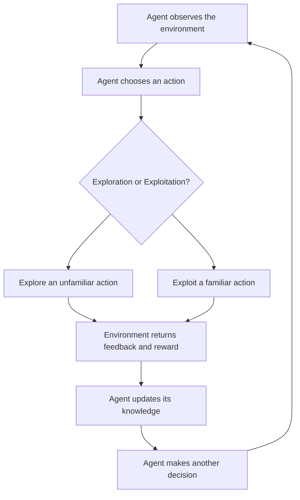

# Behaviorist AI: Exploration vs. Exploitation

## 1. Central Question

> **Why must a learning agent sometimes try an action that looks worse?**

The main idea of this topic is that an AI agent must balance two strategies: exploration and exploitation. Sometimes an agent needs to choose an unfamiliar action that may give a lower immediate reward in order to discover a better option for the future.

---

## 2. What Is Behaviorist AI?

Behaviorist AI is an approach to artificial intelligence that focuses on how an intelligent agent behaves and learns through interaction with its environment.

The agent:
- Observes its environment.
- Takes actions.
- Receives feedback.
- Learns from the results.
- Adjusts its future behaviour.

One important approach connected with this idea is **Reinforcement Learning (RL)**.

In Reinforcement Learning, an agent learns through rewards and feedback rather than simply following a fixed set of instructions.

### Key Concepts

| Concept | Explanation |
|---|---|
| Agent | The AI system that makes decisions. |
| Environment | The world or situation in which the agent operates. |
| Action | A decision made by the agent. |
| Reward | Feedback received after taking an action. |
| Policy | A strategy used by the agent to select actions. |
| Learning | Improving decisions based on previous experience. |

---

## 3. Exploration vs. Exploitation

There are two important strategies in Reinforcement Learning.

### Exploration

Exploration means trying something new to discover whether it can produce a better result.

For example:
- Trying an unfamiliar route.
- Testing a different strategy in a game.
- Choosing an option whose reward is not yet known.

**Main purpose:** Gain new information and discover potentially better actions.

### Exploitation

Exploitation means choosing the action that currently seems to provide the highest reward based on previous experience.

For example:
- Using a route that is already known to be fast.
- Repeating a successful strategy.
- Choosing an option with a reliable reward.

**Main purpose:** Receive the best expected reward using the information already available.

### Main Difference

| Exploration | Exploitation |
|---|---|
| Tries unfamiliar actions | Uses familiar actions |
| Collects new information | Uses existing knowledge |
| May produce lower immediate rewards | Often provides a more predictable immediate reward |
| Can reveal better opportunities | Can prevent discovery of better opportunities if used exclusively |

The challenge is finding the right balance between these two strategies.

---

## 4. Practical Example: The Two Reward Machines

Imagine that an AI agent has to choose between two machines.

Each machine gives points as a reward.

### Machine A — Familiar

- Always gives 4 points.
- Its reward is predictable.
- The agent already knows how it works.

### Machine B — Unfamiliar

- Its reward is initially unknown to the agent.
- For our demonstration, the outcomes are prepared in advance.
- The sequence of rewards is 2, 8, 8, and 10 points.

### The Game

The agent has four opportunities to collect rewards.

| Round | Machine A | Machine B |
|---|---:|---:|
| 1 | 4 points | 2 points |
| 2 | 4 points | 8 points |
| 3 | 4 points | 8 points |
| 4 | 4 points | 10 points |
| **Total** | **16 points** | **28 points** |

### What Happens?

At the beginning, Machine A looks like the better choice because it guarantees 4 points.

When the agent tries Machine B for the first time, it receives only 2 points.

At this moment, exploration appears to be a bad decision.

However, after collecting more information, the agent discovers that Machine B can provide higher rewards.

### Why Is Exploration Important?

If the agent always chooses Machine A, it will receive:

`4 + 4 + 4 + 4 = 16 points`

If it explores Machine B throughout this prepared demonstration, it receives:

`2 + 8 + 8 + 10 = 28 points`

This example demonstrates that an initially disappointing result does not necessarily mean an unfamiliar option is worse.

**The key lesson:** Exploration can involve a short-term cost but may reveal better opportunities for future decisions.

*Note: These rewards are an illustrative classroom sequence, not a guarantee that an unfamiliar machine will always provide higher rewards.*

---

## 5. How Does the AI Agent Learn?

The agent follows a repeated interaction cycle.

1. It observes the environment.
2. It chooses an action.
3. It receives a reward.
4. It evaluates the result.
5. It updates its knowledge.
6. It chooses its next action using the information it has collected.

### Agent–Environment Interaction

This cycle allows the agent to improve its decisions through repeated interaction.

The agent does not need to understand the environment like a human. It uses feedback to update its estimates and behaviour.

---

## 6. How Can an Agent Balance Both Strategies?

One example of a strategy used in Reinforcement Learning is called **Epsilon-Greedy**.

The basic idea is simple:

- Most of the time, the agent chooses the action that currently has the highest estimated reward.
- Sometimes, the agent chooses a different action to explore new possibilities.

For example, if epsilon is 0.2:

- 80% of decisions are exploitation.
- 20% of decisions are exploration.

This is only an illustrative setting. The best balance depends on the environment and the learning task.

Too much exploration can waste resources.

Too much exploitation can prevent the agent from discovering better options.

---

## 7. Real-World Applications

### Example 1: Delivery Robots

A delivery robot knows a familiar route that takes 6 minutes.

However, an unfamiliar route might be faster.

- **Exploration:** Testing the unfamiliar route.
- **Exploitation:** Continuing to use the familiar route.
- **Possible benefit:** Discovering a faster route.
- **Possible cost:** Losing time while testing it.

The robot must decide whether the potential future benefit is worth the cost of experimenting.

### Example 2: AI in Video Games

An AI game-playing agent has a strategy that has worked successfully before.

However, it may encounter a situation where another strategy could produce a better result.

- **Exploration:** Trying a new move or strategy.
- **Exploitation:** Repeating a previously successful move.
- **Possible benefit:** Discovering a more effective strategy.
- **Possible cost:** Losing an opportunity by trying an unsuccessful move.

Through repeated experience, the agent can improve its decisions.

---

## 8. Advantages and Challenges

### Advantages

- Helps agents discover better actions.
- Allows learning through experience.
- Improves decision-making over time.
- Makes it possible to adapt to unfamiliar situations.

### Challenges

- Exploration may produce low immediate rewards.
- Experimentation can consume time and resources.
- Exploitation may prevent the discovery of better options.
- The agent must balance short-term and long-term rewards.

---

## 9. Key Takeaways

1. Behaviorist AI focuses on observable behaviour and interaction with the environment.
2. Reinforcement Learning allows an agent to improve its behaviour through feedback and rewards.
3. Exploration means trying unfamiliar actions to gain information.
4. Exploitation means choosing the action that currently appears most rewarding.
5. An effective learning agent needs to balance exploration and exploitation.

---

## 10. Conclusion

Why must a learning agent sometimes try an action that looks worse?

Because the best immediate decision is not always the best long-term decision.

An agent that always chooses familiar actions may never discover better opportunities. By exploring unfamiliar actions, it can collect information, improve its estimates, and make better decisions in the future.

The goal is not to explore all the time or exploit all the time. The goal is to find a balance between learning and using existing knowledge.

---

## 11. Application Question

Imagine that a delivery robot knows a familiar route that takes 6 minutes.

It could test an unfamiliar route that might take either 4 minutes or 12 minutes, but testing it may delay one delivery.

**When should the robot explore the unfamiliar route, when should it exploit the familiar route, and how could it limit the cost of learning?**

Consider:
- The uncertainty of the unfamiliar route.
- The immediate cost of testing it.
- The possible future benefits.
- How many future deliveries the robot will make.

---

## 12. Sources

- Sutton, R. S., and Barto, A. G. (2018). *Reinforcement Learning: An Introduction*. 2nd Edition. MIT Press.
- [Reinforcement Learning — OpenAI Spinning Up](https://spinningup.openai.com/en/latest/spinningup/rl_intro.html)
- [Reinforcement Learning — Wikipedia](https://en.wikipedia.org/wiki/Reinforcement_learning)
