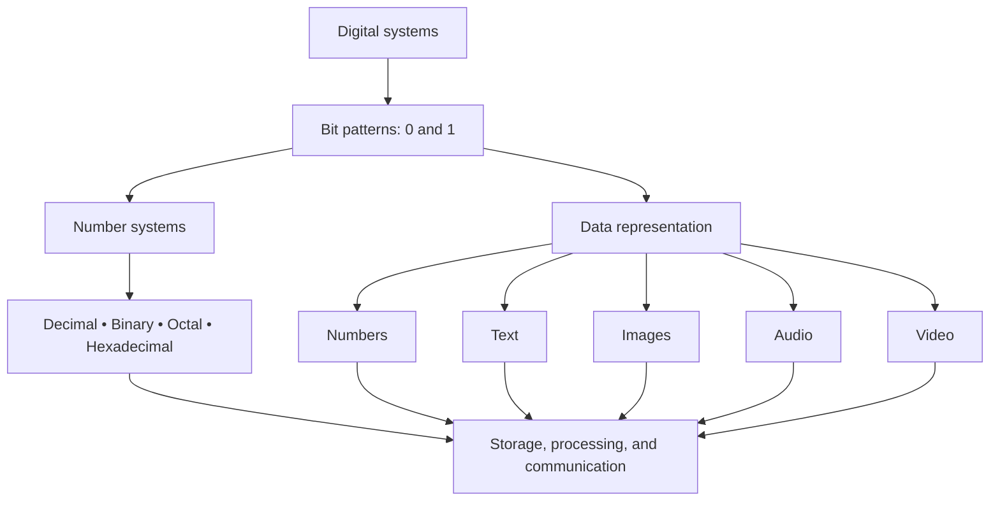
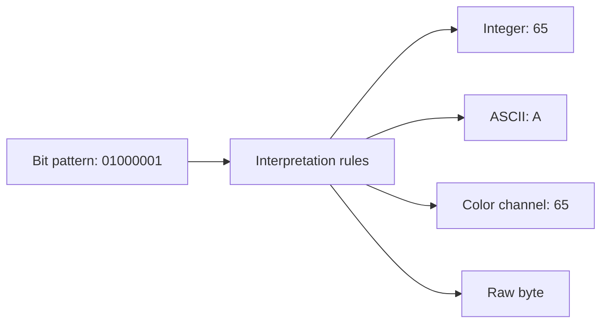
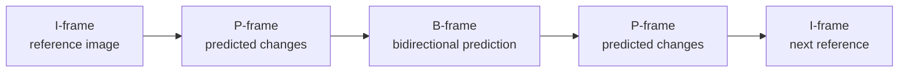
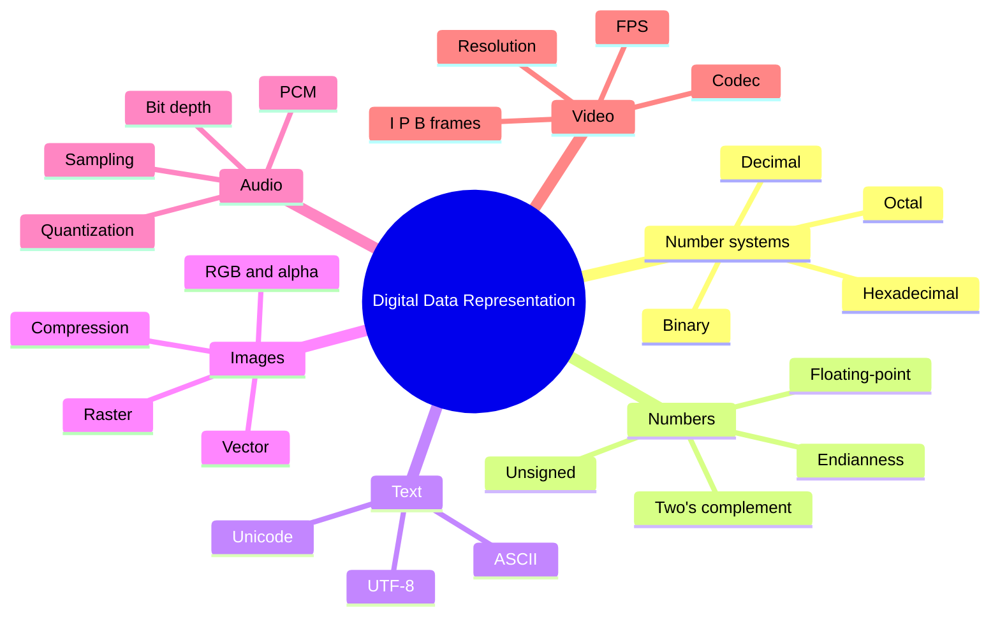

# 🔢 MODULE 01 — NUMBER SYSTEMS & DIGITAL DATA REPRESENTATION
### From transistor switches to numbers, text, images, sound, and video

> **Core idea:** Computers do not “see” numbers, letters, photographs, or music the way humans do. They store and process patterns of bits. Software and data formats determine how those patterns are interpreted.


<small>Macro photograph of the Motorola 68040 processor die. It shows the physical structure of a chip, not an individual transistor. Source: [Wikimedia Commons](https://commons.wikimedia.org/wiki/File:Motorola68040die.jpg), Farwestern / Gregg M. Erickson, CC BY 3.0.</small>

---

## 🧭 Learning Roadmap

| Module information | Details |
|---|---|
| Subject | Number systems and digital data representation |
| Coverage | Numbers, text, images, audio, and video |
| Estimated study time | 2–3 hours, including exercises |
| Prerequisites | Basic arithmetic |
| Learning outcome | Convert numbers between bases and explain how digital data is represented |

### 🎯 Learning Objectives

By the end of this module, you should be able to:

1. Explain why digital systems use binary representation.
2. Distinguish decimal, binary, octal, and hexadecimal number systems.
3. Convert numbers between bases, including simple fractional values.
4. Understand bits, nibbles, bytes, words, and storage-capacity units.
5. Explain unsigned integers, signed integers, two's complement, and floating-point representation.
6. Distinguish ASCII, Unicode, and UTF-8.
7. Calculate basic storage requirements for images, audio, and video.
8. Explain sampling, quantization, frame rate, and data compression.

### 🗺️ How the Topics Connect



---

# PART I — NUMBER SYSTEMS

## 1. Why Do Computers Use Binary?

### 1.1 From electrical switches to bits

Humans commonly use the **decimal system (base 10)**. One simple explanation is that we are accustomed to counting with ten fingers. Computers operate according to a different physical principle: electronic circuits use transistors as switching and signal-control elements.

In a simplified digital model, a circuit distinguishes between two logical states:

- **0 (LOW / OFF):** the voltage is within the range interpreted as a low logic level.
- **1 (HIGH / ON):** the voltage is within the range interpreted as a high logic level.

A single binary digit is called a **bit** (*binary digit*). A bit is the basic unit of information in digital computing.

> **Important note:** Real devices do not always use exactly 0 volts for LOW or exactly 1 volt for HIGH. Digital circuits define voltage ranges for each state. The gap between those ranges helps a circuit continue working even when small electrical disturbances occur.

Why are two states more practical than ten? A circuit can reliably distinguish two relatively broad voltage ranges. If it had to distinguish many closely spaced voltage levels, small changes caused by heat, electromagnetic interference, or component variation could more easily lead to incorrect readings.

### 1.2 A real-world example: the binary clock


<small>A binary clock at St. Gallen railway station in Switzerland. Rows of lights represent time using binary patterns. Source: [Wikimedia Commons](https://commons.wikimedia.org/wiki/File:Binary_clock_Swiss_railway_station.jpg), BBCLCD, CC BY-SA 4.0.</small>

The binary concept predates modern computers. In 1703, Gottfried Wilhelm Leibniz published an explanation of binary arithmetic using only two symbols: 0 and 1.


<small>A binary-number table from Leibniz's 1703 work. Source: [Wikimedia Commons](https://commons.wikimedia.org/wiki/File:Leibniz_binary_system_1703.png), public domain.</small>

---

## 2. Positional Notation

In a positional number system, the value of a digit depends on:

1. the digit symbol itself;
2. the position of that digit;
3. the base of the number system.

If the base is \(b\), the allowed digits range from \(0\) to \(b-1\). A number's value can be calculated using:

\[
N = d_n b^n + d_{n-1}b^{n-1} + \cdots + d_1b^1 + d_0b^0
\]

Where:
- \(N\) = the value of the number;
- \(b\) = the base;
- \(d\) = the digit at each position;
- the exponent starts at 0 in the rightmost position.

### 2.1 The four commonly used number systems

| System | Base | Allowed symbols | Computing applications |
|---|:---:|---|---|
| Decimal | 10 | `0–9` | Everyday calculations, IPv4 addresses |
| Binary | 2 | `0–1` | Logic operations, registers, digital storage |
| Octal | 8 | `0–7` | Compact bit representation, Unix/Linux file permissions |
| Hexadecimal | 16 | `0–9`, `A–F` | Memory addresses, color codes, debugging |

In hexadecimal, letters represent the following values:

| Hex | Decimal | Hex | Decimal |
|:---:|---:|:---:|---:|
| A | 10 | C | 12 |
| B | 11 | D | 13 |
| E | 14 | F | 15 |

### 2.2 Understanding place values

The decimal number `173` means:

\[
173_{10} = 1(10^2) + 7(10^1) + 3(10^0)
\]

The binary number `10101101₂` means:

\[
\begin{aligned}
10101101_2 &= 1(2^7)+0(2^6)+1(2^5)+0(2^4)\\
&\quad+1(2^3)+1(2^2)+0(2^1)+1(2^0)\\
&=128+32+8+4+1\\
&=\boxed{173_{10}}
\end{aligned}
\]

### 2.3 Place values in an 8-bit binary number

| Position | 7 | 6 | 5 | 4 | 3 | 2 | 1 | 0 |
|---|---:|---:|---:|---:|---:|---:|---:|---:|
| Weight | 128 | 64 | 32 | 16 | 8 | 4 | 2 | 1 |
| Bit | 1 | 0 | 1 | 0 | 1 | 1 | 0 | 1 |
| Contribution | 128 | 0 | 32 | 0 | 8 | 4 | 0 | 1 |

The sum of all contributions is **173**.

---

## 3. Converting Between Number Systems

There are two main approaches:

- **Place-value method:** add the weights of all positions whose bits are 1.
- **Repeated-division method:** divide the number by the target base, then read the remainders from bottom to top.

### 3.1 Binary to decimal

Example: Convert `10101101₂` to decimal.

\[
128+32+8+4+1=\boxed{173_{10}}
\]

A practical procedure:
1. Write the bit weights from right to left: 1, 2, 4, 8, 16, 32, 64, 128.
2. Select the weights aligned with bits that contain `1`.
3. Add the selected weights.

### 3.2 Decimal to binary: repeated division by 2

Example: Convert `173₁₀` to binary.

| Operation | Quotient | Remainder |
|---|---:|---:|
| 173 ÷ 2 | 86 | 1 |
| 86 ÷ 2 | 43 | 0 |
| 43 ÷ 2 | 21 | 1 |
| 21 ÷ 2 | 10 | 1 |
| 10 ÷ 2 | 5 | 0 |
| 5 ÷ 2 | 2 | 1 |
| 2 ÷ 2 | 1 | 0 |
| 1 ÷ 2 | 0 | 1 |

Read the remainders **from the last row to the first row**:

\[
173_{10}=\boxed{10101101_2}
\]

### 3.3 Binary to hexadecimal: the 4-bit nibble shortcut

Because \(16=2^4\), each hexadecimal digit represents exactly four bits.

Example:

```text
Binary      : 1010 1101
Groups      : 1010 | 1101
Values      :   10 |   13
Hexadecimal :    A |    D
Result      : 0xAD
```

Therefore:

\[
10101101_2 = AD_{16} = 173_{10}
\]

If the number of bits is not a multiple of four, add zeros on the left. For example, `10101₂` becomes `0001 0101₂`, which is `15₁₆`.

### 3.4 Binary to octal: groups of 3 bits

Because \(8=2^3\), divide the bits into groups of three, starting from the right.

```text
Binary       : 10 101 101
Add a zero   : 010 101 101
Groups       :  2 |  5 |  5
Octal        : 255₈
```

Thus:

\[
10101101_2 = 255_8 = 173_{10}
\]

### 3.5 Converting binary fractions

Fractional positions use negative powers.

\[
101.101_2 = 1(2^2)+0(2^1)+1(2^0)+1(2^{-1})+0(2^{-2})+1(2^{-3})
\]

\[
=4+1+0.5+0.125=\boxed{5.625_{10}}
\]

To convert a decimal fraction to binary, repeatedly multiply the fractional part by 2. Record the integer part of each result in sequence.

Example: \(0.625_{10}\)

| Step | Multiplication | Integer part |
|---|---|---:|
| 1 | 0.625 × 2 = 1.25 | 1 |
| 2 | 0.25 × 2 = 0.50 | 0 |
| 3 | 0.50 × 2 = 1.00 | 1 |

Therefore:

\[
0.625_{10}=0.101_2
\]

---

## 4. Quick Reference: Values 0–15

This table is useful for nibble conversion, reading color codes, and debugging.

| Decimal | 4-bit binary | Octal | Hex | Decimal | 4-bit binary | Octal | Hex |
|:---:|:---:|:---:|:---:|:---:|:---:|:---:|:---:|
| 0 | `0000` | 0 | `0` | 8 | `1000` | 10 | `8` |
| 1 | `0001` | 1 | `1` | 9 | `1001` | 11 | `9` |
| 2 | `0010` | 2 | `2` | 10 | `1010` | 12 | `A` |
| 3 | `0011` | 3 | `3` | 11 | `1011` | 13 | `B` |
| 4 | `0100` | 4 | `4` | 12 | `1100` | 14 | `C` |
| 5 | `0101` | 5 | `5` | 13 | `1101` | 15 | `D` |
| 6 | `0110` | 6 | `6` | 14 | `1110` | 16 | `E` |
| 7 | `0111` | 7 | `7` | 15 | `1111` | 17 | `F` |

### 🧩 Why is hexadecimal so useful?

A 32-bit memory address such as:

```text
00000000010000001010000000000000₂
```

is easier to read when written as:

```text
0x0040A000
```

Hexadecimal makes bit patterns more compact without losing information. Every two hexadecimal digits represent one byte.

---

## 5. Basic Binary Arithmetic

### 5.1 Binary addition

The basic rules are:

| Operation | Result |
|---|---|
| `0 + 0` | `0` |
| `0 + 1` | `1` |
| `1 + 0` | `1` |
| `1 + 1` | `10` (write 0, carry 1) |
| `1 + 1 + 1` | `11` (write 1, carry 1) |

Example:

```text
    1011   (11 decimal)
  + 0110   ( 6 decimal)
  ------
   10001   (17 decimal)
```

### 5.2 Subtraction using two's complement

In a computer, subtraction can be performed as addition:

\[
A-B=A+(-B)
\]

To form a negative number using two's complement:
1. Invert every bit (`0` becomes `1`, and `1` becomes `0`).
2. Add `1`.

Example: −5 in 8-bit representation.

```text
+5              00000101
Invert bits     11111010
Add 1           11111011
Result: -5      11111011
```

This method allows an arithmetic unit to use the same addition circuitry for both addition and subtraction.

---

## 6. Bits, Nibbles, Bytes, Words, and Storage Capacity

| Term | Size | Description |
|---|---:|---|
| Bit | 1 bit | A single binary digit, 0 or 1 |
| Nibble | 4 bits | Half a byte; one hexadecimal digit |
| Byte | 8 bits | A common basic unit for addressing data |
| Word | Architecture-dependent | The processor's natural data width, such as 16, 32, or 64 bits |

### 6.1 Storage units: kB is not the same as KiB

In everyday use, KB and MB are often used loosely. The standards distinguish between decimal and binary units:

| Decimal unit | Value | Binary unit | Value |
|---|---:|---|---:|
| 1 kB | 1,000 bytes | 1 KiB | 1,024 bytes |
| 1 MB | 1,000,000 bytes | 1 MiB | 1,048,576 bytes |
| 1 GB | 1,000,000,000 bytes | 1 GiB | 1,073,741,824 bytes |

This difference helps explain why the capacity displayed by an operating system may appear smaller than the number printed on a storage device's packaging.

### 6.2 Octal in Linux file permissions

Each octal digit represents three permission bits:

- `4` = read (`r`)
- `2` = write (`w`)
- `1` = execute (`x`)

Example: `chmod 754`

| Digit | Binary | Permission |
|:---:|:---:|---|
| 7 | `111` | `rwx` |
| 5 | `101` | `r-x` |
| 4 | `100` | `r--` |

The result is `rwxr-xr--`: the owner can read, write, and execute; the group can read and execute; other users can only read.

---

# PART II — DIGITAL DATA REPRESENTATION

## 7. One Bit Pattern, Many Meanings

Consider this byte:

```text
01000001₂
```

The same pattern can be interpreted in different ways depending on context:

| Context | Interpretation |
|---|---|
| Unsigned integer | Decimal 65 |
| ASCII text | The letter `A` |
| RGB pixel component | Intensity of one color channel = 65 |
| Raw data | Eight bits with no assigned meaning until an interpretation rule is applied |

**Bits do not carry labels such as “this is a letter” or “this is a color.”** Programs, data structures, metadata, and file formats provide the rules for interpreting those bits.



---

## 8. Number Representation in Computers

### 8.1 Unsigned integers

An *unsigned* integer has no negative sign. All bits are used to represent the magnitude of the value.

For \(n\) bits:

\[
\text{Unsigned range}=0 \text{ to } 2^n-1
\]

Examples:

| Width | Minimum | Maximum |
|---|---:|---:|
| 8 bits | 0 | 255 |
| 16 bits | 0 | 65,535 |
| 32 bits | 0 | 4,294,967,295 |

### 8.2 Signed integers using two's complement

General-purpose computers commonly use *two's complement* to represent signed integers. For \(n\) bits, the range is:

\[
-2^{n-1} \text{ to } 2^{n-1}-1
\]

For 8 bits, the range is **−128 to +127**.

In two's-complement interpretation, the leftmost bit has a negative weight. For 8 bits, the weights are:

```text
Bit       :  1   0   1   1   0   1   0   0
Weight    : -128 64  32  16   8   4   2   1
```

Example: `11111011₂`

\[
-128+64+32+16+8+0+2+1=-5
\]

### 8.3 Overflow

*Overflow* occurs when an arithmetic result cannot be represented using the available number of bits.

Example using signed 8-bit integers:

```text
  01111111   (+127)
+ 00000001   (+1)
----------
  10000000   (-128 when interpreted as signed)
```

Mathematically, the result is +128, but that value is outside the signed 8-bit range. The stored bit pattern therefore does not represent the expected mathematical result.

> **Important:** Carry-out and signed overflow are different concepts. Carry-out is primarily relevant to unsigned arithmetic; signed overflow is determined by the signs of the operands and the sign of the result.

### 8.4 Fractional numbers: IEEE 754 floating-point

Numbers such as `3.14`, `−0.1`, and \(\pi\) require a representation for fractions. A widely used standard is **IEEE 754**.

The binary32 format (often called single precision) contains:

| Field | Number of bits | Purpose |
|---|---:|---|
| Sign | 1 | Positive or negative |
| Exponent | 8 | Scale / power of two |
| Fraction | 23 | Significant fraction bits |

The binary64 format (often called double precision) contains 1 sign bit, 11 exponent bits, and 52 fraction bits.

For normal values, the basic idea is:

\[
(-1)^s \times 1.f \times 2^{(e-\text{bias})}
\]

The binary32 exponent bias is 127, while the binary64 bias is 1023.

**Why can `0.1 + 0.2` sometimes differ slightly from `0.3` in a program?** Some decimal fractions have non-terminating binary expansions. Their values must be rounded to the available number of bits, so floating-point operations can produce small differences.

Special exponent patterns are also used to represent zero, subnormal numbers, infinity, and NaN (*Not a Number*).

### 8.5 Byte order: big-endian and little-endian

A multi-byte number can be stored in different byte orders.

For example, the hexadecimal value `0x12345678`:

| Format | Byte order in memory |
|---|---|
| Big-endian | `12 34 56 78` |
| Little-endian | `78 56 34 12` |

Both arrangements represent the same value when read using the matching endianness rule. Endianness matters when data is exchanged between devices or read directly from binary files.

---

## 9. Text Representation: ASCII, Unicode, and UTF-8

Computers do not store letters as visual shapes. They store numeric codes that are mapped to characters by a character-encoding system and displayed using fonts.

### 9.1 ASCII

**ASCII** (*American Standard Code for Information Interchange*) is a 7-bit character standard containing 128 codes, from 0 to 127. In many systems, each ASCII character is stored in one byte.

Examples:

| Character | Decimal | Hexadecimal | 8-bit binary |
|---|---:|---:|---|
| `A` | 65 | `41` | `01000001` |
| `a` | 97 | `61` | `01100001` |
| `0` | 48 | `30` | `00110000` |
| Space | 32 | `20` | `00100000` |


<small>Standard ASCII code chart. Source: [Wikimedia Commons](https://commons.wikimedia.org/wiki/File:USASCII_code_chart.svg), work of the United States federal government, public domain.</small>

### 9.2 Unicode and UTF-8

ASCII is not sufficient to represent all writing systems, mathematical symbols, and emoji. **Unicode** provides a code-point space for characters from many languages. **UTF-8** is one way to encode Unicode code points into bytes.

UTF-8 is variable-length and uses one to four bytes per code point.

| Example | Code point | UTF-8 bytes |
|---|---|---|
| `A` | U+0041 | `41` |
| `é` | U+00E9 | `C3 A9` |
| `你` | U+4F60 | `E4 BD A0` |
| `🚀` | U+1F680 | `F0 9F 9A 80` |

An important advantage of UTF-8 is **ASCII compatibility**: the first 128 code points use the same byte values as ASCII. UTF-8 is also independent of byte order (*endianness*), unlike UTF-16 or UTF-32.

> **Conceptual note:** Unicode is a character and code-point standard; UTF-8 is an encoding method. They are not interchangeable terms. A character that appears as one symbol on screen may consist of more than one code point, such as a letter with a combining mark or a sequence of emoji.

---

## 10. Digital Image Representation

### 10.1 Raster/bitmap: an image as a collection of pixels

A raster image consists of rows and columns of **pixels**. Each pixel stores color information. Camera photographs and screenshots generally use raster representation.


<small>Illustration of the difference between bitmap and vector graphics. Source: [Wikimedia Commons](https://commons.wikimedia.org/wiki/File:Bitmap_vs_vector.svg), CC BY-SA.</small>

Two important raster-image parameters are:

- **Resolution:** the number of pixels horizontally and vertically, such as 1920 × 1080.
- **Color depth:** the number of bits used to represent the color of each pixel.

### 10.2 RGB and color depth

The additive RGB color model combines red, green, and blue light.


<small>Illustration of the RGB color space. Source: [Wikimedia Commons](https://commons.wikimedia.org/wiki/File:RGB_color_cube.svg), Maklaan, CC BY-SA 3.0.</small>

In 24-bit RGB:

- red channel: 8 bits = 256 levels;
- green channel: 8 bits = 256 levels;
- blue channel: 8 bits = 256 levels.

The total number of possible color combinations is:

\[
256 \times 256 \times 256 = 16,777,216
\]

The CSS color code `#2B7A78` consists of:
- `2B` = red = 43;
- `7A` = green = 122;
- `78` = blue = 120.

The 32-bit RGBA format adds an 8-bit alpha channel for transparency information.

### 10.3 Calculating the size of an uncompressed image

The basic formula is:

\[
\text{Size (bytes)}=\frac{\text{width}\times\text{height}\times\text{bits per pixel}}{8}
\]

Example: a 1920 × 1080 image using 24-bit RGB:

\[
\frac{1920\times1080\times24}{8}=6,220,800\text{ bytes}
\]

That is approximately **6.22 MB** (or about 5.93 MiB), before metadata and compression are taken into account.

### 10.4 Vector graphics: images as geometric formulas

Vector graphics store geometric objects such as lines, curves, circles, coordinates, and colors. When enlarged, the objects are recalculated, so their edges remain sharp.

| Raster/Bitmap | Vector |
|---|---|
| Stored as a pixel grid | Stored as geometric objects/formulas |
| Suitable for photographs and complex textures | Suitable for logos, icons, diagrams, and illustrations |
| Can look blocky when enlarged | Can be enlarged without pixelation |
| Examples: PNG, JPEG, BMP, WebP | Examples: SVG, AI, EPS |

### 10.5 Image compression

- **Lossless:** the original data can be reconstructed exactly. A common example is PNG.
- **Lossy:** some information is discarded to reduce file size. A common example is JPEG.
- **WebP and AVIF:** can support lossy and lossless modes, depending on the encoder and settings.

The best compression method depends on the purpose: photographs, illustrations, transparency, file size, and the required visual quality.

---

## 11. Digital Audio Representation

Sound in the air is a continuous pressure wave. A microphone converts it into an electrical signal, and an **Analog-to-Digital Converter (ADC)** converts that analog signal into digital data.

### 11.1 The three main stages of ADC

1. **Sampling:** measuring the signal's amplitude at specific time intervals.
2. **Quantization:** rounding each measurement to one of the available amplitude levels.
3. **Encoding:** storing the quantized level as a binary code.


<small>Pulse-code modulation (PCM) illustration showing sampling and quantization. Source: [Wikimedia Commons](https://commons.wikimedia.org/wiki/File:Pcm.svg), CC BY-SA / GFDL.</small>

### 11.2 Sampling rate

The *sampling rate* is the number of samples taken per second, measured in hertz (Hz).

- 8 kHz = 8,000 samples per second.
- 44.1 kHz = 44,100 samples per second.
- 48 kHz = 48,000 samples per second.
- 96 kHz = 96,000 samples per second.

According to the Nyquist–Shannon principle, to represent a signal with a maximum frequency of \(f_{\max}\), the ideal sampling rate must be at least twice that frequency:

\[
f_s \geq 2f_{\max}
\]

In practical systems, an anti-aliasing filter is used before sampling to limit the frequencies entering the converter.

### 11.3 Bit depth

*Bit depth* determines how many quantization levels are available for each sample.

\[
\text{Number of levels}=2^{\text{bit depth}}
\]

| Bit depth | Number of levels |
|---:|---:|
| 8-bit | 256 |
| 16-bit | 65,536 |
| 24-bit | 16,777,216 |

A higher bit depth allows finer amplitude representation and a greater theoretical dynamic range. However, a higher bit depth does not automatically improve every aspect of audio quality; the source, microphone, noise, and recording process also matter.

### 11.4 Calculating PCM audio bitrate

For uncompressed PCM audio:

\[
\text{Bitrate}=\text{sampling rate}\times\text{bit depth}\times\text{number of channels}
\]

Example: CD-quality stereo audio:

\[
44,100\times16\times2=1,411,200\text{ bits/second}
\]

That is approximately **1,411.2 kbps**. The raw data requirement is about **10.584 MB per minute**, excluding file overhead.

---

## 12. Digital Video Representation

Digital video can be understood as a sequence of still images (*frames*) displayed in order, usually accompanied by audio.

### 12.1 Resolution and frame rate

- **Resolution:** the number of pixels in each frame.
- **Frame rate (FPS):** the number of frames displayed per second.
- **Bitrate:** the amount of data stored or transmitted each second.

Common frame rates include 24 FPS, 30 FPS, and 60 FPS. A higher frame rate can make motion appear smoother, but it can also increase data requirements when other factors remain unchanged.

### 12.2 Why is uncompressed video so large?

One Full HD frame at 1920 × 1080 with 24-bit RGB requires:

\[
1920\times1080\times3=6,220,800\text{ bytes}
\]

At 30 FPS:

\[
6,220,800\times30=186,624,000\text{ bytes/second}
\]

That is approximately **186.6 MB per second**, or about **11.2 GB per minute** for uncompressed video. Audio and metadata are not included.

### 12.3 How do video codecs compress video?

Video codecs reduce data redundancy. Two common approaches are:

1. **Spatial compression:** finding similarities within a single frame, such as a relatively uniform area of blue sky.
2. **Temporal compression:** using similarities between frames, so that not every frame has to be stored as a complete image.

In codecs such as H.264, commonly discussed frame types include:

| Frame type | Principle |
|---|---|
| I-frame | A self-contained frame that can be decoded without referring to other frames |
| P-frame | Uses prediction from an earlier frame |
| B-frame | Can use prediction from earlier and/or later frames |



Compression ratios are not fixed. They depend on the codec, resolution, frame rate, bitrate, motion complexity, and quality settings.

### 12.4 Codec is not the same as container

These terms are often confused:

- A **codec** defines how audio or video is encoded and decoded.
- A **container** is a file format that can hold one or more audio, video, subtitle, and metadata streams.

For example, an `.mp4` file may contain H.264 video and AAC audio. MP4 is the container; H.264 and AAC are codecs.

---

# PART III — PRACTICE, EXERCISES, AND REVIEW

## 13. Independent Practice: Number Conversion

Try each exercise before revealing the answer.

<details>
<summary><strong>Exercise 1 — Convert decimal 202</strong></summary>

Convert \(202_{10}\) to binary and hexadecimal.

**Answer:**

\[
202_{10}=11001010_2=CA_{16}
\]

Check the binary-to-decimal conversion:

\[
128+64+8+2=202
\]

</details>

<details>
<summary><strong>Exercise 2 — Convert decimal 255</strong></summary>

Convert \(255_{10}\) to binary, octal, and hexadecimal.

**Answer:**

- Binary: `11111111₂`
- Octal: `377₈`
- Hexadecimal: `FF₁₆`

</details>

<details>
<summary><strong>Exercise 3 — Decode a byte</strong></summary>

What does `01000001₂` mean when interpreted as an unsigned integer and as an ASCII character?

**Answer:** unsigned integer = 65; ASCII character = `A`.

</details>

## 14. Conceptual Review

<details>
<summary><strong>Question 1 — Why is binary suitable for digital circuits?</strong></summary>

Electronic circuits can distinguish two logic ranges more easily and reliably than many closely spaced levels. This provides tolerance to noise and component variation.

</details>

<details>
<summary><strong>Question 2 — What are the ranges of unsigned 8-bit and signed 8-bit integers?</strong></summary>

- Unsigned 8-bit: 0 to 255.
- Signed 8-bit two's complement: −128 to +127.

</details>

<details>
<summary><strong>Question 3 — What is the difference between Unicode and UTF-8?</strong></summary>

Unicode defines code points for characters. UTF-8 is one method of encoding those code points into a sequence of bytes.

</details>

<details>
<summary><strong>Question 4 — What distinguishes raster and vector graphics?</strong></summary>

Raster graphics store pixel values in a grid; vector graphics store geometric instructions. Raster is suitable for photographs, while vector is suitable for logos and illustrations that need to scale.

</details>

<details>
<summary><strong>Question 5 — What are the roles of sampling rate and bit depth?</strong></summary>

Sampling rate determines how often a signal is measured over time. Bit depth determines how many amplitude levels are available to represent each sample.

</details>

<details>
<summary><strong>Question 6 — Why does video need compression?</strong></summary>

Uncompressed video contains many pixels in every frame and many frames every second. Compression uses similarities within frames and between frames to reduce file size and bandwidth requirements.

</details>

## 15. Calculation Challenges

Try to calculate each answer yourself, then reveal the explanation.

<details>
<summary><strong>Challenge A — Image size</strong></summary>

An image is 1280 × 720 pixels and uses 24-bit RGB color. What is its uncompressed size in bytes and decimal MB?

**Solution:**

\[
1280\times720\times24/8=2,764,800\text{ bytes}
\]

\[
2,764,800/1,000,000=2.7648\text{ MB}
\]

The uncompressed image is approximately **2.76 MB**, before compression and metadata.

</details>

<details>
<summary><strong>Challenge B — Audio bitrate</strong></summary>

PCM audio has a sampling rate of 48 kHz, a bit depth of 24 bits, and 2 channels. Calculate the bitrate.

**Solution:**

\[
48,000\times24\times2=2,304,000\text{ bits/second}
\]

Bitrate = **2,304 kbps**.

</details>

<details>
<summary><strong>Challenge C — Uncompressed video size</strong></summary>

A video is 1280 × 720, RGB 24-bit, and 25 FPS. How much raw data does it require per second?

**Solution:**

\[
1280\times720\times3\times25=69,120,000\text{ bytes/second}
\]

Approximately **69.12 MB/second**.

</details>

---

## 16. Key Takeaways

| Concept | What to remember |
|---|---|
| Binary | Base-2 system using digits 0 and 1 |
| Octal | Base 8; one digit represents 3 bits |
| Hexadecimal | Base 16; one digit represents 4 bits |
| Byte | 8 bits |
| Unsigned n-bit integer | Range from \(0\) to \(2^n-1\) |
| Signed n-bit two's complement | Range from \(-2^{n-1}\) to \(2^{n-1}-1\) |
| Floating-point | Represents fractional values using sign, exponent, and fraction fields |
| ASCII | 7-bit character set with 128 codes |
| Unicode | Standard defining character code points |
| UTF-8 | Unicode encoding using 1–4 bytes |
| Raster | Image made of pixels |
| Vector | Image described by geometric objects |
| Sampling rate | Number of samples per second |
| Bit depth | Number of quantization levels |
| FPS | Frames per second |
| Codec | Method for encoding/decoding media |
| Container | File structure that holds media streams and metadata |

### 🧠 Final Concept Map



## 17. Glossary

| Term | Brief definition |
|---|---|
| ADC | Circuit that converts an analog signal into digital data |
| Aliasing | Distortion caused by insufficient sampling of a signal's frequency content |
| Bit | A single binary digit |
| Byte | A group of 8 bits |
| Codec | A system for encoding and decoding data, especially audio/video |
| Code point | A numeric value assigned to a character in Unicode |
| Endianness | The byte order used when storing a multi-byte value |
| Frame | One image in a video sequence |
| Nibble | A group of 4 bits |
| Pixel | The smallest element of a raster image |
| Quantization | Mapping a continuous value to a discrete level |
| Sampling | Measuring a signal at specific time intervals |
| Transistor | A semiconductor component that can control current or signals |
| Overflow | A condition in which a result cannot be represented using the available bit width |

---

## 18. References and Image Credits

### Learning references

1. Unicode Consortium. [UTF-8, UTF-16, UTF-32 & BOM — FAQ](https://www.unicode.org/faq/utf_bom.html).
2. National Institute of Standards and Technology (NIST). [Digital Library of Mathematical Functions, §3.1 — Floating-Point Arithmetic](https://dlmf.nist.gov/3.1).
3. The Open University. [Sampling and Quantisation](https://www.open.edu/openlearn/digital-computing/exploring-communications-technology/content-section-3.2).
4. NASA National Space Science Data Center. [Standard ASCII Set](https://nssdc.gsfc.nasa.gov/nssdc/formats/ASCIICharacters.htm).
5. ITU-T. [Recommendation H.264 — Advanced video coding](https://www.itu.int/rec/T-REC-H.264).

### Image credits

| Illustration | Source | License |
|---|---|---|
| Motorola 68040 processor die | [Wikimedia Commons](https://commons.wikimedia.org/wiki/File:Motorola68040die.jpg) | CC BY 3.0 |
| St. Gallen binary clock | [Wikimedia Commons](https://commons.wikimedia.org/wiki/File:Binary_clock_Swiss_railway_station.jpg) | CC BY-SA 4.0 |
| Leibniz manuscript, 1703 | [Wikimedia Commons](https://commons.wikimedia.org/wiki/File:Leibniz_binary_system_1703.png) | Public domain |
| ASCII code chart | [Wikimedia Commons](https://commons.wikimedia.org/wiki/File:USASCII_code_chart.svg) | Public domain |
| Bitmap vs. vector | [Wikimedia Commons](https://commons.wikimedia.org/wiki/File:Bitmap_vs_vector.svg) | CC BY-SA |
| RGB color cube | [Wikimedia Commons](https://commons.wikimedia.org/wiki/File:RGB_color_cube.svg) | CC BY-SA 3.0 |
| PCM diagram | [Wikimedia Commons](https://commons.wikimedia.org/wiki/File:Pcm.svg) | CC BY-SA / GFDL |

---

> **Final thought:** All digital information is ultimately represented as patterns of bits. The difference between numbers, text, images, audio, and video lies in the encoding rules and in how software interprets those patterns. Understanding this principle provides a foundation for studying computer architecture, networking, programming, multimedia, and information security.
