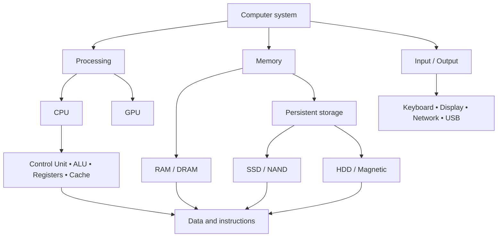
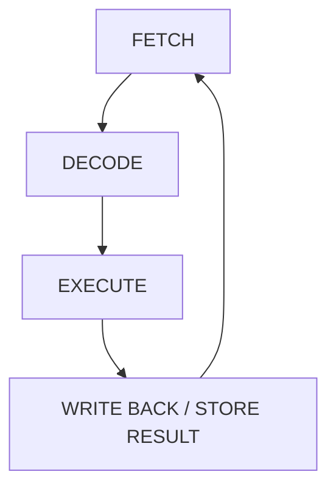
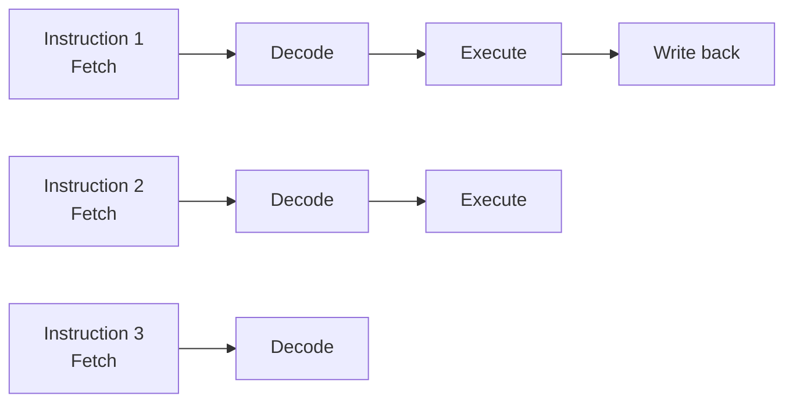
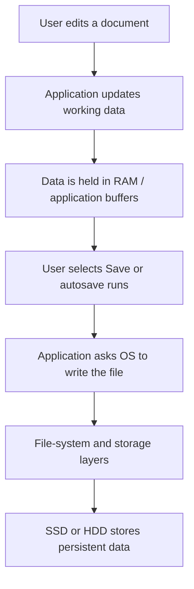
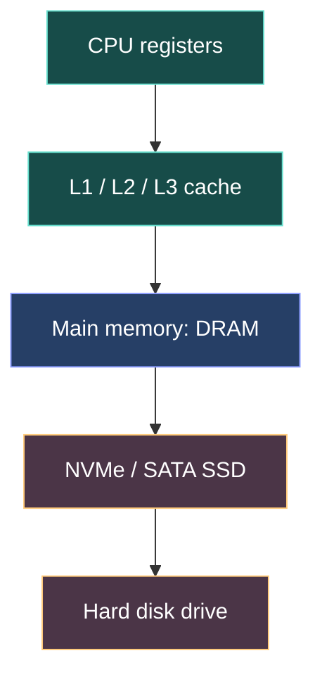
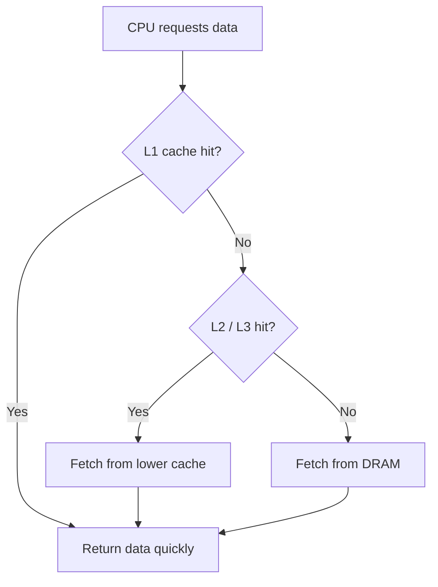
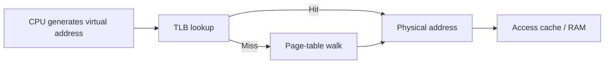
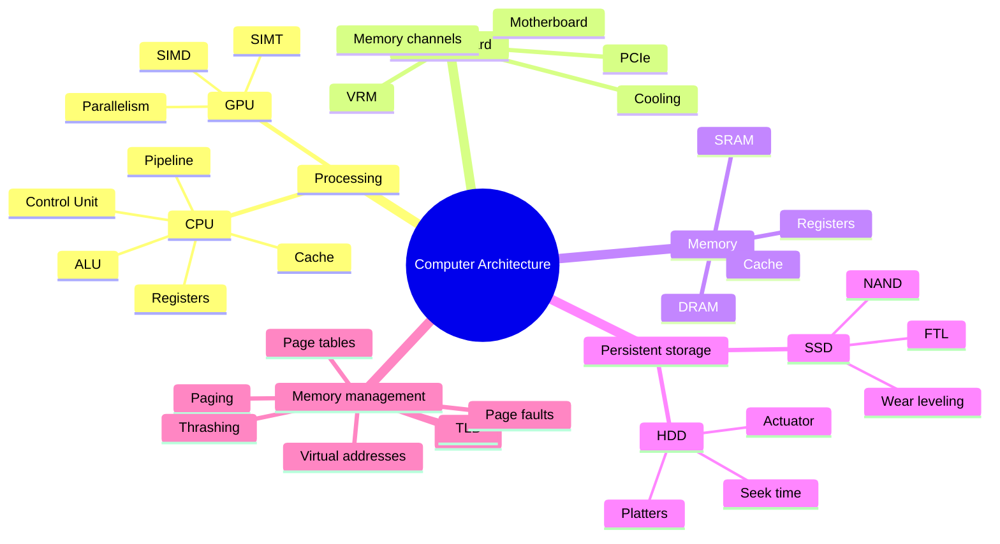

# ⚙️ MODULE 02 — CORE COMPUTER COMPONENTS & THE MEMORY HIERARCHY
### Inside the CPU, Von Neumann architecture, GPU parallelism, RAM, persistent storage, and virtual memory

> **The big picture:** A computer is not one single “fast machine.” It is a coordinated system of processors, memory, storage, interconnects, and input/output devices. Performance depends on how effectively these components work together—and on whether the right data is available to the processor at the right time.


<small>A processor die map illustrates how much functionality can be integrated into one silicon device. Image: Intel in Deutschland, via [Wikimedia Commons](https://commons.wikimedia.org/wiki/File:4th_Generation_Intel%C2%AE_Core%E2%84%A2_Processor_Die_Map.jpg), CC BY-SA 2.0.</small>

---

## 🧭 Learning Roadmap

| Module information | Details |
|---|---|
| Module | 02 — Core Computer Components & The Memory Hierarchy |
| Topics | Topic 3: Core components and CPU architecture; Topic 4: RAM, storage, and memory hierarchy |
| Estimated study time | 2.5–3.5 hours, including exercises |
| Prerequisites | Basic computer literacy and an introductory understanding of digital data |
| Main question | How do the CPU, RAM, cache, and storage cooperate to run programs? |

### 🎯 Learning Objectives

After completing this module, you should be able to:

1. Identify the main components of a computer system and explain their roles.
2. Describe the stored-program idea behind the Von Neumann architecture.
3. Explain the fetch–decode–execute cycle and the roles of the Program Counter, Control Unit, ALU, and registers.
4. Interpret CPU specifications such as clock frequency, core count, threads, IPC, and cache.
5. Compare CPU and GPU architectures and identify workloads suited to each.
6. Explain the roles of the motherboard, chipset, PCIe, VRM, power supply, and cooling system.
7. Distinguish volatile memory from non-volatile storage.
8. Explain how SRAM, DRAM, NAND flash, and magnetic disks work at a conceptual level.
9. Describe the memory hierarchy and explain cache hits, cache misses, and locality.
10. Explain virtual addresses, page tables, the MMU, page faults, paging, and thrashing.
11. Diagnose common performance bottlenecks by matching symptoms to the relevant hardware resource.

### 🗺️ Concept Map



---

# PART I — CORE COMPUTER COMPONENTS & CPU ARCHITECTURE

# Topic 3 — Core Components and the Von Neumann Model

## 1. The Computer as a Coordinated System

### 1.1 The kitchen analogy: processor, workbench, and pantry

Imagine preparing a large meal in a professional kitchen:

- **The chef — CPU:** reads the recipe, makes decisions, and performs the work.
- **The workbench — RAM:** holds ingredients and tools that are currently being used.
- **The small tray beside the chef — CPU cache:** keeps the most frequently needed ingredients within immediate reach.
- **The pantry — SSD or HDD:** stores ingredients for future meals and keeps them when the kitchen closes.
- **The kitchen layout and connecting corridors — motherboard and buses:** allow people, tools, ingredients, and equipment to communicate.
- **Specialist kitchen equipment — GPU and other accelerators:** perform particular tasks efficiently, often in parallel.

Would a larger pantry make the chef chop vegetables faster? No. A larger SSD gives a computer more long-term storage capacity, but it does not automatically make the CPU calculate faster.

The analogy also reveals why a computer needs several kinds of memory. The CPU requires data quickly, but keeping every file in the fastest memory would be extremely expensive and physically impractical. A hierarchy balances speed, capacity, and cost.

### 1.2 The main hardware components

| Component | Main responsibility | Everyday example |
|---|---|---|
| CPU | Executes general-purpose instructions and coordinates processing | Running an application, compiling code, managing operating-system tasks |
| GPU | Performs highly parallel graphics and compute operations | Rendering 3D scenes, image processing, machine-learning workloads |
| RAM | Holds program code and data currently in use | Open applications, active browser tabs, unsaved working data |
| Cache | Keeps recently or frequently used data close to CPU cores | Reusing instructions and data without repeatedly accessing DRAM |
| SSD / HDD | Stores files persistently | Operating system, documents, games, photos, backups |
| Motherboard | Connects components and distributes signals and power | Linking CPU, memory, storage, GPU, and external interfaces |
| PSU | Converts wall power into regulated DC power for components | Supplying stable power to the motherboard and graphics card |
| Cooling system | Transfers heat away from chips | Fans, heatsinks, heat pipes, and liquid-cooling loops |
| Network interface | Sends and receives data over a network | Ethernet, Wi-Fi, and data-center networking |

---

## 2. The Von Neumann Stored-Program Architecture

### 2.1 The stored-program concept

The **Von Neumann architecture** is a foundational model of general-purpose computer organization. It is associated with the 1945 *First Draft of a Report on the EDVAC*, which helped formalize the stored-program approach.

Its central idea is that **instructions and data are represented in binary and stored in the same main memory**. The processor fetches instructions from memory, interprets them, and operates on data.

This is important because a computer does not need to be physically rewired for every new task. A different program—a different sequence of instructions—can be loaded into memory and executed by the same hardware.


<small>A modern Von Neumann-style block diagram showing the CPU, memory, and input/output paths. Image: Pngwen, [Wikimedia Commons](https://commons.wikimedia.org/wiki/File:Modern_Von_Neumann_Architecture.svg).</small>

### 2.2 Main architectural elements

A simplified Von Neumann computer contains:

1. **Central Processing Unit (CPU):** fetches and executes instructions.
2. **Main memory:** stores instructions and data.
3. **Input devices:** provide information, such as a keyboard, mouse, camera, or sensor.
4. **Output devices:** present results, such as a display, printer, or speaker.
5. **Interconnection system:** carries addresses, data, and control signals between components.

### 2.3 Address, data, and control signals

The classic model often describes three broad categories of bus signals:

| Bus / signal group | Purpose | Example |
|---|---|---|
| Address | Identifies the memory location or device being accessed | “Read the value at this address.” |
| Data | Carries the actual instruction or data value | The byte or word being transferred |
| Control | Indicates what operation should occur and when | Read, write, interrupt, timing, or acknowledgement signals |

A **bus** is a communication pathway. In modern computers, these functions are not necessarily carried on three single, shared physical buses. Systems use multiple interconnects and point-to-point links, including memory channels, PCI Express (PCIe), and on-chip networks.

### 2.4 The Von Neumann bottleneck

When instructions and data share memory resources and pathways, the processor can be limited by how quickly information moves between the CPU and memory. This is commonly called the **Von Neumann bottleneck**.

For example, an arithmetic unit may be able to perform an operation very quickly, but it cannot use that speed if it must wait for the required data to arrive from main memory.

Modern designs reduce this pressure through:

- multiple levels of CPU cache;
- separate instruction and data caches at some cache levels;
- wider memory interfaces and multiple memory channels;
- prefetching, which brings likely-needed data closer to the CPU;
- pipelining and out-of-order execution;
- high-bandwidth interconnects.

> **A useful distinction:** Many modern processors use a *modified Harvard* organization internally—for example, separate L1 instruction and data caches—while still presenting a unified address space to software. The classic Von Neumann model remains useful for understanding the overall stored-program principle.

### 2.5 Von Neumann versus Harvard architecture

| Feature | Von Neumann model | Harvard model |
|---|---|---|
| Instruction and data storage | Shared memory space in the classic model | Separate instruction and data memories |
| Access paths | Traditionally shared | Traditionally separate |
| Main advantage | Flexible, simple general-purpose model | Can fetch instructions and data independently |
| Common teaching example | General-purpose stored-program computer | Some microcontrollers and digital signal processors |
| Modern reality | Often uses separate internal caches | Implementations vary; many designs are hybrid |

---

## 3. Inside the CPU

A CPU is not just one calculator. It contains several cooperating units, buffers, registers, and control mechanisms.


<small>Processor die map showing the integrated nature of a modern CPU. Image: Intel in Deutschland, [Wikimedia Commons](https://commons.wikimedia.org/wiki/File:4th_Generation_Intel%C2%AE_Core%E2%84%A2_Processor_Die_Map.jpg), CC BY-SA 2.0.</small>

### 3.1 The Control Unit (CU)

The **Control Unit** coordinates the execution of instructions. It interprets instruction information and generates control signals that direct data movement and operations.

Its responsibilities include:

- determining which instruction is being processed;
- selecting source registers and destinations;
- coordinating arithmetic, logic, memory, and I/O operations;
- controlling the flow of instructions;
- responding to events such as interrupts and exceptions.

The Control Unit is not necessarily one single physical block in every modern CPU. Its implementation can be distributed across decode logic, scheduling logic, control circuitry, and microcode mechanisms.

### 3.2 The Arithmetic Logic Unit (ALU)

The **ALU** performs integer arithmetic and logical operations.

| Operation category | Examples |
|---|---|
| Arithmetic | Addition, subtraction, multiplication, increment |
| Boolean logic | AND, OR, XOR, NOT |
| Comparison | Equal to, less than, greater than |
| Bit manipulation | Shift, rotate, mask, set or clear a bit |

Example:

```text
  00000101   (5)
+ 00000011   (3)
----------
  00001000   (8)
```

The ALU produces the result and may update status flags, such as zero, carry, sign, or overflow, depending on the instruction-set architecture.

### 3.3 Registers

**Registers** are very small, very fast storage locations inside a processor core. They hold values that instructions are currently using.

Common conceptual register roles include:

| Register / group | Purpose |
|---|---|
| General-purpose registers | Hold integer values, addresses, and intermediate results |
| Program Counter (PC) | Identifies the next instruction address to be fetched |
| Stack Pointer (SP) | Identifies the current top of a program stack |
| Status / flags register | Stores condition information from operations |
| Vector registers | Hold multiple data elements for SIMD operations |
| Floating-point registers | Hold floating-point values |

The exact register names, widths, and roles depend on the processor's instruction-set architecture (ISA).

### 3.4 The Floating-Point Unit (FPU) and vector units

Many CPUs contain specialized execution units:

- **FPU:** performs floating-point operations, such as calculations involving decimal-like values.
- **SIMD/vector unit:** applies one instruction to multiple data elements at once.
- **Load/store units:** move data between registers and memory.
- **Branch units:** help evaluate and redirect program control flow.

These units help the processor execute different kinds of work efficiently.

### 3.5 The fetch–decode–execute cycle

The **fetch–decode–execute cycle** is a useful simplified model of instruction processing.



#### Step 1 — FETCH

The processor obtains the next instruction.

- The **Program Counter (PC)** identifies the address of the next instruction.
- The instruction is retrieved from the instruction cache or, if necessary, from lower levels of the memory hierarchy.
- The PC is updated to the next sequential instruction address or redirected by a branch, jump, exception, or interrupt.

> The PC does not always increase by exactly 1. Instruction length and address rules depend on the ISA. In a simplified fixed-width teaching model, the PC may advance by one instruction word.

#### Step 2 — DECODE

The instruction is interpreted.

- The **opcode** identifies the operation, such as ADD, LOAD, or JUMP.
- The **operands** identify the values, registers, or memory locations involved.
- The processor determines which execution resources are required.

#### Step 3 — EXECUTE

The required operation is performed.

- The ALU may add or compare values.
- An FPU may perform a floating-point calculation.
- A load/store unit may access data memory.
- A branch unit may calculate a new instruction address.

#### Step 4 — WRITE BACK

The result is written to its destination, such as a register or memory location. Some instructions do not produce a conventional result, so this stage is a useful conceptual addition rather than a universal separate step.

### 3.6 What modern CPUs do beyond the simple cycle

Modern processors use sophisticated techniques to keep execution units busy:

- **Pipelining:** overlaps different stages of several instructions.
- **Branch prediction:** predicts the likely direction of a conditional branch so the pipeline can continue working.
- **Out-of-order execution:** allows ready instructions to execute before earlier instructions that are waiting on data, while preserving the required architectural result.
- **Speculative execution:** performs work based on predictions that may later be discarded.
- **Register renaming:** reduces false dependencies between instructions that reuse the same architectural register names.
- **Retirement / commit:** makes completed instructions visible in the correct program order.



<small>Conceptual illustration of pipeline overlap. Real CPU pipelines contain more stages, queues, dependencies, and scheduling logic than this simplified diagram.</small>

---

## 4. Understanding CPU Performance

### 4.1 Clock speed (GHz)

A CPU clock provides a timing reference for processor operations.

- 1 GHz means one billion clock cycles per second.
- 3.5 GHz means approximately 3.5 billion cycles per second.
- A 3.5 GHz clock has a nominal cycle period of about \(1/3.5\) nanoseconds, or 0.286 ns.

The processor's clock is commonly derived from a reference clock and internal clock-generation circuitry. The crystal oscillator is not necessarily switching at the CPU's final multi-gigahertz frequency.

**Higher clock speed does not automatically mean a faster CPU.** Different processors can complete different amounts of useful work per cycle.

### 4.2 Instructions per cycle (IPC)

**IPC** describes the average number of instructions completed per clock cycle under a particular workload.

A simplified performance relationship is:

\[
\text{Instructions per second}\approx \text{Clock frequency}\times\text{IPC}
\]

For example, suppose two processors run a workload:

| Processor | Clock | Average IPC | Approx. instructions per second |
|---|---:|---:|---:|
| A | 3.2 GHz | 2.0 | 6.4 billion |
| B | 4.0 GHz | 1.2 | 4.8 billion |

In this simplified example, Processor A completes more instructions per second despite having a lower clock frequency.

Actual performance also depends on instruction complexity, cache behavior, memory latency, core count, software, power limits, and thermal conditions.

### 4.3 Cores, threads, and parallelism

A **CPU core** is a processing unit capable of executing instructions. A multi-core CPU integrates multiple cores into one processor package or chip.

- **4-core CPU:** four physical processing cores.
- **8-core CPU:** eight physical processing cores.
- **16-core CPU:** sixteen physical processing cores.

A **software thread** is a sequence of instructions that the operating system can schedule. Some CPU designs support **simultaneous multithreading (SMT)**, allowing one physical core to maintain more than one hardware thread context.

More cores can improve performance when a workload can be divided into independent tasks. However, a program that depends on a long sequence of operations may gain little from additional cores.

### 4.4 Cache size and latency

CPU cache is small, fast memory placed close to the processor cores. It reduces the need to retrieve data repeatedly from slower main memory.

| Cache level | Typical role | Common organization |
|---|---|---|
| L1 | Smallest and closest to a core | Often split into instruction and data caches |
| L2 | Larger next-level cache | Often private to a core, but designs vary |
| L3 / LLC | Larger last-level cache | Often shared by multiple cores |

Cache sizes and access times vary widely across processor generations and product classes. Do not treat a particular L1, L2, or L3 size as universal.

### 4.5 A practical CPU specification checklist

When comparing processors, consider more than GHz:

| Specification | What it tells you | Why it matters |
|---|---|---|
| Architecture / ISA | The instruction-set family supported | Software compatibility and available instructions |
| Microarchitecture | How the CPU implements the ISA | Performance, efficiency, and design features |
| Core count | Number of physical cores | Potential parallel throughput |
| Thread count | Number of hardware execution contexts exposed | Can improve utilization in some workloads |
| Base / boost frequency | Operating clock ranges | Useful for understanding performance behavior |
| IPC / benchmarks | Work completed per cycle or in a test | Helps compare real workload performance |
| Cache | Amount and structure of fast on-chip memory | Affects data-access delays |
| Power limits | Electrical and thermal operating constraints | Influences sustained performance |
| Integrated graphics | Whether graphics hardware is included | May remove the need for a discrete GPU |

---

## 5. CPU vs. GPU: Different Designs for Different Workloads

### 5.1 CPU: optimized for flexible, low-latency execution

A CPU typically has a smaller number of powerful, complex cores. Each core is designed to handle varied instructions, branching decisions, operating-system activity, and tasks with dependencies.

Common CPU workloads include:

- running the operating system;
- responding to keyboard and mouse input;
- managing application logic;
- compiling software;
- executing sequential algorithms;
- coordinating work across other devices.

### 5.2 GPU: optimized for high-throughput parallel work

A GPU contains many processing units designed to execute large numbers of similar operations in parallel.

This is useful when the same kind of operation must be applied to many independent data elements.

Examples include:

- rendering pixels and vertices in 3D graphics;
- image and video processing;
- matrix multiplication;
- scientific simulation;
- machine-learning training and inference.


<small>Photograph of an NVIDIA GK107 Kepler GPU chip. Image: Phiarc, [Wikimedia Commons](https://commons.wikimedia.org/wiki/File:NVidia_GK107-860-A2.jpg), CC BY-SA 4.0.</small>

### 5.3 CPU and GPU compared

| Feature | CPU | GPU |
|---|---|---|
| Primary design goal | Low-latency, flexible instruction execution | High-throughput parallel execution |
| Processing units | Relatively few complex cores | Many simpler processing lanes / cores |
| Control flow | Handles complex branching efficiently | Most effective when many threads follow similar paths |
| Cache and control | Devotes substantial resources to caches and control logic | Devotes more resources to parallel arithmetic and data throughput |
| Strong workloads | Operating systems, application logic, serial tasks | Graphics, matrix operations, data-parallel workloads |
| Limitation | Fewer parallel execution resources | Less efficient for highly irregular or serial work |

The distinction is not absolute. CPUs can perform SIMD operations, and GPUs can execute branching code. The difference is the balance of hardware resources and the workloads each is designed to handle. See NVIDIA's [CUDA Programming Guide](https://docs.nvidia.com/cuda/cuda-programming-guide/01-introduction/introduction.html) for a discussion of GPU throughput and parallel workloads.

### 5.4 SIMD and SIMT in simple terms

- **SIMD — Single Instruction, Multiple Data:** one instruction operates on multiple data elements, such as adding several pairs of numbers in a vector register.
- **SIMT — Single Instruction, Multiple Threads:** a GPU programming model in which groups of threads execute related instructions over different data elements.

Example: adding two arrays of one million numbers.

```text
Array A: [a1, a2, a3, a4, ...]
Array B: [b1, b2, b3, b4, ...]

Output : [a1+b1, a2+b2, a3+b3, a4+b4, ...]
```

Each output element can be calculated independently, making the task suitable for parallel processing.

### 5.5 Integrated GPU vs. discrete GPU

| Integrated GPU (iGPU) | Discrete GPU (dGPU) |
|---|---|
| Integrated into the CPU or SoC package | Separate graphics processor |
| Often shares system memory | Usually has dedicated VRAM |
| Lower power and compact design | Often higher graphics and compute throughput |
| Common in laptops and compact devices | Common in gaming PCs, workstations, and compute servers |

A discrete GPU also requires a high-bandwidth path to system memory and often uses PCIe for communication with the CPU. Data-transfer overhead can matter: a GPU is not automatically faster for every task.

---

## 6. Motherboard, Connectivity, Power, and Cooling

### 6.1 The motherboard

The **motherboard** is the main printed circuit board (PCB) that connects the processor, memory, storage, expansion cards, and external interfaces.


<small>Block diagram of a motherboard, illustrating major component connections. Image: Moxfyre, [Wikimedia Commons](https://commons.wikimedia.org/wiki/File:Motherboard_diagram.svg), CC BY-SA / GFDL.</small>


<small>Example of a physical computer motherboard. Image source: [Wikimedia Commons](https://commons.wikimedia.org/wiki/Category:ATX_computer_motherboards).</small>

Important motherboard areas include:

| Component / interface | Function |
|---|---|
| CPU socket | Provides the physical and electrical connection for a compatible processor |
| DIMM slots | Hold memory modules |
| PCIe slots | Connect graphics cards, network cards, and other expansion devices |
| M.2 connector | Commonly supports NVMe SSDs and sometimes SATA SSDs or wireless modules |
| SATA ports | Connect SATA storage devices |
| Chipset / platform controller | Provides additional I/O connectivity and system management |
| VRM | Regulates and supplies suitable voltage to the CPU and other components |
| UEFI firmware chip | Stores firmware used to initialize hardware and start the boot process |
| Rear I/O | Exposes USB, network, audio, display, and other connectors |

### 6.2 PCI Express (PCIe)

**PCI Express** is a high-speed serial interconnect used by many internal devices.

PCIe links use one or more lanes:

- x1 = one lane;
- x4 = four lanes;
- x8 = eight lanes;
- x16 = sixteen lanes.

More lanes generally provide more potential bandwidth, but actual throughput also depends on the PCIe generation, device, platform configuration, and workload.

### 6.3 Memory channels and DIMM slots

A memory channel is a data path between the memory controller and system memory.

- **Single-channel:** one active memory channel.
- **Dual-channel:** two channels can transfer data in parallel.
- **Quad-channel:** four channels, common in some workstation and server platforms.

A system's supported memory speed, channel count, module capacity, and slot population rules depend on the CPU and motherboard. Installing two modules does not guarantee dual-channel operation unless they are placed in supported slots and the platform supports that configuration.

### 6.4 Voltage Regulator Module (VRM)

The power supply provides several voltage rails. The CPU requires a much lower and tightly controlled voltage than the PSU's main 12 V rail.

The motherboard's **VRM** converts and regulates power for the CPU and other components. It must respond to rapid changes in processor power demand while keeping voltage within the required operating range.

### 6.5 Power and thermal management

Transistors consume energy as they switch. Some of that energy becomes heat.

A cooling system transfers heat from the CPU or GPU into the surrounding air or liquid. Common components include:

- a heat spreader or cold plate;
- thermal interface material;
- heatsink fins;
- heat pipes or vapor chambers;
- fans or liquid-cooling pumps and radiators.


<small>An 80 mm fan directing air through an aluminium-copper heatsink. Image: ZeroOne, [Wikimedia Commons](https://commons.wikimedia.org/wiki/File:CPU_fan_and_heatsink.jpg), GFDL.</small>

### 6.6 Thermal throttling

**Thermal throttling** is a protective performance-control mechanism. When a chip approaches its configured thermal or power limits, it can reduce clock frequency and/or voltage to control temperature and power.

Possible symptoms include:

- performance dropping during long workloads;
- fan noise increasing;
- clock speeds falling after a period of heavy use;
- laptop performance changing when airflow is blocked.

There is no single temperature threshold that applies to every CPU or GPU. Limits depend on the chip, firmware, cooling design, and operating conditions.

---

# PART II — RAM, STORAGE, AND THE MEMORY HIERARCHY

# Topic 4 — RAM vs. Storage: Volatility, Speed, and Memory Hierarchy

## 7. Why Unsaved Work Can Disappear

Imagine writing a 2,000-word essay for two hours without saving. The words are visible on the screen, so it may feel as though the computer has permanently stored them. But if the power suddenly fails, recent unsaved changes may disappear.

Why?

When an application is running, it keeps active program state and working data in memory. The document editor may hold recent edits in RAM and may also use operating-system file caches. Those changes are not necessarily committed to persistent storage until the application saves or autosaves them.


<small>A disassembled hard disk drive and a solid-state drive. The HDD uses moving magnetic components; the SSD stores data in NAND flash chips. Image: original uploader Rochellesinger, via [Wikimedia Commons](https://commons.wikimedia.org/wiki/File:Disassembled_HDD_and_SSD.JPG).</small>

### 7.1 What happens when you press Save?

A simplified saving process is:



The operating system and storage device may buffer or reorder writes for performance. Applications and operating systems use synchronization and flush mechanisms when they need stronger guarantees that data has reached persistent storage.

**Key distinction:**
- RAM is designed for fast working access while the computer is powered.
- SSDs and HDDs are designed to retain data when power is removed.

Saving regularly, using autosave, and maintaining backups protect work against different kinds of data loss.

---

## 8. Volatile Memory vs. Non-Volatile Storage

### 8.1 Volatile memory

A memory technology is **volatile** if it requires power to maintain its stored state.

Examples:
- CPU registers;
- SRAM cache;
- DRAM main memory.

When power is removed, volatile memory loses its stored contents.

### 8.2 Non-volatile storage

A technology is **non-volatile** if it retains information without continuous power.

Examples:
- NAND flash in SSDs and USB drives;
- magnetic storage in HDDs;
- ROM and other persistent memory technologies.

Non-volatile does not mean permanent forever. Storage devices can fail, wear out, or lose data under unsuitable conditions. Backups remain important.

### 8.3 Comparing the main technologies

| Technology | Volatile? | Typical role | Main characteristic |
|---|:---:|---|---|
| CPU registers | Yes | Immediate operands and results | Extremely fast, very small |
| SRAM | Yes | CPU cache | Fast; does not need periodic refresh while powered |
| DRAM | Yes | Main system memory | Dense and cost-effective; requires refresh |
| NAND flash | No | SSD, USB drive, memory card | Retains data without power; erase/program constraints |
| Magnetic disk | No | HDD | Large capacity; mechanical movement adds latency |

---

## 9. How DRAM Works

### 9.1 The 1T1C memory cell

Most conventional system RAM uses **Dynamic Random-Access Memory (DRAM)**.

A common DRAM cell design is called **1T1C**:

- **1T:** one transistor acts as a switch.
- **1C:** one capacitor stores electrical charge.

The charge level represents a bit. Because the capacitor gradually loses charge, the memory controller periodically refreshes DRAM cells.


<small>Schematic of a one-transistor, one-capacitor DRAM cell. Image: Cyferz, [Wikimedia Commons](https://commons.wikimedia.org/wiki/File:Original_1T1C_DRAM_design.svg), CC BY 2.5 / CC BY-SA / GFDL as listed on the source page.</small>

### 9.2 Why DRAM needs refresh

A DRAM capacitor is extremely small and cannot hold its charge indefinitely. The memory controller refreshes rows periodically to preserve the stored information.

A simplified access sequence includes:

1. **Activate:** select a row and sense the stored charge.
2. **Read or write:** access the required column or update the data.
3. **Precharge:** prepare the bank for another row access.
4. **Refresh:** periodically restore charge in rows that need it.

The detailed timing depends on the DRAM generation and device. Reading a DRAM cell is generally destructive at the cell level, so the sense amplifier restores the data after sensing it.

### 9.3 DRAM advantages and limitations

| Advantages | Limitations |
|---|---|
| High density | Requires refresh |
| Lower cost per bit than SRAM | Higher access latency than on-chip cache |
| Suitable for large memory capacities | Loses contents when power is removed |
| Widely used as system RAM | Performance depends on frequency, timings, channels, and controller |

### 9.4 SRAM vs. DRAM

**Static RAM (SRAM)** stores bits using a latch or flip-flop circuit. It does not need periodic refresh while power is supplied, but each bit requires more transistors than a typical DRAM cell.

| Feature | SRAM | DRAM |
|---|---|---|
| Storage principle | Latch / flip-flop | Capacitor and transistor |
| Refresh | Not required periodically | Required |
| Density | Lower | Higher |
| Cost per bit | Higher | Lower |
| Typical use | CPU cache and small buffers | Main system memory |

---

## 10. How SSDs and NAND Flash Work

### 10.1 NAND flash: storing data without power

An SSD commonly uses **NAND flash memory**. NAND cells store information by controlling the electrical characteristics of a memory transistor. Depending on the design, the cell may use a floating gate or a charge-trap structure.

The stored charge changes the transistor's threshold voltage. The controller interprets the resulting voltage states as data.

NAND is non-volatile, meaning it can retain data without continuous power. However, retention depends on cell condition, temperature, wear, and device design.

### 10.2 Bits per cell: SLC, MLC, TLC, and QLC

A NAND cell can store different numbers of bits:

| NAND type | Bits per cell | Number of voltage states (conceptually) |
|---|---:|---:|
| SLC | 1 | 2 |
| MLC | 2 | 4 |
| TLC | 3 | 8 |
| QLC | 4 | 16 |

Storing more bits per cell increases density and can lower cost per bit. It also makes voltage-state discrimination more demanding and can affect write performance and endurance.

### 10.3 Pages and blocks

NAND flash is organized into pages and blocks:

- **Read:** data is read in page-sized units.
- **Program:** data is written in page-sized units.
- **Erase:** an entire block containing multiple pages is erased.

This is why NAND cannot simply overwrite an arbitrary byte in place like RAM.


<small>The SSD's circuit board contains NAND packages and a controller. Image: [Wikimedia Commons](https://commons.wikimedia.org/wiki/File:Disassembled_HDD_and_SSD.JPG).</small>

### 10.4 What the SSD controller does

An SSD is more than a collection of flash chips. Its controller manages several important functions:

- **Flash Translation Layer (FTL):** maps logical block addresses from the computer to physical NAND locations.
- **Wear leveling:** distributes writes across blocks to avoid excessive wear in one area.
- **Garbage collection:** consolidates valid data and prepares blocks for reuse.
- **Error Correction Code (ECC):** detects and corrects certain data errors.
- **Bad-block management:** avoids using blocks that are no longer reliable.
- **TRIM / deallocation support:** allows the operating system to tell the SSD which logical data ranges are no longer needed.

Because NAND is programmed and erased in pages and blocks, updating a small amount of data can require additional internal work. This contributes to **write amplification**.

For more detail, see Micron's [NAND technology overview](https://www.micron.com/products/storage/nand-flash/choosing-the-right-nand) and Kingston's explanation of [NAND flash and SSDs](https://www.kingston.com/en/blog/pc-performance/nand-flash-technology-and-ssd).

### 10.5 Why an SSD cannot replace RAM

An SSD can provide backing storage for virtual memory, but it is not a practical replacement for physical RAM.

| RAM | SSD |
|---|---|
| Designed for frequent, fine-grained working-memory access | Designed for persistent block storage |
| Much lower access latency | Higher access latency |
| Directly addressable by CPU load/store operations through the memory system | Accessed through a storage controller and I/O protocol |
| Volatile | Non-volatile |
| No flash erase-block constraint | NAND program/erase constraints |

An SSD may be thousands of times slower than a CPU cache access, and it is substantially slower than DRAM for many random-access workloads. The exact ratio depends on the devices, access pattern, queue depth, and platform. It is misleading to assume one universal speed ratio.

---

## 11. How a Hard Disk Drive (HDD) Works

An HDD stores information magnetically on rotating platters.

Main components include:

- **Platters:** circular disks coated with magnetic material.
- **Spindle motor:** rotates the platters.
- **Read/write heads:** detect or change magnetic states.
- **Actuator arm:** moves the heads to the required track.
- **Controller electronics:** manage commands and data transfer.

### 11.1 Seek time and rotational latency

To read data, the HDD must position the head over the correct track and wait for the desired sector to rotate underneath it.

Two important contributors to access time are:

1. **Seek time:** time required to move the head to the target track.
2. **Rotational latency:** time spent waiting for the desired sector to rotate into position.

This mechanical movement makes random access much slower than access to solid-state storage.

### 11.2 HDD strengths and weaknesses

| Strengths | Weaknesses |
|---|---|
| Low cost per terabyte in many markets | Mechanical latency |
| Large capacities available | Sensitive to shock and vibration |
| Useful for archives and backups | Moving parts can wear or fail |
| Good for large sequential transfers | Slower random access than SSDs |

### 11.3 SSD vs. HDD

| Feature | SSD | HDD |
|---|---|---|
| Technology | NAND flash | Magnetic platters |
| Moving parts | None in the storage medium | Yes |
| Random access | Much faster | Much slower |
| Noise | Silent | Can produce mechanical noise |
| Shock resistance | Generally better | More sensitive while operating |
| Cost per capacity | Usually higher | Usually lower |
| Common use | OS, applications, active projects | Bulk storage, archives, backups |

---

## 12. The Computer Memory Hierarchy

### 12.1 Why does a computer need multiple memory levels?

The fastest memory technologies are expensive and have limited capacity. Slower technologies can store much more data at lower cost.

A computer therefore uses a **memory hierarchy**:

- near the CPU: very fast, very small storage;
- farther from the CPU: slower, larger, and less expensive storage.


<small>Diagram of a computer memory hierarchy. Image: [Wikimedia Commons](https://commons.wikimedia.org/wiki/File:Computer_Memory_Hierarchy.svg).</small>

### 12.2 Memory hierarchy table

The values below are **illustrative orders of magnitude**, not specifications for every computer.

| Level | Technology | Volatile? | Approximate access scale | Typical capacity |
|---|---|:---:|---|---|
| 1. CPU registers | Flip-flop / register file | Yes | Around a CPU cycle or less in many designs | Bytes to a few KB per core context |
| 2. L1 cache | SRAM | Yes | Around 1 ns scale | Tens of KB per core |
| 3. L2 cache | SRAM | Yes | A few ns scale | Hundreds of KB to a few MB |
| 4. L3 / LLC | SRAM | Yes | Several to tens of ns | Several to tens of MB |
| 5. Main memory | DRAM | Yes | Tens to around 100 ns scale | Several GB to hundreds of GB |
| 6. NVMe SSD | NAND flash | No | Microsecond scale for many operations | Hundreds of GB to several TB |
| 7. SATA SSD | NAND flash | No | Tens to hundreds of microseconds for many operations | Hundreds of GB to several TB |
| 8. HDD | Magnetic disk | No | Millisecond scale for random access | Several TB to tens of TB |

Latency depends on the hardware generation, access pattern, queue depth, and measurement method. Sequential throughput and random-access latency are different performance measures.

### 12.3 The hierarchy trade-off

As we move down the hierarchy:

- capacity generally increases;
- cost per bit generally decreases;
- access latency generally increases;
- the distance from the CPU generally increases.



### 12.4 Why the CPU cache works: locality

Cache is effective because programs often reuse data in predictable ways.

**Temporal locality:** if a program accesses a value now, it may access that same value again soon.

Example: a loop repeatedly updates the same counter.

**Spatial locality:** if a program accesses one memory address, it may soon access nearby addresses.

Example: reading the elements of an array sequentially.

Cache controllers move data in **cache lines**, which are blocks of adjacent memory bytes. A cache line is often 64 bytes on modern desktop and server CPUs, although the size is architecture-dependent.

### 12.5 Cache hit and cache miss

- **Cache hit:** requested data is already present in the relevant cache level.
- **Cache miss:** requested data is not present there, so it must be fetched from a lower level.

A simplified path:



The CPU may experience different miss penalties depending on which level contains the requested data.

### 12.6 Why cache misses matter

Suppose a CPU can execute instructions quickly but frequently waits for data from DRAM. The workload may become **memory-bound** rather than compute-bound.

Ways to improve data locality include:

- processing arrays in sequential order;
- reusing data while it is still in cache;
- avoiding unnecessary large data structures;
- improving memory access patterns;
- reducing unpredictable pointer chasing where practical.

---

## 13. Virtual Memory, Paging, and Thrashing

### 13.1 What is virtual memory?

**Virtual memory** is an abstraction that gives each process its own virtual address space.

A program uses virtual addresses. The processor's **Memory Management Unit (MMU)** translates those addresses into physical memory addresses using page tables and translation caches.

Benefits include:

- process isolation;
- a convenient address space for applications;
- the ability to map non-contiguous physical pages into a contiguous virtual range;
- controlled sharing of memory between processes;
- the ability to move inactive pages out of physical RAM when needed.


<small>Conceptual diagram showing how a process's virtual address range can map to non-contiguous physical memory and backing storage. Image: Philcha, [Wikimedia Commons](https://commons.wikimedia.org/wiki/File:VirtualMem01.png), public domain.</small>

### 13.2 Virtual address translation

The simplified translation path is:



- **Page table:** data structures that record how virtual pages map to physical frames or other backing locations.
- **MMU:** hardware that performs address translation and enforces memory access permissions.
- **TLB (Translation Lookaside Buffer):** a small cache of recent address translations.

A TLB hit avoids a full page-table walk. A TLB miss requires the processor to consult the page tables, which adds work and latency.

### 13.3 Pages and page frames

Virtual memory is divided into fixed-size units called **pages**. Physical memory is divided into corresponding units called **page frames**.

A page size of 4 KiB is common on x86 systems, but other page sizes are supported by some architectures and operating systems.

When a page is resident in physical RAM, its data is stored in a physical page frame. A virtual address identifies a location within a virtual page; the page table maps that page to a physical frame.

### 13.4 What is a page fault?

A **page fault** occurs when a process accesses a virtual page that cannot be completed using the current translation and memory-residency state.

Not every page fault means a serious error or disk access.

- **Soft / minor page fault:** the operating system can resolve the condition without reading the page from disk—for example, by updating mappings or using a page already in memory.
- **Hard / major page fault:** the required page must be read from backing storage, such as a paging file or a memory-mapped file.

Microsoft's documentation distinguishes working-set pages and hard page faults in its [Working Set](https://learn.microsoft.com/en-us/windows/win32/memory/working-set) reference.

### 13.5 Paging and swap space

When physical memory is under pressure, the operating system may move less-active memory pages to a backing store.

Examples include:
- `pagefile.sys` on Windows;
- swap partitions or swap files on Linux;
- swap files managed by macOS.

The operating system can later bring the data back into RAM when a program needs it.

This does **not** mean every page is automatically written to disk whenever RAM becomes full. Operating systems also reclaim file cache, compress memory in some environments, and use different memory-management policies.

### 13.6 Working set

A process's **working set** is the set of its pages currently resident in physical memory.

If a program repeatedly uses a particular group of pages, keeping those pages in RAM helps it run smoothly. If the working set cannot fit in available physical memory, the operating system may need to move pages in and out more frequently.

### 13.7 Thrashing: when paging becomes the bottleneck

**Thrashing** occurs when the system spends too much time moving pages between RAM and backing storage instead of doing useful application work.

Imagine a laptop with 16 GB of physical RAM running applications whose active working sets collectively require much more memory.

1. The system has to reclaim or page out some memory.
2. The user switches to an application whose needed pages are no longer resident.
3. The operating system must retrieve those pages from backing storage.
4. Other pages may need to be removed to make room.
5. If this happens repeatedly, the computer spends substantial time paging.


<small>Virtual memory lets a process see a logical address space while physical pages may be distributed across RAM and backing storage. Image: [Wikimedia Commons](https://commons.wikimedia.org/wiki/File:VirtualMem01.png).</small>

### 13.8 Why free SSD space does not solve RAM pressure

A laptop may have 300 GB of free SSD space and still become slow when its active memory demand exceeds available RAM.

Free SSD capacity is not the same as free physical RAM:

- SSD access has much higher latency than DRAM.
- Paging requires additional operating-system and storage work.
- Repeated page-in/page-out activity can create heavy I/O.
- More free disk space does not make the SSD behave like a DRAM module.

Microsoft explains that virtual address spaces can exceed physical memory and that pages may be moved between RAM and a paging file in its [Virtual Address Space and Physical Storage](https://learn.microsoft.com/en-us/windows/win32/memory/virtual-address-space-and-physical-storage) documentation.

### 13.9 Practical ways to reduce memory pressure

- Close applications and browser tabs that are not needed.
- Avoid running multiple high-memory applications simultaneously.
- Add RAM if the workload regularly exceeds installed capacity and the device supports upgrades.
- Keep adequate free storage space for normal operating-system and application activity.
- Check which applications consume the most memory.
- Investigate memory leaks if memory use grows continuously.
- Use an SSD for faster application loading and less painful paging, but do not treat it as a replacement for sufficient RAM.

---

## 14. Practical Performance Diagnosis

A computer can feel slow for different reasons. The right upgrade depends on the bottleneck.

| Symptom | Possible bottleneck | What to investigate |
|---|---|---|
| Application calculations are slow while CPU use is high | CPU compute capacity | CPU generation, core utilization, sustained clock, software efficiency |
| System becomes unresponsive with many applications open | RAM pressure / paging | Memory use, committed memory, hard page faults, working sets |
| Computer takes a long time to boot or open large files | Storage performance | HDD vs SSD, drive health, random I/O |
| 3D games have low frame rates | GPU or CPU limit | GPU utilization, CPU bottleneck, resolution, graphics settings |
| Performance drops after several minutes | Thermal or power limit | Temperatures, cooling, fan behavior, power limits |
| Large files transfer slowly | Storage or interface bandwidth | Source/destination drive, USB/PCIe/SATA link, workload |
| Many apps load slowly but then run normally | Storage latency | Startup I/O, background tasks, drive type |

### 14.1 Which upgrade helps which problem?

| Upgrade | Most likely to help | Does not automatically improve |
|---|---|---|
| More RAM | Multitasking, large datasets, avoiding paging | CPU-bound calculations when RAM is already sufficient |
| Faster SSD | Boot, application loading, file transfers, paging responsiveness | Pure CPU arithmetic speed |
| Faster CPU | Compilation, simulation, CPU-bound tasks | GPU-limited rendering |
| Better GPU | 3D graphics, GPU compute, supported AI workloads | General file storage capacity |
| Better cooling | Sustained performance when thermal throttling occurs | Workloads limited by storage or insufficient RAM |

---

# PART III — INTERACTIVE LABS, PRACTICE, AND REVIEW

## 15. Interactive Lab: Explore the Memory Hierarchy

Select a memory level to see its role, relative speed, capacity, and persistence.

<details>
<summary><strong>Registers</strong></summary>

Registers are the processor's immediate working locations. They hold operands, addresses, and intermediate results used by instructions. They are extremely fast but have very limited capacity.

</details>

<details>
<summary><strong>CPU Cache</strong></summary>

Cache stores copies of recently or frequently used data close to CPU cores. It uses locality to reduce the average time required to access data.

</details>

<details>
<summary><strong>RAM</strong></summary>

Main memory stores the active instructions and data of running programs. It offers much more capacity than cache but has higher access latency. Conventional DRAM is volatile.

</details>

<details>
<summary><strong>SSD</strong></summary>

An SSD stores data in NAND flash. It retains data without power and provides much faster random access than a mechanical HDD, but it is not as low-latency as DRAM.

</details>

<details>
<summary><strong>HDD</strong></summary>

An HDD stores data magnetically on rotating platters. It offers large capacity at a relatively low cost per byte, but mechanical movement makes random access slower.

</details>

## 16. Knowledge Check

<details>
<summary><strong>Question 1 — What is the main idea of stored-program architecture?</strong></summary>

**Answer:** Program instructions and data are represented in binary and stored in memory, allowing the same hardware to execute different programs.

</details>

<details>
<summary><strong>Question 2 — What does the Program Counter do?</strong></summary>

**Answer:** It holds the address of the next instruction to be fetched. Its value changes as instructions execute and may be redirected by branches, jumps, exceptions, or interrupts.

</details>

<details>
<summary><strong>Question 3 — What is the difference between the ALU and the Control Unit?</strong></summary>

**Answer:** The ALU performs arithmetic and logical operations. The Control Unit coordinates instruction interpretation and directs the processor's operations.

</details>

<details>
<summary><strong>Question 4 — Why is a GPU effective for matrix operations?</strong></summary>

**Answer:** Many matrix calculations can be divided into large numbers of similar, independent operations. GPUs are designed to execute many such operations in parallel.

</details>

<details>
<summary><strong>Question 5 — Why is DRAM volatile?</strong></summary>

**Answer:** DRAM stores bits as electrical charge in capacitors. The charge leaks over time, so cells need refresh while power is supplied. Removing power causes the stored contents to be lost.

</details>

<details>
<summary><strong>Question 6 — Why can an SSD not simply replace RAM?</strong></summary>

**Answer:** SSDs are persistent block-storage devices with much higher access latency and different read/program/erase behavior. RAM is designed for direct, frequent working-memory access.

</details>

<details>
<summary><strong>Question 7 — What is a cache miss?</strong></summary>

**Answer:** A cache miss occurs when requested data is not present in the cache level being checked, so it must be obtained from a lower level of the memory hierarchy.

</details>

<details>
<summary><strong>Question 8 — Is every page fault a disk read?</strong></summary>

**Answer:** No. A soft page fault can be resolved without reading from disk. A hard page fault requires data to be retrieved from backing storage.

</details>

<details>
<summary><strong>Question 9 — What causes thrashing?</strong></summary>

**Answer:** Thrashing occurs when active memory demands exceed available physical memory to such an extent that the system repeatedly moves pages between RAM and backing storage, reducing useful application work.

</details>

## 17. Calculation and Scenario Exercises

<details>
<summary><strong>Exercise A — CPU clock period</strong></summary>

A processor runs at 4.0 GHz. What is the duration of one clock cycle?

**Solution:**

\[
T=\frac{1}{f}=\frac{1}{4.0\times10^9}
\]

\[
T=0.25\text{ ns}
\]

One nominal clock cycle lasts **0.25 nanoseconds**.

</details>

<details>
<summary><strong>Exercise B — Simplified instruction throughput</strong></summary>

A CPU operates at 3.0 GHz and averages 1.5 instructions per cycle for a particular workload. Estimate the instruction throughput.

**Solution:**

\[
3.0\times10^9\times1.5=4.5\times10^9
\]

The simplified estimate is **4.5 billion instructions per second**. Real workloads vary, and instructions do not all represent the same amount of work.

</details>

<details>
<summary><strong>Exercise C — Memory capacity pressure</strong></summary>

A computer has 16 GB of RAM. The active working sets of the applications you are using total approximately 22 GB. What is likely to happen?

**Solution:** The operating system must manage the pressure by reclaiming memory, compressing memory where supported, or paging some less-active data to backing storage. If the applications repeatedly need pages that are no longer resident, performance may fall sharply.

The 22 GB estimate is a simplified workload model, not a prediction that exactly 6 GB will always be written to the page file.

</details>

<details>
<summary><strong>Exercise D — Choosing the correct upgrade</strong></summary>

A laptop has 16 GB RAM, an HDD, and a CPU that is not fully utilized. The system becomes slow when many browser tabs and a large image editor are open. Which upgrade should be investigated first?

**Suggested answer:** Check memory pressure and paging. If the active workload regularly exceeds available RAM, more RAM may help. Replacing the HDD with an SSD can also improve loading and paging responsiveness, but it does not provide the same benefit as sufficient physical RAM.

</details>

<details>
<summary><strong>Exercise E — CPU or GPU?</strong></summary>

A program applies the same mathematical transformation to millions of independent pixels. Which processor is likely to be more suitable?

**Suggested answer:** A GPU is often suitable because the work is highly data-parallel. The CPU may still coordinate the program, prepare data, and handle tasks that are less parallel.

</details>

---

## 18. Final Summary

| Concept | Key point |
|---|---|
| CPU | Executes general-purpose instructions |
| GPU | Provides high-throughput parallel processing |
| Motherboard | Connects and coordinates system components |
| Von Neumann architecture | Instructions and data share a stored-program memory model |
| Control Unit | Coordinates instruction processing |
| ALU | Performs integer arithmetic and logical operations |
| Registers | Hold immediate operands and results |
| Program Counter | Identifies the next instruction address |
| Clock speed | Number of clock cycles per second |
| IPC | Average instructions completed per cycle |
| Multi-core | Multiple physical processing cores |
| Cache | Small, fast memory close to CPU cores |
| DRAM | Volatile main memory requiring refresh |
| SRAM | Fast memory commonly used for CPU cache |
| NAND flash | Non-volatile storage technology used in SSDs |
| HDD | Magnetic storage with mechanical access |
| Memory hierarchy | Organizes storage by speed, capacity, and cost |
| Cache hit | Requested data is present in the cache |
| Cache miss | Requested data must be fetched from a lower level |
| Virtual memory | Per-process virtual address abstraction |
| MMU | Hardware for address translation and access control |
| TLB | Cache of recent virtual-to-physical translations |
| Page fault | Event when a memory access needs operating-system handling |
| Thrashing | Excessive paging that reduces useful work |

### 🧠 Final Concept Map



---

## 19. Glossary

| Term | Definition |
|---|---|
| ALU | Arithmetic Logic Unit; performs arithmetic and logical operations |
| Cache | Small, fast memory that keeps copies of frequently or recently used data |
| Cache hit | Requested data is found in the cache |
| Cache miss | Requested data is not found in the cache |
| Clock cycle | One period of the processor's clock signal |
| Core | A processing unit within a CPU |
| CPU | Central Processing Unit |
| DRAM | Dynamic Random-Access Memory |
| FTL | Flash Translation Layer; maps logical storage addresses to physical flash locations |
| GPU | Graphics Processing Unit |
| Hard page fault | A page fault that requires retrieving data from backing storage |
| HDD | Hard Disk Drive |
| IPC | Instructions per cycle |
| ISA | Instruction Set Architecture |
| MMU | Memory Management Unit |
| NAND | Non-volatile flash memory technology used in SSDs |
| Page | Fixed-size unit of virtual memory |
| Page fault | Event that occurs when a memory reference requires operating-system handling |
| Page frame | Fixed-size block of physical memory |
| PCIe | Peripheral Component Interconnect Express |
| PC | Program Counter |
| PSU | Power Supply Unit |
| RAM | Random Access Memory |
| SIMD | Single Instruction, Multiple Data |
| SIMT | Single Instruction, Multiple Threads |
| SRAM | Static Random-Access Memory |
| TLB | Translation Lookaside Buffer |
| Thrashing | Excessive page movement between RAM and backing storage |
| VRM | Voltage Regulator Module |
| Virtual address | Address used by a process in its virtual address space |
| Working set | Pages of a process currently resident in physical memory |

---

## 20. References and Image Credits

### Technical references

1. Arm. [CPU Architecture](https://www.arm.com/architecture/cpu). Explains the distinction between CPU architecture and microarchitecture.
2. IBM. [What is computer hardware?](https://www.ibm.com/think/topics/hardware). General overview of computer hardware.
3. Intel. [11th Generation Intel Core Processor Desktop — Datasheet](https://cdrdv2-public.intel.com/634648/634648-004.pdf). Example of a real processor cache hierarchy; specific values apply to the documented processor family.
4. NVIDIA. [CUDA Programming Guide — Introduction](https://docs.nvidia.com/cuda/cuda-programming-guide/01-introduction/introduction.html). Explains GPU throughput and parallel workloads.
5. Microsoft Learn. [Virtual Address Space and Physical Storage](https://learn.microsoft.com/en-us/windows/win32/memory/virtual-address-space-and-physical-storage).
6. Microsoft Learn. [Working Set](https://learn.microsoft.com/en-us/windows/win32/memory/working-set).
7. Micron. [Choosing the Right NAND](https://www.micron.com/products/storage/nand-flash/choosing-the-right-nand). NAND types and controller functions.
8. Kingston Technology. [NAND Flash Technology and Solid-State Drives](https://www.kingston.com/en/blog/pc-performance/nand-flash-technology-and-ssd).
9. Kingston Technology. [SSD FAQ](https://www.kingston.com/en/ssd/ssd-faq). SSD wear leveling, endurance, and HDD comparison.

### Image credits

| Image | Source | License / attribution |
|---|---|---|
| 4th Generation Intel Core processor die map | [Wikimedia Commons](https://commons.wikimedia.org/wiki/File:4th_Generation_Intel%C2%AE_Core%E2%84%A2_Processor_Die_Map.jpg) | Intel in Deutschland, CC BY-SA 2.0 |
| Modern Von Neumann architecture | [Wikimedia Commons](https://commons.wikimedia.org/wiki/File:Modern_Von_Neumann_Architecture.svg) | Pngwen; see source page |
| Motherboard block diagram | [Wikimedia Commons](https://commons.wikimedia.org/wiki/File:Motherboard_diagram.svg) | Moxfyre; CC BY-SA / GFDL |
| Physical motherboard photograph | [Wikimedia Commons](https://commons.wikimedia.org/wiki/File:Computer-motherboard.jpg) | Marcin Wieclaw, CC BY-SA 4.0 |
| NVIDIA GK107 GPU chip | [Wikimedia Commons](https://commons.wikimedia.org/wiki/File:NVidia_GK107-860-A2.jpg) | Phiarc, CC BY-SA 4.0 |
| CPU fan and heatsink | [Wikimedia Commons](https://commons.wikimedia.org/wiki/File:CPU_fan_and_heatsink.jpg) | ZeroOne, GFDL |
| DRAM 1T1C cell | [Wikimedia Commons](https://commons.wikimedia.org/wiki/File:Original_1T1C_DRAM_design.svg) | Cyferz; see source page for applicable license |
| Disassembled HDD and SSD | [Wikimedia Commons](https://commons.wikimedia.org/wiki/File:Disassembled_HDD_and_SSD.JPG) | Original uploader Rochellesinger; see source page |
| Computer memory hierarchy | [Wikimedia Commons](https://commons.wikimedia.org/wiki/File:Computer_Memory_Hierarchy.svg) | See source page |
| Virtual memory diagram | [Wikimedia Commons](https://commons.wikimedia.org/wiki/File:VirtualMem01.png) | Philcha, public domain |

---

> **Final thought:** Computer performance is a systems problem. A powerful CPU cannot work efficiently if it constantly waits for data; a large SSD cannot replace sufficient RAM; and a GPU only helps when the workload can use parallel processing. Understanding how processing, memory, storage, and interconnects cooperate is the key to understanding modern computer architecture.
