# 🚀 MODULE 03 — HOW A COMPUTER STARTS UP & HOW APPLICATIONS RUN
### From the Power Button to the Desktop: UEFI, POST, Bootloaders, Operating-System Kernels, Processes, Threads, and Saving Files

> **The big idea:** A computer does not move directly from “off” to “ready.” It passes control through a sequence of hardware and software components. Later, when you open an application, the operating system creates a process, prepares its memory, schedules its threads, and coordinates input, processing, display, storage, and network activity.


<small>Illustration of the UEFI startup process. Image: [Wikimedia Commons — UEFI boot process](https://commons.wikimedia.org/wiki/File:UEFI_boot_process.png). Consult the source page for attribution and licensing.</small>

---

## 🧭 Learning Roadmap

| Module information | Details |
|---|---|
| Module | 03 — How a Computer Starts Up & Application Execution |
| Topics | Topic 5: Power-on to sign-in; Topic 6: Opening and using an application |
| Estimated study time | 2.5–3.5 hours, including the interactive activities |
| Prerequisites | Basic computer components, CPU operation, RAM, storage, and the memory hierarchy |
| Main question | How does a powered-off computer become a usable system, and how does an application become an executing process? |

### 🎯 Learning Objectives

By the end of this module, you should be able to:

1. Explain the bootstrapping problem and why firmware is needed before the operating system.
2. Describe the power-on sequence, CPU reset vector, firmware initialization, and POST.
3. Distinguish legacy BIOS, UEFI firmware, the firmware Boot Manager, and an operating-system bootloader.
4. Explain the roles of the EFI System Partition (ESP), NVRAM boot entries, and the operating-system kernel.
5. Describe the major UEFI phases at a conceptual level.
6. Explain Secure Boot, its trust databases, and what it does—and does not—protect.
7. Describe PXE/network booting and distinguish it from ordinary local startup.
8. Diagnose common startup symptoms using evidence rather than assumptions.
9. Distinguish a program, process, and thread.
10. Explain how an operating system creates a process and prepares its virtual address space.
11. Describe user mode, kernel mode, system calls, scheduling, context switching, and event-driven input.
12. Explain how an application displays a window, responds to input, and saves data.
13. Distinguish local application activity from tasks that require a network connection.

### 🗺️ Concept Map

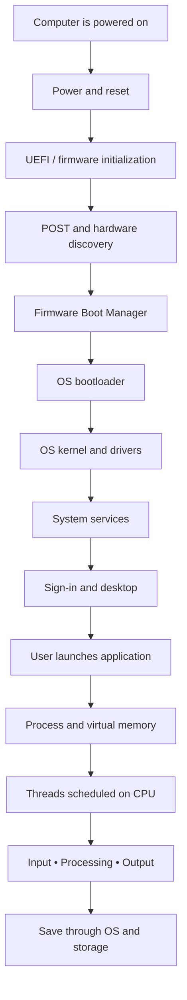

---

# PART I — HOW A COMPUTER STARTS UP

# Topic 5 — From Power-On to Sign-In

## 1. The Bootstrapping Paradox

### 1.1 The chicken-and-egg problem

Consider two facts:

1. The CPU must execute instructions to perform useful work.
2. When a computer is fully powered off, ordinary DRAM does not retain the operating system's working state. The operating system files are stored on persistent storage, such as an SSD.

This creates an apparent paradox:

**How can the CPU load the operating system from the SSD if it needs an operating system to control the computer?**

The answer is **firmware**.

A small amount of non-volatile firmware is stored on the motherboard or system platform. The processor is designed to begin execution from a predefined reset location. Firmware performs the earliest initialization, makes enough hardware usable to locate a boot device, and transfers control to a bootloader. The bootloader then loads the operating-system kernel.

This self-starting sequence is called **bootstrapping**, commonly shortened to **booting**.


<small>The firmware initializes the platform and eventually transfers control to a bootloader and operating system. Image: [Wikimedia Commons](https://commons.wikimedia.org/wiki/File:UEFI_boot_process.png).</small>

### 1.2 The startup relay analogy

Imagine a relay race:

- **Power circuitry** prepares the track.
- **Firmware** wakes and checks the hardware.
- **Firmware Boot Manager** chooses a boot option.
- **OS bootloader** prepares the operating system for launch.
- **Kernel** takes control of system management.
- **Services and user-session components** prepare the computer for the user.

Each stage performs enough work to hand control to the next stage.

> **Important:** The “five-stage relay” used in this module is a teaching model. Real startup sequences differ by platform, firmware implementation, operating system, and security configuration. Some systems have additional stages or combine steps.

---

## 2. The Five-Stage Startup Relay

### 2.1 At a glance

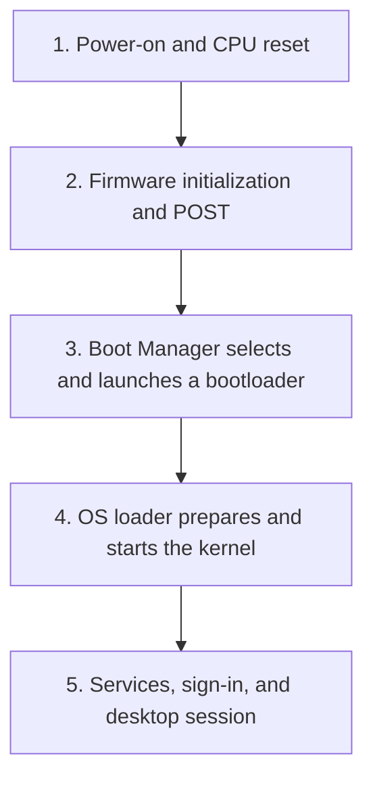

| Stage | Main component | Main responsibility | Typical visible evidence |
|---|---|---|---|
| 1 | PSU, motherboard power circuitry, CPU | Establish power and begin CPU execution | LEDs, fans, keyboard indicators |
| 2 | UEFI / legacy BIOS firmware | Initialize platform hardware and perform checks | Manufacturer logo, firmware screen, diagnostic codes |
| 3 | Firmware Boot Manager and bootloader | Select a boot target and launch its boot software | Boot menu, operating-system logo |
| 4 | OS loader and kernel | Load the kernel and essential startup components | OS loading animation, recovery messages |
| 5 | Services and user-session components | Start system services and present sign-in | Login screen, desktop |

---

## 3. Stage 1 — Power-On and the CPU Reset Vector

### 3.1 Pressing the power button

When you press the power button, the button normally sends a signal to the system's power-management circuitry. It does not directly “switch on the CPU” in isolation.

A simplified sequence is:

1. The system receives the power-on request.
2. The power supply and platform power-management circuitry enable the required power rails.
3. Voltage regulators provide suitable voltages to the CPU, memory, chipset, and other components.
4. The platform waits for required power and clock conditions to become stable.
5. The CPU is released from reset and begins its initial instruction sequence.

The exact signaling and timing depend on the motherboard, power supply, CPU platform, and laptop design.

### 3.2 What is the reset vector?

A **reset vector** is the architecturally defined starting address from which a processor begins fetching instructions after reset.

The processor does not need Windows, Linux, or macOS to discover this first instruction. Its hardware design defines the initial execution state.

On a typical PC, platform firmware is stored in non-volatile flash memory and is mapped into the processor's address space so the CPU can execute the early firmware code. Some firmware implementations use temporary processor cache or other early-memory techniques before DRAM is initialized.

**Useful distinction:**
- The reset vector is a CPU/platform-defined starting point.
- The firmware image is the code that the processor begins executing.
- The firmware is not the operating system; it is the low-level software that prepares the platform for the operating system.

### 3.3 Why DRAM is not immediately ready

System DRAM needs initialization and configuration before normal use. The firmware must configure the memory controller and perform memory detection/training procedures appropriate to the platform.

Before that work is complete, the firmware relies on the resources available at the earliest boot stage, such as processor registers, firmware storage, and temporary memory mechanisms.

---

## 4. Stage 2 — Platform Firmware, UEFI, Legacy BIOS, and POST

## 4.1 What is firmware?

**Firmware** is software stored in non-volatile memory and used to initialize or control hardware. PC firmware runs before the operating system and provides the interfaces needed to locate and launch a boot program.

The two terms most commonly encountered in PC startup are:

- **Legacy BIOS:** the traditional PC firmware interface.
- **UEFI:** the modern firmware interface used by most current PCs.

### 4.2 Legacy BIOS vs. UEFI

| Feature | Legacy BIOS | UEFI |
|---|---|---|
| Historical role | Traditional PC firmware interface | Modern firmware interface |
| Boot method | Commonly uses MBR bootstrap code | Loads EFI applications from a supported system partition |
| Partitioning commonly associated with boot | MBR | GPT |
| Disk-size limitation | Traditional MBR partition tables using 32-bit sector addressing and 512-byte sectors are limited to about 2 TiB | GPT supports much larger disks |
| Firmware environment | Traditional BIOS execution model | Defined firmware services and EFI application environment |
| Graphical setup | Often text-based | May be graphical, but graphical menus are optional |
| Secure Boot | Not a standard BIOS feature | Supports UEFI Secure Boot |
| Network boot | Possible with firmware/network ROM support | Supports standardized network boot options |

> **Accuracy note:** The familiar “2 TB BIOS limit” is not simply a limit of the BIOS chip. It is associated with the traditional MBR partition-table format and its addressing scheme. UEFI commonly works with GPT, which removes that traditional MBR capacity limit.

UEFI is not inherently restricted to one CPU word size. Implementations exist for different processor architectures and execution modes. A 64-bit operating system generally needs a compatible firmware/boot path for that platform.

### 4.3 What is POST?

**POST (Power-On Self-Test)** is the common name for early startup checks and initialization routines performed by firmware.

Depending on the platform, firmware may:

- initialize and train system memory;
- discover CPU and chipset features;
- initialize display output;
- initialize storage and USB controllers;
- enumerate PCIe devices;
- check selected platform components;
- prepare boot services and boot-device discovery.

POST is not one universal test with an identical checklist on every PC. Some checks are performed by firmware, some by device firmware, and some continue later during operating-system startup.

### 4.4 What happens if POST detects a problem?

A system may communicate a hardware problem using:

- beep patterns;
- diagnostic LEDs;
- a two-digit or multi-digit motherboard code display;
- a firmware error message;
- a blank screen or automatic shutdown.

The meaning of a beep or LED pattern is manufacturer- and model-specific. Always consult the motherboard or laptop service manual before interpreting a code.


<small>Example of a ThinkPad firmware boot-priority menu. It allows the user to configure the order in which bootable devices are considered. Image: [Wikimedia Commons](https://commons.wikimedia.org/wiki/File:Lenovo_ThinkPad_T430_UEFI_BIOS_1.16_boot_order_menu.jpg).</small>

---

## 5. UEFI Initialization Phases

The five-stage relay is easy to remember, but UEFI implementations can be described in more detailed phases.

| Phase | Name | Conceptual responsibility |
|---|---|---|
| SEC | Security | Earliest firmware execution and establishment of a temporary environment |
| PEI | Pre-EFI Initialization | Initializes essential platform resources, including memory on many platforms |
| DXE | Driver Execution Environment | Loads firmware drivers and initializes more platform devices |
| BDS | Boot Device Selection | Applies boot policy and selects a boot option |
| TSL | Transient System Load | Transfers control to the selected EFI application, often an OS bootloader |
| RT | Runtime | Provides selected runtime services after the OS takes control |

The names and exact behavior are defined by the UEFI Platform Initialization architecture and implementation. A consumer PC may not display these phase names to the user.

### 5.1 Why the phases matter

The phases explain why a computer can appear to “hang” at different points:

- A failure during early initialization may prevent any logo from appearing.
- A memory initialization problem may stop the machine before the operating system loader is reached.
- A storage-controller or boot-device discovery problem may allow the firmware screen to appear but prevent the OS bootloader from launching.
- A bootloader or kernel problem can occur after firmware has successfully completed its own initialization.

---

## 6. Stage 3 — Firmware Boot Manager vs. OS Bootloader

This is one of the most important distinctions in the module.

### 6.1 Firmware Boot Manager

The **UEFI Boot Manager** is part of the platform firmware environment. It reads firmware boot configuration, including boot entries stored in non-volatile variables, and selects a boot option.

On many UEFI PCs, boot entries include:

- Windows Boot Manager;
- a Linux bootloader;
- a removable USB device;
- a network boot option;
- a secondary internal drive.

The firmware can store boot-order information in **NVRAM** variables. Common UEFI variable names include `BootOrder`, `BootNext`, and entries such as `Boot0001`.

### 6.2 OS bootloader

An **OS bootloader** is a program that prepares a particular operating system to start.

Examples include:

- Windows Boot Manager, commonly `bootmgfw.efi`;
- GRUB on many Linux systems;
- `systemd-boot` on some Linux systems;
- Apple-specific boot software on macOS systems.

The bootloader is not the same thing as the firmware Boot Manager. The firmware chooses and launches a boot application; the boot application then carries out operating-system-specific loading steps.

### 6.3 The EFI System Partition (ESP)

On a typical UEFI/GPT installation, the **EFI System Partition** is a small FAT-formatted partition containing EFI boot applications and related files.

A simplified example:

```text
Internal SSD
│
├── EFI System Partition (ESP)
│   ├── EFI/
│   │   ├── Microsoft/
│   │   │   └── Boot/
│   │   │       └── bootmgfw.efi
│   │   └── ubuntu/
│   │       └── shimx64.efi / grubx64.efi
│   │
├── Operating-system partition
│   ├── Windows system files or Linux root filesystem
│   └── Applications and user data
│
└── Recovery partition (if configured)
```

This is an illustrative layout. The exact directories and files vary by operating system, distribution, architecture, and installation method.

### 6.4 The handoff

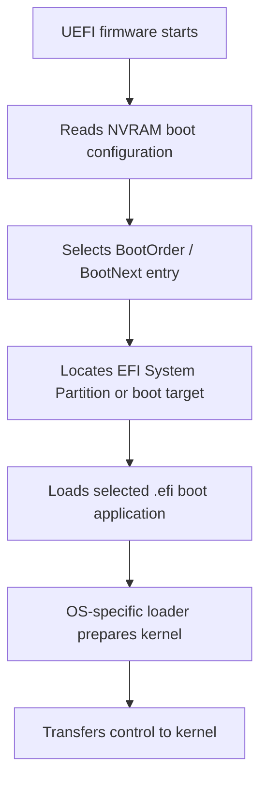

<box>
**Exam trap — do not confuse these components**

| Component | Where it normally resides | Main job |
|---|---|---|
| UEFI firmware | Non-volatile firmware storage on the platform | Initializes hardware and provides boot services |
| UEFI Boot Manager | Firmware environment | Selects a boot entry or device |
| OS bootloader | Usually an EFI application on the ESP or another boot location | Loads or prepares the OS |
| OS kernel | Loaded into memory during startup | Manages processes, memory, devices, and system resources |
</box>

---

## 7. Stage 4 — Operating-System Loader, Kernel, and Drivers

### 7.1 What is the kernel?

The **kernel** is the central component of an operating system. It manages resources and provides essential services to applications.

Its responsibilities include:

- process and thread scheduling;
- memory management;
- device and driver coordination;
- file-system operations;
- system-call handling;
- interrupt and exception handling;
- access control and isolation.

### 7.2 The OS loader's role

The OS loader performs operating-system-specific preparation before the kernel takes over.

For example, Windows startup commonly includes distinct Windows Boot Manager and Windows OS Loader stages. The Windows loader prepares the kernel and required boot-start drivers before transferring control.

Linux boot paths often involve a bootloader loading the kernel image and an **initramfs/initrd** image. The initramfs provides a temporary early userspace environment that can help locate and mount the real root file system.

macOS uses Apple-specific boot components and platform security mechanisms. Its startup flow differs across Intel-based Macs and Apple silicon systems.


<small>Illustration of a Linux boot path from firmware and bootloader through kernel, root file-system mounting, system initialization, and login. This is one Linux-oriented example; other operating systems and distributions differ. Image: [PrepCity — Linux Boot Process Illustrated](https://www.prepcity.io/library/linux-boot-process-illustrated).</small>

### 7.3 Device drivers

A **device driver** is software that allows the operating system to communicate with a hardware device or controller.

Examples:

| Device | Driver role |
|---|---|
| GPU | Graphics and compute device control |
| Wi-Fi adapter | Wireless network communication |
| Audio controller | Sound input and output |
| NVMe controller | Communication with NVMe storage |
| USB controller | USB device communication |
| Printer | Printer-specific communication and job handling |

Some drivers are needed early in boot. Others are initialized later, after the kernel is running.

### 7.4 Kernel initialization

After the kernel receives control, it performs tasks such as:

1. establishing core memory-management structures;
2. initializing scheduler and interrupt mechanisms;
3. initializing essential drivers and device subsystems;
4. mounting or locating the root system volume;
5. starting the first system-management process or session manager;
6. starting additional system services and user-session components.

The exact order differs across operating systems.

---

## 8. Stage 5 — Services, Sign-In, and the Desktop

### 8.1 Background services and daemons

A computer performs many tasks before the user opens an application.

Examples include:

- network configuration;
- security and authentication services;
- logging;
- update services;
- audio services;
- printing services;
- device management;
- desktop and window-management components.

In Unix-like systems, long-running background services are commonly called **daemons**. Windows uses the term **services** for many background system components.

### 8.2 Sign-in is not the same as boot completion

The operating system can be running before the user signs in. The sign-in screen is a user-authentication interface presented by the operating system.

After authentication, the OS creates or activates a user session and starts session-specific components, such as:

- desktop shell;
- taskbar or dock;
- user preferences;
- startup applications;
- accessibility services;
- user-specific background processes.

### 8.3 Cold boot, restart, sleep, and hibernate

| State / action | What happens | Does the OS start from a fresh boot path? |
|---|---|---|
| Cold boot | System starts from a powered-off state | Generally yes |
| Restart | OS shuts down and starts again | Yes, through the restart boot path |
| Sleep | System enters a low-power state while preserving active session state in memory | No full OS boot |
| Hibernate | OS saves memory/session state to persistent storage and powers down | Resume restores saved state; behavior differs by platform |
| Hybrid / fast startup | Some systems save a kernel session state to storage during shutdown | Not identical to a full cold boot |

---

## 9. UEFI Secure Boot and the Chain of Trust

### 9.1 What is Secure Boot?

**Secure Boot** is a UEFI security feature designed to help ensure that only trusted, authorized boot software is allowed to execute during the early boot process.

It uses cryptographic signatures, certificates, and firmware-maintained databases to verify boot applications.


<small>Example of a firmware Secure Boot configuration screen. Image: [Wikimedia Commons](https://commons.wikimedia.org/wiki/File:InsydeH20_UEFI_security_custom_Secure_Boot_screenshot.jpg).</small>

### 9.2 The Secure Boot key databases

Four terms are especially important:

| Name | Full name | Conceptual role |
|---|---|---|
| PK | Platform Key | Establishes platform ownership and controls changes to the key hierarchy |
| KEK | Key Exchange Key | Authorizes updates to Secure Boot signature databases |
| db | Allowed signature database | Contains trusted certificates, keys, and/or hashes |
| dbx | Forbidden signature database | Contains revoked or disallowed certificates, keys, and/or hashes |

The `dbx` revocation database can block a boot image even if it would otherwise match a trusted entry in `db`.

### 9.3 A simplified trust sequence

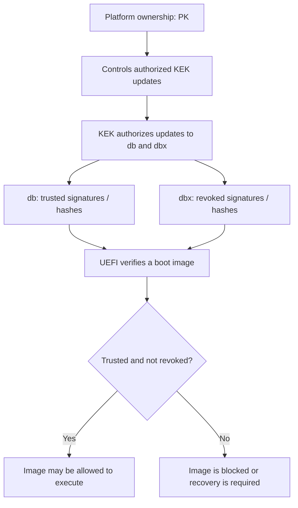

This is a conceptual overview rather than a complete description of every platform's key-management implementation.

### 9.4 What Secure Boot does

- Helps prevent unauthorized or modified boot applications from executing.
- Verifies signatures or hashes against firmware trust databases.
- Can reject boot components that have been revoked.
- Helps establish a chain of trust from platform firmware into the boot process.

### 9.5 What Secure Boot does not do

Secure Boot is not a complete security solution.

It does not, by itself:

- replace the user's account password or biometric sign-in;
- encrypt the entire SSD;
- guarantee that every application launched after sign-in is safe;
- scan every email attachment or downloaded file;
- prevent every firmware, hardware, or operating-system vulnerability;
- guarantee that the computer is free from malware.

**Secure Boot and full-disk encryption solve different problems.** Secure Boot helps validate early boot software; disk encryption protects data at rest. They can be used together.

### 9.6 Secure Boot vs. Measured Boot

| Feature | Secure Boot | Measured Boot |
|---|---|---|
| Primary purpose | Enforce a policy about which boot images may execute | Record measurements of boot components |
| Typical mechanism | Signature/hash verification against trust databases | Cryptographic hashes extended into TPM Platform Configuration Registers (PCRs) |
| Main result | A boot image is accepted or rejected according to policy | A record of what was loaded can be evaluated or attested |
| Relationship | Can be used alongside measured boot | Can complement Secure Boot |

---

## 10. Network Booting: PXE and UEFI Network Boot

### 10.1 Does normal startup require the internet?

**No.** A typical personal computer boots from local firmware and local storage. It does not need an internet connection simply to load an installed operating system.

However, organizations sometimes use **network booting** to start computers from an image or installation environment provided by a server.

### 10.2 What is PXE?

**PXE (Preboot Execution Environment)** is a network-boot mechanism that allows a compatible client to start using boot resources provided over a network.

A simplified PXE sequence:

1. The firmware initializes the network interface.
2. The client requests network configuration, commonly using DHCP.
3. The network boot service provides information about a boot server and boot file.
4. The client downloads or retrieves the network boot program.
5. The boot program loads an installer, diagnostic environment, or operating system image.

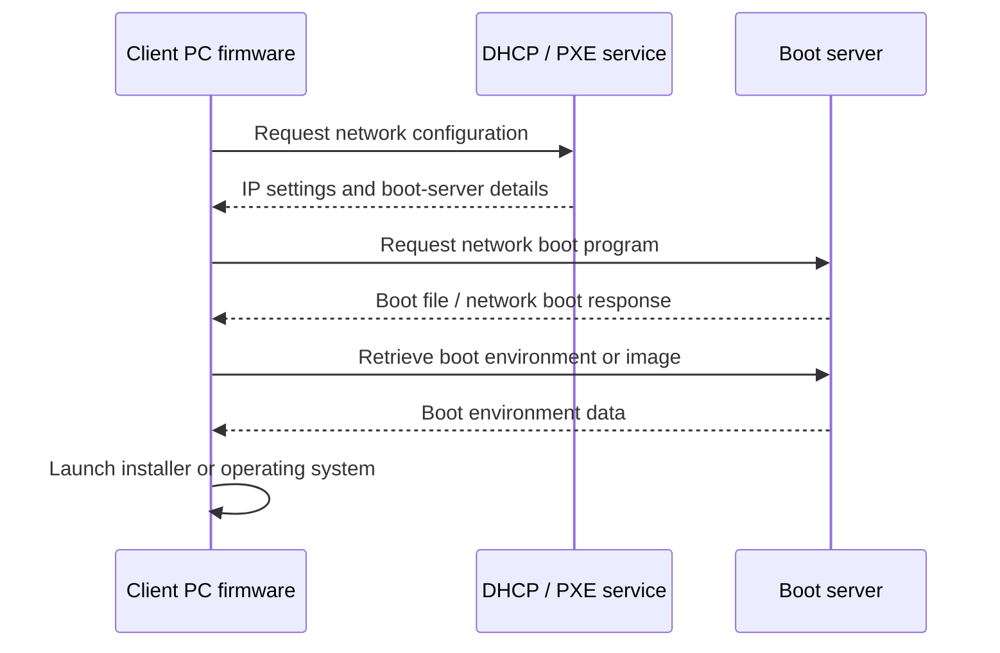


<small>Example PXE sequence showing the client, DHCP service, and TFTP server exchanging configuration and boot files. Image: [Matchbox network booting guide](https://matchbox.psdn.io/network-booting/).</small>

PXE is useful in:
- enterprise desktop deployment;
- computer laboratories;
- operating-system installation;
- diskless workstations;
- centralized recovery and diagnostics.

### 10.3 Local boot vs. network boot

| Scenario | Uses local storage? | Requires network? |
|---|:---:|:---:|
| Start installed Windows from internal SSD | Yes | No, for the basic boot path |
| Start installed Linux from internal SSD | Yes | No, for the basic boot path |
| Boot from a USB installer | USB media | No, unless the installer downloads content |
| PXE boot from a deployment server | Not necessarily | Yes |
| Sign in to a cloud account after boot | Local OS already running | Usually yes |
| Download operating-system updates | Local OS already running | Yes |

---

## 11. Evidence-Based Startup Troubleshooting

A useful technician does not guess that a component is broken from one symptom. Instead, the technician asks: **What stage has the computer demonstrably reached?**

### 11.1 Diagnostic table

| What you observe | What it suggests | What it does not prove |
|---|---|---|
| No lights, no fans, no response | Power delivery, battery, power button, or board-level issue may exist | It does not identify one failed component |
| LEDs or fans turn on, but no image appears | Some power is present; display path or early initialization may be failing | It does not prove POST completed or the SSD is faulty |
| Manufacturer logo or firmware screen appears | Firmware has initialized enough hardware to produce display output | It does not prove that a bootable OS was found |
| “No bootable device” appears | Firmware reached boot-device selection but did not successfully launch a suitable boot target | It does not prove the SSD is physically dead |
| OS logo appears, then recovery or boot error | The bootloader or OS loading path has started | It does not prove all drivers or system files are healthy |
| Sign-in screen appears | The operating system reached its sign-in interface | It does not prove Wi-Fi, DNS, or internet access works |
| Desktop appears but one app fails | The OS boot path is broadly operational | It does not prove the application, its files, or its dependencies are healthy |

### 11.2 A practical diagnostic decision tree

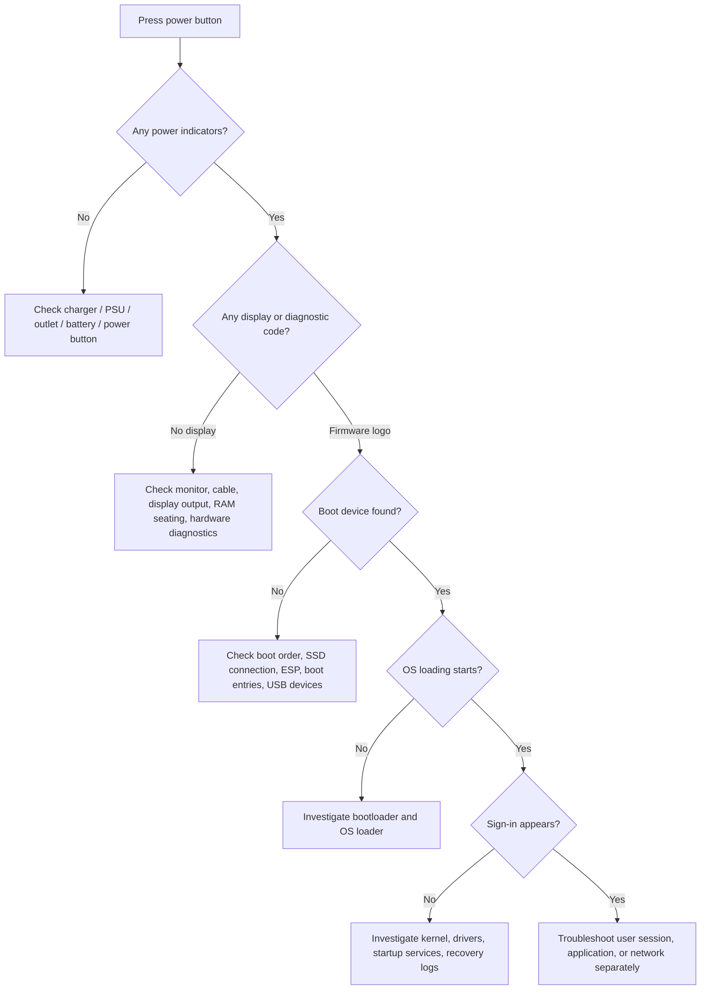

### 11.3 Safe first checks

Before opening a computer or changing firmware settings:

1. Confirm the power adapter, wall outlet, and cable connections.
2. Check monitor power, input selection, and display cable.
3. Disconnect unnecessary external USB devices.
4. Note any beep codes, LED patterns, and exact error messages.
5. Check whether the firmware can detect the internal storage device.
6. Confirm boot order and whether the intended boot entry is present.
7. Avoid changing Secure Boot, storage mode, or firmware settings without understanding the consequences.
8. If data is important, avoid reinstalling the OS or formatting the drive before assessing recovery options.

### 11.4 Three important diagnostic examples

**Example A — Fans spin, screen is black**

This proves only that some power is reaching the system. It does not establish that POST completed. Check display connections and diagnostic indicators before assuming the SSD has failed.

**Example B — Manufacturer logo, then “No bootable device”**

The firmware has progressed far enough to display its interface and attempt boot selection. Possible causes include an incorrect boot order, disconnected or failed storage, a missing or damaged EFI boot file, an unsupported boot mode, or an unbootable USB device.

**Example C — Sign-in works, but a website does not load**

The local boot sequence has reached the user interface. The issue may be Wi-Fi, Ethernet, DNS, a proxy, firewall rules, or the remote service. Reinstalling the operating system is not the first logical response.

---

# PART II — WHAT HAPPENS WHEN YOU OPEN AN APPLICATION?

# Topic 6 — From a Program File to an Interactive Process

## 12. The Moment You Double-Click an Icon

### 12.1 A file is not the same thing as a running application

An executable file stored on an SSD is passive data. It contains instructions and other information, but it does not execute itself.

When you open the application, the operating system:

1. receives the launch request;
2. identifies the executable and its required resources;
3. creates or configures a process;
4. establishes a virtual address space;
5. maps executable code and data into that address space;
6. creates an initial thread;
7. schedules that thread on a CPU;
8. coordinates libraries, devices, windows, and user input.


<small>Illustrative 64-bit Linux process virtual-memory layout. Actual address-space layouts vary by architecture, kernel, process, and security configuration. Image: [Wikimedia Commons](https://commons.wikimedia.org/wiki/File:Linux_Virtual_Memory_Layout_64bit.svg).</small>

### 12.2 The six-stage application lifecycle

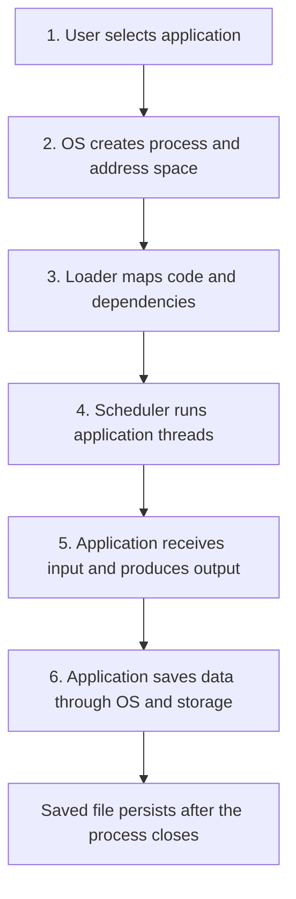

| Stage | Name | Main event |
|---|---|---|
| 1 | Select | User requests that an application be opened |
| 2 | Prepare | OS creates process resources and a virtual address space |
| 3 | Load and execute | Loader maps executable code and required libraries; threads begin execution |
| 4 | Interact | Input events, application logic, and display updates occur |
| 5 | Save | Application requests that data be written through OS file services |
| 6 | Reopen | Persisted data can be read by a later process |

---

## 13. Stage 1 — User Input and the Launch Request

### 13.1 What happens when you double-click?

A mouse click is detected by the input device and communicated through its controller and driver stack. The operating system receives input events and the desktop shell interprets the double-click as a request to launch an application or open a file.

The shell or application launcher identifies the target program and asks the operating system to start it.

Examples of executable paths include:

```text
Windows:
C:\Program Files\Editor\editor.exe

Linux:
 /usr/bin/gedit
```

The exact path depends on the operating system and installation.

### 13.2 Does the mouse directly start the CPU?

No. The mouse does not directly instruct the CPU to execute the application file.

A simplified path is:


The operating system mediates the request, checks access and execution conditions, and creates the process.

---

## 14. Stage 2 — Process Creation and Virtual Address Space

### 14.1 Program vs. process vs. thread

These terms are related but not interchangeable.

| Term | Meaning | Analogy |
|---|---|---|
| Program | A set of instructions and resources stored as files | A recipe printed on paper |
| Process | A running program instance with its own resources and execution context | A cooking station prepared to follow the recipe |
| Thread | A schedulable sequence of execution within a process | One worker performing a sequence of tasks |

A process typically contains:
- a unique process identifier (PID);
- a virtual address space;
- executable code and data mappings;
- one or more threads;
- open handles or file descriptors;
- security credentials or context;
- environment variables and process metadata.

A process usually begins with at least one initial thread. It may create more threads later.

### 14.2 What is a PID?

A **Process ID (PID)** is an identifier used by the operating system to refer to a process.

Examples:
- Windows Task Manager displays process information and identifiers through its details views.
- Linux commands such as `ps` and `top` display process IDs.
- macOS Activity Monitor shows running processes, with additional details available through command-line tools.

### 14.3 What is virtual address space?

A process uses **virtual addresses** rather than directly choosing physical RAM locations.

The operating system and memory-management hardware map virtual pages to physical frames, enforce permissions, and provide isolation between processes.

Benefits include:
- a consistent address space for each process;
- protection between unrelated applications;
- flexible mapping of code and data;
- support for shared libraries and shared-memory regions;
- the ability to manage pages that are not currently resident in RAM.

### 14.4 User space and kernel space

| User space | Kernel space |
|---|---|
| Where ordinary application code runs | Where the core OS kernel and many privileged components run |
| Restricted access to hardware and protected OS data | Privileged access to system resources |
| Uses system calls to request OS services | Handles system calls and manages protected operations |
| A faulty application is often isolated from other processes | A serious kernel fault can affect the whole system |

The exact memory layout and privilege model vary by operating system and processor architecture.

---

## 15. Stage 3 — Loading Executable Code and Starting Threads

### 15.1 What does the loader do?

An executable file contains more than a sequence of machine instructions. It may also describe:

- code sections;
- initialized data;
- uninitialized data;
- entry-point information;
- required shared libraries;
- relocation and linking information;
- security and execution metadata.

The OS loader and related runtime components prepare the process so the CPU can begin executing it.

### 15.2 Demand paging

The operating system does not necessarily read an entire executable file into RAM before the application can start.

With **demand paging**, pages are brought into physical memory when they are first needed. Some code and data may be mapped from the executable file and loaded on demand.

This can reduce startup work and avoid loading unused portions of a large program.

### 15.3 Shared libraries and dynamic linking

Applications commonly depend on shared libraries.

Examples:
- Windows DLL files;
- Linux shared objects (`.so`);
- macOS dynamic libraries and frameworks.

A dynamic linker or loader resolves required library references and prepares the process to use them.

Shared libraries can reduce duplicated code in memory and make software easier to update, but missing or incompatible dependencies can prevent an application from starting.

### 15.4 ASLR and memory protection

Modern operating systems commonly use security mechanisms such as:

- **ASLR (Address Space Layout Randomization):** varies the location of key memory regions to make memory-corruption attacks harder.
- **DEP / NX:** marks selected memory pages as non-executable.
- **Code-signing policies:** restrict which executable code may be loaded in particular environments.
- **Process isolation:** separates one process's address space from another's.

These mechanisms are platform- and configuration-dependent.

### 15.5 A conceptual process memory map

A process may contain several important memory regions:

| Region | Purpose |
|---|---|
| `.text` / code | Executable machine instructions |
| `.data` | Initialized global or static data |
| `.bss` | Zero-initialized or uninitialized global/static data, depending on executable format |
| Heap | Dynamic allocations requested while the program runs |
| Stack | Function calls, local variables, return addresses, and thread execution state |
| Shared libraries | Mapped code and data from reusable libraries |
| Memory-mapped files | File-backed regions mapped into the process address space |

A conceptual layout:

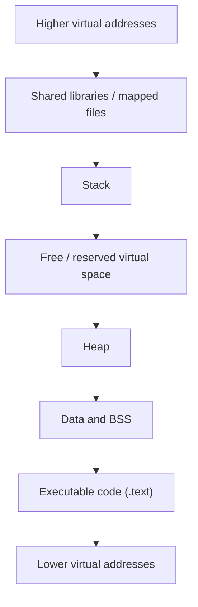

This is not a universal physical arrangement. Address-space direction, region placement, and layout vary across platforms and security configurations.


<small>Illustrative process layout showing code, data, heap, and stack regions. Actual placement and growth directions depend on the architecture and operating system. Image: [CS 465 — Introduction to Security and Privacy](https://cs465.zappala.org/winter2025/notes/stack-overflows/).</small>

---

## 16. Stage 4 — CPU Scheduling and the Interactive Loop

### 16.1 The CPU executes threads, not “applications” as one indivisible object

The operating system's scheduler selects runnable threads and assigns them CPU time.

A process may have several threads, for example:
- a user-interface thread;
- a background file-loading thread;
- an autosave thread;
- a network communication thread;
- a rendering or computation thread.

The scheduler decides when threads run, subject to priorities, CPU availability, and system policy.

### 16.2 Process and thread states

A simplified thread-state model:

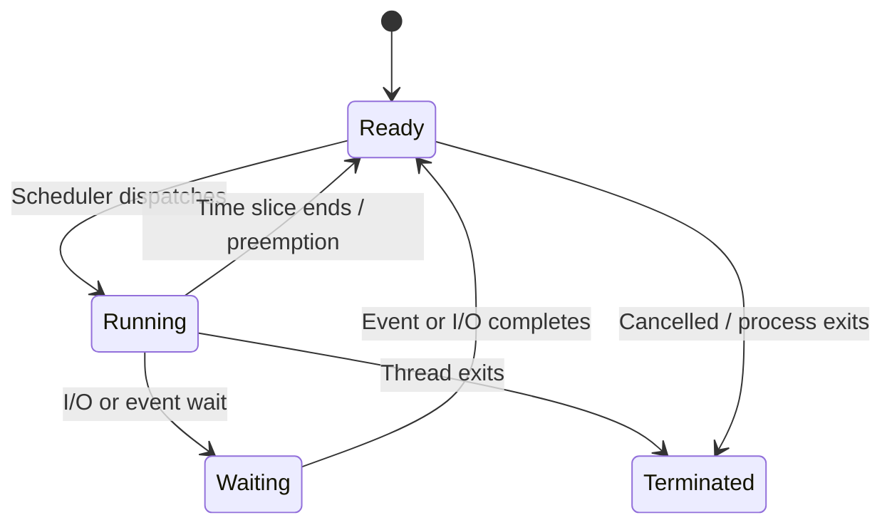

Common conceptual states:

| State | Meaning |
|---|---|
| New | Thread or process is being created |
| Ready | Able to run but waiting for CPU time |
| Running | Currently executing on a CPU core |
| Waiting / blocked | Waiting for I/O, a lock, a timer, or another event |
| Terminated | Execution has ended |

Operating systems use more detailed state models internally.

### 16.3 Context switching

A **context switch** occurs when the CPU stops running one thread and begins running another.

The OS saves the outgoing thread's execution context and restores the incoming thread's context. This includes relevant registers and scheduling state.

Context switching enables multitasking, but it has overhead. Too many runnable threads, excessive blocking, or heavy background activity can affect responsiveness.

### 16.4 The input–process–output loop

When you type into a document editor:

1. The keyboard generates an input event.
2. The OS input subsystem delivers the event to the appropriate application window.
3. The application's UI thread processes the event.
4. The application updates its internal document model and working data.
5. The application requests a visual update.
6. The window system and graphics stack coordinate display output.

The CPU is not necessarily executing continuously on behalf of one application. It switches among runnable threads and other system work.

### 16.5 How the window appears

A modern graphical application may involve:
- the application process;
- a window manager or desktop compositor;
- graphics APIs and drivers;
- the GPU;
- display hardware.

The CPU handles application logic and coordinates rendering work. The GPU may accelerate drawing, compositing, image processing, or 3D operations. Not every UI operation requires a discrete GPU.

---

## 17. Stage 5 — Saving a File: From Application Buffer to Persistent Storage

### 17.1 Why unsaved changes can be lost

When you edit a document, the application maintains a working representation of the document in memory. Recent edits may be held in RAM buffers and other in-memory structures.

If power is removed before changes are safely saved, some recent edits may be lost.

However, it is too simplistic to say every unsaved character exists only in one heap buffer. Real applications may use:
- multiple in-memory data structures;
- temporary files;
- autosave or recovery files;
- operating-system file caches;
- cloud synchronization queues.

### 17.2 What happens when you press Ctrl+S?

A simplified saving path:

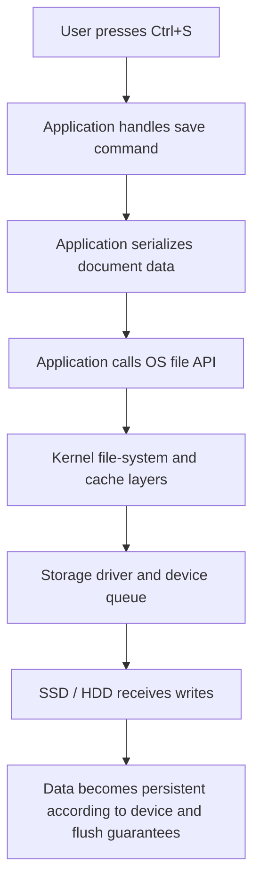

### 17.3 What is a system call?

A **system call** is a controlled interface through which an application requests a service from the operating-system kernel.

Examples include:
- opening or creating a file;
- reading or writing data;
- allocating or mapping memory;
- creating a process;
- communicating through a socket.

On Unix-like systems, `write()` is a common system call used to write data to a file descriptor. On Windows, applications commonly use Win32 APIs such as `WriteFile`, which interact with the OS I/O system.

### 17.4 Does write() mean the data is already on the SSD?

Not necessarily.

A successful write request may mean that data has been accepted by the operating system or placed in a cache. The operating system may write it to the storage device later.

For stronger durability guarantees, applications and file systems may use flush or synchronization operations. Exact guarantees depend on the API, file system, storage device, cache settings, and whether the device correctly honors flush commands.

**Important distinction:**
- **Write request accepted:** the OS has accepted the data for writing.
- **Data flushed:** the relevant buffers have been requested to reach the storage device.
- **Durable storage:** the device has committed the data in a way intended to survive power loss.

Autosave and recovery features can reduce data loss, but they are not a substitute for backups.

### 17.5 Local save vs. cloud save

| Action | Typical path | Needs internet? |
|---|---|:---:|
| Save a document to an internal SSD | Application → OS file services → local storage | No |
| Save to an external USB drive | Application → OS → USB storage stack → drive | No |
| Upload a document to cloud storage | Application → OS → network interface → router → remote service | Yes |
| Synchronize a local folder with cloud storage | Local file changes → sync client → network → remote server | Yes |
| Save a document to a network share | Application → OS network file protocol → local network/server | Yes, to that network |

---

## 18. Stage 6 — Closing and Reopening the Application

### 18.1 What happens when an application closes?

When a process exits, the operating system releases or reclaims its process resources, including:
- virtual address-space mappings;
- process-specific handles or descriptors;
- thread scheduling resources;
- memory allocations;
- other process-owned resources.

The OS may retain some file data in its system cache for performance. This does not mean the application process is still running.

### 18.2 Why a saved file survives

Once a document has been saved to persistent storage, it exists independently of the original application process.

You can:
1. close the editor;
2. shut down the computer;
3. power it on later;
4. open the same file in another compatible application.

The application is temporary execution state. The saved file is persistent data.

### 18.3 What if the application crashes before saving?

Possible outcomes:
- changes since the last save may be lost;
- autosave or recovery files may preserve some work;
- a cloud sync client may have already uploaded earlier changes;
- the OS may have buffered some writes, but that does not guarantee the latest document state was saved.

For important work, use regular saves, autosave where available, version history, and independent backups.

---

## 19. Local Execution vs. Network Activity

When troubleshooting an application, separate local computer operations from actions that require network communication.

### 19.1 Comparison table

| User task | Requires network? | Simplified path |
|---|:---:|---|
| Open an installed offline calculator | No | SSD → OS loader → RAM mappings → CPU → display |
| Type text in a local editor | No | Keyboard → OS input → application thread → RAM |
| Save to a local folder | No | Application → OS file system → local SSD |
| Print to a network printer | Usually yes | Application → OS print system → NIC → network printer |
| Sync a folder to cloud storage | Yes | Local files → sync client → NIC → router → cloud server |
| Stream a video | Yes | Network → NIC → browser/app buffers → CPU/GPU → display |
| Verify an online-only game account | Yes | Game process → network stack → NIC → remote service |
| Open a local PDF file | No, if all required data is local | SSD → process memory → CPU/GPU → display |

### 19.2 What is a NIC?

A **Network Interface Controller (NIC)** is hardware that connects a computer to a network.

Common forms include:
- Ethernet controller;
- Wi-Fi adapter;
- integrated laptop wireless card;
- USB network adapter.

The operating system uses network drivers and protocol stacks to send and receive data.

### 19.3 A simplified internet path


A local application can run even if the internet is disconnected. Only functions that depend on a remote service will fail or become unavailable.

---

# PART III — PRACTICAL LABS, DIAGNOSTICS, AND REVIEW

## 20. Interactive Lab: Explore the Boot Sequence

Select a stage to see what it does and what evidence you might observe.

<details>
<summary><strong>Stage 1 — Power-on and reset</strong></summary>

The power-management circuitry enables required power rails. After the platform is ready, the CPU leaves reset and begins fetching instructions from its reset vector.

**Look for:** power indicators, fan activity, keyboard LEDs, and diagnostic codes.

</details>

<details>
<summary><strong>Stage 2 — Firmware and POST</strong></summary>

UEFI or legacy BIOS initializes platform hardware, configures memory, discovers devices, and performs startup checks.

**Look for:** firmware logo, setup screen, beep patterns, diagnostic LEDs, or POST error messages.

</details>

<details>
<summary><strong>Stage 3 — Boot selection</strong></summary>

The firmware Boot Manager evaluates boot entries and selects a boot target. It may launch an EFI boot application from the EFI System Partition.

**Look for:** boot menu, missing boot entry, “No bootable device,” or a bootloader screen.

</details>

<details>
<summary><strong>Stage 4 — Kernel and drivers</strong></summary>

The OS loader prepares the kernel and essential startup components. The kernel initializes memory management, scheduling, and device subsystems.

**Look for:** OS loading animation, recovery screen, kernel error, or repeated restart.

</details>

<details>
<summary><strong>Stage 5 — Services and sign-in</strong></summary>

System services and user-session components start. The operating system presents a sign-in interface and then loads the user's desktop session.

**Look for:** login screen, desktop, startup applications, or a service-specific error.

</details>

## 21. Interactive Lab: Diagnose the Startup Symptom

Choose the symptom that most closely matches a computer you are troubleshooting.

<details>
<summary><strong>A. Power indicators are on, but the screen is black</strong></summary>

**Likely investigation area:** display path or early hardware initialization.

Check:
1. monitor power and input selection;
2. display cable and port;
3. laptop brightness or external-display behavior;
4. motherboard diagnostic LEDs or beep codes;
5. memory seating and hardware diagnostics, if safe and appropriate.

Do not conclude that the SSD is defective from a black screen alone.

</details>

<details>
<summary><strong>B. The manufacturer's logo appears, then “No bootable device”</strong></summary>

**Likely investigation area:** firmware boot selection or the boot device.

Check:
1. whether the SSD is detected in firmware;
2. whether the intended OS boot entry exists;
3. boot order and removable USB devices;
4. whether the EFI System Partition and bootloader are intact;
5. whether a recent firmware setting change altered boot mode or storage configuration.

The message does not by itself prove physical SSD failure.

</details>

<details>
<summary><strong>C. The operating-system logo appears, then recovery starts</strong></summary>

**Likely investigation area:** OS loader, kernel, boot-start driver, or system files.

Record the exact recovery message and recent changes. Use the operating system's recovery tools before attempting a reinstall.

</details>

<details>
<summary><strong>D. Sign-in works, but websites do not open</strong></summary>

**Likely investigation area:** network connectivity, DNS, proxy, firewall, or remote service.

Check Wi-Fi/Ethernet status, gateway reachability, DNS resolution, and whether other devices can access the same service. A successful local boot does not guarantee internet access.

</details>

## 22. Interactive Lab: Explore the Application Lifecycle

<details>
<summary><strong>1 — Select</strong></summary>

The user requests that an application be launched. The desktop shell or launcher identifies the target executable and requests process creation.

</details>

<details>
<summary><strong>2 — Prepare</strong></summary>

The operating system creates a process, assigns a PID, establishes a virtual address space, and prepares the initial thread and process resources.

</details>

<details>
<summary><strong>3 — Load and execute</strong></summary>

The executable loader maps code and data, resolves dependencies, and makes the initial thread runnable. The scheduler eventually assigns it CPU time.

</details>

<details>
<summary><strong>4 — Interact</strong></summary>

Input events are delivered to the application. Its threads process the events, update program state, and request visual output.

</details>

<details>
<summary><strong>5 — Save</strong></summary>

The application serializes its data and asks the operating system to write it. File-system and storage layers coordinate the write.

</details>

<details>
<summary><strong>6 — Reopen</strong></summary>

A later process reads the persisted file. The data survives even though the original application process has ended.

</details>

## 23. Knowledge Check

<details>
<summary><strong>Question 1 — Why can a CPU start without Windows or Linux already running?</strong></summary>

**Answer:** The processor has a hardware-defined reset starting point and can execute platform firmware stored in non-volatile memory. Firmware performs early initialization and launches the OS boot path.

</details>

<details>
<summary><strong>Question 2 — What does POST mean?</strong></summary>

**Answer:** Power-On Self-Test. It is a common term for early firmware startup checks and initialization. The exact checks vary by platform.

</details>

<details>
<summary><strong>Question 3 — What is the difference between UEFI Boot Manager and an OS bootloader?</strong></summary>

**Answer:** The firmware Boot Manager selects and launches a boot option. The OS bootloader performs operating-system-specific loading and preparation.

</details>

<details>
<summary><strong>Question 4 — What is the EFI System Partition?</strong></summary>

**Answer:** On a typical UEFI installation, it is a FAT-formatted partition that contains EFI boot applications and related boot files.

</details>

<details>
<summary><strong>Question 5 — Does Secure Boot encrypt the SSD?</strong></summary>

**Answer:** No. Secure Boot validates early boot software according to firmware trust policy. Full-disk encryption is a separate protection mechanism.

</details>

<details>
<summary><strong>Question 6 — Does normal local startup require internet access?</strong></summary>

**Answer:** No. A computer can load an installed operating system from local storage without internet access. Network booting and online sign-in or services are separate cases.

</details>

<details>
<summary><strong>Question 7 — What is the difference between a program and a process?</strong></summary>

**Answer:** A program is stored instructions and resources. A process is a running instance with an address space, resources, and at least one thread.

</details>

<details>
<summary><strong>Question 8 — What does the scheduler assign to CPU cores?</strong></summary>

**Answer:** The scheduler selects runnable threads for execution. A process is a resource container; its threads are the entities that are scheduled.

</details>

<details>
<summary><strong>Question 9 — What is a system call?</strong></summary>

**Answer:** A controlled interface through which an application requests a service from the operating-system kernel, such as file I/O or process management.

</details>

<details>
<summary><strong>Question 10 — Does a successful write() always mean data is physically committed to the SSD?</strong></summary>

**Answer:** Not necessarily. Data may first be accepted into an OS or device cache. Stronger durability may require flush or synchronization operations, depending on the API and storage stack.

</details>

<details>
<summary><strong>Question 11 — Why can an offline application open without Wi-Fi?</strong></summary>

**Answer:** Its executable code and required local resources are available on local storage. The OS can load and run it without contacting a remote server.

</details>

<details>
<summary><strong>Question 12 — Why might cloud synchronization fail while local saving still works?</strong></summary>

**Answer:** Local saving uses local file-system and storage services. Cloud synchronization also requires the network interface, network connection, DNS/routing, authentication, and a reachable remote service.

</details>

## 24. Calculation and Scenario Exercises

<details>
<summary><strong>Exercise A — Identify the boot stage</strong></summary>

A computer displays the manufacturer's logo and then reports “No bootable device.”

**Question:** Which part of the startup process should be investigated first?

**Suggested answer:** Investigate boot-device selection and the boot path: firmware boot order, drive detection, boot entries, EFI System Partition, and bootloader. The message does not establish that the SSD is physically damaged.

</details>

<details>
<summary><strong>Exercise B — Secure Boot or password?</strong></summary>

A laptop has Secure Boot enabled, but anyone can still reach the sign-in screen.

**Question:** Does this mean Secure Boot has failed?

**Suggested answer:** No. Secure Boot validates early boot components. It does not replace user authentication. Account sign-in and data-at-rest encryption are separate security controls.

</details>

<details>
<summary><strong>Exercise C — Program vs. process</strong></summary>

An editor executable is stored at `C:\Program Files\Editor\editor.exe`. You double-click it and two editor windows appear.

**Question:** Is the executable file itself the process? Must the two windows always share one process?

**Suggested answer:** The executable file is a program file, not a process. The OS creates one or more process instances according to the application's design and launch behavior. Multiple windows may share one process or be hosted by separate processes.

</details>

<details>
<summary><strong>Exercise D — Why is the CPU not always busy?</strong></summary>

A browser is open, but the CPU usage is low while the page waits for a network response.

**Suggested answer:** The browser's thread may be waiting for I/O or a network event. A waiting thread is not continuously executing on a CPU core. The scheduler can run other ready threads.

</details>

<details>
<summary><strong>Exercise E — Local save or cloud save?</strong></summary>

You can save a file to the laptop's Documents folder while Wi-Fi is disabled, but cloud synchronization shows an error.

**Suggested answer:** Local file saving uses the local OS and storage stack. Cloud synchronization requires network communication with a remote service, so it can fail while local saving continues to work.

</details>

<details>
<summary><strong>Exercise F — Write completion and durability</strong></summary>

A program calls a file-writing API and receives a success result. The computer loses power immediately afterward.

**Question:** Is it guaranteed that the newest data reached persistent media?

**Suggested answer:** Not from the success result alone. Data may have been buffered by the OS or device. Applications that require stronger durability must use appropriate synchronization or flush operations, and the file system and device must honor those requests.

</details>

---

## 25. Practical Tools for Observing Processes and Startup

You can connect the theory to a real computer using built-in tools.

| Operating system | Tool | What to observe |
|---|---|---|
| Windows | Task Manager | Processes, CPU, memory, startup apps, services |
| Windows | Event Viewer | System and application events, startup-related errors |
| Windows | System Information (`msinfo32`) | BIOS mode, Secure Boot state, system hardware information |
| Windows | `bcdedit` | Boot configuration data |
| Linux | `ps`, `top`, `htop` | Process IDs, threads, CPU and memory usage |
| Linux | `systemd-analyze` | Startup timing and boot critical chain on systemd systems |
| Linux | `journalctl -b` | Logs from the current boot |
| macOS | Activity Monitor | Processes, CPU, memory, energy, and network activity |
| macOS | System Information | Hardware, firmware, and system details |

### 25.1 Example commands

Windows Command Prompt:

```powershell
systeminfo
bcdedit /enum
tasklist
```

Linux terminal:

```bash
ps aux
top
systemd-analyze time
journalctl -b
```

macOS Terminal:

```bash
ps aux
top
system_profiler SPHardwareDataType
```

Use administrative commands carefully. Do not change boot configuration, firmware variables, or storage partitions unless you understand the effect and have a recovery plan.

---

## 26. Final Summary

| Concept | Key point |
|---|---|
| Bootstrapping | Firmware starts the process that eventually loads the OS |
| Reset vector | CPU-defined starting location after reset |
| Firmware | Non-volatile low-level software that initializes the platform |
| POST | Early startup checks and initialization |
| BIOS | Traditional PC firmware interface |
| UEFI | Modern firmware interface and boot environment |
| GPT | Partition-table format commonly used with UEFI |
| MBR | Traditional partition-table format with legacy addressing limits |
| UEFI Boot Manager | Selects a boot entry or device |
| OS bootloader | Loads or prepares the operating system |
| ESP | EFI System Partition containing EFI boot applications |
| Kernel | Core OS component managing resources |
| Driver | Software that enables OS communication with hardware |
| Service / daemon | Background system component |
| Secure Boot | Validates early boot software against trust policy |
| PK / KEK / db / dbx | Secure Boot key and signature databases |
| PXE | Network-based boot environment |
| Program | Stored instructions and resources |
| Process | Running instance with resources and address space |
| Thread | Schedulable execution path within a process |
| PID | Process identifier |
| Virtual address space | Address range used by a process |
| Demand paging | Loads pages when they are needed |
| System call | Controlled request from an application to the kernel |
| Scheduler | Selects runnable threads for CPU execution |
| Context switch | Saves one thread's execution state and restores another's |
| File cache | OS-managed memory used to improve file I/O performance |
| Flush / synchronization | Requests that buffered data reach persistent storage |
| NIC | Hardware interface connecting the computer to a network |

### 🧠 Final Concept Map

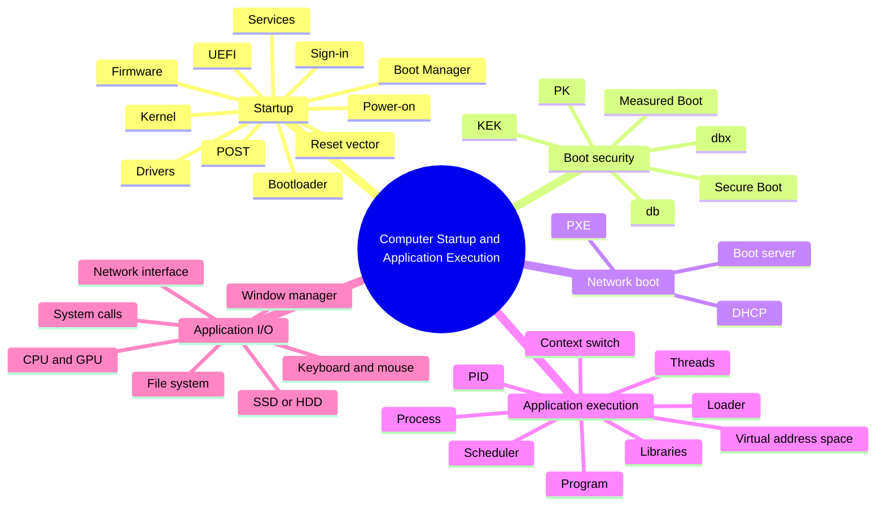

---

## 27. Glossary

| Term | Definition |
|---|---|
| ASLR | Address Space Layout Randomization; varies memory-region locations |
| BIOS | Basic Input/Output System; traditional PC firmware interface |
| Bootloader | Software that prepares and launches an operating system |
| Boot Manager | Firmware component that selects a boot entry or device |
| BDS | Boot Device Selection phase in UEFI PI terminology |
| Context switch | Saving one thread's execution state and restoring another's |
| Daemon | Background service process in Unix-like systems |
| Demand paging | Loading memory pages when they are needed |
| Device driver | Software that enables the OS to control or communicate with a device |
| DHCP | Dynamic Host Configuration Protocol |
| DXE | Driver Execution Environment phase |
| EFI | Extensible Firmware Interface |
| ESP | EFI System Partition |
| Firmware | Low-level software stored in non-volatile memory |
| GPT | GUID Partition Table |
| Initramfs | Temporary early userspace environment used during some Linux boot paths |
| Kernel | Core operating-system component |
| KEK | Key Exchange Key |
| MBR | Master Boot Record / traditional partition-table format |
| NIC | Network Interface Controller |
| NVRAM | Non-volatile random-access memory; firmware variables may be stored here |
| OS | Operating system |
| PEI | Pre-EFI Initialization phase |
| PID | Process Identifier |
| POST | Power-On Self-Test |
| Process | Running program instance with resources and execution context |
| PXE | Preboot Execution Environment |
| Reset vector | CPU-defined initial instruction address after reset |
| Secure Boot | UEFI mechanism for enforcing trust policy on boot images |
| Service | Background system component, especially in Windows terminology |
| System call | Interface for requesting kernel services |
| Thread | Schedulable sequence of execution within a process |
| UEFI | Unified Extensible Firmware Interface |
| Virtual address | Address used within a process's virtual address space |
| Working set | Pages of a process currently resident in physical memory |

---

## 28. References and Image Credits

### Technical references

1. Microsoft Learn. [Windows startup issues troubleshooting](https://learn.microsoft.com/windows/client-management/advanced-troubleshooting-boot-problems). Windows startup phases and troubleshooting.
2. UEFI Forum. [UEFI Specification — Boot Manager](https://uefi.org/specs/UEFI/2.10_A/03_Boot_Manager.html). UEFI boot services and boot manager concepts.
3. UEFI Forum. [UEFI Specification — Secure Boot and Driver Signing](https://uefi.org/specs/UEFI/2.10/32_Secure_Boot_and_Driver_Signing.html). Secure Boot trust relationships and signature databases.
4. Microsoft Learn. [Windows Secure Boot Key Creation and Management Guidance](https://learn.microsoft.com/en-us/windows-hardware/manufacture/desktop/windows-secure-boot-key-creation-and-management-guidance). PK, KEK, db, and dbx.
5. Microsoft Learn. [Secure Boot](https://learn.microsoft.com/en-us/windows-hardware/design/device-experiences/oem-secure-boot). Secure Boot requirements and boot sequence.
6. Microsoft Learn. [About Processes and Threads](https://learn.microsoft.com/en-us/windows/win32/procthread/about-processes-and-threads). Process and thread concepts.
7. Microsoft Learn. [Creating Processes](https://learn.microsoft.com/en-us/windows/win32/procthread/creating-processes). Process creation.
8. Microsoft Learn. [Virtual Address Space and Physical Storage](https://learn.microsoft.com/en-us/windows/win32/memory/virtual-address-space-and-physical-storage). Virtual memory, working sets, and paging.
9. Microsoft Learn. [Virtual Address Spaces](https://learn.microsoft.com/en-us/windows-hardware/drivers/gettingstarted/virtual-address-spaces). Address translation and user/kernel address spaces.
10. Linux man-pages project. [`execve(2)`](https://man7.org/linux/man-pages/man2/execve.2.html). Executing a program on Linux.
11. Linux man-pages project. [`mmap(2)`](https://man7.org/linux/man-pages/man2/mmap.2.html). Mapping files and devices into a process address space.
12. NSA. [Guidance for Managing UEFI Secure Boot](https://media.defense.gov/2025/Dec/11/2003841096/-1/-1/1/CSI_UEFI_SECURE_BOOT.PDF). Secure Boot databases and boot phases.

### Image credits

| Image | Source |
|---|---|
| UEFI boot process | [Wikimedia Commons — UEFI boot process](https://commons.wikimedia.org/wiki/File:UEFI_boot_process.png) |
| ThinkPad UEFI boot-order menu | [Wikimedia Commons — Lenovo ThinkPad T430 boot order](https://commons.wikimedia.org/wiki/File:Lenovo_ThinkPad_T430_UEFI_BIOS_1.16_boot_order_menu.jpg) |
| UEFI Secure Boot settings | [Wikimedia Commons — InsydeH2O Secure Boot screen](https://commons.wikimedia.org/wiki/File:InsydeH20_UEFI_security_custom_Secure_Boot_screenshot.jpg) |
| Linux 64-bit virtual memory layout | [Wikimedia Commons — Linux Virtual Memory Layout](https://commons.wikimedia.org/wiki/File:Linux_Virtual_Memory_Layout_64bit.svg) |
| SPI flash chip on a circuit board | [Electrical Engineering Stack Exchange — SPI flash device](https://electronics.stackexchange.com/questions/348847/clip-type-for-in-system-programming-soic8-vs-dip8) |
| PXE network boot sequence | [Matchbox — Network booting guide](https://matchbox.psdn.io/network-booting/) |
| Linux boot process illustration | [PrepCity — Linux Boot Process Illustrated](https://www.prepcity.io/library/linux-boot-process-illustrated) |
| User-space process memory layout | [CS 465 — Introduction to Security and Privacy](https://cs465.zappala.org/winter2025/notes/stack-overflows/) |

> **Final thought:** A computer's startup process is a carefully ordered handoff from hardware to firmware, from firmware to a bootloader, and from the bootloader to the operating-system kernel. Application execution follows the same systems principle: the OS prepares resources, schedules threads, and coordinates devices. Once you understand these handoffs, startup errors and application problems become much easier to diagnose logically.
