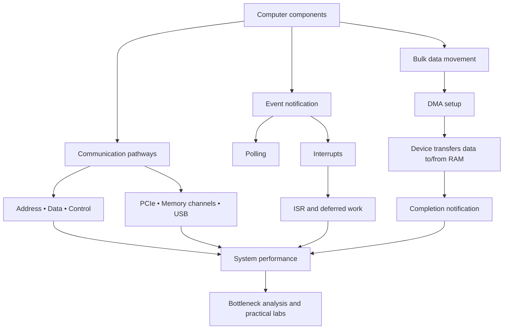
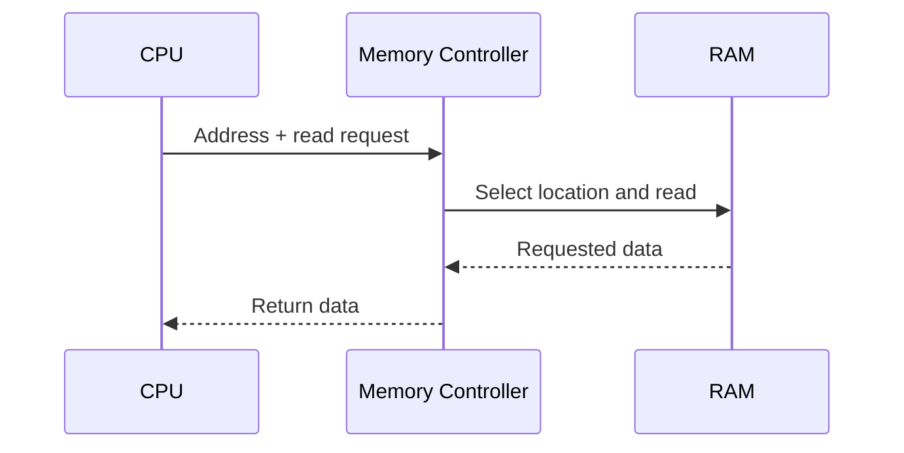
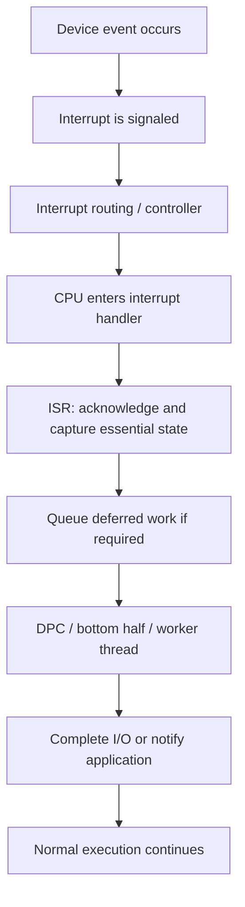
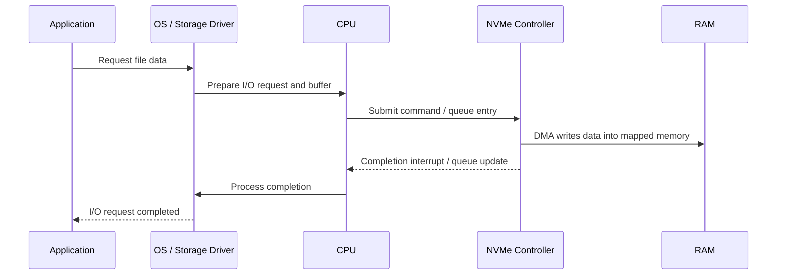
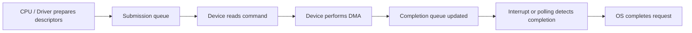
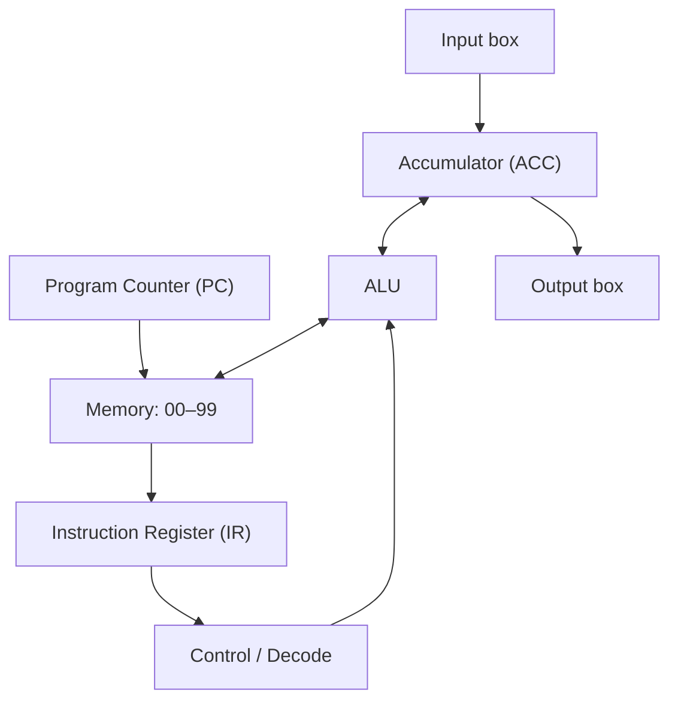
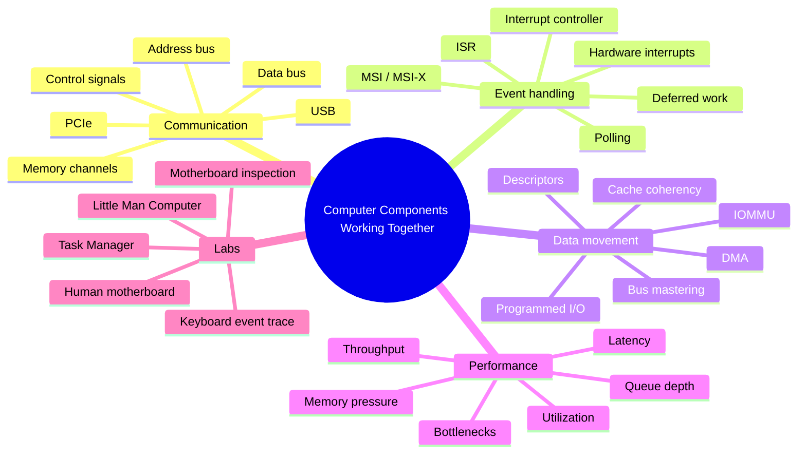

# ⚙️ MODULE 04 — HOW COMPUTER COMPONENTS WORK TOGETHER
### System Buses, Hardware Interrupts, Direct Memory Access (DMA), Performance Bottlenecks, and Hands-On CPU Labs

> **The big idea:** A computer is not a collection of independent parts. The CPU, memory, storage, graphics processor, network interface, and input devices cooperate through communication pathways and carefully coordinated events. Buses and interconnects move information, interrupts notify the processor that attention is needed, and DMA allows capable devices to transfer data to or from memory without requiring the CPU to copy every byte itself.


<small>Conceptual illustration of address, data, and control buses. This is a simplified teaching model; modern computers use more complex interconnects. Image: [Wikimedia Commons — Computer buses.svg](https://commons.wikimedia.org/wiki/File:Computer_buses.svg), public domain.</small>

---

## 🧭 Module Roadmap

| Module information | Details |
|---|---|
| Module | 04 — How Computer Components Work Together |
| Topics | Topic 7: Buses, interrupts, and DMA; Topic 8: Hardware activities and platform labs |
| Estimated study time | 3–4 hours, including the practical labs |
| Prerequisites | CPU fetch–decode–execute cycle, RAM, storage, operating systems, and basic computer architecture |
| Central question | How can components with very different speeds exchange data efficiently without forcing the CPU to manage every tiny operation? |

### 🎯 Learning Objectives

By the end of this module, you should be able to:

1. Explain the purpose of system buses and distinguish address, data, and control information.
2. Calculate the theoretical address space associated with an address width and explain why real systems have additional limits.
3. Distinguish a traditional shared system bus from modern point-to-point interconnects such as PCI Express.
4. Explain polling, hardware interrupts, interrupt service routines (ISRs), and deferred interrupt processing.
5. Describe how interrupt controllers and message-signaled interrupts help coordinate devices.
6. Explain the purpose and sequence of Direct Memory Access (DMA).
7. Distinguish programmed I/O from DMA-based transfers.
8. Explain DMA descriptors, bus mastering, IOMMUs, and memory coherency at an introductory level.
9. Trace data movement through a computer during common workloads.
10. Identify performance bottlenecks using evidence such as latency, throughput, utilization, memory pressure, and queue depth.
11. Use the Little Man Computer (LMC) model to trace instructions, registers, and memory.
12. Observe CPU and memory behavior with Task Manager or Activity Monitor.
13. Explain the difference between CPU activity, memory allocation, and persistent storage.

### 🗺️ Concept Map



---

# PART I — HOW COMPONENTS COMMUNICATE

# Topic 7 — System Buses, Interrupts, and DMA

## 1. The Speed Mismatch: Why Coordination Matters

Imagine typing on a keyboard while a modern CPU is running a demanding game.

- A person might press approximately **5 keys per second**—about one key every 200 milliseconds.
- A CPU core operating at **3.5 GHz** has a clock frequency of 3.5 billion cycles per second.
- During one 200-millisecond interval, a 3.5 GHz clock produces approximately **700 million clock cycles**.

This comparison illustrates the enormous speed difference between human input and processor activity.

However, one clock cycle is not necessarily one completed instruction. Modern CPUs may execute multiple instructions per cycle, stall while waiting for data, or run at a frequency different from the advertised maximum. The calculation is a comparison of clock cycles, not a claim about exact instruction throughput.

### The coordination problem

If the processor repeatedly asked a keyboard whether a key had been pressed, it could spend time checking a device that usually has nothing new to report. If the CPU had to copy every byte of a large storage transfer itself, it would also spend valuable execution time on work that a capable I/O device can perform more efficiently.

Computers solve these problems using three complementary ideas:

1. **Interconnects and buses** provide pathways for addresses, data, and control information.
2. **Interrupts** allow a device to notify the processor when attention is needed.
3. **Direct Memory Access (DMA)** allows a capable device or DMA engine to transfer blocks of data to or from memory with limited CPU involvement.


<small>A desktop motherboard contains sockets, memory slots, expansion connectors, storage connections, and supporting controllers. The physical layout helps illustrate why communication pathways are essential. Image: [Wikimedia Commons — Desktop Computer Motherboard](https://commons.wikimedia.org/wiki/File:Desktop_Computer_Motherboard.jpg).</small>

---

## 2. What Is a Bus?

A **bus** is a communication pathway used to transfer information between computer components. In introductory computer architecture, a bus is often described as a collection of signal lines that carry addresses, data, and control signals.

A traditional shared system bus can connect the processor, memory, and I/O controllers. The bus model is useful for learning how computer components communicate, even though modern computers use more complex structures.

### 2.1 The three classic bus categories

The traditional model separates bus communication into three logical categories:

- **Address bus:** identifies the location or device involved in a transaction.
- **Data bus:** carries the actual information being transferred.
- **Control bus:** carries commands, status, and coordination signals.


<small>Simplified single-system-bus architecture connecting the CPU, memory, and I/O. This historical model is useful for understanding the basic roles of communication pathways. Image: [Wikimedia Commons — Computer system bus.svg](https://commons.wikimedia.org/wiki/File:Computer_system_bus.svg), CC BY-SA 3.0.</small>

### 2.2 Address bus

The **address bus** carries the address of the memory location or I/O resource involved in an operation.

For example, the CPU might request data from a memory address such as:

```text
0x0040A000
```

The address tells the memory system where the requested data is located. It does not contain the data itself.

In a simplified byte-addressable system, an address width of \(n\) bits can represent:

\[
2^n \text{ unique addresses}
\]

Examples:

| Address width | Theoretical number of addresses | Theoretical byte-addressable space |
|---:|---:|---:|
| 8 bits | \(2^8 = 256\) | 256 bytes |
| 16 bits | \(2^{16} = 65,536\) | 64 KiB |
| 32 bits | \(2^{32}\) | 4 GiB |
| 64 bits | \(2^{64}\) | 16 EiB |

**Important qualification:** These are mathematical address-space sizes, not promises that a computer can install or use that amount of physical RAM. Actual systems have implementation limits, reserved address ranges, memory-controller limits, firmware constraints, and operating-system limits. A 64-bit CPU does not necessarily implement all 64 bits as usable physical-address bits.

### 2.3 Data bus

The **data bus** carries the values being transferred.

A read operation moves data from memory or a device toward the processor. A write operation moves data from the processor or another bus master toward memory or a device.

A wider data path can move more bits per transfer, but actual performance also depends on:
- transfer frequency;
- protocol overhead;
- number of channels or lanes;
- wait states and latency;
- memory-controller design;
- contention with other devices.

For example, a 64-bit-wide data path can transfer 8 bytes in one data transfer. A 128-bit-wide path can transfer 16 bytes in one transfer, assuming comparable signaling and one transfer event.

**DDR memory qualification:** DDR memory transfers data on both clock edges. Dual-channel operation increases available memory bandwidth by using multiple channels, but the exact organization depends on the platform and memory modules. DDR5 DIMMs, for example, use two independent 32-bit subchannels per standard non-ECC DIMM. It is therefore misleading to describe every DDR5 configuration simply as one universal “128-bit bus.”

### 2.4 Control bus

The **control bus** is a conceptual category for signals that coordinate a transfer or describe what operation should occur.

Examples of control information include:
- read or write requests;
- timing and synchronization;
- ready or wait status;
- bus request and grant;
- reset;
- interrupt signaling.

The control bus helps components coordinate their actions. It is not accurate to assume that every modern interrupt is literally a voltage pulse traveling on one shared control wire. Modern systems use dedicated interrupt controllers, routing logic, and—in PCIe systems—message-signaled interrupts.

### 2.5 Comparison table

| Bus category | Main question answered | Typical information |
|---|---|---|
| Address | **Where?** | Memory or I/O address |
| Data | **What?** | Instruction, byte, word, or data block |
| Control | **How / when?** | Read, write, ready, reset, interrupt, and timing-related signals |

### 2.6 Example: Reading a value from RAM

A simplified read transaction:

1. The CPU generates the address of the requested memory location.
2. The memory system receives the address.
3. Control logic identifies the operation as a read.
4. The memory system returns the requested data.
5. The CPU receives the data and continues execution.



This is a conceptual sequence. Real processors use caches, memory controllers, queues, and multiple outstanding transactions, so many memory accesses do not travel to DRAM in this simple one-at-a-time pattern.

---

## 3. Traditional Buses vs. Modern Interconnects

The three-bus model is valuable, but it is not a literal map of every wire in a modern computer.

Modern systems commonly use a combination of:
- dedicated memory channels between the CPU's memory controller and DRAM;
- high-speed point-to-point links;
- PCI Express (PCIe) lanes for expansion devices;
- USB for external peripherals;
- SATA or PCIe/NVMe paths for storage;
- internal on-chip networks and fabric interconnects.

### 3.1 What is PCI Express?

**PCI Express (PCIe)** is a high-speed serial interconnect used to connect devices such as graphics cards, NVMe storage, network adapters, and other expansion hardware.

PCIe uses point-to-point links built from one or more lanes. A link may be described as:
- x1;
- x2;
- x4;
- x8;
- x16.

A larger lane count generally provides more aggregate link bandwidth at a given PCIe generation, although the actual throughput depends on generation, encoding, protocol overhead, and device capabilities.


<small>Example of PCI/PCIe expansion connectors on a motherboard. Connector appearance and electrical capabilities differ between legacy PCI and PCI Express. Image: [Wikimedia Commons — PCI slots](https://commons.wikimedia.org/wiki/File:PCI_slots.jpg), CC BY-SA 2.0.</small>

### 3.2 Common communication pathways

| Interconnect / interface | Common purpose | Example device |
|---|---|---|
| Memory channel | CPU memory controller ↔ DRAM | System RAM |
| PCIe | High-speed internal expansion | GPU, NVMe SSD, network card |
| SATA | Storage connectivity | SATA SSD or HDD |
| NVMe | Storage protocol commonly carried over PCIe | NVMe SSD |
| USB | External peripheral connectivity | Keyboard, mouse, webcam, external drive |
| Ethernet | Wired networking | Ethernet NIC |
| Wi-Fi | Wireless networking | Wireless network adapter |

### 3.3 Why this distinction matters

A simplified diagram might show one shared system bus connecting every component. A modern PC is more accurately understood as a set of connected subsystems and interconnects.

For example:
- the CPU may communicate with DRAM through integrated memory controllers;
- a GPU may communicate with the CPU and system through PCIe;
- an NVMe SSD may use PCIe and perform bus-master DMA;
- USB devices communicate through host controllers and hubs.

The underlying principles of addressing, data movement, control, arbitration, and synchronization still apply.

---

# PART II — INTERRUPTS AND EVENT-DRIVEN HARDWARE

## 4. Polling: The CPU Keeps Asking

**Polling** occurs when software repeatedly checks a device or status register to determine whether an event has happened.

Imagine waiting for a delivery.

- You could walk to the front door every few seconds to see whether the package has arrived.
- Or you could continue working until the doorbell rings.

The first method resembles polling. The second resembles interrupt-driven notification.

### 4.1 How polling works

A simplified polling loop:

```text
repeat:
    read device status
    if data is available:
        read the data
        process it
```

Advantages:
- simple to understand and implement;
- useful when a device must be checked at predictable intervals;
- can be efficient for very short waits or carefully designed high-speed loops.

Disadvantages:
- repeated checks can consume CPU time;
- a device may be checked many times when no event is ready;
- a long polling interval can increase response latency;
- a short polling interval can create unnecessary overhead.

Polling is not always inefficient. High-performance systems sometimes use polling deliberately because it can reduce interrupt overhead and provide predictable latency under particular workloads.

---

## 5. Hardware Interrupts: The Device Signals an Event

A **hardware interrupt** is a notification that causes the processor to transfer control to an interrupt-handling path.

Instead of repeatedly asking a device whether something happened, the processor can perform other work or allow a thread to wait until an event occurs.

### 5.1 The doorbell analogy

| Polling | Interrupt-driven notification |
|---|---|
| Repeatedly checks whether an event occurred | Receives a notification when an event needs attention |
| Can waste CPU time on empty checks | Can reduce unnecessary checking |
| Response depends partly on polling interval | Response depends on interrupt delivery and handling latency |
| Can be useful for some high-performance or predictable loops | Common for event-driven device I/O |

### 5.2 Simplified interrupt-handling sequence

1. A device detects an event, such as received keyboard input or completed I/O.
2. The device signals an interrupt through the platform's interrupt mechanism.
3. The interrupt controller and processor determine how the event should be delivered.
4. The CPU enters the appropriate interrupt-handling path.
5. The kernel or device driver runs an **Interrupt Service Routine (ISR)** or equivalent handler.
6. The handler acknowledges or records the event and performs urgent work.
7. Additional processing may be deferred to a lower-priority routine or normal thread.
8. The interrupted execution can resume when the processor and scheduler are ready.



### 5.3 What is an ISR?

An **Interrupt Service Routine (ISR)** is a routine that handles an interrupt at an elevated or specially controlled execution level.

The ISR should generally be short. It may:
- identify or acknowledge the interrupt;
- read essential device status;
- preserve information that could otherwise be lost;
- schedule additional work;
- return control to the operating system.

A common misconception is that the ISR must complete every part of the device operation. In many operating systems, lengthy work is deferred.

### 5.4 Deferred processing: DPCs and bottom halves

On Windows, an ISR commonly schedules a **Deferred Procedure Call (DPC)** to perform additional interrupt-related work at a lower interrupt request level.

On Linux, interrupt handling can use mechanisms such as threaded interrupts, softirqs, tasklets in older or specific contexts, and workqueues. The terminology and details differ, but the design principle is similar:

**Do the urgent work quickly, then defer work that does not need to run in the immediate interrupt context.**

This helps prevent long-running interrupt handlers from reducing system responsiveness.

### 5.5 Why an ISR should be short

A long ISR can:
- delay other interrupt handling;
- increase latency for time-sensitive devices;
- interfere with scheduling;
- reduce overall system responsiveness.

The exact rules vary by OS and interrupt level. Windows driver guidance explicitly recommends keeping ISRs brief and deferring additional processing to DPCs where appropriate.

---

## 6. IRQ Lines, Interrupt Controllers, MSI, and MSI-X

### 6.1 What is an IRQ?

**IRQ** traditionally refers to an Interrupt Request: a signal or interrupt resource used to request processor attention.

Older PC architectures used fixed interrupt request lines. Modern systems use interrupt controllers and more flexible routing mechanisms.

### 6.2 What does an interrupt controller do?

An interrupt controller helps:
- receive interrupt requests;
- prioritize and route them;
- deliver an appropriate interrupt vector to a processor;
- support multiple processors and interrupt destinations;
- manage masking and acknowledgement.

On x86 systems, the Local APIC and I/O APIC are important parts of interrupt delivery. Other architectures use different interrupt-controller designs.

### 6.3 Message-Signaled Interrupts (MSI)

Modern PCI devices may use **Message-Signaled Interrupts (MSI)** rather than relying only on a physical interrupt pin.

An MSI is generated when the device performs a specially formatted write to an address that the platform recognizes as an interrupt message.

**MSI-X** extends this model and supports a larger number of independently configurable interrupt vectors. This is useful for devices with multiple queues, such as high-performance network and storage controllers.

### 6.4 Why multiple interrupt vectors are useful

A network adapter may have multiple receive/transmit queues. With multiple interrupt vectors, the device and operating system can distribute work more flexibly across CPU cores.

A storage controller may also use multiple queues and interrupt vectors to support parallel I/O.

### 6.5 Interrupts vs. exceptions

These terms should not be confused:

| Term | Meaning |
|---|---|
| Hardware interrupt | Asynchronous event signaled by hardware |
| Exception | Synchronous event associated with instruction execution, such as a page fault or divide error |
| Software interrupt / trap | A controlled software-generated transfer to a handler, depending on architecture |
| System call | A defined mechanism for an application to request a kernel service |

---

# PART III — DIRECT MEMORY ACCESS

## 7. Direct Memory Access (DMA): Moving Data Without CPU Byte-by-Byte Copying

**Direct Memory Access (DMA)** is a mechanism that allows a device or DMA engine to transfer data between a device and system memory without requiring the CPU to copy every byte through its general-purpose registers.

DMA is especially useful for large or frequent I/O transfers.


<small>Illustration of a DMA controller and data-transfer organization. The diagram is a conceptual hardware model; modern bus-mastering devices may implement DMA engines inside the device controller itself. Image: [Wikimedia Commons — Controleur DMA.svg](https://commons.wikimedia.org/wiki/File:Controleur_DMA.svg), CC0.</small>

### 7.1 Programmed I/O vs. DMA

**Programmed I/O (PIO)** is a broad term for I/O where the CPU actively performs the data movement by reading or writing device registers or data ports.

**DMA** allows a device or DMA engine to transfer a block of data to or from memory after the CPU has configured the operation.

| Feature | Programmed I/O | DMA |
|---|---|---|
| Who performs the data movement? | CPU executes the data-transfer instructions | Device or DMA engine moves the block |
| CPU involvement | Repeatedly involved in moving data | Sets up and manages the transfer; does not copy every byte |
| Best suited for | Small transfers, register access, simple devices | Larger or frequent data transfers |
| CPU availability during transfer | More CPU work is spent on the transfer | CPU can perform other work, subject to resource contention |
| Overhead | CPU instruction overhead can be high for large blocks | Setup, mapping, completion, and synchronization overhead still exist |

**Important:** Programmed I/O does not necessarily freeze the entire computer. The operating system can schedule other threads. The key distinction is that the CPU performs more of the data movement itself.

### 7.2 A simplified DMA example

Imagine reading a large video file from an NVMe SSD.

A simplified DMA-based path:

1. The application requests file data.
2. The operating system and storage driver prepare an I/O request.
3. The driver arranges suitable memory buffers and DMA mappings.
4. The CPU submits a command to the storage controller.
5. The NVMe controller transfers data over PCIe into system memory using bus mastering DMA.
6. The controller signals completion, often using an interrupt.
7. The OS completes the I/O request and makes the data available to the application.



### 7.3 Does the CPU do nothing during DMA?

No. DMA reduces the CPU's responsibility for copying each byte, but the CPU still participates in the overall operation.

The CPU or operating system may need to:
- prepare the request;
- allocate or select a buffer;
- create DMA mappings;
- configure descriptors or queues;
- submit the command;
- handle completion;
- process the data after transfer;
- perform synchronization or cache-management operations when required.

DMA also uses memory and interconnect bandwidth. Other devices and CPU cores may compete for those resources.

### 7.4 Bus mastering

A **bus-mastering device** can initiate transactions on an interconnect and transfer data to or from system memory, subject to platform permissions and configuration.

For example, an NVMe controller can initiate PCIe transactions to write incoming data into a memory buffer prepared by the operating system.

### 7.5 DMA descriptors and transfer queues

Many high-performance devices use descriptors to describe work.

A descriptor may contain:
- a memory address or DMA address;
- a transfer length;
- flags or command information;
- ownership or completion state.

Devices can process a queue of descriptors, allowing multiple I/O operations to be outstanding.



### 7.6 IOMMU: Protecting DMA access

An **Input-Output Memory Management Unit (IOMMU)** helps control how devices access system memory.

An IOMMU can:
- translate device-visible DMA addresses;
- restrict a device to approved memory regions;
- isolate devices from unrelated memory;
- support safe sharing and virtualization use cases.

Without appropriate protection, a misbehaving or compromised device with unrestricted DMA access could potentially access memory it should not use.

### 7.7 DMA and cache coherency

Modern CPUs use caches. Devices may access system memory through DMA while CPU cores also have cached copies of data.

The platform must ensure that CPU and device views of memory remain consistent.

Depending on the architecture and mapping type, the system may provide hardware-coherent DMA or require explicit synchronization operations.

The Linux DMA API distinguishes coherent and streaming mappings and provides rules for preparing memory for device access and CPU access.

**Key lesson:** DMA is not simply “copy data straight to RAM.” Correct DMA requires memory mapping, ownership rules, synchronization, and protection.

---

## 8. Worked Example: Estimating a DMA Transfer Time

Suppose a storage device transfers a 500 MB block at an ideal sustained rate of 3,000 MB/s.

\[
\text{Ideal transfer time} =
\frac{\text{Data size}}{\text{Transfer rate}}
\]

\[
\frac{500\text{ MB}}{3000\text{ MB/s}} \approx 0.167\text{ s}
\]

So the theoretical transfer time is approximately **167 milliseconds**.

This is an idealized calculation. Real performance can be lower because of:
- protocol overhead;
- storage performance variation;
- queueing;
- file-system work;
- memory bandwidth contention;
- thermal behavior;
- controller and driver overhead;
- the difference between sequential and random access.

DMA reduces CPU copying work, but it does not make the physical transfer instantaneous.

---

# PART IV — TRACING WORKLOADS AND FINDING BOTTLENECKS

## 9. What Is a Performance Bottleneck?

A **bottleneck** is a component or stage that limits the performance of a particular workload.

The bottleneck is not always the component with the highest advertised speed or the one showing the largest percentage in a monitoring tool. It is the resource that constrains the workload under the current conditions.

### 9.1 Three useful performance measures

| Measure | Meaning | Example |
|---|---|---|
| Latency | Time taken for one operation to complete | Time for a file read to return |
| Throughput | Amount of work completed per unit of time | MB/s transferred |
| Utilization | How busy a resource is over time | CPU utilization or GPU utilization |

Other useful indicators include:
- queue depth;
- average response time;
- memory pressure;
- page faults;
- cache misses;
- thermal throttling;
- network retransmissions;
- storage I/O wait.

### 9.2 Workload 1 — Launching a large game

A simplified path:


Potential bottlenecks:
- slow random reads from storage;
- CPU decompression or shader compilation;
- insufficient system RAM;
- insufficient GPU VRAM;
- GPU compute or memory bandwidth;
- thermal throttling.

A faster SSD may improve loading time, but it will not necessarily increase frame rate after the game is fully loaded.

### 9.3 Workload 2 — 4K video editing with many browser tabs

If the active working sets of the editor, browser, and operating system exceed available physical RAM, the system may need to reclaim memory and move pages between RAM and storage.

If memory pressure becomes severe, the system may repeatedly move pages in and out. This can cause **thrashing**, where the computer spends excessive time managing memory rather than making useful progress.

Potential bottlenecks:
- insufficient RAM capacity;
- storage latency during paging;
- CPU effects and encoding;
- GPU acceleration and VRAM capacity;
- media codec and file-format constraints.

Not every page fault causes disk access. Many page faults are resolved from memory, and operating systems use sophisticated memory-management policies.

### 9.4 Workload 3 — Training a neural network or rendering a complex 3D scene

A simplified path:

1. Training data or scene assets are loaded from storage.
2. Data is prepared in system memory.
3. Data is transferred to GPU memory as required.
4. The GPU executes compute or rendering workloads.
5. Results may be copied back or used for subsequent operations.

Potential bottlenecks:
- GPU compute capacity;
- GPU memory capacity and bandwidth;
- PCIe transfer bandwidth;
- CPU data preparation;
- storage throughput;
- cooling and power limits.

### 9.5 Workload comparison

| Workload | Important components | Possible bottleneck |
|---|---|---|
| Launching a large game | SSD, RAM, CPU, GPU | Storage reads, decompression, shader compilation |
| 4K editing + many browser tabs | RAM, SSD, CPU, GPU | Memory pressure, paging, encoding |
| Neural-network training | CPU, RAM, PCIe, GPU, VRAM | GPU compute, VRAM capacity/bandwidth, data pipeline |
| Copying a large file over a network | Storage, NIC, network, CPU | Network link, storage write speed, protocol overhead |
| Typing in a text editor | Keyboard, input stack, CPU, RAM, display | Usually no meaningful hardware bottleneck |

### 9.6 A systematic bottleneck investigation

Use this sequence rather than guessing:

1. **Define the symptom:** Is the system slow to start, slow to load, laggy while editing, or slow to transfer data?
2. **Measure the workload:** Record latency, throughput, and utilization.
3. **Identify the active path:** Determine which devices and software layers are involved.
4. **Look for saturation:** Check whether a resource is consistently near its practical limit.
5. **Check secondary evidence:** Review memory pressure, queue depth, thermal behavior, and error logs.
6. **Change one factor at a time:** Compare before-and-after results.
7. **Avoid assumptions:** High CPU utilization does not automatically mean the CPU is the only bottleneck.

---

# PART V — HANDS-ON HARDWARE PLATFORM LABS

## 10. Lab 8.1 — Inside the CPU with the Little Man Computer (LMC)

The **Little Man Computer (LMC)** is a simplified educational model of a computer based on the Von Neumann architecture. It is useful for understanding how instructions, registers, memory, and input/output work together.

**Open the interactive simulator:** [Peter Higginson's Little Man Computer](https://peterhigginson.co.uk/LMC/). It provides a browser-based environment for assembling, running, and stepping through LMC programs.

### 10.1 Main LMC components

The LMC model uses:

- **100 memory mailboxes:** addresses `00` through `99`;
- **Program Counter (PC):** stores the address of the next instruction;
- **Instruction Register (IR):** holds the instruction currently being processed;
- **Accumulator (ACC):** stores values used by arithmetic and logic operations;
- **Arithmetic Logic Unit (ALU):** performs arithmetic operations;
- **Input box:** supplies values to the program;
- **Output box:** displays values produced by the program.



### 10.2 LMC instruction set used in this lab

| Mnemonic | Machine code | Meaning |
|---|---:|---|
| `INP` | `901` | Read input into the accumulator |
| `OUT` | `902` | Send accumulator value to output |
| `HLT` | `000` | Stop execution |
| `ADD XX` | `1XX` | Add the value in mailbox `XX` to ACC |
| `SUB XX` | `2XX` | Subtract the value in mailbox `XX` from ACC |
| `STA XX` | `3XX` | Store ACC in mailbox `XX` |
| `LDA XX` | `5XX` | Load mailbox `XX` into ACC |
| `BRA XX` | `6XX` | Branch unconditionally to address `XX` |
| `BRZ XX` | `7XX` | Branch if ACC is zero |
| `BRP XX` | `8XX` | Branch if ACC is positive or zero |

### 10.3 Experiment 1 — Add 14 and 28

Enter this program into the simulator:

```text
INP
STA 99
INP
ADD 99
OUT
HLT
```

Provide the inputs:

```text
14
28
```

Expected result:

\[
14 + 28 = 42
\]

### 10.4 Step-by-step execution trace

| Step | PC before fetch | Instruction | Operation | ACC after | Mailbox 99 | Output |
|---:|---:|---|---|---:|---:|---:|
| 1 | `00` | `901` — INP | Read 14 | 014 | 000 | — |
| 2 | `01` | `399` — STA 99 | Store 14 in mailbox 99 | 014 | 014 | — |
| 3 | `02` | `901` — INP | Read 28; ACC is overwritten | 028 | 014 | — |
| 4 | `03` | `199` — ADD 99 | Add 14 to 28 | 042 | 014 | — |
| 5 | `04` | `902` — OUT | Display ACC | 042 | 014 | **42** |
| 6 | `05` | `000` — HLT | Stop execution | 042 | 014 | **42** |

### 10.5 Why is `STA 99` necessary?

The accumulator is a working register. In this example, the second `INP` replaces the first input in ACC.

If the first value were not stored in memory, it would be lost when the second input arrived.

This demonstrates a fundamental relationship:

- registers provide very fast temporary storage;
- RAM holds values that must remain available beyond the current register operation;
- instructions move data between registers and memory.

### 10.6 Experiment 2 — Compute `(A + B) − C`

Try this program:

```text
INP
STA 99
INP
ADD 99
STA 99
INP
STA 98
LDA 99
SUB 98
OUT
HLT
```

Use inputs:

```text
14
28
10
```

Expected result:

\[
(14 + 28) - 10 = 32
\]

The program stores the running sum in mailbox `99`, stores the third input in mailbox `98`, reloads the sum, subtracts the third value, and outputs the result.

---

## 11. Lab 8.2 — The Human Motherboard Role-Play

This classroom activity demonstrates volatile memory, persistent storage, and the roles of different computer components.

### Materials

- sticky notes;
- index cards;
- a folder;
- a table or open floor space.

### Assign four roles

| Role | Human representation | Responsibility |
|---|---|---|
| User / OS | Person coordinating the activity | Requests work and decides when to save |
| CPU | Person following instruction cards | Performs the current operation |
| RAM | Person holding sticky notes | Stores temporary working information |
| SSD | Folder holding index cards | Preserves saved information |

### Activity A — Unsaved work

1. The CPU receives a task from the User/OS.
2. The RAM participant holds sticky notes representing new document content.
3. The instructor calls **“POWER OUTAGE!”** before the User/OS requests Save.
4. The RAM participant drops the sticky notes.
5. Discuss why unsaved changes may be lost.

### Activity B — Saved work

1. Repeat the activity.
2. This time, the User/OS requests Save.
3. The CPU copies the information to an index card.
4. The SSD participant places the card in the folder.
5. The instructor calls **“POWER OUTAGE!”**
6. The RAM participant drops the sticky notes, but the SSD folder retains the saved card.

### Discussion questions

- Why is RAM described as volatile memory?
- Why does a saved file survive after an application closes?
- Does pressing Save always guarantee that every byte has already reached persistent media?
- Why are backups still important?

---

## 12. Lab 8.3 — Live Task Manager / Activity Monitor Experiment

This experiment connects CPU utilization and memory allocation to real applications.

### Windows procedure

1. Press `Ctrl + Shift + Esc` to open Task Manager.
2. Select the **Processes** tab.
3. Observe the CPU and Memory columns.
4. Launch a browser or word processor.
5. Watch CPU utilization during application startup.
6. Leave the application open without interacting with it.
7. Observe CPU activity and memory usage.
8. Open several additional tabs and observe how memory use changes.
9. Close the application and watch resource usage change.

### macOS procedure

1. Open **Activity Monitor** from Applications → Utilities.
2. Select the CPU tab.
3. Launch an application and observe CPU activity.
4. Select the Memory tab and observe memory use.
5. Close the application and compare the readings.

### What should you observe?

- CPU utilization often rises during application startup because the processor executes initialization and loading work.
- CPU utilization may fall when an application is idle or waiting for user input.
- Memory can remain allocated while the application is open, even when CPU usage is low.
- A browser with many tabs may use substantially more memory than a single idle tab.
- Closing a window does not always end every related background process.

**Interpretation note:** Do not expect a fixed CPU value such as 1–3%. Utilization depends on the application, operating system, background activity, CPU core count, power state, and measurement interval.

### Observation worksheet

| Activity | CPU observation | Memory observation | Interpretation |
|---|---|---|---|
| Desktop idle | | | |
| Launch browser | | | |
| Open several tabs | | | |
| Play a video | | | |
| Close browser | | | |

---

## 13. Lab 8.4 — Identify Expansion and Storage Pathways

Use a desktop motherboard photograph or a physical computer (with power disconnected and appropriate supervision) to identify:

- CPU socket;
- DIMM memory slots;
- PCIe expansion slots;
- storage connectors;
- chipset or platform controller;
- rear I/O connectors.


### Questions

1. Which slot would typically be used for a discrete graphics card?
2. Why might an NVMe SSD use a PCIe connection?
3. How is a SATA SSD different from an NVMe SSD in terms of interface and protocol?
4. Why do devices need controllers and drivers?
5. Why is it inaccurate to imagine every component sharing one physical bus?

---

## 14. Lab 8.5 — Trace a Keyboard Input Event

Trace the path of a key press from the physical keyboard to an application.


### Questions

1. Does the keyboard directly write text into the application's RAM?
2. What role does the operating system play?
3. Why can the CPU perform other work while the user is not typing?
4. What might happen if the input device or its driver stops responding?

---

# PART VI — INTERACTIVE LEARNING ACTIVITIES

## 15. Interactive Activity A — Explore the Three Bus Categories

Select a bus category in the interactive HTML version to see what it carries and how it is used.

- Address: identifies where data should be read or written.
- Data: carries the actual values.
- Control: coordinates the operation and its timing.

## 16. Interactive Activity B — Polling vs. Interrupts

Adjust the polling interval and compare the number of checks with a keyboard event rate.

For example, at a 1 ms polling interval:

\[
\frac{1000\text{ ms}}{1\text{ ms}} = 1000 \text{ checks per second}
\]

If a person generates 5 key events per second, most of those checks will find no new key event.

This is an illustrative model, not a measurement of a real operating system's keyboard driver.

## 17. Interactive Activity C — DMA Transfer Estimator

Change the data size and assumed transfer rate to calculate an ideal transfer time.

\[
t = \frac{D}{R}
\]

Where:
- \(t\) = ideal transfer time;
- \(D\) = data size;
- \(R\) = transfer rate.

Remember that real transfer time includes overhead and resource contention.

## 18. Interactive Activity D — LMC CPU Simulator

The interactive HTML companion includes a simplified 100-mailbox LMC simulator. It allows you to:

- assemble a short LMC program;
- supply input values;
- execute one instruction at a time;
- observe PC, IR, and ACC;
- inspect memory mailboxes;
- view output;
- reset the CPU and repeat the experiment.

The companion also links to Peter Higginson's full browser-based LMC simulator.

---

# PART VII — REVIEW AND ASSESSMENT

## 19. Knowledge Check

1. What is the main purpose of an address bus?
2. What is the difference between address information and data information?
3. Why is the three-bus model a simplification of modern computer architecture?
4. What is polling?
5. What is a hardware interrupt?
6. Why should an ISR generally be short?
7. What is deferred interrupt processing?
8. What is the difference between a traditional IRQ line and an MSI?
9. What does DMA allow a device to do?
10. Why does DMA still require CPU and operating-system involvement?
11. What is a DMA descriptor?
12. What problem does an IOMMU help address?
13. What is memory coherency?
14. What is the difference between latency and throughput?
15. Why might adding more RAM improve performance when many applications are open?
16. What is a process bottleneck?
17. What is the purpose of the LMC Program Counter?
18. Why does the LMC addition program store the first input in mailbox 99?
19. Why can CPU utilization fall while an application remains open?
20. Why is a high CPU percentage not automatically proof that the CPU is the only bottleneck?

## 20. Scenario-Based Exercises

### Exercise A — The keyboard polling problem

A program checks a keyboard status register 2,000 times per second. A user presses approximately 5 keys per second.

**Questions:**
- Approximately how many status checks occur between key presses?
- Why might interrupt-driven input be more efficient?
- Is polling always wrong?

**Suggested reasoning:** At 2,000 checks per second and 5 key events per second, there are approximately 400 checks per key event on average. Interrupt-driven notification can avoid many empty checks. Polling can still be useful in specialized high-performance or timing-sensitive designs.

### Exercise B — A large storage transfer

A storage controller transfers 1,200 MB of data at an ideal rate of 4,000 MB/s.

Calculate the ideal transfer time.

\[
\frac{1200}{4000} = 0.3 \text{ seconds}
\]

**Answer:** Approximately 300 milliseconds, before overhead.

### Exercise C — CPU is low, but the computer is slow

A video editor reports low CPU utilization, but timeline playback stutters.

Possible causes include:
- insufficient GPU performance;
- storage read latency;
- insufficient RAM or VRAM;
- codec or media-decoding limitations;
- thermal or power constraints;
- an external device or network dependency.

**Task:** Identify which metrics you would inspect before replacing the CPU.

### Exercise D — High memory use, low CPU use

A browser is open with many tabs. Memory use is high, but CPU use is low.

**Question:** Does this mean the browser is not using resources?

**Answer:** No. Memory is a resource allocation measure, while CPU utilization reflects processor activity over a measurement interval. An idle application can retain memory while doing little computation.

### Exercise E — DMA and security

A device is configured for DMA but should only access one specific memory buffer.

**Question:** What hardware mechanism can help restrict its memory access?

**Answer:** An IOMMU can translate and constrain device-visible DMA addresses, helping isolate device access to approved memory regions.

### Exercise F — LMC memory reasoning

Why does the program use `STA 99` before reading the second input?

**Answer:** Because the second `INP` replaces the accumulator value. Storing the first input in memory preserves it so that the ALU can use it later.

---

## 21. Practical Troubleshooting Checklist

| Symptom | What to investigate |
|---|---|
| Keyboard input is delayed | Input device, USB/wireless link, driver, system load, application event loop |
| Large file copy is slow | Source/destination storage, interface, file size pattern, cache, CPU, network if remote |
| CPU is busy during I/O | Driver path, programmed I/O behavior, data processing, compression, interrupt/DPC activity |
| Storage transfer is slow despite a fast SSD | Queue depth, workload pattern, thermal throttling, PCIe link, storage controller, file-system overhead |
| Network transfer is slow | NIC speed, Wi-Fi signal, router, link utilization, protocol overhead, remote server |
| System becomes unresponsive under memory pressure | Working-set size, paging activity, available RAM, application behavior |
| Audio or input glitches under heavy load | DPC/ISR latency, driver behavior, scheduling, device contention |

Do not diagnose hardware failure from a single utilization number. Collect evidence across the active data path.

---

## 22. Final Summary

| Concept | Key point |
|---|---|
| Bus | Communication pathway between components |
| Address bus | Identifies the memory or I/O location |
| Data bus | Carries the actual information |
| Control bus | Carries commands and coordination signals |
| Address width | Determines a theoretical number of addressable locations |
| Data width | Affects how many bits can be transferred per data transfer |
| PCIe | High-speed serial point-to-point interconnect |
| Polling | Repeatedly checking device status |
| Interrupt | Notification that an event requires attention |
| IRQ | Traditional interrupt request terminology |
| Interrupt controller | Routes and prioritizes interrupts |
| ISR | Interrupt Service Routine |
| DPC | Windows deferred processing mechanism |
| MSI | Message-Signaled Interrupt |
| MSI-X | Extended message-signaled interrupt capability |
| DMA | Device- or engine-driven data transfer to/from memory |
| PIO | CPU-managed programmed I/O |
| Bus mastering | Device capability to initiate bus transactions |
| DMA descriptor | Structure describing a transfer or device operation |
| IOMMU | Controls and translates device memory access |
| Cache coherency | Consistency between CPU caches and memory/device views |
| Latency | Time taken for an operation |
| Throughput | Work completed per unit of time |
| Utilization | How busy a resource is |
| Bottleneck | Resource limiting a workload |
| LMC | Simplified Von Neumann computer model |
| PC | Program Counter |
| IR | Instruction Register |
| ACC | Accumulator |
| ALU | Arithmetic Logic Unit |

### 🧠 Final Concept Map



---

## 23. Glossary

| Term | Definition |
|---|---|
| Address bus | Communication pathway carrying an address |
| ALU | Arithmetic Logic Unit; performs arithmetic and logical operations |
| APIC | Advanced Programmable Interrupt Controller |
| Bus | Pathway for communication between components |
| Bus mastering | Ability of a device to initiate transactions on an interconnect |
| Cache coherency | Mechanism that keeps relevant views of memory consistent |
| Control bus | Conceptual category for control and coordination signals |
| Data bus | Pathway carrying data values |
| DMA | Direct Memory Access |
| DMA descriptor | Data structure describing a device transfer or operation |
| DPC | Deferred Procedure Call in Windows |
| IOMMU | Input-Output Memory Management Unit |
| Interrupt | Notification that causes the processor to handle an event |
| IRQ | Interrupt Request |
| ISR | Interrupt Service Routine |
| LMC | Little Man Computer |
| Latency | Time required for an operation to complete |
| MSI | Message-Signaled Interrupt |
| MSI-X | Extended Message-Signaled Interrupt capability |
| PCIe | PCI Express |
| PIO | Programmed Input/Output |
| Polling | Repeatedly checking a device's status |
| Program Counter | Register holding the next instruction address |
| Throughput | Amount of data or work completed per unit of time |
| Utilization | Fraction of time a resource is busy |
| Working set | Pages of a process currently resident in physical memory |

---

## 24. References and Further Reading

### Technical references

1. PCI-SIG. [PCI Express Base Specification Overview](https://pcisig.com/specification-overview/pci-express-base). PCI Express architecture, interconnect attributes, and programming interface.
2. Linux Kernel Documentation. [Dynamic DMA Mapping Guide](https://kernel.org/doc/html/next/core-api/dma-api-howto.html). DMA mapping, coherent memory, and streaming mappings.
3. Microsoft Learn. [Introduction to Interrupt Service Routines](https://learn.microsoft.com/en-us/windows-hardware/drivers/kernel/introduction-to-interrupt-service-routines). ISR concepts and message-signaled interrupts.
4. Microsoft Learn. [Servicing an Interrupt](https://learn.microsoft.com/en-us/windows-hardware/drivers/wdf/servicing-an-interrupt). ISR, DPC, and deferred interrupt processing.
5. Microsoft Learn. [Introduction to DPC Objects](https://learn.microsoft.com/en-us/windows-hardware/drivers/kernel/introduction-to-dpc-objects). Deferred Procedure Calls.
6. Linux Kernel Documentation. [The MSI Driver Guide HOWTO](https://www.kernel.org/doc/html/latest/PCI/msi-howto.html). MSI and MSI-X concepts and usage.
7. Intel. [Intel 64 and IA-32 Architectures Software Developer Manuals](https://www.intel.com/content/www/us/en/developer/articles/technical/intel-sdm.html). Processor architecture, system programming, and interrupt handling.
8. Peter Higginson. [Little Man Computer Simulator](https://peterhigginson.co.uk/LMC/). Interactive LMC environment.
9. Wellingborough School. [Little Man Computer Simulator and Instruction Set](https://wellingborough.github.io/LMC/LMC0.3.html). LMC architecture and instructions.
10. Linux Kernel Documentation. [How to Write Linux PCI Drivers](https://docs.kernel.org/PCI/pci.html). PCI device and interrupt handling concepts.

### Image credits

| Illustration | Source and licensing information |
|---|---|
| Computer buses | [Wikimedia Commons — Computer buses.svg](https://commons.wikimedia.org/wiki/File:Computer_buses.svg), public domain |
| Computer system bus | [Wikimedia Commons — Computer system bus.svg](https://commons.wikimedia.org/wiki/File:Computer_system_bus.svg), CC BY-SA 3.0 |
| Desktop motherboard | [Wikimedia Commons — Desktop Computer Motherboard.jpg](https://commons.wikimedia.org/wiki/File:Desktop_Computer_Motherboard.jpg), CC BY-SA (see source page for the exact terms) |
| PCI expansion slots | [Wikimedia Commons — PCI slots.jpg](https://commons.wikimedia.org/wiki/File:PCI_slots.jpg), CC BY-SA 2.0 |
| DMA controller | [Wikimedia Commons — Controleur DMA.svg](https://commons.wikimedia.org/wiki/File:Controleur_DMA.svg), CC0 |
| LMC simulator | [Peter Higginson — Little Man Computer](https://peterhigginson.co.uk/LMC/) |

> **Final thought:** A computer performs well not simply because it has a fast CPU, but because its components communicate efficiently. Buses and interconnects move information, interrupts coordinate events, and DMA reduces the processor's role in bulk data movement. Understanding these mechanisms makes it easier to explain real-world performance, identify bottlenecks, and reason about how hardware and software cooperate.
