# 🌐 MODULE 05 — NETWORK FUNDAMENTALS, DEVICES & CORE PROTOCOLS
### Packets and Frames, Bandwidth and Latency, Network Scopes, Switches and Routers, Transmission Media, IP and MAC Addressing, DHCP, ARP, DNS, TCP, UDP, and HTTPS/TLS

> **The central idea:** A network allows independent devices to exchange information through shared rules, addressing systems, communication media, and forwarding devices. Understanding how packets travel—and how each network component contributes—makes it easier to diagnose connectivity problems and explain what happens when you open a website, print a document, or join a video call.


<small>Network topology examples, including star, mesh, bus, ring, and tree. Source: [Wikimedia Commons — Nettopoc.png](https://commons.wikimedia.org/wiki/File:Nettopoc.png).</small>

---

## 🧭 Module Roadmap

| Module information | Details |
|---|---|
| Module | 05 — Network Fundamentals, Devices & Core Protocols |
| Topics | Topic 9: Network fundamentals and types; Topic 10: Network devices and transmission media; Topic 11: Network addresses and protocols |
| Estimated study time | 3–4 hours, including interactive activities |
| Prerequisites | Basic computer architecture, operating-system concepts, binary numbers, and data representation |
| Central question | How does information move from one device to another, and how do networks know where to send it? |

### 🎯 Learning Objectives

By the end of this module, you should be able to:

1. Explain why a Local Area Network (LAN) can continue to support local communication when the external Internet connection is unavailable.
2. Distinguish packets from frames and describe the basic process of network encapsulation.
3. Explain packet switching and why large messages are divided into smaller units.
4. Distinguish bandwidth, latency, round-trip time, and throughput.
5. Compare PAN, LAN/WLAN, MAN, and WAN by scale and example.
6. Recognize star, mesh, bus, ring, and tree network topologies.
7. Compare client–server and peer-to-peer (P2P) network models.
8. Explain the roles of a NIC, wireless access point, Ethernet switch, and router.
9. Distinguish copper Ethernet, fiber-optic cable, and Wi-Fi radio as transmission media.
10. Explain the difference between domain names, IP addresses, and MAC addresses.
11. Identify IPv4, IPv6, private IPv4 ranges, subnet masks, and the default gateway.
12. Trace the DHCP DORA sequence and explain the purpose of ARP and DNS.
13. Compare TCP and UDP at an introductory level.
14. Explain how HTTPS uses TLS to protect web communication.
15. Trace a local printing request and a web-browsing request through the relevant network components.

### 🗺️ Concept Map

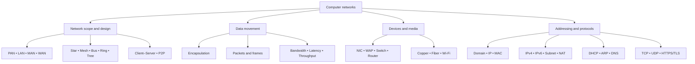

---

# PART I — NETWORK FUNDAMENTALS

# Topic 9 — Network Fundamentals and Types

## 1. The LAN Is Not the Internet

Imagine a thunderstorm damages the Internet Service Provider's (ISP's) fiber connection outside an office building. External websites such as `google.com` and `youtube.com` become unavailable.

A colleague assumes that all networking has stopped. However, a document can still be sent to a nearby Wi-Fi printer.

Why?

Because the **Local Area Network (LAN)** and the **Internet** are not the same thing.

A LAN connects devices within a limited local area, such as a home, classroom, or office. Local traffic can travel through the local wireless access point and Ethernet switch without needing to leave the building or reach the ISP.


<small>A consumer wireless gateway commonly combines wireless access, Ethernet switching, and routing functions in one enclosure. Source: [Wikimedia Commons — Netgear Nighthawk AC1900 WiFi Router](https://commons.wikimedia.org/wiki/File:Netgear-Nighthawk-AC1900-WiFi-Router.jpg).</small>

### 1.1 Local communication versus Internet communication

**Local communication:**

```text
Laptop ── Wi-Fi ── Access Point / Switch ── Printer
```

**External Internet communication:**

```text
Laptop ── Wi-Fi ── Access Point / Switch ── Router ── ISP ── Internet
```

The first path can remain available when the ISP connection fails. The second path requires the external connection.

### 1.2 What the example teaches

- A network can continue to function locally even if its Internet connection is unavailable.
- A Wi-Fi access point provides wireless connectivity to the local network.
- A switch forwards local Ethernet frames.
- A router forwards packets between different IP networks.
- The Internet is a global network of interconnected networks, not the same thing as one household or office LAN.

---

## 2. Why Networks Use Packets and Frames

Why does a computer not send a 100 MB video as one enormous, uninterrupted transmission?

A shared network must support communication from multiple devices. Dividing data into smaller units makes it possible to share network capacity and manage transmission more flexibly.

### 2.1 Packet switching

**Packet switching** is a method of communication in which data is divided into smaller units and transmitted across a network.

The source material highlights three reasons for this approach:

1. **Line sharing:** Smaller transmissions allow multiple users and applications to share network links instead of one enormous transfer occupying the medium for an extended period.
2. **Error recovery:** Smaller units make it possible for higher-level protocols to recover from missing or corrupted data without restarting an entire large-file transfer.
3. **Flexible forwarding:** Packets can be forwarded through network devices, and different packets may experience different paths or delays.

The source uses approximately 1,500 bytes as an illustrative packet size. This is a teaching approximation, not a universal size for every packet or frame.

### 2.2 Packet versus frame

The terms *packet* and *frame* refer to different layers of network communication.

| Unit | Layer / context | Main role |
|---|---|---|
| Application data | Application layer | The information an application wants to send |
| TCP segment / UDP datagram | Transport layer | Carries transport information and application data |
| IP packet | Network layer | Carries source and destination IP information |
| Ethernet / Wi-Fi frame | Link layer | Carries local-link delivery information |

A common introductory description is:

- **Packet:** the Layer 3 network unit, such as an IP packet.
- **Frame:** the Layer 2 link unit, such as an Ethernet or Wi-Fi frame.


<small>Encapsulation example showing application data, a transport header, an IP header, and a link-layer frame header. Source: [Wikimedia Commons — UDP encapsulation.svg](https://commons.wikimedia.org/wiki/File:UDP_encapsulation.svg).</small>

### 2.3 Encapsulation: Wrapping data as it travels down the network stack

When an application sends data, each networking layer adds information needed by the next stage of delivery.

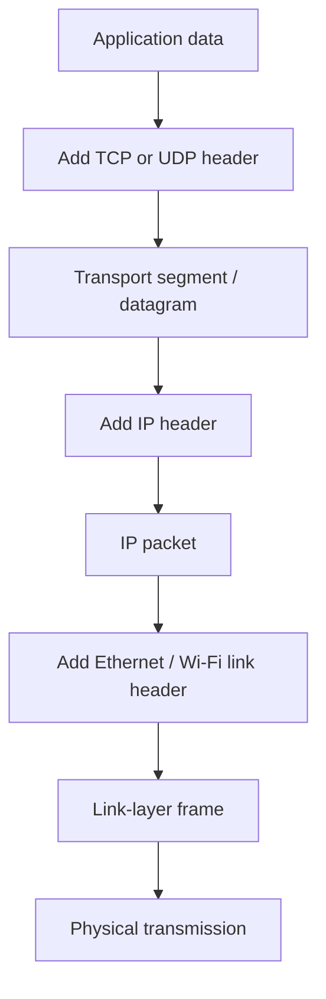

The receiver processes the information in the reverse direction. This is often called **decapsulation**.

### 2.4 Example: Sending a file

Suppose a user sends a file to another computer.

1. The application provides the file data to the operating system.
2. The transport layer prepares the data using TCP or UDP, depending on the application.
3. The network layer adds IP addressing information.
4. The link layer prepares a frame for the next local network hop.
5. The physical medium carries the encoded signals.
6. The receiving system processes the frame, packet, transport information, and application data.

### 2.5 Why packets may arrive out of order

Packets may experience different delays as they travel through a network. One packet may encounter a busy router or a slower path, while another may arrive sooner.

For TCP communication, sequence information allows the receiving TCP implementation to place received data into the correct order and recover missing data when necessary.

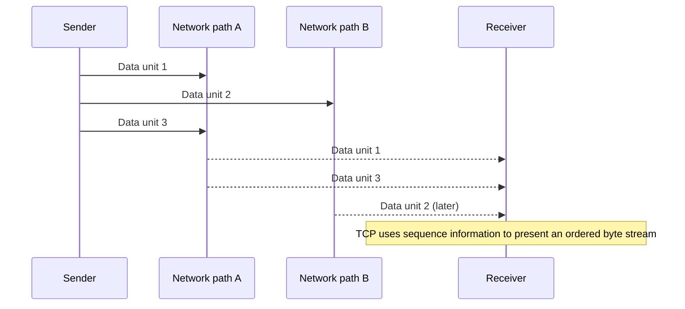

**Important distinction:** IP itself does not promise that every lost packet will be retransmitted. TCP provides reliability and ordered delivery for its byte stream. UDP does not provide the same transport-level recovery service by default.

---

## 3. Bandwidth vs. Latency vs. Throughput

These three terms describe different aspects of network performance. They should not be treated as interchangeable.

### 3.1 Bandwidth — how much data a link can carry

**Bandwidth** describes the capacity of a network connection, commonly expressed in bits per second.

Examples:
- Mbps = megabits per second;
- Gbps = gigabits per second.

The highway analogy is useful: bandwidth is like the number of lanes available for traffic.

A connection with greater bandwidth can potentially carry more data per second.

### 3.2 Latency — how long communication takes

**Latency** describes delay in communication. It is commonly measured in milliseconds (ms).

A useful network measurement is **Round-Trip Time (RTT)**, often called ping: the time for a test message to travel to a destination and for a response to return.

The highway analogy is travel time from City A to City B and back.

The source gives the following illustrative comparison:

- A geostationary satellite connection may offer high bandwidth, such as 100 Mbps, while having high latency because the signal travels a long distance to and from the satellite.
- Fiber-optic links can offer high bandwidth and comparatively low latency.

The source's example cites approximately 35,786 km for geostationary orbital altitude and around 600 ms as a satellite-latency illustration. Actual latency depends on the complete route, network equipment, and service design.

### 3.3 Throughput — what is actually delivered

**Throughput** is the real-world amount of data successfully delivered per unit of time.

Actual throughput may be lower than a link's advertised bandwidth because of:
- protocol headers and other overhead;
- retransmissions;
- congestion;
- device performance;
- firewall and security processing;
- limitations elsewhere along the end-to-end path.

### 3.4 Comparison

| Measure | Meaning | Common unit | Example question |
|---|---|---|---|
| Bandwidth | Link capacity | Mbps / Gbps | How much data could this link carry per second? |
| Latency | Communication delay | ms | How long does a response take? |
| RTT / Ping | Round-trip delay | ms | How long does a test message and reply take? |
| Throughput | Actual delivery rate | Mbps / Gbps | How quickly is the file really arriving? |

### 3.5 Why the distinction matters

| Activity | Bandwidth importance | Latency importance |
|---|---|---|
| Downloading a large file | High | Usually less important after the transfer begins |
| Competitive online gaming | Moderate to high | Very high |
| Video conferencing | Sustained bandwidth matters | Low and stable latency is important |
| Loading a simple web page | Depends on page size and resources | Delay can be noticeable |
| Cloud backup | High sustained throughput | Usually less sensitive to small delays |

### 3.6 Worked calculation — ideal download time

Suppose a file is 100 MB and the connection rate is 100 Mbps.

Convert megabytes to megabits:

\[
100\text{ MB} \times 8 = 800\text{ Mb}
\]

Estimate the ideal transfer time:

\[
t = \frac{800\text{ Mb}}{100\text{ Mb/s}} = 8\text{ seconds}
\]

This is an ideal estimate. Real transfer time is affected by protocol overhead, congestion, retransmissions, server capacity, and other conditions.

---

## 4. Network Scope: PAN, LAN, MAN, and WAN

Networks are often classified according to the geographic area they cover.

| Network scope | Typical distance in the source | Examples |
|---|---:|---|
| **PAN — Personal Area Network** | 1–10 metres | Bluetooth earbuds, smartwatch, wireless mouse |
| **LAN / WLAN — Local / Wireless Local Area Network** | 10–300 metres | Home, classroom, or office computers and printers |
| **MAN — Metropolitan Area Network** | 1–50 km | University campus buildings or city hospitals linked by fiber |
| **WAN — Wide Area Network** | 100–20,000 km | Networks connecting distant offices and the global Internet |

### 4.1 PAN

A Personal Area Network connects devices around an individual.

Example: a phone connected to wireless earbuds and a smartwatch.

### 4.2 LAN and WLAN

A Local Area Network connects devices in a limited area such as a home, office, or classroom.

A WLAN is a wireless LAN that uses Wi-Fi radio communication.

### 4.3 MAN

A Metropolitan Area Network connects sites across a campus, city, or metropolitan region.

### 4.4 WAN

A Wide Area Network connects networks across large geographic areas. The Internet is the most familiar example of a global network of networks.

---

## 5. Network Topologies

A **network topology** describes how devices and connections are arranged.


### 5.1 Common topologies

| Topology | Basic arrangement | Introductory characteristic |
|---|---|---|
| **Star** | Devices connect to a central switch or hub | Common in modern LANs; a central device is important to connectivity |
| **Mesh** | Devices have multiple interconnections | Offers alternative paths when links fail |
| **Bus** | Devices share one main communication cable | Simple historical topology; the shared backbone is a dependency |
| **Ring** | Devices form a closed loop | Data follows the ring arrangement |
| **Tree** | Multiple star-like groups are arranged hierarchically | Supports structured expansion across levels |

### 5.2 Star topology

In a star, end devices connect to a central device, typically an Ethernet switch in a modern wired LAN.

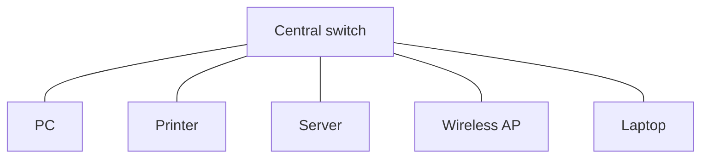

### 5.3 Mesh topology

In a mesh, devices or network nodes have multiple paths between them. A mesh design can improve resilience because communication may continue through another available route when a link fails.

### 5.4 Bus, ring, and tree

- **Bus:** devices share a common backbone.
- **Ring:** devices are connected in a loop.
- **Tree:** groups of devices are organized in a hierarchy.

### 5.5 Client–Server vs. Peer-to-Peer (P2P)

These are network architecture models rather than physical cable layouts.


<small>Conceptual comparison of a central server model and a peer-to-peer model. Source: [Wikimedia Commons — Client-server vs peer-to-peer](https://commons.wikimedia.org/wiki/File:Client-server_Vs_peer-to-peer_-_en.png).</small>

| Model | How it works | Example |
|---|---|---|
| **Client–Server** | Clients request services or data from a central server | A browser requests a page from a web server |
| **Peer-to-Peer (P2P)** | Participating devices can share resources directly with one another | Peers exchange pieces of a file |

**Key distinction:** A topology describes the arrangement of network connections; client–server and P2P describe how devices provide and consume services.

---

# PART II — NETWORK DEVICES AND TRANSMISSION MEDIA

# Topic 10 — Network Devices and Transmission Media

## 6. Why a Home “Wi-Fi Router” Is More Than a Router

A typical home networking device is often called a *Wi-Fi router*. In practice, a consumer home gateway commonly combines several functions inside one enclosure:

1. A **Wireless Access Point (WAP)** for Wi-Fi connections.
2. An **Ethernet switch** for local wired connections.
3. A **router** to connect the local network to other IP networks, such as the ISP network.


This combination is convenient for homes and small offices. Larger organizations often deploy access points, switches, and routers as separate devices so that each can be positioned and managed according to network requirements.

---

## 7. The Four Core Network Devices

## 7.1 NIC — Network Interface Card

A **Network Interface Card (NIC)** is the hardware interface that connects a device to a network.

A NIC may support:
- Ethernet electrical signaling over copper cable;
- Wi-Fi radio communication;
- a hardware MAC address;
- the framing and transmission functions required by its network interface.

The NIC provides the device with a way to send and receive network traffic.

## 7.2 WAP — Wireless Access Point

A **Wireless Access Point (WAP)** provides Wi-Fi connectivity and bridges wireless devices onto the local network.

In the introductory model used in this module:
- wireless clients connect to the access point;
- the access point connects to the wired LAN;
- local traffic can then be forwarded through the switching infrastructure.

A WAP is not the same thing as a router. Its central role is wireless network access and bridging.

## 7.3 Switch — local Layer 2 forwarding

An Ethernet **switch** connects devices inside a LAN.

A Layer 2 switch uses MAC addresses to learn where devices are located. It maintains a MAC address table that associates learned MAC addresses with switch ports.

When a frame arrives, the switch uses its forwarding information to decide where to send the frame.


<small>Example of a compact Gigabit Ethernet switch. Source: [Wikimedia Commons — Netgear Gigabit Switch 5-port](https://commons.wikimedia.org/wiki/File:Netgear_Gigabit_Switch_5-port.jpg).</small>

## 7.4 Router — forwarding between IP networks

A **router** connects different IP networks.

It examines destination IP information and forwards packets toward the next network or next hop.

In a home network, the router commonly acts as the **default gateway** for devices on the LAN.

### 7.5 Device comparison

| Device | Main layer in the introductory model | Address / information used | Main job |
|---|---|---|---|
| NIC | Layer 1 / Layer 2 | MAC address and link signaling | Connects the computer to a network medium |
| WAP | Layer 1 / Layer 2 bridge | MAC / link-layer information | Bridges Wi-Fi clients to the wired LAN |
| Switch | Layer 2 — Data Link | MAC address | Forwards local frames within a LAN |
| Router | Layer 3 — Network | IP address | Forwards packets between different IP networks |

### 7.6 Switch vs. router: the local printer example

Suppose:
- laptop IP: `192.168.1.10`;
- printer IP: `192.168.1.20`;
- subnet mask: `255.255.255.0`.

The two addresses are in the same `/24` subnet in this example. The laptop can communicate with the printer through the local network. It does not need to send the packet to the default gateway for external routing.

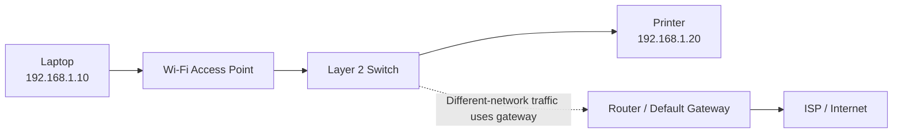

This explains why a local print job can continue even when the Internet connection is unavailable.

---

## 8. Transmission Media: Copper, Fiber, and Wi-Fi

A network needs a medium through which signals travel. The source distinguishes guided media, which use a physical path, from unguided media, which transmit through space.

### 8.1 Twisted-pair copper Ethernet

Twisted-pair Ethernet cable contains pairs of copper conductors twisted together. The twisting helps reduce electromagnetic interference and crosstalk.


<small>Illustration of twisted-pair cable construction and shielding. Source: [Wikimedia Commons — F-FTP twisted pair cable shielding](https://commons.wikimedia.org/wiki/File:F-FTP_twisted_pair_cable_shielding.svg).</small>

Common cable categories in the source:
- Cat5e;
- Cat6;
- Cat6a.

The source gives a typical maximum channel distance of up to 100 metres and a speed range of 1–10 Gbps, depending on cable category and deployment.

Common use cases:
- desktop computers;
- wall network outlets;
- Ethernet switches;
- ceiling-mounted wireless access points.

### 8.2 Fiber-optic cable

Fiber-optic cable carries light pulses through glass or other optical material.


<small>Optical fiber cable example. Source: [Wikimedia Commons — Optical fiber cable](https://commons.wikimedia.org/wiki/File:Optical_fiber_cable.jpg).</small>

The source distinguishes:
- **Single-mode fiber**;
- **Multi-mode fiber**.

Fiber is useful for longer-distance, high-capacity links and is not affected by electromagnetic interference in the same way as copper electrical signaling.

Common use cases:
- campus building connections;
- data-center links;
- telecommunications infrastructure;
- long-distance and undersea network backbones.

### 8.3 Wi-Fi radio waves

Wi-Fi uses electromagnetic radio waves to connect devices without a physical cable.

The source identifies:
- 2.4 GHz;
- 5 GHz;
- 6 GHz.

The introductory comparison is:
- 2.4 GHz generally offers longer range and better wall penetration;
- 5 GHz and 6 GHz can offer higher speeds, with range and penetration affected by the environment.

Common use cases:
- laptops;
- smartphones;
- tablets;
- mobile devices and robots.

### 8.4 Media comparison

| Medium | Category | Signal type | Source's illustrative distance / speed | Common use |
|---|---|---|---|---|
| Twisted-pair copper (Cat5e/Cat6/Cat6a) | Guided / wired | Electrical signals over twisted copper pairs | Up to 100 m; 1–10 Gbps | PCs, wall jacks, switches, access points |
| Fiber-optic (single-mode / multi-mode) | Guided / wired | Light pulses in optical fiber | 300 m to 100+ km; 10–400+ Gbps | Campus, data center, backbone |
| Wi-Fi (802.11; 2.4/5/6 GHz) | Unguided / wireless | Radio waves | 30–100 m indoors in the source's example | Laptops, phones, tablets, mobile devices |

### 8.5 Choosing a medium

| Requirement | Medium to investigate first | Reason |
|---|---|---|
| Fixed desktop connection | Copper Ethernet | Direct wired connection |
| Long building-to-building connection | Fiber | Long-distance, high-capacity link |
| Mobile device access | Wi-Fi | Wireless connectivity |
| Electrically noisy environment | Fiber | Optical transmission is not affected by electrical noise in the same way as copper |
| Flexible device movement | Wi-Fi | No physical cable is required at the client device |

---

# PART III — NETWORK ADDRESSES AND PROTOCOLS

# Topic 11 — Network Addresses and Protocols

## 9. Why Does a Laptop Use Domain, IP, and MAC Addresses?

Think of sending a parcel to a person.

The source uses three types of identity as an analogy:

1. **Human-readable name / domain name:** easy for people to remember, but a network needs an address to deliver traffic.
2. **IP address:** identifies a device or interface at the network layer and supports routing between networks.
3. **MAC address:** used for local link-layer delivery on a network segment.

These addresses serve different purposes. They are not interchangeable.

### 9.1 Domain name

A domain name such as:

```text
www.example.com
```

is easier for people to remember than a numerical IP address.

The Domain Name System (DNS) looks up information associated with domain names, commonly including IP addresses used to reach services.

### 9.2 IP address

An IP address is used at the network layer.

Examples:

```text
192.168.1.10
93.184.216.34
```

IP addressing is hierarchical and supports routing between networks.

### 9.3 MAC address

A MAC address is used for link-layer communication.

Example:

```text
A4:83:E7:12:9B:04
```

A switch uses MAC address information to forward local Ethernet frames.

**Conceptual distinction:** An IP address helps route traffic between networks. A MAC address is used to deliver a frame over a local link. A domain name provides a human-friendly name that can be resolved through DNS.

---

## 10. IPv4, IPv6, Subnet Masks, Private IPs, and NAT

## 10.1 IPv4

IPv4 uses 32-bit addresses, commonly written in dotted-decimal notation.

Example:

```text
192.168.1.10
```

The theoretical address count is:

\[
2^{32} = 4,294,967,296
\]

This is approximately 4.3 billion possible IPv4 address values.

### 10.2 Private IPv4 address ranges

RFC 1918 reserves three IPv4 address blocks for private internets:

| Private range | CIDR notation |
|---|---|
| `10.0.0.0` – `10.255.255.255` | `10.0.0.0/8` |
| `172.16.0.0` – `172.31.255.255` | `172.16.0.0/12` |
| `192.168.0.0` – `192.168.255.255` | `192.168.0.0/16` |

These addresses are used inside private networks and are not globally routed as public IPv4 addresses.

### 10.3 NAT — Network Address Translation

**Network Address Translation (NAT)** changes address information as packets pass through a network boundary.

A common home-network example is that multiple private LAN devices share an external public IPv4 address when communicating with the Internet.


<small>Conceptual Network Address Translation illustration. Source: [Wikimedia Commons — Bidirectional NAT](https://commons.wikimedia.org/wiki/File:Bidirectional_NAT-en.svg).</small>

### 10.4 Subnet masks

A **subnet mask** identifies which part of an IPv4 address represents the network prefix and which part identifies a host within that subnet.

Example:

```text
IP address:  192.168.1.10
Subnet mask: 255.255.255.0
CIDR:        /24
```

In this example:
- network prefix: `192.168.1`;
- host portion: `.10`.

### 10.5 Same subnet or different network?

Consider these two examples using a `/24` subnet mask.

**Example A — local destination**

```text
Source:      192.168.1.10
Destination: 192.168.1.20
Mask:        255.255.255.0
```

Both addresses have the same first three octets. In this example, they are in the same subnet. The source can send a frame directly on the local network after resolving the destination's link-layer address.

**Example B — remote destination**

```text
Source:      192.168.1.10
Destination: 93.184.216.34
Mask:        255.255.255.0
```

The destination is outside the local `/24` subnet. The source sends the traffic toward its configured default gateway.

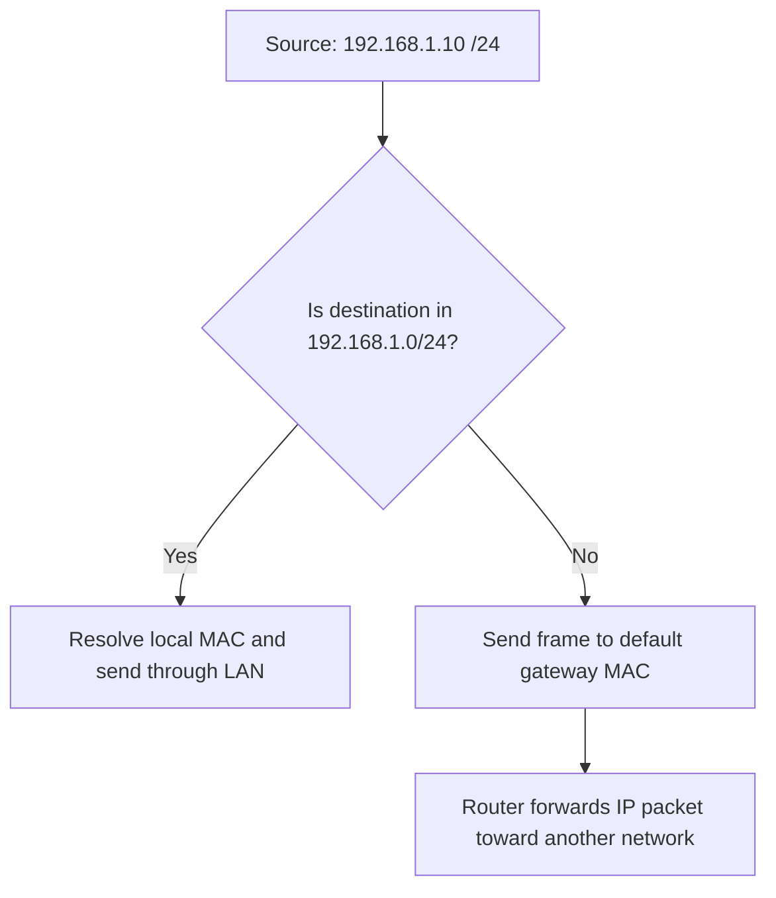

### 10.6 IPv6

IPv6 uses 128-bit addresses, commonly written as hexadecimal groups.

Example:

```text
2001:0db8:85a3::8a2e:0370:7334
```

The theoretical address space is:

\[
2^{128} \approx 3.4 \times 10^{38}
\]

IPv6 provides a vastly larger address space than IPv4.

---

## 11. DHCP — Automatically Configuring a Device

**Dynamic Host Configuration Protocol (DHCP)** automatically provides network configuration information to a client.

The source describes the four-step process using the acronym **DORA**:

1. Discover
2. Offer
3. Request
4. Acknowledge


<small>Four-step DHCP exchange. Source: [Wikimedia Commons — DHCP session.svg](https://commons.wikimedia.org/wiki/File:DHCP_session.svg).</small>

### 11.1 DORA explained

| Step | Message | What happens |
|---|---|---|
| 1 | DHCPDISCOVER | The client looks for a DHCP server |
| 2 | DHCPOFFER | A DHCP server offers configuration information |
| 3 | DHCPREQUEST | The client requests the offered configuration |
| 4 | DHCPACK | The server acknowledges and confirms the configuration |

### 11.2 What can DHCP provide?

The source identifies:
- client IP address;
- subnet mask;
- default gateway;
- DNS server IP address.

### 11.3 Why DHCP is useful

Without automatic configuration, an administrator or user would need to configure network settings manually on each device.

DHCP makes it easier to connect laptops, phones, printers, and other clients to a network.

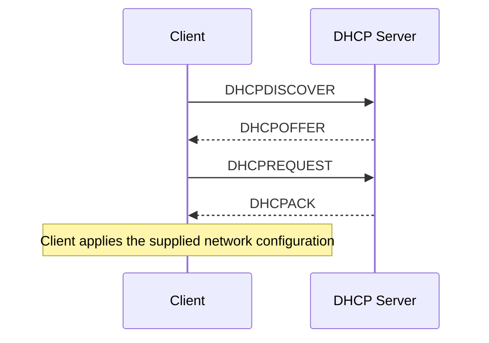

---

## 12. ARP — Finding a Local MAC Address

**Address Resolution Protocol (ARP)** helps an IPv4 device discover the MAC address associated with an IPv4 address on the local network.

Suppose a laptop knows the printer's IP address:

```text
192.168.1.20
```

But the laptop needs a destination MAC address to prepare the local Ethernet frame.

The laptop can broadcast an ARP request:

```text
Who has 192.168.1.20?
```

The device using that IPv4 address responds with its MAC address.


<small>ARP request and reply example. Source: [Wikimedia Commons — Protocol ARP.svg](https://commons.wikimedia.org/wiki/File:Protocol_ARP.svg).</small>

### 12.1 ARP sequence

1. The sender checks whether it already knows the destination's MAC address.
2. If the mapping is not available, it broadcasts an ARP request on the local network.
3. The device using the target IP address replies with its MAC address.
4. The sender can then prepare the local link-layer frame.

### 12.2 ARP in the local printing example

```text
Laptop:  192.168.1.10
Printer: 192.168.1.20

ARP request:
"Who has 192.168.1.20?"

ARP reply:
"192.168.1.20 is at DD:EE:FF:00:11:02"
```

ARP is part of the IPv4 local-link process described in this module.

---

## 13. DNS — Translating Domain Names into IP Addresses

The **Domain Name System (DNS)** translates domain names into information that network clients can use, commonly an IP address.

For example:

```text
www.example.com
        ↓ DNS lookup
93.184.216.34
```

DNS is often described as the Internet's phonebook.

### 13.1 DNS lookup hierarchy

The source describes a resolver consulting several levels of the DNS hierarchy:

1. Root DNS servers (`.`)
2. Top-Level Domain (TLD) servers, such as `.org`
3. Authoritative name servers for the domain


<small>Illustration of an iterative DNS resolver query. Source: [Wikimedia Commons — Example of an iterative DNS resolver](https://commons.wikimedia.org/wiki/File:Example_of_an_iterative_DNS_resolver.svg).</small>

### 13.2 DNS does not download the website

This distinction is essential:

- DNS looks up domain-related information, such as an IP address.
- The browser then uses network protocols to communicate with the destination service.
- The web server returns the page content through the relevant application and transport protocols.

DNS does **not** download the HTML page itself.

### 13.3 Simplified DNS lookup sequence

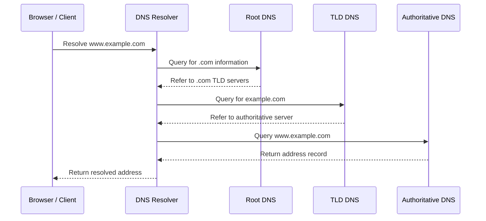

---

## 14. TCP vs. UDP — Two Transport Protocols

TCP and UDP are transport-layer protocols. They provide different communication services to applications.

## 14.1 TCP — Transmission Control Protocol

The source describes TCP as a tracked and reliable delivery method.

Key characteristics:
- connection establishment using a three-way handshake;
- sequence information for transmitted data;
- ordered delivery of a byte stream;
- retransmission mechanisms for missing data;
- use by common web, email, and file-transfer applications.

### TCP three-way handshake

Before normal TCP data exchange, the endpoints establish a connection using:

1. SYN
2. SYN-ACK
3. ACK

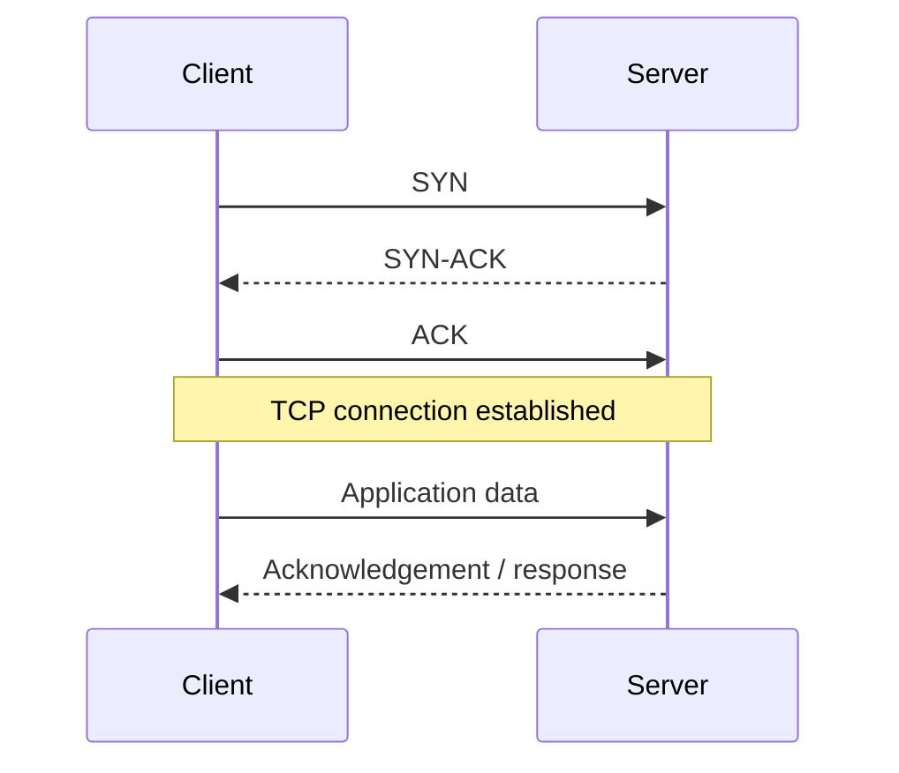

### 14.2 UDP — User Datagram Protocol

The source describes UDP as a fast, connectionless transport protocol.

Introductory characteristics:
- no TCP-style three-way connection handshake;
- low transport-level overhead;
- no built-in guarantee of delivery or ordering;
- commonly used for real-time audio/video, online gaming, and DNS queries.

### 14.3 TCP and UDP comparison

| Feature | TCP | UDP |
|---|---|---|
| Connection setup | Uses a three-way handshake | No TCP-style handshake |
| Delivery model | Reliable, ordered byte stream | Datagram delivery without built-in reliability or ordering |
| Retransmission | TCP provides retransmission mechanisms | No built-in UDP retransmission |
| Relative overhead | More transport control | Lower transport-level overhead |
| Example uses in the source | Web, email, file downloads | Live calls, online gaming, DNS queries |

**Technical precision note:** UDP itself does not retransmit lost datagrams, but an application built on UDP can add its own reliability or recovery mechanisms. Similarly, TCP reliability is implemented by the transport protocol, not by the IP layer.

---

## 15. HTTP, HTTPS, and TLS

HTTP is an application-layer protocol used for web communication.

Examples of HTTP methods and response status codes include:

| HTTP example | Meaning |
|---|---|
| `GET` | Request a resource |
| `POST` | Submit data to a resource |
| `200 OK` | Request succeeded |
| `404 Not Found` | Requested resource was not found |

### 15.1 What is HTTPS?

**HTTPS** is HTTP communication protected by TLS.

TLS provides security mechanisms that include:
- encryption of data in transit;
- authentication of the server through certificate validation;
- integrity protection for transmitted data.

The source specifically references TLS 1.3.

### 15.2 Simplified HTTPS communication flow

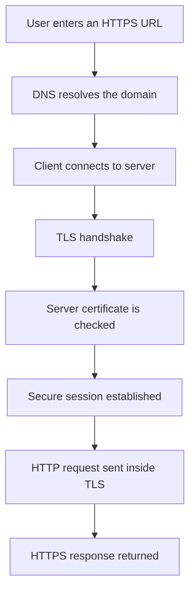

### 15.3 Why HTTPS matters

Without appropriate transport security, data sent over a network may be exposed to observation or modification by parties able to intercept the communication.

HTTPS protects web traffic in transit and helps the browser verify that it is communicating with the intended server identity.

---

# PART IV — TRACE COMPLETE NETWORK WORKFLOWS

## 16. Workflow A — Joining a Wi-Fi Network

A simplified sequence:

1. The device connects to a wireless access point.
2. DHCP provides IP configuration.
3. The device obtains an IP address, subnet mask, default gateway, and DNS server information.
4. The device can communicate with local devices and attempt to reach external networks.

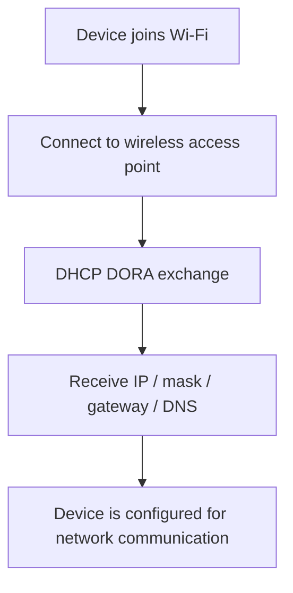

## 17. Workflow B — Printing to a Local Printer

Assume:
- laptop: `192.168.1.10/24`;
- printer: `192.168.1.20/24`.

A simplified flow:

1. The user selects Print.
2. The laptop identifies the printer as a local destination in the same subnet.
3. The laptop resolves the printer's local MAC address using ARP if needed.
4. The laptop sends local frames through the wireless access point and switching infrastructure.
5. The printer receives the print data.

The ISP connection is not required for this local path, provided the LAN and printer remain operational.

## 18. Workflow C — Opening a Website

A simplified sequence:

1. The user enters a domain name.
2. DNS resolves the domain to an IP address.
3. The device determines whether the destination is local or remote.
4. If remote, the device sends the frame to its default gateway.
5. Routers forward the IP packet across networks.
6. The client and server establish the required transport communication.
7. For HTTPS, TLS protects the HTTP communication.
8. The server returns the requested web content.

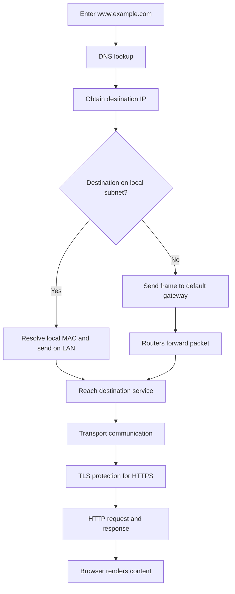

## 19. Workflow D — Diagnosing “The Internet Is Down”

A useful first step is to distinguish local network access from external Internet access.

| Test | What it helps establish |
|---|---|
| Can the device connect to Wi-Fi? | Wireless association is functioning |
| Does it have an IP address? | Network configuration may be available |
| Can it communicate with a local printer? | Local LAN communication may still work |
| Can it reach the default gateway? | Local path to the router may be working |
| Can it resolve a domain name? | DNS service may be working |
| Can it reach an external IP address? | External routing may be working |
| Can it open an HTTPS site? | Multiple network and application layers are functioning together |

A failed test does not automatically identify one faulty component. Use the sequence to narrow down where communication stops.

---

# PART V — INTERACTIVE LEARNING ACTIVITIES

## 20. Interactive Activity A — Encapsulation Explorer

Select each layer to see what information is added as application data moves toward the physical network.

- Application data: the content being sent.
- TCP or UDP: transport information.
- IP: source and destination network addresses.
- Ethernet or Wi-Fi: local link-layer framing.

## 21. Interactive Activity B — Bandwidth and Transfer-Time Calculator

Enter a file size and connection bandwidth to estimate ideal transfer time.

\[
t = \frac{\text{File size in megabits}}{\text{Bandwidth in megabits per second}}
\]

The calculator also allows you to adjust an efficiency percentage to model the difference between theoretical capacity and practical throughput.

## 22. Interactive Activity C — Same Subnet or Default Gateway?

Enter two IPv4 addresses and a CIDR prefix.

The tool calculates whether both addresses belong to the same IPv4 subnet under the supplied prefix.

- Same subnet: local link delivery is normally used.
- Different subnet: the sender uses its default gateway for routing.

This is a learning aid and does not inspect a real network interface or route table.

## 23. Interactive Activity D — DHCP DORA Sequence

Step through:
- DHCPDISCOVER;
- DHCPOFFER;
- DHCPREQUEST;
- DHCPACK.

Observe how a client obtains the network configuration information needed to communicate.

## 24. Interactive Activity E — Protocol Explorer

Compare the purpose and behavior of:
- DHCP;
- ARP;
- DNS;
- TCP;
- UDP;
- HTTPS/TLS.

---

# PART VI — REVIEW AND ASSESSMENT

## 25. Knowledge Check

1. Why can a computer still print to a local printer when the ISP fiber connection is cut?
2. What is packet switching?
3. What is the difference between a packet and a frame?
4. What does encapsulation mean?
5. Why might packets arrive out of order?
6. What is the difference between bandwidth and latency?
7. What is throughput?
8. What is the difference between a PAN and a LAN?
9. Name five common network topologies.
10. How does client–server differ from peer-to-peer?
11. What is the purpose of a NIC?
12. What does a wireless access point do?
13. How does a switch use a MAC address table?
14. What is the main job of a router?
15. What is the difference between copper, fiber, and Wi-Fi transmission?
16. What is the purpose of an IP address?
17. What is the purpose of a MAC address?
18. What is the purpose of DNS?
19. What does DHCP provide?
20. What does DORA stand for?
21. What is the purpose of ARP?
22. What is the difference between IPv4 and IPv6 address widths?
23. What does a `/24` subnet mask represent in the example?
24. When does a device send traffic to its default gateway?
25. What is the TCP three-way handshake?
26. What is the difference between TCP and UDP?
27. What does TLS add to HTTPS?
28. Why does DNS not download the HTML page?

## 26. Scenario-Based Exercises

### Exercise A — The office printer still works

An office loses its ISP fiber connection. Employees cannot open external websites, but they can still print to a nearby Wi-Fi printer.

**Questions:**
- Which network is still functioning?
- Which devices are likely involved in the local path?
- Why is the external ISP link not needed for this print job?

**Expected reasoning:** The LAN may remain operational. The laptop can send traffic through the wireless access point and switching infrastructure to the printer without routing the print job through the Internet.

### Exercise B — A large file downloads slowly

A user has a connection advertised at 1 Gbps but observes much lower file-transfer throughput.

**Questions:**
- Are bandwidth and throughput the same?
- What factors could reduce actual throughput?
- Why should the user check the complete path rather than only the ISP speed?

**Expected reasoning:** Advertised bandwidth is link capacity; throughput is actual delivery rate. Protocol overhead, congestion, retransmissions, server capacity, and other path limitations can reduce throughput.

### Exercise C — Same subnet or remote network?

A laptop has `192.168.1.10` with mask `255.255.255.0`.

Classify the following destinations:

1. `192.168.1.20`
2. `192.168.1.200`
3. `192.168.2.20`
4. `93.184.216.34`

**Expected reasoning:** The first two are in the same `192.168.1.0/24` subnet. The third and fourth are outside that subnet and require routing through the default gateway.

### Exercise D — A device joins Wi-Fi

A new laptop connects to a wireless access point but has no manually configured IP address.

**Questions:**
- Which protocol can provide its configuration?
- What are the four DORA messages?
- Which configuration details can the device receive?

**Expected reasoning:** DHCP can supply an IP address, subnet mask, default gateway, and DNS server information through Discover, Offer, Request, and Acknowledge.

### Exercise E — The browser cannot find a website

A user enters `www.example.com`, but the browser reports a name-resolution problem.

**Questions:**
- Which protocol should be investigated?
- Does DNS download the page?
- What happens after the name is resolved?

**Expected reasoning:** DNS resolves the domain name. The browser then uses the returned address to communicate with the destination service; DNS does not retrieve the HTML page.

### Exercise F — A video call has high delay

A user has a fast connection but experiences delayed responses during a live call.

**Questions:**
- Which measure should be examined besides bandwidth?
- What is RTT?
- Why can a high-latency connection feel slow even when bandwidth is high?

**Expected reasoning:** Latency and RTT should be examined. High delay can make interactive communication feel unresponsive even when the link has substantial capacity.

### Exercise G — Choose the transport protocol

A developer is comparing TCP and UDP for an application.

**Questions:**
- Which protocol provides a reliable, ordered byte stream?
- Which protocol avoids the TCP-style three-way handshake?
- Why might an application choose UDP?

**Expected reasoning:** TCP provides reliable ordered byte-stream service. UDP has lower transport-level overhead and does not use the TCP-style handshake, making it useful for applications that prioritize timeliness or implement their own recovery logic.

---

## 27. Practical Troubleshooting Checklist

| Symptom | First areas to investigate |
|---|---|
| Wi-Fi connected but no Internet | IP configuration, default gateway, ISP connection, DNS |
| Local printer unavailable | Wi-Fi association, printer IP, subnet, ARP, access point, switch |
| External sites fail but local devices work | Router WAN connection, ISP, external routing, DNS |
| Domain name does not resolve | DNS server configuration and resolver availability |
| Slow large-file transfer | Actual throughput, bandwidth, congestion, retransmissions, source/destination capacity |
| Online game feels delayed | Latency, RTT, route quality, congestion |
| Device has no usable IP configuration | DHCP availability and client configuration |
| Wired connection unavailable | NIC, cable, switch port, link status |
| Wi-Fi coverage is weak | Access-point placement, radio band, walls, interference |
| HTTPS site reports a security error | Certificate validation, system time, TLS configuration, server identity |

---

## 28. Final Summary

| Concept | Key point |
|---|---|
| LAN | Local network connecting devices in a limited area |
| Internet | Global network of interconnected networks |
| Packet switching | Divides communication into smaller units |
| Packet | Layer 3 network unit |
| Frame | Layer 2 link unit |
| Encapsulation | Adding protocol information as data moves through layers |
| Bandwidth | Link capacity |
| Latency | Communication delay |
| RTT / Ping | Round-trip delay |
| Throughput | Actual delivered data rate |
| PAN | Personal Area Network |
| LAN / WLAN | Local / Wireless Local Area Network |
| MAN | Metropolitan Area Network |
| WAN | Wide Area Network |
| Star topology | Devices connect through a central device |
| Mesh topology | Multiple paths connect network nodes |
| Client–Server | Clients request services from servers |
| P2P | Peers share resources directly |
| NIC | Network Interface Card |
| WAP | Wireless Access Point |
| Switch | Forwards local frames using MAC address information |
| Router | Forwards packets between IP networks |
| Copper Ethernet | Electrical signaling over twisted-pair cable |
| Fiber | Optical signaling through fiber |
| Wi-Fi | Wireless radio communication |
| Domain name | Human-readable name resolved through DNS |
| IP address | Network-layer address |
| MAC address | Link-layer address |
| IPv4 | 32-bit IP addressing |
| IPv6 | 128-bit IP addressing |
| Subnet mask | Identifies network and host portions of an IPv4 address |
| NAT | Network Address Translation |
| DHCP | Automatically supplies network configuration |
| DORA | Discover, Offer, Request, Acknowledge |
| ARP | Resolves an IPv4 address to a local MAC address |
| DNS | Resolves domain names to network information |
| TCP | Reliable, ordered transport byte stream |
| UDP | Connectionless datagram transport |
| HTTP | Application protocol for web communication |
| HTTPS | HTTP protected by TLS |
| TLS | Provides encryption, integrity, and authentication mechanisms |

---

## 29. Glossary

| Term | Definition |
|---|---|
| ARP | Address Resolution Protocol; resolves IPv4-to-MAC mappings on a local network |
| Bandwidth | The capacity of a communication link |
| Client | A device or program that requests a service |
| DNS | Domain Name System; resolves domain names |
| DHCP | Dynamic Host Configuration Protocol; supplies network configuration |
| Encapsulation | Wrapping data with protocol headers as it moves through network layers |
| Ethernet | A common wired LAN technology |
| Frame | Link-layer data unit |
| Gateway | A device that forwards traffic from one network toward another |
| IP address | Logical network-layer address |
| LAN | Local Area Network |
| Latency | Time delay in communication |
| MAC address | Link-layer hardware address |
| MAN | Metropolitan Area Network |
| Mesh | Topology with multiple interconnections |
| NAT | Network Address Translation |
| NIC | Network Interface Card |
| Packet | Network-layer data unit |
| PAN | Personal Area Network |
| P2P | Peer-to-peer architecture |
| Router | Device that forwards packets between IP networks |
| RTT | Round-Trip Time |
| Subnet mask | IPv4 mask identifying network and host portions |
| Switch | Layer 2 device that forwards frames using MAC information |
| TCP | Transmission Control Protocol |
| Throughput | Actual data-delivery rate |
| TLS | Transport Layer Security |
| UDP | User Datagram Protocol |
| WAN | Wide Area Network |
| WAP | Wireless Access Point |
| WLAN | Wireless Local Area Network |

---

## 30. References and Further Reading

### Standards and technical references

1. Cisco. [Networking Basics](https://www.cisco.com/site/us/en/learn/topics/small-business/networking-basics.html). Introductory networking concepts and LAN fundamentals.
2. IETF. [RFC 1918 — Address Allocation for Private Internets](https://www.rfc-editor.org/rfc/rfc1918). Private IPv4 address ranges.
3. IETF. [RFC 2131 — Dynamic Host Configuration Protocol](https://www.rfc-editor.org/rfc/rfc2131). DHCP behavior and message exchange.
4. IETF. [RFC 826 — An Ethernet Address Resolution Protocol](https://www.rfc-editor.org/rfc/rfc826). ARP.
5. IETF. [RFC 1034 — Domain Names: Concepts and Facilities](https://www.rfc-editor.org/rfc/rfc1034). DNS architecture and concepts.
6. IETF. [RFC 9110 — HTTP Semantics](https://www.rfc-editor.org/rfc/rfc9110). HTTP methods, semantics, and status codes.
7. IETF. [RFC 8446 — The Transport Layer Security (TLS) Protocol Version 1.3](https://www.rfc-editor.org/rfc/rfc8446). TLS 1.3 protocol.
8. Cloudflare. [What is a DNS server?](https://www.cloudflare.com/learning/dns/what-is-a-dns-server/). Introductory DNS explanation.

### Image credits

| Illustration | Source |
|---|---|
| Network topologies | [Wikimedia Commons — Nettopoc.png](https://commons.wikimedia.org/wiki/File:Nettopoc.png) |
| UDP encapsulation | [Wikimedia Commons — UDP encapsulation.svg](https://commons.wikimedia.org/wiki/File:UDP_encapsulation.svg) |
| Client–server vs. P2P | [Wikimedia Commons — Client-server vs peer-to-peer](https://commons.wikimedia.org/wiki/File:Client-server_Vs_peer-to-peer_-_en.png) |
| Home wireless gateway | [Wikimedia Commons — Netgear Nighthawk AC1900](https://commons.wikimedia.org/wiki/File:Netgear-Nighthawk-AC1900-WiFi-Router.jpg) |
| Gigabit Ethernet switch | [Wikimedia Commons — Netgear Gigabit Switch 5-port](https://commons.wikimedia.org/wiki/File:Netgear_Gigabit_Switch_5-port.jpg) |
| Twisted-pair cable | [Wikimedia Commons — F-FTP twisted pair cable shielding](https://commons.wikimedia.org/wiki/File:F-FTP_twisted_pair_cable_shielding.svg) |
| Optical fiber | [Wikimedia Commons — Optical fiber cable](https://commons.wikimedia.org/wiki/File:Optical_fiber_cable.jpg) |
| NAT | [Wikimedia Commons — Bidirectional NAT](https://commons.wikimedia.org/wiki/File:Bidirectional_NAT-en.svg) |
| DHCP | [Wikimedia Commons — DHCP session](https://commons.wikimedia.org/wiki/File:DHCP_session.svg) |
| ARP | [Wikimedia Commons — Protocol ARP](https://commons.wikimedia.org/wiki/File:Protocol_ARP.svg) |
| DNS resolver | [Wikimedia Commons — Iterative DNS resolver](https://commons.wikimedia.org/wiki/File:Example_of_an_iterative_DNS_resolver.svg) |

> **Final thought:** Networking is a coordinated process. Applications create data, protocols add the information needed for delivery, devices forward frames and packets, and transmission media carry signals between systems. Domain names, IP addresses, MAC addresses, DHCP, ARP, DNS, TCP, UDP, and HTTPS each solve a different part of the communication problem.
