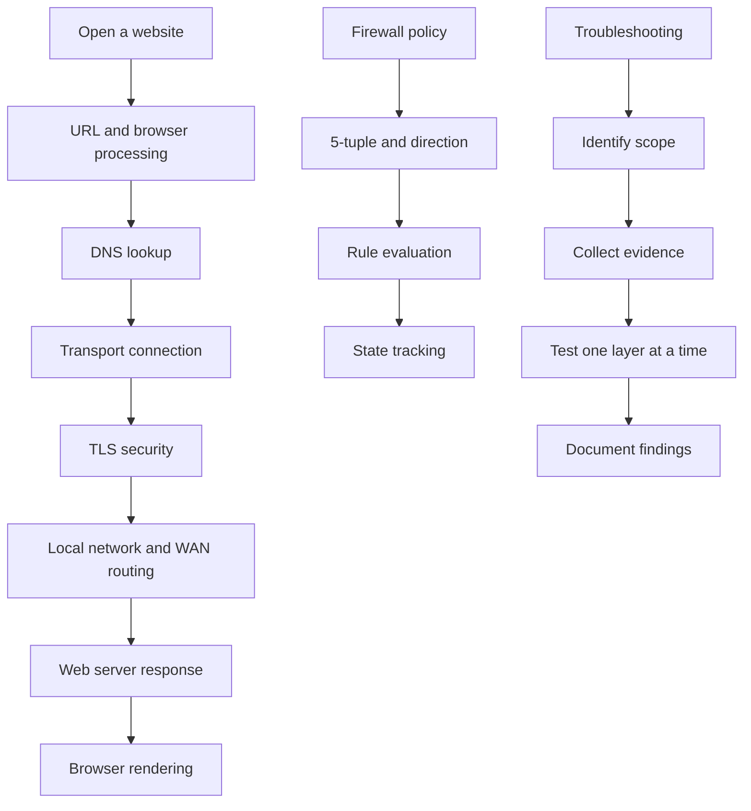
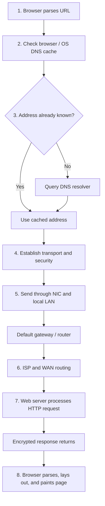
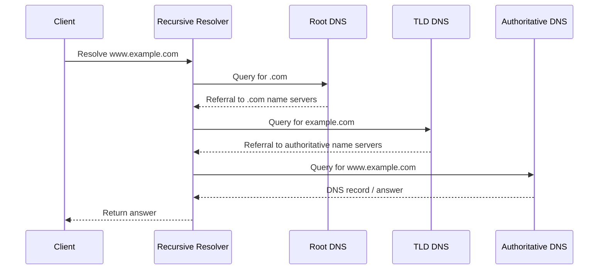
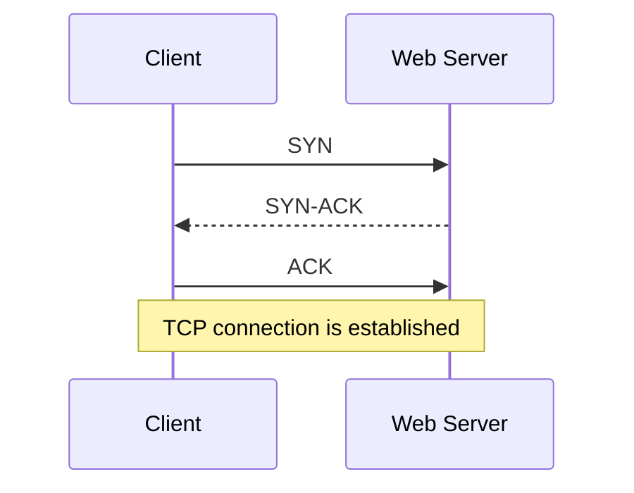
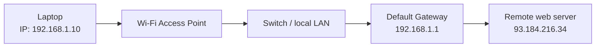
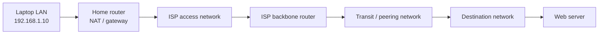
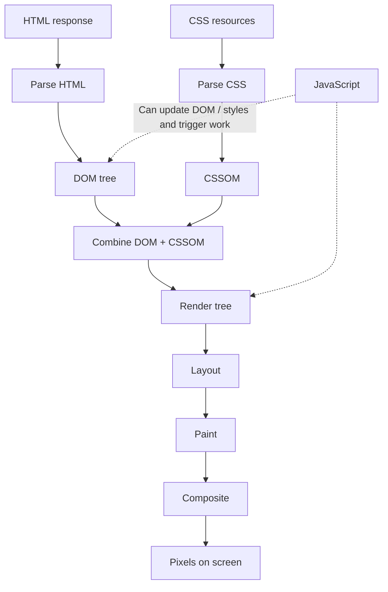
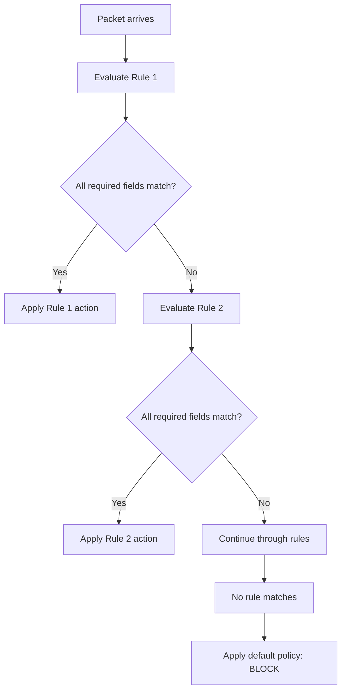
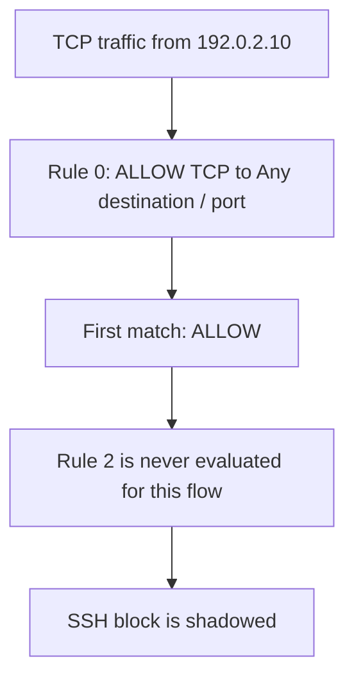
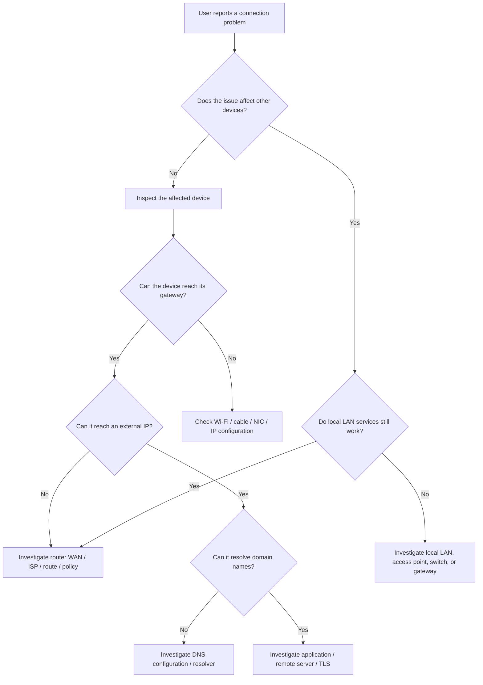

# 🛡️ MODULE 06
# The Web Journey, Firewalls & Network Troubleshooting Labs

### From a browser request to a secure connection: packet journeys, DNS, TCP, TLS, stateful firewall rules, evidence-based diagnostics, and browser developer tools

---

> **The big question:** What really happens between pressing **Enter** in a browser and seeing a web page—and how can we tell whether a problem is caused by the browser, DNS, the local network, a firewall, the Internet path, or the remote server?

| Module guide | Details |
|---|---|
| Module | 06 — The Web Journey, Firewalls & Network Troubleshooting Labs |
| Topics | Topic 12: The website request journey · Topic 13: Firewalls · Topic 14: Safe troubleshooting · Topic 15: Practical network labs |
| Estimated study time | 3–4 hours, including practical activities |
| Prerequisites | Basic IP addressing, LAN devices, DNS, TCP/UDP, and HTTP/HTTPS |
| Main practical tools | Terminal / Command Prompt, `ipconfig`, `ip addr`, `arp`, `nslookup`, `ping`, browser DevTools |
| Learning approach | Follow the data, inspect the evidence, test one hypothesis at a time |

## 🎯 Learning Objectives

By the end of this module, you should be able to:

1. Describe the main stages involved when a browser opens a website.
2. Explain the roles of URL parsing, DNS caching, DNS resolution, routing, NAT, TCP, TLS, HTTP, and browser rendering.
3. Distinguish the Internet from the World Wide Web.
4. Explain the TCP three-way handshake and the purpose of a TLS handshake.
5. Describe how a local Ethernet or Wi-Fi frame reaches the default gateway when the destination is on a remote network.
6. Explain why MAC addresses change at routed network hops while IP addresses are generally used for end-to-end routing.
7. Distinguish host-based firewalls from network firewalls.
8. Identify the five fields in a network flow's 5-tuple.
9. Evaluate a simple first-match firewall rule table and explain implicit deny.
10. Explain stateful inspection and how it differs from stateless packet filtering.
11. Identify common firewall limitations and explain why an allowed HTTPS connection does not prove that a downloaded file is safe.
12. Apply a safe, evidence-based troubleshooting sequence without disrupting other users.
13. Use read-only network commands to inspect local IP configuration, ARP entries, and DNS resolution.
14. Use browser DevTools to inspect requests, response headers, status codes, and timing information.
15. Identify a shadowed firewall rule and explain how rule ordering can weaken a security policy.

## 🧭 Module Map



## 📚 Contents

- [Part I — The eight-stage website journey](#part-i--the-eight-stage-website-journey)
- [Part II — Firewalls and traffic control](#part-ii--firewalls-and-traffic-control)
- [Part III — Safe, evidence-based troubleshooting](#part-iii--safe-evidence-based-troubleshooting)
- [Part IV — Practical network labs](#part-iv--practical-network-labs)
- [Part V — Review and assessment](#part-v--review-and-assessment)
- [Glossary](#glossary)
- [References and image credits](#references-and-image-credits)

---

# PART I — THE EIGHT-STAGE WEBSITE JOURNEY

# 🌍 Topic 12: How Data Travels from Your Computer to a Website

## 1. The Journey Behind One Press of Enter

You type:

```text
https://www.example.com/index.html
```

Then you press **Enter**. The browser eventually displays the requested page. The visible action is simple, but the process involves several systems working together:

- the browser interprets the URL;
- the operating system and browser check available name-resolution information;
- DNS may be queried to find an IP address;
- the computer establishes or reuses a transport connection;
- TLS protects the communication when HTTPS is used;
- the local network forwards traffic to the default gateway;
- routers move packets between networks;
- the remote server processes the request and returns a response;
- the browser parses and renders the returned resources.

The original lesson organizes this into eight stages. The stages below retain that learning structure while adding important details about modern web communication.

<figure>
  
  <figcaption><strong>Figure 1.</strong> TCP three-way handshake: SYN → SYN-ACK → ACK. Source: <a href="https://commons.wikimedia.org/wiki/File:3-way-handshake.JPG">Wikimedia Commons</a>.</figcaption>
</figure>

<figure>
  
  <figcaption><strong>Figure 2.</strong> TLS 1.3 handshake. It establishes cryptographic parameters and authenticates the server according to the client's certificate-validation process. Source: <a href="https://commons.wikimedia.org/wiki/File:TLS_1.3_Handshake.png">Wikimedia Commons</a>.</figcaption>
</figure>

## 2. The Eight Stages at a Glance

| Stage | Main activity | Key component or protocol | Main question answered |
|---:|---|---|---|
| 1 | Parse the URL | Browser, CPU, RAM | What resource is being requested? |
| 2 | Check local name information | Browser / OS caches | Do we already know the destination address? |
| 3 | Resolve the domain name | DNS | Which IP address should be contacted? |
| 4 | Establish secure transport | TCP + TLS, or QUIC + TLS for HTTP/3 | How will the client and server communicate securely? |
| 5 | Deliver traffic across the local LAN | NIC, access point, switch, default gateway | How does the packet leave the local network? |
| 6 | Forward traffic across the WAN | NAT, ISP, routers | How does the packet reach the remote network? |
| 7 | Process the request and return a response | Web server, HTTP | What response does the server send? |
| 8 | Build and display the page | Browser engine, CPU, GPU | How does received content become pixels? |

### Complete journey diagram



> **Timing note:** The original lesson uses “400 milliseconds” as an engaging illustration. It is not a guaranteed page-load time. Actual performance depends on DNS caching, network latency, connection reuse, server response time, page size, browser processing, and many other factors.

---

## 3. Stage 1 — The Browser Parses the URL

A URL (Uniform Resource Locator) identifies a resource and provides information about how to access it.

Consider:

```text
https://www.example.com:443/index.html?mode=student#overview
```

| URL component | Example | Meaning |
|---|---|---|
| Scheme | `https` | The communication scheme |
| Hostname | `www.example.com` | The server name to resolve |
| Port | `443` | The destination service port; 443 is the default for HTTPS |
| Path | `/index.html` | The requested resource path |
| Query string | `?mode=student` | Additional request parameters |
| Fragment | `#overview` | A location within the resource, normally handled by the browser |

The browser interprets the URL and determines what resource it should request. It may also apply browser policies, extensions, cached information, and security checks.

### Why the port matters

A port number identifies a transport-layer endpoint on a host.

Common examples include:

| Port | Common service |
|---:|---|
| TCP 80 | HTTP |
| TCP 443 | HTTPS over TCP |
| UDP 443 | Commonly used by HTTP/3 over QUIC |
| TCP 22 | SSH |
| UDP/TCP 53 | DNS, depending on the query and transport |

**Important modern distinction:** HTTPS does not always mean TCP. HTTP/1.1 and HTTP/2 commonly use TLS over TCP. HTTP/3 uses QUIC over UDP and incorporates TLS 1.3 into the QUIC connection setup. Therefore, a modern browser may use UDP port 443 rather than TCP port 443 for an HTTPS website.

---

## 4. Stage 2 — Check the Browser and Operating-System DNS Caches

Before sending a new DNS query, the browser and operating system may already have address information available.

A simplified lookup sequence is:

1. The browser checks its own relevant cache.
2. The operating system checks its DNS cache and local name-resolution configuration.
3. If no usable answer is available, the system asks a configured DNS resolver.
4. The resolver may answer from its own cache or perform additional DNS queries.

Caching reduces repeated lookups and can shorten the time needed to connect to a website.

### What is a DNS cache?

A DNS cache stores recently obtained DNS records for a limited period. The record's Time to Live (TTL) helps determine how long the answer may be cached.

For example:

```text
www.example.com → an IP address
```

The mapping is not necessarily permanent. The answer can change over time, and different resolvers may return different addresses because of content delivery networks, geographic routing, or service configuration.

**Practical implication:** If a DNS answer is cached, the browser may not show a new DNS lookup phase for every request.

---

## 5. Stage 3 — DNS Resolution

The Domain Name System (DNS) translates domain names into records that applications can use. A common task is resolving a hostname to an IP address.

Example:

```text
www.example.com
       |
       | DNS lookup
       v
IP address returned by DNS
```

The original lesson uses `93.184.216.34` as an illustrative answer. Treat it as an example, not a permanent address: DNS answers can change, and a hostname may resolve to more than one address.

### 5.1 The DNS resolver

A client commonly sends a query to a configured recursive resolver. The resolver may already have a cached answer. If it does not, it can query the DNS hierarchy to obtain the answer.

A simplified iterative resolution path is:



### 5.2 Common DNS record types

| Record | Purpose | Example use |
|---|---|---|
| A | Maps a hostname to an IPv4 address | `www.example.com → IPv4` |
| AAAA | Maps a hostname to an IPv6 address | `www.example.com → IPv6` |
| CNAME | Identifies an alias for another domain name | An alias points to a canonical hostname |
| MX | Identifies mail servers for a domain | Receiving email |
| NS | Identifies authoritative name servers | Delegation of DNS responsibility |
| TXT | Stores text information associated with a name | Domain verification and email-security policies |

### 5.3 DNS transport: a useful qualification

Traditional DNS queries commonly use UDP port 53. TCP port 53 is also used in circumstances such as large responses and zone transfers. Other DNS transport methods exist, including DNS over TLS (DoT) and DNS over HTTPS (DoH).

The important learning point is that DNS resolution is a separate step from downloading a web page.

> **DNS finds information about the destination. It does not download the website's HTML, CSS, JavaScript, or images.**

---

## 6. Stage 4 — Transport Connection and TLS Security

Once the client has an address, it needs a way to communicate with the destination service.

### 6.1 TCP three-way handshake

For a typical HTTPS connection using TCP, the client and server establish a TCP connection through three messages:

1. **SYN:** The client requests to start a TCP connection.
2. **SYN-ACK:** The server acknowledges the request and sends its own synchronization information.
3. **ACK:** The client acknowledges the server's response.



The handshake establishes the TCP connection. It does not itself encrypt the HTTP content.

### 6.2 TLS handshake

TLS (Transport Layer Security) provides security for communication. In a typical HTTPS-over-TCP connection, TLS is negotiated after the TCP connection is established.

TLS helps provide:

- **Confidentiality:** encryption protects data from being read by unauthorized observers.
- **Integrity:** cryptographic protection helps detect unauthorized modification.
- **Authentication:** certificate validation helps the client verify the server's identity.

A simplified TLS 1.3 sequence:

1. The client sends a ClientHello with supported cryptographic options.
2. The server responds with its selected parameters and certificate-related information.
3. The client validates the server certificate and completes the required handshake messages.
4. Both sides derive session keys.
5. Application data is exchanged using encryption.

TLS 1.3's full handshake is designed to reduce handshake latency compared with older TLS versions. A typical full TLS 1.3 handshake uses one round trip after the underlying TCP connection is established. Session resumption can have different timing characteristics.

### 6.3 HTTP/3: the modern alternative to the TCP path

HTTP/3 changes the transport arrangement:

| Traditional HTTPS path | HTTP/3 path |
|---|---|
| HTTP over TLS over TCP | HTTP over QUIC |
| TCP connection setup | QUIC connection setup |
| TLS handshake follows TCP setup | TLS 1.3 is integrated into QUIC |
| Commonly TCP port 443 | Commonly UDP port 443 |
| TCP stream behavior | QUIC streams with independent stream-level delivery |

QUIC is a secure, multiplexed transport built on UDP. HTTP/3 uses QUIC and TLS 1.3 rather than the traditional TCP-plus-TLS arrangement.

**Why this matters in troubleshooting:** A firewall policy that blocks UDP traffic can prevent HTTP/3 from being used. A browser may then fall back to a TCP-based HTTP version if the server and client support it.

---

## 7. Stage 5 — The Local LAN Hop

The destination web server is usually outside the laptop's local subnet. The laptop therefore needs to send the packet to its **default gateway**.

Example configuration:

```text
Laptop IPv4:       192.168.1.10
Subnet mask:       255.255.255.0
Default gateway:   192.168.1.1
Website IP:        93.184.216.34   (illustrative)
```

The laptop compares the destination address with its own subnet information. Since the website address is outside `192.168.1.0/24`, the laptop sends the traffic to the default gateway.

### 7.1 The important IP-versus-MAC distinction

For this first local hop:

- the **destination IP address** in the IP packet identifies the remote web server;
- the **destination MAC address** in the local Ethernet or Wi-Fi frame identifies the default gateway's local network interface.



This is a key networking principle: the local frame is addressed to the next hop, while the IP packet is routed toward the final destination.

### 7.2 Why ARP may be involved

In an IPv4 Ethernet LAN, the laptop needs the MAC address of its default gateway. If the mapping is not already cached, ARP can discover it.

A simplified exchange:

```text
Laptop broadcasts:
"Who has 192.168.1.1?"

Gateway replies:
"192.168.1.1 is at AA:BB:CC:DD:EE:FF"
```

For IPv6, Neighbor Discovery (NDP), rather than ARP, performs the corresponding link-neighbor discovery functions.

---

## 8. Stage 6 — Global WAN Routing and NAT

After the local frame reaches the default gateway, the router forwards the IP packet toward the next network.

A typical home IPv4 network uses private addresses internally. The router may perform Network Address Translation (NAT), commonly Port Address Translation (PAT), so multiple private devices can share a public IPv4 address.

### 8.1 Simplified NAT example

Before translation:

```text
Private source:      192.168.1.10:51520
Destination:         93.184.216.34:443
```

After the home router performs address and port translation:

```text
Public source:       203.0.113.25:62001
Destination:         93.184.216.34:443
```

These values are illustrative. The public address and translated source port depend on the network.

### 8.2 What changes at each router hop?

At each routed hop:

- the router removes the incoming link-layer frame;
- it examines the IP packet and selects the next hop;
- it updates the IP TTL (IPv4) or Hop Limit (IPv6);
- it builds a new link-layer frame for the next link.

Therefore, the **link-layer source and destination MAC addresses are local to each link** and normally change when a packet crosses a router.

The destination IP address is generally used end-to-end for routing, but it is not an absolute invariant: NAT, proxies, tunnels, load balancers, and other network services can alter or encapsulate addressing information.



### 8.3 What is a router hop?

A hop is one forwarding step from one router to the next. A packet may cross several routers before reaching the destination network.

Routers use routing tables and forwarding information to choose the next hop. The route may vary according to network conditions and routing policy.

---

## 9. Stage 7 — Web Server Processing and the HTTP Response

When the request reaches the web server, the server processes it according to the requested method, path, headers, application logic, and available resource.

An illustrative request:

```http
GET /index.html HTTP/1.1
Host: www.example.com
Accept: text/html
```

An illustrative successful response:

```http
HTTP/1.1 200 OK
Content-Type: text/html
```

### 9.1 Common HTTP status codes

| Status | Meaning | Typical interpretation |
|---:|---|---|
| 200 | OK | The request succeeded |
| 301 | Moved Permanently | The resource has a permanent redirect |
| 302 | Found | The resource is temporarily redirected |
| 304 | Not Modified | A cached representation may be reused |
| 400 | Bad Request | The server could not process the request as sent |
| 401 | Unauthorized | Authentication is required or has failed |
| 403 | Forbidden | The server refuses the request |
| 404 | Not Found | The requested resource was not found |
| 500 | Internal Server Error | The server encountered an unexpected condition |
| 502 | Bad Gateway | A gateway or proxy received an invalid upstream response |
| 503 | Service Unavailable | The service is temporarily unable to handle the request |
| 504 | Gateway Timeout | A gateway or proxy did not receive a timely upstream response |

### 9.2 The response travels back

The server's response travels through the network toward the client. Stateful network devices may recognize the returning packets as part of an established connection.

For HTTPS, application data is protected by TLS or by the security mechanisms integrated into QUIC for HTTP/3.

A page may require more than one request. The initial HTML can reference CSS, JavaScript, images, fonts, and other resources. The browser requests these resources as needed, often with substantial concurrency.

---

## 10. Stage 8 — Browser Rendering

Receiving the HTML does not mean the page is already displayed. The browser must process the response and construct the visual result.

A simplified rendering sequence:

1. **Receive response data:** the browser obtains the response through the network stack.
2. **Parse HTML:** the browser builds the Document Object Model (DOM).
3. **Parse CSS:** the browser builds the CSS Object Model (CSSOM).
4. **Execute JavaScript:** scripts may modify the DOM, request additional resources, or change page behavior.
5. **Build the render tree:** relevant DOM and style information is combined.
6. **Layout:** the browser calculates the size and position of elements.
7. **Paint:** visual properties are drawn.
8. **Composite:** browser rendering layers are combined for display.



### Why a page may continue loading after it first appears

A browser can display meaningful content before every resource has finished loading. Images, fonts, advertisements, analytics scripts, embedded content, and other resources may continue to arrive after the initial HTML response.

**Important:** The GPU can assist with graphics and compositing, but browser rendering is a coordinated process involving CPU work, memory, browser engines, and sometimes GPU acceleration.

---

## 11. The Internet vs. the World Wide Web

These terms are related but do not mean the same thing.

| Internet | World Wide Web (WWW) |
|---|---|
| Global infrastructure connecting networks | A system of linked resources and applications that operates over the Internet |
| Includes routers, IP networks, fiber, Wi-Fi, and transport protocols | Uses URLs, HTTP/HTTPS, HTML, and browser software |
| Supports many services | One major service that uses the Internet |
| Also carries email, SSH, messaging, games, and other traffic | Primarily associated with websites and web applications |

The Web is commonly associated with the work of Tim Berners-Lee at CERN around 1989–1990. It is one service that uses the Internet; it is not the Internet itself.

---

# PART II — FIREWALLS AND TRAFFIC CONTROL

# 🛡️ Topic 13: Firewalls — Host vs. Network, 5-Tuple, Stateful Inspection & Security Limits

## 12. What a Firewall Does

A firewall controls network traffic according to a security policy. Depending on its type and configuration, it can allow, block, log, or otherwise handle traffic that enters or leaves a host or network.

A firewall can help enforce boundaries between systems with different trust levels.

<figure>
  
  <figcaption><strong>Figure 3.</strong> Conceptual gateway firewall between a local network and an external network. Source: <a href="https://commons.wikimedia.org/wiki/File:Gateway_firewall.svg">Wikimedia Commons</a>.</figcaption>
</figure>

### 12.1 A firewall is not an antivirus guarantee

Imagine a user downloads an unfamiliar executable from an HTTPS website. The firewall permits the connection because the traffic matches an allowed rule for web communication.

Does that prove the downloaded file is safe?

**No.** A basic packet-filtering or stateful firewall may permit traffic based on network and transport information without examining the safety of the downloaded program.

HTTPS protects communication in transit. It does not guarantee that the server, website, download, or file is trustworthy.

### 12.2 Host firewall vs. network firewall

| Type | Where it operates | Main purpose | Example |
|---|---|---|---|
| **Host-based firewall** | On an individual computer or server | Controls traffic to and from that endpoint | Windows Defender Firewall, macOS application firewall, Linux `nftables` / `ufw` configuration |
| **Network firewall** | Between network segments or at a network boundary | Controls traffic crossing a network boundary | Campus perimeter firewall, office gateway firewall |
| **Next-Generation Firewall (NGFW)** | Commonly at network boundaries or internal segmentation points | Adds capabilities such as application awareness, intrusion prevention, and advanced policy controls | Enterprise security appliance |
| **Web Application Firewall (WAF)** | In front of a web application or API | Inspects HTTP(S) application traffic for web-specific attack patterns | Protection for a public web application |

A host firewall protects one endpoint even when it moves between networks. A network firewall can enforce shared rules for many devices. Organizations often use both.

---

## 13. The 5-Tuple: How a Network Flow Is Identified

A common way to describe a transport-layer network flow is the **5-tuple**.

It contains:

1. Source IP address
2. Destination IP address
3. Transport protocol
4. Source port
5. Destination port

Direction, interface, zone, connection state, and other metadata can also be included in firewall policy decisions. They are useful rule attributes, but they are not additional fields in the basic 5-tuple.

### 13.1 Example 5-tuple

A laptop initiates an HTTPS connection to a web server:

| Field | Example |
|---|---|
| Source IP | `192.0.2.10` |
| Destination IP | `198.51.100.20` |
| Protocol | TCP |
| Source port | `51520` |
| Destination port | `443` |

The source port is often an ephemeral port selected by the operating system. The destination port identifies the service endpoint being contacted.

### 13.2 Common protocol and port examples

| Protocol / port | Common use |
|---|---|
| TCP 443 | HTTPS over TCP |
| UDP 443 | Commonly HTTP/3 over QUIC |
| TCP 80 | HTTP |
| TCP 22 | SSH |
| UDP/TCP 53 | DNS |
| ICMP | Network diagnostic and control messages; it does not use TCP/UDP port numbers |

**Important:** A port number is meaningful together with its transport protocol. TCP 443 and UDP 443 are not the same flow.

---

## 14. How Firewall Rules Are Evaluated

Many firewall rule sets use an ordered, first-match model. In that model, rules are checked from top to bottom, and the first rule that matches the traffic determines the action.

The exact evaluation model depends on the firewall product and policy system. The examples below deliberately use a simple first-match model for learning.

### 14.1 Example firewall rule table

| Order | Source IP | Destination IP | Protocol | Source port | Destination port | Action |
|---:|---|---|---|---|---:|---|
| Rule 1 | `192.0.2.10` | `198.51.100.20` | TCP | Any | 443 | **ALLOW** |
| Rule 2 | `192.0.2.10` | `198.51.100.20` | TCP | Any | 22 | **BLOCK** |
| Default | Any | Any | Any | Any | Any | **BLOCK** |

The default block is called an **implicit deny** when the policy blocks traffic that has not matched an explicit allow rule.

### 14.2 Evaluate four test cases

**Test Case 1**

```text
Source:      192.0.2.10
Destination: 198.51.100.20
Protocol:    TCP
Dest port:   443
```

Result: Rule 1 matches. **ALLOW.**

**Test Case 2**

```text
Source:      192.0.2.10
Destination: 198.51.100.20
Protocol:    TCP
Dest port:   22
```

Result: Rule 1 does not match the destination port. Rule 2 matches. **BLOCK.**

**Test Case 3**

```text
Source:      192.0.2.10
Destination: 198.51.100.30
Protocol:    TCP
Dest port:   443
```

Result: The destination IP does not match Rule 1 or Rule 2. The traffic reaches the default policy. **BLOCK.**

**Test Case 4**

```text
Source:      192.0.2.10
Destination: 198.51.100.20
Protocol:    UDP
Dest port:   443
```

Result: The protocol does not match the TCP rules. The traffic reaches the default policy. **BLOCK.**

### 14.3 Rule-evaluation diagram



### 14.4 Why implicit deny is useful

An implicit-deny policy follows the principle that traffic should not be allowed unless there is a defined reason to permit it.

This can reduce unintended exposure. However, a deny-by-default policy still needs carefully designed allow rules so that legitimate services can operate.

---

## 15. Stateful Inspection vs. Stateless Filtering

### 15.1 Stateless packet filtering

A stateless filter evaluates packets individually against configured criteria. It does not maintain the same connection-state awareness as a stateful firewall.

It may examine fields such as:
- source and destination IP;
- protocol;
- source and destination port;
- direction or interface, depending on the implementation.

### 15.2 Stateful inspection

A stateful firewall tracks information about active network conversations in a **state table** or connection-tracking table.

When an outbound connection is allowed, the firewall records information about the flow. When matching response traffic returns, the firewall can recognize it as part of an established or related session.

```mermaid
sequenceDiagram
    participant C as Internal Client
    participant F as Stateful Firewall
    participant S as External Server
    C->>F: Outbound TCP connection request
    Note over F: Evaluate policy and create connection state
    F->>S: Forward permitted traffic
    S-->>F: Response traffic
    Note over F: Match response to established state
    F-->>C: Permit matching response
    S-->>F: Unsolicited new connection attempt
    Note over F: No matching state; evaluate inbound policy
```

### 15.3 What stateful inspection does—and does not do

Stateful inspection helps distinguish expected response traffic from an unsolicited new connection. It does not automatically make all traffic safe.

A stateful firewall can still allow:
- malicious downloads over permitted services;
- phishing pages;
- compromised websites;
- malware communication over allowed channels;
- harmful activity that originates from an already compromised endpoint.

State tracking is a traffic-control feature, not a complete malware-detection system.

---

## 16. Rule Shadowing: When a Broad Rule Makes a Specific Rule Useless

A **shadowed rule** is a rule that can never be reached because an earlier rule already matches the same traffic.

Consider this rule added at the top:

| Order | Source | Destination | Protocol | Destination port | Action |
|---:|---|---|---|---|---|
| Rule 0 | `192.0.2.10` | Any | TCP | Any | **ALLOW** |
| Rule 1 | `192.0.2.10` | `198.51.100.20` | TCP | 443 | ALLOW |
| Rule 2 | `192.0.2.10` | `198.51.100.20` | TCP | 22 | **BLOCK** |
| Default | Any | Any | Any | Any | BLOCK |

If `192.0.2.10` attempts to connect to TCP port 22, Rule 0 matches first because it allows any TCP destination port. Rule 2 is never reached for that traffic.



### How to avoid rule shadowing

- Prefer narrow, least-privilege allow rules.
- Place exceptions and restrictions carefully according to the firewall's documented evaluation model.
- Review broad rules for unintended overlap.
- Test representative traffic after a policy change.
- Review logs and rule-hit counters where available.
- Document why each rule exists and who owns it.

There is no universal rule-ordering instruction that applies to every firewall product. Always confirm how the specific platform evaluates policy, including whether it uses first-match, priority, zones, chains, or another model.

---

## 17. The Security Limits of a Firewall

A firewall is one layer in a broader security strategy.

### 17.1 Why HTTPS does not mean a download is safe

HTTPS can protect the connection between a client and a server. It does not prove that:
- the website is honest;
- the website has not been compromised;
- the downloaded file is harmless;
- the user is not being tricked;
- the server's content is appropriate for the user.

A valid TLS certificate helps authenticate control of a domain according to certificate-validation rules. It is not a certification that the site's content is benign.

### 17.2 Additional security controls

| Security control | Main purpose |
|---|---|
| Anti-malware / endpoint protection | Detects or blocks malicious files and behaviors |
| Endpoint Detection and Response (EDR) | Monitors endpoint activity and supports investigation and response |
| Secure web gateway / URL filtering | Applies policies to web access |
| Intrusion Detection System (IDS) | Detects suspicious activity and generates alerts |
| Intrusion Prevention System (IPS) | Can block or disrupt detected malicious traffic |
| Web Application Firewall (WAF) | Filters HTTP requests targeting web applications |
| Application control | Restricts which software may execute |
| Multi-Factor Authentication (MFA) | Adds authentication factors beyond a password |
| Backups and recovery plans | Support restoration after data loss or ransomware |
| Security updates | Fix known software vulnerabilities |
| User awareness | Helps users recognize phishing and unsafe downloads |

### 17.3 Four security properties emphasized in this lesson

The original material highlights confidentiality, authentication, integrity, and nonrepudiation. These are important properties, but they should be understood alongside the widely used **CIA triad**: confidentiality, integrity, and availability.

| Property | Meaning | Example mechanism |
|---|---|---|
| **Confidentiality** | Only authorized parties should be able to read protected information | Encryption such as TLS |
| **Authentication** | Verify the identity of a user, device, or service | MFA, certificates |
| **Integrity** | Detect unauthorized changes to information | Cryptographic hashes, HMAC, authenticated encryption |
| **Nonrepudiation** | Provide evidence supporting the origin and integrity of an action or message | Digital signatures, supported by trustworthy key management and processes |
| **Availability** | Keep systems and information accessible when needed | Redundancy, backups, resilience, capacity management |

A hash such as SHA-256 can detect changes when compared against a trusted value, but a plain hash alone does not prove who created the data. HMAC uses a shared secret to authenticate and protect integrity. Digital signatures use asymmetric cryptography and can support evidence of origin, although nonrepudiation also depends on key control, identity proofing, policy, and legal context.

---

# PART III — SAFE, EVIDENCE-BASED TROUBLESHOOTING

# 🩺 Topic 14: Basic Safety and Evidence-Based Troubleshooting

## 18. Never Unplug the Shared Router First

Imagine one student cannot open a website during an online examination. Restarting the classroom router immediately may disconnect every student, teacher, and shared device.

A better approach is **evidence-based troubleshooting**:

1. Identify exactly what is failing.
2. Determine whether the problem affects one user, one device, one application, or many users.
3. Check what still works.
4. Test one likely cause at a time.
5. Record observations before changing settings.
6. Escalate to the network administrator when the issue is outside your authority.

### 18.1 Start by identifying the scope

| Scope | Example | Initial interpretation |
|---|---|---|
| One website | Only one portal fails | The domain, remote service, route, or a site-specific policy may be involved |
| One application | Browser works, one app fails | Application configuration or service-specific connectivity may be involved |
| One device | Other laptops work normally | Local device configuration, NIC, Wi-Fi, or endpoint firewall may be involved |
| Many devices on one LAN | Several users lose external access | Shared gateway, DNS, ISP, or network policy may be involved |
| Local devices work, external sites fail | Printing works but web browsing fails | Local LAN may be operating while WAN or DNS access is impaired |

### 18.2 A safe troubleshooting decision tree



This diagram is a guide for narrowing the problem. Real networks can have multiple simultaneous faults, and a failed test does not always identify one unique cause.

---

## 19. Read the Symptom Before Choosing a Test

| Observed symptom | Possible area | Safe initial check |
|---|---|---|
| `ERR_NAME_NOT_RESOLVED` for one site while other sites work | Typo, domain configuration, or DNS response for that name | Check spelling and use `nslookup <domain>` |
| `ERR_CONNECTION_TIMED_OUT` for one portal while other sites work | Remote server, routing, filtering, or service availability | Compare from another authorized device; record the URL, time, and exact error |
| No external sites load on multiple laptops, but local printing works | WAN, upstream routing, DNS, or shared policy | Check the actual default gateway; compare gateway and external-IP reachability |
| One laptop cannot connect to Wi-Fi | Wireless association, credentials, radio, driver, or access point | Check Wi-Fi status and whether other devices can connect |
| Browser works by IP but not by domain name | DNS resolution | Inspect DNS configuration and query the resolver |
| Local printer cannot be reached | Local subnet, ARP/NDP, Wi-Fi AP, switch, printer, or endpoint policy | Check local IP settings and printer reachability |
| HTTPS certificate warning appears | Certificate validity, hostname mismatch, system clock, TLS interception, or server configuration | Record the warning; do not bypass it for sensitive activity |
| Connection is slow but does not fail | Latency, packet loss, congestion, server response, or device load | Compare latency, timing, and performance across more than one destination |

### 19.1 Why one test is not enough

- A successful ping to the gateway shows that one local IP path is working; it does not prove that DNS or Internet access works.
- A successful ping to an external IP suggests some IP connectivity, but it does not prove that HTTPS is allowed.
- A failed ping does not necessarily mean the destination is down. Some networks block or deprioritize ICMP.
- A successful DNS lookup does not prove that the web server is reachable.
- A successful TCP connection does not prove that the application request will succeed.

Use several independent observations before drawing a conclusion.

---

## 20. A Layer-by-Layer Troubleshooting Method

| Layer / area | Question | Evidence to collect |
|---|---|---|
| Physical / wireless | Is the device connected to Wi-Fi or Ethernet? | Link status, Wi-Fi association, cable and port indicators |
| Local configuration | Does the device have a valid IP configuration? | IP address, subnet mask or prefix, gateway, DNS server |
| Local link | Can the device communicate with its gateway or local peer? | Gateway test, ARP table, local device test |
| Network routing | Can traffic reach an external IP? | Ping where permitted, route tracing, gateway information |
| DNS | Can the hostname be resolved? | `nslookup` result and configured resolver |
| Transport | Can the client establish the required connection? | Browser error, connection diagnostics, permitted port test |
| TLS / security | Does certificate validation succeed? | Browser security details, certificate hostname and validity |
| Application | Does the service return the expected response? | HTTP status, response headers, server-side error information |

---

# PART IV — PRACTICAL NETWORK LABS

# 🧪 Topic 15: Network Activities & Interactive Platform Labs

> **Safety first:** Perform these exercises only on a device and network you are authorized to inspect. The commands in this section are intended for observation and basic connectivity testing. Do not change router, firewall, DNS, or IP settings during the labs unless an instructor or administrator has explicitly authorized the change.

## 21. Lab 15.1 — Safe Command-Line Diagnostics

### Objective

Inspect your own network configuration, local ARP cache, and DNS resolution.

### Tools

- Windows: Command Prompt or PowerShell
- macOS: Terminal
- Linux: Terminal

### Step 1 — Inspect IP configuration

**Windows**

```powershell
ipconfig /all
```

**Linux**

```bash
ip addr
ip route
```

**macOS**

```bash
ifconfig
route -n get default
```

Look for:

| Field | What it tells you |
|---|---|
| IPv4 address | The device's IPv4 address |
| Subnet mask / prefix | Which addresses are considered local |
| Default gateway | The next-hop router used for remote destinations |
| DNS server | The resolver configured for name lookups |
| Physical / MAC address | The link-layer address of the network interface |

Example configuration:

```text
IPv4 Address:      192.168.1.10
Subnet Mask:       255.255.255.0
Default Gateway:   192.168.1.1
DNS Server:        192.168.1.1
```

Your actual values will differ. Do not assume every network uses `192.168.1.1`.

### Step 2 — Inspect the ARP cache

```bash
arp -a
```

The output may show IP-to-MAC mappings known to the local system.

Example:

```text
Internet Address      Physical Address
192.168.1.1           aa-bb-cc-dd-ee-ff
192.168.1.20          11-22-33-44-55-66
```

**Interpretation:**

- An entry may represent a recently contacted local IPv4 neighbor.
- The table is a cache, not a complete list of every device on the network.
- Entries can expire or disappear.
- Different interfaces can have different neighbor information.
- IPv6 uses Neighbor Discovery rather than ARP.

### Step 3 — Query DNS

```bash
nslookup example.com
```

The output normally identifies the DNS server used and one or more returned records.

Example format:

```text
Server:  resolver.example
Address: 192.168.1.1

Name:    example.com
Address: <DNS answer>
```

The returned address can vary. Do not expect every resolver or every date to produce exactly the same answer.

**Observation:** `nslookup` requests DNS information. It does not download the website's HTML page.

### Step 4 — Test the local gateway

First identify the actual default gateway from Step 1. Then test it.

```bash
ping 192.168.1.1
```

Replace `192.168.1.1` with your actual gateway address.

A reply suggests that the gateway is reachable using ICMP. No reply is not conclusive because some devices or policies block ICMP.

### Step 5 — Test external IP reachability

```bash
ping 8.8.8.8
```

This is an example of an external IP reachability test. It does not test DNS resolution, and ICMP may be filtered by the network or destination.

### Step 6 — Compare name resolution and IP reachability

| Result | Possible interpretation |
|---|---|
| Gateway responds; external IP responds; DNS fails | Investigate DNS configuration or resolver availability |
| Gateway responds; external IP does not | Investigate WAN, routing, filtering, or ICMP policy |
| Gateway does not respond | Check local connection, addressing, gateway selection, or ICMP policy |
| DNS resolves; website still fails | Investigate routing, transport, TLS, remote service, or application behavior |

### Optional: Trace the route

**Windows**

```powershell
tracert example.com
```

**macOS / Linux**

```bash
traceroute example.com
```

A route trace displays the sequence of responding network hops where responses are available. Some routers do not return trace responses, so asterisks do not automatically mean the route is broken.

### Lab worksheet

| Item to record | Your observation |
|---|---|
| Device operating system | |
| Network interface used | |
| IPv4 address | |
| Subnet mask / prefix | |
| Default gateway | |
| DNS resolver | |
| One ARP entry | |
| DNS answer for `example.com` | |
| Gateway test result | |
| External IP test result | |
| One conclusion supported by your evidence | |

**Privacy reminder:** Do not post screenshots containing your public IP address, MAC address, device name, organization name, or other identifying network details in a public forum.

---

## 22. Lab 15.2 — Observe the HTTPS Request in Browser DevTools

### Objective

Inspect a real browser request and identify the request method, status, remote address, headers, and timing information.

### Tools

A current version of Chrome, Edge, or another browser with developer tools.

### Procedure

1. Open the browser.
2. Open Developer Tools:
   - Windows/Linux: `F12` or `Ctrl + Shift + I`
   - macOS: `Cmd + Option + I`
   - Alternatively, right-click the page and select **Inspect**.
3. Select the **Network** panel.
4. If available, enable **Preserve log** so navigation does not immediately clear the request history.
5. Visit `https://example.com`.
6. Reload the page while the Network panel is open.
7. Select the main document request.
8. Inspect the **Headers**, **Response**, and **Timing** sections.

### What to inspect

| DevTools area | What to look for |
|---|---|
| Name | Requested resource or URL |
| Method | For example, `GET` |
| Status | For example, `200`, `301`, or `404` |
| Type | Document, stylesheet, script, image, font, and other resource types |
| Remote address | The network endpoint used for the request, where shown |
| Request headers | Information sent by the browser |
| Response headers | Information returned by the server |
| Initiator | What caused the request |
| Timing | Breakdown of the request's phases |
| Waterfall | Relative start times and durations of requests |

### Understanding the Timing tab

Depending on the browser and connection, timing information may include:

- **Queueing / Stalled:** time before the request can proceed;
- **DNS Lookup:** time spent resolving the hostname;
- **Initial connection:** connection establishment, including relevant transport setup;
- **SSL / TLS:** security negotiation where shown;
- **Request sent:** time spent transmitting the request;
- **Waiting (TTFB):** time until the first response byte arrives;
- **Content Download:** time spent receiving the response body.

**TTFB** means *Time to First Byte*. It includes network delay and the time the server takes to begin producing the response.

### Important observations

- A DNS phase may be absent when the answer is cached.
- Connection setup may be absent when the browser reuses an existing connection.
- TLS timing may not appear as a separate phase for every request.
- HTTP/3 uses QUIC, so the timing display may differ from a TCP-based connection.
- Browser versions use slightly different labels and timing presentations.
- A page's total request count varies by page content, caching, browser behavior, and current site design. Do not expect a fixed number of requests.

### Compare two websites

Repeat the procedure with:

- `https://example.com`
- `https://www.wikipedia.org`

Compare:
- number of requests;
- document status;
- types of resources;
- response sizes;
- request initiators;
- timing and waterfall patterns.

### Lab worksheet

| Question | Your observation |
|---|---|
| What was the main document's HTTP method? | |
| What status code did it return? | |
| What was the content type? | |
| Was a DNS phase visible? | |
| Was a connection reused? | |
| What was the TTFB? | |
| Which resource took the longest? | |
| Did the page request CSS, JavaScript, images, or fonts? | |
| What difference did you observe between the two sites? | |

<figure>
  
  <figcaption><strong>Figure 4.</strong> The Chrome DevTools Network panel records requests and provides request details and timing views. See the <a href="https://developer.chrome.com/docs/devtools/network/reference/">official Network panel reference</a> for current screenshots and instructions.</figcaption>
</figure>

---

## 23. Lab 15.3 — The Shadowed Rule Firewall Challenge

### Scenario

A junior network administrator adds this rule at the top of the example firewall table:

```text
Rule 0
Source:      192.0.2.10
Destination: Any
Protocol:    TCP
Dest port:   Any
Action:      ALLOW
```

The existing lower rule says:

```text
Rule 2
Source:      192.0.2.10
Destination: 198.51.100.20
Protocol:    TCP
Dest port:   22
Action:      BLOCK
```

### Your task

Explain what happens when `192.0.2.10` tries to connect to `198.51.100.20` on TCP port 22.

<details>
<summary><strong>Reveal the answer</strong></summary>

Under the first-match model used in this lab, Rule 0 matches first. It allows TCP traffic from `192.0.2.10` to any destination and any destination port.

The firewall stops evaluating the rules for that flow. Rule 2 is never reached, so the intended SSH block is shadowed.

**Lesson:** Broad allow rules can unintentionally override narrower restrictions. Use least-privilege policies, review rule overlap, and test policy changes against representative traffic.

</details>

### Extension

Modify the policy conceptually so that:
- the intended SSH traffic is blocked;
- the approved HTTPS destination remains reachable;
- other unapproved traffic is denied by the default policy.

Write down the order and purpose of each rule. Do not change a real firewall unless you have explicit authorization.

---

## 24. Lab 15.4 — Reconstruct the Eight-Stage Website Journey

### Scenario

A student opens `https://www.example.com` from a laptop configured as follows:

```text
Laptop IP:        192.168.1.10/24
Default gateway:  192.168.1.1
DNS resolver:     192.168.1.1
Website IP:       Use the answer returned by DNS
```

### Tasks

1. Identify the first component that interprets the URL.
2. Explain what happens if the DNS answer is already cached.
3. Identify the role of DNS if no cached answer is available.
4. Explain the difference between the destination IP and destination MAC on the first LAN hop.
5. Explain why the router may perform NAT.
6. Describe the purpose of the transport connection and TLS.
7. Identify what an HTTP status code tells the browser.
8. Describe how HTML and CSS become visible page content.

### Expected reasoning

The browser interprets the URL, checks available name information, and obtains an address if necessary. The device then uses the relevant transport and security mechanisms, sends traffic to the next hop, and relies on routers to reach the remote network. The server returns an HTTP response, and the browser processes the response and its related resources to render the page.

---

## 25. Lab 15.5 — Diagnose a Network Incident Without Disrupting Others

### Scenario

During a class, one student reports that a learning portal does not load. Other students appear to be working normally. The student can still print to the local network printer.

### Your investigation

1. Ask whether other websites load.
2. Check whether the issue occurs in another browser or on another authorized device.
3. Inspect the device's IP address, subnet, gateway, and DNS server.
4. Query the portal's hostname using `nslookup`.
5. Record the exact browser error and time.
6. If permitted, compare gateway and external-IP reachability.
7. Inspect the request in DevTools if the site resolves and the browser reaches it.
8. Escalate the evidence to the network or service administrator.

### Do not

- unplug the shared router;
- disable the firewall;
- change DNS settings without authorization;
- bypass certificate warnings;
- install unknown diagnostic tools;
- scan networks or devices that you do not own or administer.

### Incident report template

| Field | Record |
|---|---|
| Date and time | |
| Affected user / device (use an approved identifier) | |
| Affected website or application | |
| Exact error message | |
| Do other websites work? | |
| Do local network services work? | |
| IP configuration valid? | |
| DNS lookup result | |
| Gateway test result | |
| External reachability result | |
| DevTools status / timing evidence | |
| Steps already attempted | |
| Recommended escalation | |

---

# PART V — REVIEW AND ASSESSMENT

## 26. Knowledge Check

Try answering these questions before opening the answer sections.

1. What are the eight stages involved in the website journey described in this module?
2. What information does a URL contain?
3. Why might a browser not need to perform a new DNS query for every page request?
4. What is the purpose of DNS?
5. Does DNS download the HTML page?
6. What are the three messages in the TCP three-way handshake?
7. What does TLS provide?
8. How does HTTP/3 differ from the common TCP-based HTTPS path?
9. Why does a laptop use the default gateway when the destination is outside its subnet?
10. What is the difference between the destination IP and destination MAC on the first LAN hop?
11. What does NAT commonly change in a home IPv4 network?
12. Why do link-layer MAC addresses change at routed hops?
13. What is the difference between the Internet and the World Wide Web?
14. What is the difference between a host firewall and a network firewall?
15. What are the five fields in a 5-tuple?
16. What is an implicit-deny policy?
17. What does first-match rule evaluation mean?
18. What is stateful inspection?
19. What is a shadowed firewall rule?
20. Why does an allowed HTTPS connection not prove that a file is safe?
21. What is the difference between confidentiality and authentication?
22. Why is a plain SHA-256 hash not, by itself, proof of who created a file?
23. Why should a technician identify the scope of a problem before changing network equipment?
24. What information can `ipconfig /all` or `ip addr` reveal?
25. What does `arp -a` display?
26. What does `nslookup` test?
27. Why is a failed ping not conclusive proof that a host is offline?
28. What does TTFB mean?
29. Why might the DNS or TLS phases be missing from a browser timing display?
30. What evidence should be included in a network incident report?

<details>
<summary><strong>Answer key — Questions 1–10</strong></summary>

1. URL parsing; local cache check; DNS resolution; transport and TLS setup; local LAN hop; WAN routing; server processing and response; browser rendering.
2. Scheme, hostname, optional port, path, query string, and fragment.
3. The browser or operating system may have a valid cached DNS answer, or another local name-resolution mechanism may provide the result.
4. DNS resolves domain names to records such as IP addresses.
5. No. DNS resolves names; the browser separately requests web resources from the server.
6. SYN, SYN-ACK, ACK.
7. TLS provides confidentiality, integrity protection, and authentication mechanisms.
8. Traditional HTTPS commonly uses HTTP over TLS over TCP. HTTP/3 uses HTTP over QUIC, which uses UDP and integrates TLS 1.3.
9. The default gateway forwards traffic toward networks outside the device's local subnet.
10. The destination IP identifies the remote endpoint; the destination MAC identifies the next hop on the local link.
</details>

<details>
<summary><strong>Answer key — Questions 11–20</strong></summary>

11. NAT commonly translates a private source IP address and, in many home configurations, a source port to a public address and translated port.
12. MAC addresses are link-layer addresses used for delivery on a particular local link. A router creates a new frame for the next link.
13. The Internet is the global network infrastructure. The Web is an application service that uses the Internet.
14. A host firewall protects an individual endpoint. A network firewall controls traffic between network segments or at a boundary.
15. Source IP, destination IP, transport protocol, source port, destination port.
16. Traffic that does not match an explicit allow rule is denied by the default policy.
17. Rules are checked in order; under this model, the first matching rule determines the action.
18. Stateful inspection tracks active network conversations and can recognize matching response traffic.
19. A rule that is never reached because an earlier rule already matches the same traffic.
20. HTTPS protects communication in transit; it does not guarantee that the content or downloaded file is harmless.
</details>

<details>
<summary><strong>Answer key — Questions 21–30</strong></summary>

21. Confidentiality restricts who can read information. Authentication verifies identity.
22. A plain hash can help detect a change if compared with a trusted hash, but it does not authenticate the source by itself.
23. A change to shared equipment can disrupt many users and may not address the actual cause.
24. Interface addresses, subnet masks, gateways, DNS settings, and other interface configuration details.
25. The local system's cached IPv4-to-MAC address mappings.
26. DNS name resolution.
27. ICMP may be blocked or deprioritized even when other services work.
28. Time To First Byte: the time from the start of a request until the first response byte is received.
29. DNS may be cached and a transport connection may be reused; browser timing labels also vary by protocol and browser.
30. Time, affected service and device, exact error, scope, IP configuration, DNS result, connectivity tests, DevTools evidence, and steps already attempted.
</details>

---

## 27. Scenario-Based Assessment

### Scenario A — DNS or Web Server?

A student can ping an external IP address, but `www.example.com` does not open. `nslookup www.example.com` returns an error.

**Questions**
- Which service should be investigated first?
- Does successful IP reachability prove DNS is working?
- What additional evidence should be collected?

<details>
<summary><strong>Suggested answer</strong></summary>

DNS should be investigated first because the hostname lookup is failing while an external IP test succeeds. IP reachability does not prove name resolution is functioning. Record the configured DNS resolver, the exact lookup error, the time of the test, and whether another authorized resolver or device produces the same result. Do not change DNS settings without permission.
</details>

### Scenario B — HTTPS Is Allowed, but the File Is Malicious

A firewall allows outbound TCP 443. A user downloads a harmful executable from a malicious website.

**Questions**
- Why did the firewall allow the connection?
- What does HTTPS protect?
- Which additional controls can reduce the risk?

<details>
<summary><strong>Suggested answer</strong></summary>

The firewall rule allowed traffic that matched the permitted network flow. HTTPS protects communication in transit, but it does not guarantee that the content is safe. Endpoint protection, application control, secure web filtering, user awareness, least privilege, and timely updates provide additional layers of defense.
</details>

### Scenario C — A Specific Rule Does Not Work

A firewall administrator blocks TCP port 22 in Rule 8, but SSH connections continue to succeed.

**Questions**
- What should be checked in the earlier rules?
- What does rule shadowing mean?
- Why should the administrator check the product's rule-evaluation model?

<details>
<summary><strong>Suggested answer</strong></summary>

Check for an earlier broad allow rule that matches the same SSH traffic. Under first-match evaluation, that rule may prevent Rule 8 from being reached. The administrator must also confirm whether the firewall uses first-match ordering or another policy model.
</details>

### Scenario D — Local Printing Works, but the Web Does Not

Several devices can print to a local printer, but none can access external websites.

**Questions**
- Which part of the network may still be functioning?
- Which shared components should be investigated?
- Why should the administrator avoid restarting the router as the first action?

<details>
<summary><strong>Suggested answer</strong></summary>

The local LAN may still be functioning. Investigate the default gateway, router WAN connection, ISP service, external routing, DNS, and shared firewall policy. Restarting a shared router can disrupt all users and may erase useful evidence without addressing the cause.
</details>

---

## 28. Final Summary

| Concept | Essential point |
|---|---|
| URL parsing | The browser identifies the requested resource and scheme |
| DNS cache | Stores recently obtained name-resolution information |
| DNS | Resolves domain names to records such as IP addresses |
| TCP handshake | SYN → SYN-ACK → ACK |
| TLS | Protects communication through encryption, integrity, and authentication mechanisms |
| HTTP/3 | Uses QUIC over UDP and integrates TLS 1.3 |
| Local LAN hop | The frame is addressed to the next hop, often the default gateway |
| IP address | Used for network-layer addressing and routing |
| MAC address | Used for local link-layer delivery |
| NAT | Translates address information, commonly private IPv4 source address and port |
| Router hop | Forwards a packet to the next network and creates a new link-layer frame |
| HTTP response | Contains a status code, headers, and possibly a response body |
| Browser rendering | Converts HTML, CSS, and other resources into visible content |
| Internet | Global network infrastructure |
| WWW | Web resources and applications that use the Internet |
| Host firewall | Controls traffic for an individual endpoint |
| Network firewall | Controls traffic between network segments |
| 5-tuple | Source IP, destination IP, protocol, source port, destination port |
| First-match model | First matching rule determines the action |
| Implicit deny | Unmatched traffic is denied by the default policy |
| Stateful inspection | Tracks active flows and recognizes matching response traffic |
| Shadowed rule | A rule made unreachable by an earlier matching rule |
| Evidence-based troubleshooting | Tests a hypothesis using observations rather than guessing |
| `ipconfig` / `ip addr` | Inspects local network configuration |
| `arp -a` | Displays cached IPv4-to-MAC mappings |
| `nslookup` | Queries DNS |
| `ping` | Tests reachability using ICMP where permitted |
| DevTools Network panel | Records browser requests, responses, and timing |
| TTFB | Time to First Byte |

---

# 📖 Glossary

| Term | Definition |
|---|---|
| ARP | Address Resolution Protocol; resolves IPv4 addresses to link-layer addresses on a local network |
| Browser cache | Local storage used by a browser to reuse previously obtained resources or information |
| CIA triad | Confidentiality, Integrity, and Availability |
| ClientHello | A TLS handshake message sent by a client |
| DNS | Domain Name System; resolves domain names to DNS records |
| DNS resolver | A service that processes DNS queries on behalf of clients |
| DOM | Document Object Model; the browser's structured representation of an HTML document |
| Default gateway | The router or next-hop device used to reach destinations outside the local subnet |
| Ephemeral port | A temporary source port commonly selected by an operating system for a client connection |
| Firewall | A system that controls traffic according to a security policy |
| HTTP | Hypertext Transfer Protocol |
| HTTPS | HTTP protected by TLS |
| HTTP/3 | HTTP mapped onto the QUIC transport protocol |
| ICMP | Internet Control Message Protocol; used for network control and diagnostic messages |
| Implicit deny | A default policy that denies traffic not explicitly permitted |
| MAC address | Link-layer address used for local network delivery |
| NAT | Network Address Translation |
| NGFW | Next-Generation Firewall |
| NDP | IPv6 Neighbor Discovery Protocol |
| NIC | Network Interface Card |
| Packet | Network-layer data unit |
| Port | Transport-layer endpoint identifier |
| QUIC | Secure, multiplexed transport protocol built on UDP |
| Stateful inspection | Firewall technique that tracks active communication flows |
| Stateless filtering | Packet filtering without the same connection-state tracking |
| TCP | Transmission Control Protocol |
| TLS | Transport Layer Security |
| TTFB | Time to First Byte |
| UDP | User Datagram Protocol |
| URL | Uniform Resource Locator |
| WAF | Web Application Firewall |
| WAN | Wide Area Network |
| WWW | World Wide Web |

---

# 🔗 References and Further Reading

## Standards and technical documentation

1. **IETF — RFC 9110: HTTP Semantics.**  
   https://www.rfc-editor.org/rfc/rfc9110  
   HTTP methods, status codes, fields, and message semantics.

2. **IETF — RFC 8446: The Transport Layer Security (TLS) Protocol Version 1.3.**  
   https://www.rfc-editor.org/rfc/rfc8446  
   TLS 1.3 handshake, cryptographic protection, and protocol behavior.

3. **IETF — RFC 9114: HTTP/3.**  
   https://www.rfc-editor.org/rfc/rfc9114  
   HTTP semantics mapped onto QUIC.

4. **IETF — RFC 9000: QUIC: A UDP-Based Multiplexed and Secure Transport.**  
   https://www.rfc-editor.org/rfc/rfc9000  
   QUIC transport behavior.

5. **IETF — RFC 6335: Internet Assigned Numbers Authority (IANA) Procedures for the Management of the Service Name and Transport Protocol Port Number Registry.**  
   https://www.rfc-editor.org/rfc/rfc6335  
   Service names and transport port-number registration.

6. **NIST — SP 800-41 Rev. 1: Guidelines on Firewalls and Firewall Policy.**  
   https://csrc.nist.gov/pubs/sp/800/41/r1/final  
   Firewall technologies, policy design, deployment, testing, and management.

7. **Microsoft Learn — Windows Firewall.**  
   https://learn.microsoft.com/en-us/windows/security/operating-system-security/network-security/windows-firewall/  
   Windows host firewall concepts and configuration guidance.

8. **Chrome for Developers — DevTools Network Reference.**  
   https://developer.chrome.com/docs/devtools/network/reference/  
   Network request inspection, request details, timing, and waterfall analysis.

9. **Chrome for Developers — Network Panel Overview.**  
   https://developer.chrome.com/docs/devtools/network/  
   Recording and analyzing browser network activity.

## Image credits

| Illustration | Source |
|---|---|
| TCP three-way handshake | [Wikimedia Commons — 3-way-handshake.JPG](https://commons.wikimedia.org/wiki/File:3-way-handshake.JPG) |
| TLS 1.3 handshake | [Wikimedia Commons — TLS 1.3 Handshake.png](https://commons.wikimedia.org/wiki/File:TLS_1.3_Handshake.png) |
| Gateway firewall | [Wikimedia Commons — Gateway_firewall.svg](https://commons.wikimedia.org/wiki/File:Gateway_firewall.svg) |
| Browser Network panel reference | [Chrome for Developers — Network reference](https://developer.chrome.com/docs/devtools/network/reference/) |

*External images and official documentation require an Internet connection. Check each image's source page for its current license and attribution requirements before reusing it in a public publication.*

---

> **Final takeaway:** Opening a website is not one action performed by one device. It is a coordinated sequence involving browser logic, DNS, transport protocols, encryption, local forwarding, Internet routing, server processing, and rendering. Firewalls control which network flows are permitted, but they are only one layer of security. Effective troubleshooting depends on identifying the scope of a problem, collecting reliable evidence, and testing one part of the communication path at a time.
