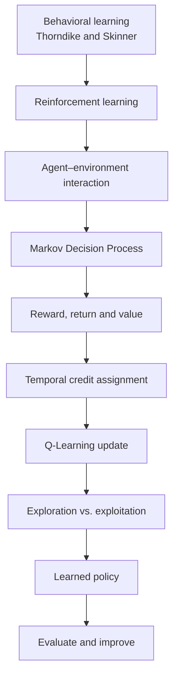
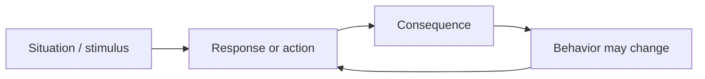
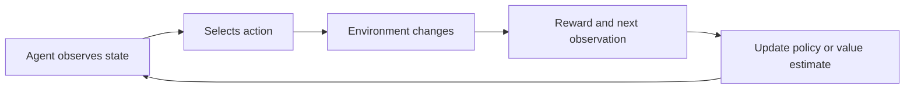
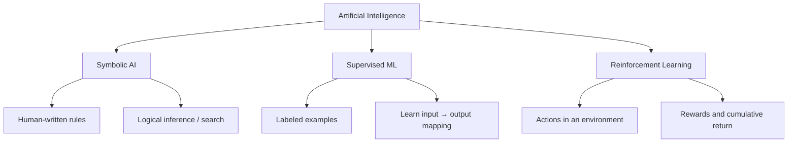
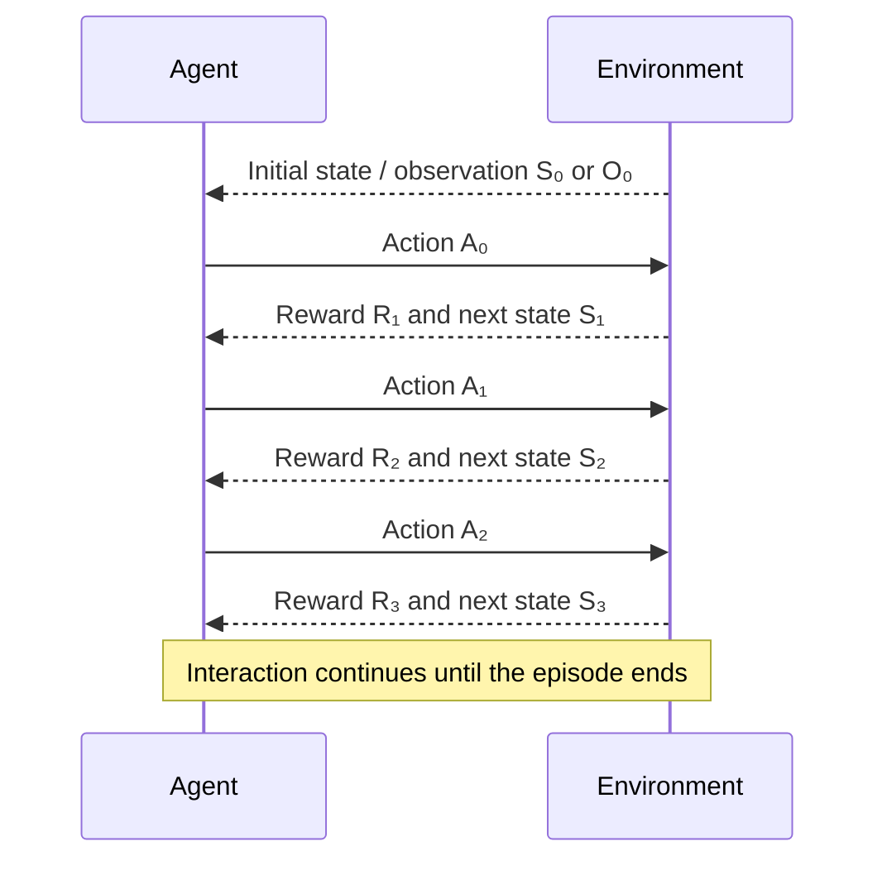
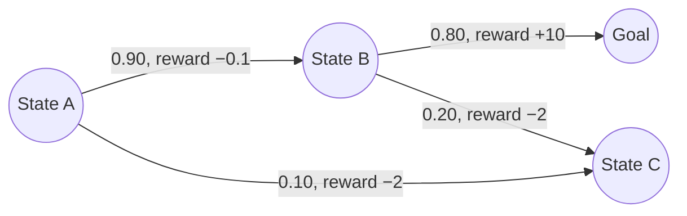
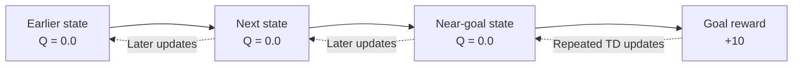
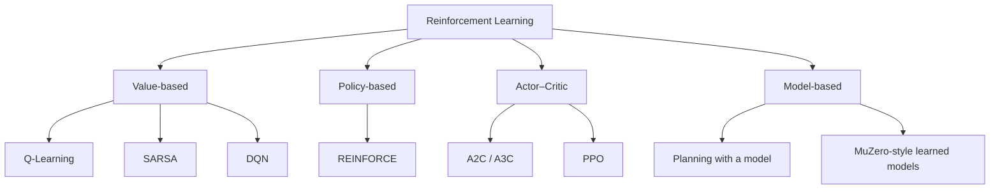
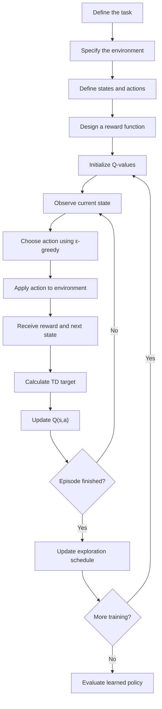

# 🤖 MODULE 07
# Behaviorist AI, the Agent–Environment Loop & Q-Learning

### From Thorndike and Skinner to Markov Decision Processes, temporal credit assignment, and learning optimal actions through trial and error

> **The central question:** How can an intelligent system learn what to do when nobody gives it a complete set of instructions? Reinforcement learning provides one answer: let an agent interact with an environment, observe the consequences of its actions, and improve its decision strategy using experience.

---

## 📘 Module Overview

| Module guide | Details |
|---|---|
| Module | 07 — Behaviorist AI, MDPs & Q-Learning |
| Topics | 16. Behaviorist AI · 17. Agent–Environment Loop and MDPs · 18. Rewards, Credit Assignment and Q-Learning |
| Estimated study time | 4–5 hours, including the exercises |
| Prerequisites | Basic Python, variables, functions, arrays or tables, and introductory AI concepts |
| Main mathematical ideas | Probability, expected value, cumulative reward, discounting, Bellman equations |
| Main algorithm | Tabular Q-Learning |
| Practical setting | A small grid-world maze |
| Learning approach | Understand the concept → inspect the diagram → work through the mathematics → test the algorithm |

## 🎯 Learning Objectives

By the end of this module, you should be able to:

1. Explain how Thorndike's Law of Effect and Skinner's operant conditioning influenced the way reinforcement learning is described.
2. Distinguish psychological behaviorism from computational reinforcement learning.
3. Compare symbolic AI, supervised machine learning, and reinforcement learning.
4. Identify the agent, environment, state, observation, action, reward, and policy in a learning task.
5. Explain the agent–environment interaction loop using time-step notation.
6. Define a Markov Decision Process (MDP) and interpret its states, actions, transition probabilities, rewards, and discount factor.
7. Explain the Markov property and distinguish fully observable from partially observable tasks.
8. Calculate a discounted return and interpret state-value and action-value functions.
9. Explain temporal credit assignment and the role of temporal-difference learning.
10. Apply the tabular Q-Learning update equation to a numerical example.
11. Explain why Q-Learning is an off-policy method.
12. Describe the exploration–exploitation trade-off and implement an ε-greedy action-selection strategy.
13. Identify the limitations of tabular Q-Learning and recognize other major reinforcement-learning algorithm families.
14. Interpret a small grid-world Q-table and evaluate whether a learned policy reaches a goal efficiently.

## 🗺️ Learning Roadmap



## 🧠 Core Idea in One Picture


*Figure 1. The agent chooses actions; the environment returns observations, rewards, and new states. Source: OpenAI Spinning Up, “Key Concepts in RL.” See the official [reinforcement-learning introduction](https://spinningup.openai.com/en/latest/spinningup/rl_intro.html).*

---

# PART I — THE BEHAVIORAL FOUNDATIONS OF REINFORCEMENT LEARNING

# 🧠 Topic 16: What Is Behaviorist AI?

## 1. The Bicycle-Learning Problem

Think about the first time you tried to ride a bicycle.

- Nobody gave you a complete mathematical model of balance, friction, angular momentum, and steering.
- You tried an action: turning the handlebars, shifting your weight, or pedaling.
- You observed what happened: the bicycle moved, tilted, slowed down, or fell.
- You adjusted your next action based on the result.

This is a useful analogy for **learning through interaction**. A learner does not need a complete list of instructions for every possible situation. It can improve its behavior by collecting experience and responding to feedback.

A computer system can use a related strategy. Instead of receiving a fixed instruction such as:

```text
Step 1: Move up.
Step 2: Move right.
Step 3: Move down.
Step 4: Stop.
```

a learning agent can repeatedly test actions in an environment and gradually estimate which choices lead to better long-term outcomes.

> **Important distinction:** A human learning to ride a bicycle and a computer running a reinforcement-learning algorithm are not biologically or psychologically identical. The analogy describes a shared pattern—action, consequence, adaptation—not the same mental process.

## 2. From Thorndike and Skinner to Computational Learning

### 2.1 Edward Thorndike and the Law of Effect

Edward Thorndike's **Law of Effect** is commonly summarized as follows:

- Behaviors followed by satisfying consequences become more likely to occur in similar situations.
- Behaviors followed by unsatisfying consequences become less likely to occur in similar situations.

Thorndike's work helped establish the importance of consequences in learning. It is an important historical foundation for later discussions of reinforcement and behavior.

### 2.2 B. F. Skinner and Operant Conditioning

B. F. Skinner developed the systematic study of **operant conditioning**. An operant is a behavior that acts on the environment and is influenced by its consequences.

A classic example is the operant conditioning chamber, commonly called a **Skinner box**. A chamber may include a lever or response key, a food dispenser, lights, and other experimental controls. Researchers can observe how the frequency of a behavior changes when consequences are delivered according to a schedule.


*Figure 2. A diagram of an operant conditioning chamber (Skinner box). The apparatus makes it possible to study how a response is related to its consequences. Image: AndreasJS / Pixelsquid, Wikimedia Commons, [CC BY-SA 3.0](https://creativecommons.org/licenses/by-sa/3.0/). Source page: [Wikimedia Commons](https://commons.wikimedia.org/wiki/File:Skinner_box_scheme_01.svg).*


*Figure 3. A historical operant conditioning chamber. Image source: [Wikimedia Commons — Skinner box photo 02](https://commons.wikimedia.org/wiki/File:Skinner_box_photo_02.jpg). Check the source page for the file's attribution and license details.*

### 2.3 Reinforcement and Punishment: A Crucial Vocabulary Distinction

In everyday speech, “positive” often means good and “negative” means bad. In operant conditioning, these words have a different technical meaning:

- **Positive** means that a stimulus is added.
- **Negative** means that a stimulus is removed.
- **Reinforcement** increases the future probability or frequency of a behavior.
- **Punishment** decreases the future probability or frequency of a behavior.

| Category | What happens? | Effect on behavior | Simple example |
|---|---|---|---|
| Positive reinforcement | A stimulus is added | Behavior becomes more likely | A learner receives praise after completing a task |
| Negative reinforcement | An unpleasant stimulus is removed | Behavior becomes more likely | A warning sound stops after a seat belt is fastened |
| Positive punishment | A stimulus is added | Behavior becomes less likely | An additional corrective task follows a rule violation |
| Negative punishment | A stimulus is removed | Behavior becomes less likely | A privilege is temporarily removed after a rule violation |

<figure>
  
  <figcaption><strong>Figure 4.</strong> An illustration of choice in an operant conditioning setting. Image by Mark E. Bouton, Wikimedia Commons, licensed under <a href="https://creativecommons.org/licenses/by-sa/4.0/">CC BY-SA 4.0</a>. Source: <a href="https://commons.wikimedia.org/wiki/File:Operant_Conditioning_Involves_Choice.png">Wikimedia Commons</a>.</figcaption>
</figure>

**Do not confuse negative reinforcement with punishment.** Negative reinforcement strengthens a behavior by removing a stimulus. Punishment, whether positive or negative, is intended to reduce a behavior.

### 2.4 Reinforcement Is Not the Same as a Reward Number

Psychological reinforcement is defined by its effect on behavior. A stimulus is a reinforcer if it increases the behavior it follows.

In computational reinforcement learning, a reward is normally represented as a numerical signal supplied by the environment. The algorithm uses that signal to update estimates or policy parameters.

The concepts are related, but they are not interchangeable:

| Behavioral psychology | Computational reinforcement learning |
|---|---|
| Studies how consequences influence behavior | Studies how an agent can optimize cumulative reward |
| Reinforcement is defined by its effect on future behavior | Reward is a numerical signal used by an algorithm |
| Experiments may involve organisms and controlled stimuli | Experiments may involve simulations, games, robots, or software environments |
| Learning is studied through behavioral evidence | Learning is studied through policies, value estimates, and performance measures |

## 3. How a Skinner Box Relates to a Learning Agent

A simplified analogy can be drawn between an animal in an operant conditioning chamber and a software agent in a simulated environment.



In a computational system:



The shared teaching pattern is:

**Situation → Action → Consequence → Adaptation**

However, the computer does not need to feel pleasure, pain, hunger, or disappointment. A Q-learning agent updates numerical estimates according to a mathematical rule.

## 4. What Is Behaviorist AI?

The phrase **Behaviorist AI** is sometimes used in teaching to describe AI systems that learn from actions and consequences. In modern computer science, the more standard technical term for this family of methods is **Reinforcement Learning (RL)**.

Reinforcement learning is a framework in which an agent interacts with an environment, receives rewards, and seeks a policy that maximizes cumulative reward.

An RL agent may maintain:

- a **policy** describing which action to select;
- a **value function** estimating the long-term return of a state;
- an **action-value function** estimating the return of a state–action pair;
- a **Q-table** in small discrete tasks;
- a **neural network** in larger tasks;
- a **world model** in some model-based methods.

The agent's “learning” is a mathematical change in parameters, estimates, or decision rules. It is not evidence that the system has human-like emotions or subjective experience.

### 4.1 Why trial and error is useful

A fixed rule-based program can perform well when the environment is predictable and the rules are known. However, a hand-written rule for every possible situation becomes difficult when:

- the environment contains many possible states;
- actions have uncertain consequences;
- the environment changes;
- a good action depends on future consequences;
- the developer cannot write a complete optimal policy in advance.

Reinforcement learning offers a way to improve decisions from interaction rather than requiring every decision to be manually specified.

### 4.2 The reward signal defines what the agent is encouraged to optimize

Suppose a maze agent receives:

| Event | Reward |
|---|---:|
| Reaches the exit | +10 |
| Hits a wall | −2 |
| Takes an ordinary step | −0.1 |

The reward design encourages the agent to reach the exit while avoiding unnecessary movement and wall collisions.

But reward design is not trivial. If the reward function does not represent the real objective accurately, an agent may find an unintended strategy that earns high reward without achieving the intended goal. This is often discussed as **reward hacking** or **reward misspecification**.

> **Design lesson:** The agent optimizes the objective it is given, not necessarily the objective its designer intended.

## 5. Three Major AI Paradigms

The following table compares three broad approaches to building intelligent systems.

| AI paradigm | How it works | What the human provides | Example applications |
|---|---|---|---|
| **1. Symbolic / rule-based AI** | Applies explicit facts, logic rules, and search procedures | Rules, symbols, constraints, and knowledge | Expert systems, rule-based configuration, logic programming |
| **2. Supervised machine learning** | Learns statistical patterns from labeled input–output examples | Training examples with labels | Spam classification, image classification, document categorization |
| **3. Reinforcement learning** | Learns through interaction and seeks to maximize cumulative reward | Environment, action interface, and reward design | Robot control, game-playing agents, simulated decision-making |

### Visual comparison



### 5.1 Symbolic AI

A symbolic system may use rules such as:

```python
if temperature > 38:
    alert = "High temperature"
else:
    alert = "Normal range"
```

The behavior is determined by rules supplied by a programmer or knowledge engineer.

### 5.2 Supervised Learning

A supervised learning system receives examples such as:

| Input | Human-provided label |
|---|---|
| Email containing suspicious links | Spam |
| Email from a known colleague | Not spam |
| Image of an apple | Apple |
| Image of a banana | Banana |

The model learns a statistical relationship between inputs and labels.

### 5.3 Reinforcement Learning

An RL agent receives no complete answer label for every action. Instead, it interacts with the environment and receives reward feedback.

For example, a maze agent may initially move randomly. After many episodes, its estimates can improve so that it selects actions that lead to the exit more efficiently.

## 6. Where Reinforcement Learning Is Used

| Application | Agent | Environment | Possible objective |
|---|---|---|---|
| Robot navigation | Robot-control policy | Physical or simulated space | Reach a target safely |
| Strategy games | Game-playing program | Game board and opponent | Maximize probability of winning |
| Resource allocation | Scheduling policy | Jobs, machines, and queues | Reduce waiting time or cost |
| Traffic signal control | Signal-control policy | Road network and traffic | Improve traffic flow |
| Recommendation experiments | Ranking or selection policy | Users and content choices | Optimize a carefully defined long-term metric |
| Industrial control | Control policy | Process or plant | Maintain performance within constraints |

### 6.1 Real-world success requires more than a high reward score

A successful simulation does not guarantee safe performance in the real world. Deployment can introduce:

- sensor noise;
- hardware wear;
- changing conditions;
- unexpected users or objects;
- differences between the simulator and the real environment;
- safety constraints that are not fully represented by the reward function.

For real-world systems, learning must be combined with testing, monitoring, constraints, and appropriate human oversight.

---

# PART II — THE AGENT–ENVIRONMENT LOOP AND MARKOV DECISION PROCESSES

# 🔄 Topic 17: The Agent–Environment Loop & Markov Decision Processes (MDPs)

## 7. The Agent–Environment Boundary

Consider a mobile robot moving across a wet floor. Which parts are the agent, and which parts are the environment?

A useful introductory modeling convention is:

- **Agent:** the decision-making algorithm that selects actions.
- **Environment:** the world and system dynamics that respond to those actions.

Under this convention, the robot's physical wheels, motors, battery, floor, and surrounding objects are treated as part of the environment model. The policy is the decision-making component.

**Modeling clarification:** This is a useful boundary for the example, not a universal rule about every robotics architecture. In some engineering designs, sensing and actuation modules are described as parts of the agent system. The important requirement is to define the boundary consistently so that the model makes clear what chooses actions and what responds.

## 8. The Reinforcement-Learning Interaction Loop

At time step \(t\):

1. The agent receives the current state or observation.
2. The agent selects an action.
3. The environment applies the action.
4. The environment produces a reward.
5. The environment moves to a new state.
6. The process repeats.


*Figure 5. The agent–environment loop. The agent selects an action; the environment returns a reward and a new state or observation. Source: [OpenAI Spinning Up — Key Concepts in RL](https://spinningup.openai.com/en/latest/spinningup/rl_intro.html).*

### 8.1 Formal time-step notation

The interaction can be written as:

\[
S_t \xrightarrow{\text{Agent chooses } A_t}
\text{Environment}
\xrightarrow{\text{response}}
(R_{t+1}, S_{t+1})
\]

| Symbol | Meaning |
|---|---|
| \(S_t\) | State at time \(t\) |
| \(O_t\) | Observation available to the agent |
| \(A_t\) | Action selected at time \(t\) |
| \(R_{t+1}\) | Reward received after the action |
| \(S_{t+1}\) | Next state |
| \(\pi\) | Policy used to select actions |

The reward is commonly indexed as \(R_{t+1}\) because it is observed after action \(A_t\) changes the environment.

### 8.2 The loop as a sequence



## 9. Core Building Blocks of an MDP

A **Markov Decision Process (MDP)** is a mathematical framework for modeling sequential decision-making when actions influence state transitions and rewards.

A common MDP representation includes:

\[
\mathcal{M} = (S, A, P, R, \gamma)
\]

Some references use a five-tuple such as \((S,A,P,R,\rho_0)\), where \(\rho_0\) is the initial-state distribution, and treat \(\gamma\) as a separate objective parameter. Notation varies across textbooks and implementations. This module uses \(S,A,P,R,\gamma\) for the introductory model and discusses the initial-state distribution separately.

| Component | Meaning | Grid-world example |
|---|---|---|
| \(S\) | Set of possible states | Every valid cell in a 4 × 4 maze |
| \(A\) | Set of available actions | Up, Down, Left, Right |
| \(P(s' \mid s,a)\) | Probability of reaching next state \(s'\) after action \(a\) in state \(s\) | Moving Right succeeds with probability 0.90 |
| \(R(s,a,s')\) | Reward associated with a transition | +10 at the exit; −2 for a wall collision |
| \(\gamma\) | Discount factor for future rewards | 0.90 |
| \(\rho_0\) | Distribution over initial states | Start at the bottom-left cell |

### 9.1 State

A **state** describes the relevant configuration of the environment at a particular time.

In a simple maze, a state may be the robot's current grid coordinate:

\[
S_t = (2,1)
\]

In a more complex robot-control task, the state may include position, velocity, orientation, battery level, and other variables needed to predict what happens next.

### 9.2 Observation

An **observation** is the information that the agent actually receives.

For example:

- True state: the complete map, robot position, and obstacle locations.
- Observation: a camera image or a distance-sensor reading such as “obstacle detected 10 cm ahead.”

The distinction matters because an agent may not have access to the complete state.

| Fully observable task | Partially observable task |
|---|---|
| The agent receives all relevant state information | The agent receives incomplete or noisy information |
| The state may be directly available | The agent may need memory or a belief estimate |
| A standard MDP may be suitable | A Partially Observable MDP (POMDP) may be more appropriate |

### 9.3 Action Space

The **action space** is the set of actions the agent is allowed to choose.

A discrete maze:

\[
A = \{\text{Up, Down, Left, Right}\}
\]

A robot arm may use continuous-valued actions such as joint velocities or torques. Discrete and continuous action spaces often require different algorithm designs.

### 9.4 Reward Function

A reward function assigns a numerical signal to an event, state, or transition.

Example:

| Event | Reward |
|---|---:|
| Reach the exit | +10 |
| Hit a wall | −2 |
| Take one ordinary step | −0.1 |
| Fall into a hazard | −10 |

A reward can be positive, zero, or negative. A negative reward is often called a penalty.

**The reward is not necessarily the same as the final objective.** It is a designed signal intended to guide learning toward the objective.

### 9.5 Transition Probability

The transition function describes how the environment changes after an action.

A deterministic environment may always produce the same next state for a given state and action:

\[
P(S_{t+1}=s' \mid S_t=s,A_t=a)=1
\]

A stochastic environment may have several possible outcomes.

Example: a robot attempts to move Right on a slippery floor.

| Outcome | Probability |
|---|---:|
| Moves Right as intended | 0.90 |
| Slips into an adjacent cell | 0.10 |
| Total | 1.00 |

The probabilities for all possible next states must sum to 1 for a fixed state and action.


*Figure 6. An MDP interaction diagram showing the agent's policy and the environment's transition-and-reward mechanism. Source: [Ecole documentation — Using Environments](https://doc.ecole.ai/py/en/stable/using-environments.html).*

### 9.6 A Small Stochastic MDP



The labels illustrate the transition probability and the reward associated with each outcome. They are teaching values, not measurements from a real robot.

## 10. The Markov Property

The **Markov property** states that, when the state is properly defined, the next-state distribution depends on the current state and action rather than the entire history.

\[
P(S_{t+1}\mid S_t,A_t,S_{t-1},A_{t-1},\ldots)
=
P(S_{t+1}\mid S_t,A_t)
\]

In plain language:

> If the current state contains all information needed to predict the next transition, the earlier history does not add predictive information.

### Example

Suppose a maze state is defined only by the robot's position. If the maze contains moving obstacles, position alone may not be enough. The future may also depend on obstacle positions or velocities.

To make the state more informative, the model may need to include those variables.

### Why the Markov property matters

- It allows the task to be represented using a compact state description.
- It supports standard MDP planning and learning methods.
- It clarifies what information an agent needs to make a decision.
- It exposes modeling mistakes when important variables are omitted.

### 10.1 Markov state vs. incomplete observation

A state can be Markov even when the agent does not observe it fully. In that case, the agent is solving a partially observable problem and may need memory or a belief state.

A **belief state** is a probability distribution over possible underlying states. It represents what the agent currently believes about the environment.

## 11. Policy: The Agent's Decision Strategy

A **policy** specifies how an agent chooses actions.

A deterministic policy selects one action for a given state:

\[
a_t = \mu(s_t)
\]

A stochastic policy assigns probabilities to possible actions:

\[
\pi(a\mid s)=P(A_t=a\mid S_t=s)
\]

Example:

| State | Up | Down | Left | Right |
|---|---:|---:|---:|---:|
| Cell (0,2) | 0.02 | 0.01 | 0.02 | 0.95 |

The policy selects Right with a probability of 95% in this illustrative state.

### 11.1 Policy and Q-table

A Q-table stores estimated values for state–action pairs. A greedy policy can choose the action with the largest Q-value:

\[
\pi(s)=\arg\max_a Q(s,a)
\]

The policy is therefore a decision rule derived from the value estimates.

## 12. Episodes, Trajectories, and Initial States

A **trajectory** is a sequence of states and actions generated through interaction:

\[
\tau=(S_0,A_0,R_1,S_1,A_1,R_2,\ldots)
\]

An **episode** is one interaction run that starts from an initial state and ends when the task reaches a terminal condition or another defined stopping condition.

Examples:
- one complete maze attempt;
- one game;
- one simulated robot navigation run;
- one balancing attempt in a control environment.

The initial state may be fixed or sampled from a distribution \(\rho_0\). Randomizing the initial state can help an agent learn a policy that works across more situations rather than only from one starting position.

## 13. Terminal States and Time Limits

A terminal state ends an episode because the task has reached a defined end condition, such as reaching the goal or entering a fatal hazard.

A time limit can also stop an episode even when the underlying task has not reached a true terminal state.

Modern reinforcement-learning environment interfaces distinguish these cases:

- **Terminated:** the task's terminal condition has been reached.
- **Truncated:** the episode was stopped by a condition outside the task's natural terminal definition, often a time limit.

This distinction matters when an algorithm decides whether to bootstrap from a next-state value. See the [Gymnasium environment API](https://gymnasium.farama.org/api/env/).

---

# PART III — REWARDS, VALUE FUNCTIONS AND Q-LEARNING

# 📈 Topic 18: Learning from Rewards & Penalties

## 14. The Temporal Credit Assignment Problem

Imagine a football team makes several passes before scoring a goal. The final goal produces a large positive outcome, but earlier actions helped create the opportunity.

How should a learning algorithm assign credit to actions that happened many steps before the final reward?

This is the **temporal credit assignment problem**.

In reinforcement learning, an action may have little immediate reward but may lead to a state from which a large reward becomes possible later.

### Example: A Maze Journey

```text
Start → Move Up → Move Up → Turn Right → Move Right → Exit
  0       0          0          0           0        +10
```

If only the exit provides a reward, the agent must learn that earlier moves contributed to reaching it.

### Reward propagation illustration


*Figure 7. A sequence of maze visualizations showing how learned values spread through a grid over repeated training iterations. Source: [MazeGame — Huy Mai](https://sabertoaster.github.io/projects/mazegame/). The image illustrates a learning process; exact values and results depend on the environment and training setup.*

## 15. Reward, Return, and Discounting

A reward is the immediate numerical feedback received after a transition. A **return** is the cumulative reward collected over time.

The discounted return from time \(t\) is commonly written as:

\[
G_t=R_{t+1}+\gamma R_{t+2}+\gamma^2R_{t+3}+\cdots
\]

For an episodic task with terminal time \(T\):

\[
G_t=\sum_{k=0}^{T-t-1}\gamma^k R_{t+k+1}
\]

The discount factor satisfies:

\[
0\leq \gamma \leq 1
\]

For many infinite-horizon discounted formulations, \(\gamma\) is chosen below 1.

### 15.1 What does the discount factor do?

The discount factor determines how much future rewards contribute to the current return.

| Discount factor | Interpretation |
|---:|---|
| \(\gamma=0\) | Only immediate reward contributes |
| \(\gamma=0.5\) | Future rewards are discounted substantially |
| \(\gamma=0.9\) | Future rewards remain important |
| \(\gamma\) close to 1 | The agent places substantial weight on distant rewards |

Example: If a reward of +10 arrives one step in the future:

\[
0.9\times 10=9
\]

Its one-step discounted contribution is +9.

If the same reward arrives three steps in the future:

\[
0.9^3\times 10=7.29
\]

The farther reward contributes less to the present return.

### 15.2 Why discount future rewards?

Discounting can:
- express a preference for earlier rewards;
- make infinite-horizon return sums finite under standard conditions;
- control how strongly an agent values distant outcomes;
- influence the learned policy.

The best value of \(\gamma\) depends on the task. A high discount factor is not automatically better.

## 16. State-Value and Action-Value Functions

### 16.1 State-value function \(V^\pi(s)\)

The state-value function estimates the expected return when the agent starts in state \(s\) and follows policy \(\pi\).

\[
V^\pi(s)=\mathbb{E}_{\pi}[G_t\mid S_t=s]
\]

It answers:

**“How good is it to be in this state if I follow this policy?”**

### 16.2 Action-value function \(Q^\pi(s,a)\)

The action-value function estimates the expected return when the agent starts in state \(s\), takes action \(a\), and then follows policy \(\pi\).

\[
Q^\pi(s,a)=\mathbb{E}_{\pi}[G_t\mid S_t=s,A_t=a]
\]

It answers:

**“How good is it to take this particular action in this state?”**

### 16.3 Optimal value functions

The optimal state-value function is:

\[
V^*(s)=\max_\pi V^\pi(s)
\]

The optimal action-value function is:

\[
Q^*(s,a)=\max_\pi Q^\pi(s,a)
\]

An optimal greedy action can be obtained from the optimal Q-function:

\[
a^*(s)=\arg\max_a Q^*(s,a)
\]

### 16.4 Visualizing a value function


*Figure 8. An example grid-world value-function visualization. Cell values represent estimated state values; walls and terminal regions constrain movement. Source: [Purdue University — MATLAB educational demos](https://www.math.purdue.edu/~zhan1966/teaching/Matlab_demo/demos.html).*

A heatmap makes the idea of a value landscape easier to understand:

- lower-value states may be far from the goal or close to hazards;
- higher-value states may lead efficiently to a positive terminal outcome;
- walls prevent the agent from taking certain routes;
- the best action can be selected by comparing action values.

**Note:** A state-value heatmap is not the same thing as a Q-table. A Q-table contains a value for each state–action pair, while a state-value table contains one value per state under a specified policy or optimality criterion.

## 17. Bellman Equations: Breaking a Long-Term Problem into Smaller Parts

The Bellman principle expresses the value of a state or action in terms of immediate reward plus the value of what happens next.

For an optimal state-value function:

\[
V^*(s)=\max_a \mathbb{E}\left[R_{t+1}+\gamma V^*(S_{t+1})\mid S_t=s,A_t=a\right]
\]

For an optimal action-value function:

\[
Q^*(s,a)=\mathbb{E}\left[R_{t+1}+\gamma\max_{a'}Q^*(S_{t+1},a')\mid S_t=s,A_t=a\right]
\]

The second equation is central to Q-Learning.

### 17.1 The intuition

Imagine the agent is in Cell A and considers moving Right to Cell B.

The value of moving Right depends on:

1. the immediate reward for the move;
2. the best expected future value available from Cell B;
3. how strongly future value is discounted.

The action is valuable when it leads to a favorable combination of immediate and future outcomes.

## 18. Monte Carlo Learning vs. Temporal-Difference Learning

Both approaches learn from experience, but they update estimates in different ways.

| Feature | Monte Carlo methods | Temporal-Difference (TD) methods |
|---|---|---|
| When update occurs | Often after an episode ends | Can update after each time step |
| Learning target | Observed return | Reward plus a bootstrapped estimate |
| Uses a next-state estimate? | Not in the basic return target | Yes |
| Suitable for continuing interaction? | Basic episodic methods wait for an episode | Often suitable for step-by-step learning |
| Main idea | Learn from complete sampled outcomes | Learn from reward and estimated future value |

### 18.1 What is bootstrapping?

Bootstrapping means updating an estimate using another current estimate.

For example, an agent may not know the final return yet. It can still update the value of its current action using the immediate reward plus the current estimate of the next state's best value.

This allows information to be learned and propagated step by step.

## 19. Tabular Q-Learning

**Q-Learning** is a model-free, off-policy, temporal-difference control algorithm. In a small discrete problem, it stores estimates in a table.

For every state \(s\), the table contains one value for every available action \(a\):

\[
Q(s,a)
\]

For a maze with four possible actions, each state has four Q-values:

| State | Up | Down | Left | Right |
|---|---:|---:|---:|---:|
| Cell A | 0.0 | 0.0 | 0.0 | 0.0 |
| Cell B | 0.0 | 0.0 | 0.0 | 0.0 |
| Cell C | 0.0 | 0.0 | 0.0 | 0.0 |

The values are estimates, not guaranteed rewards. They change as the agent collects experience.

### 19.1 The Q-Learning update equation

After the agent takes action \(a\) in state \(s\), it receives reward \(r\) and reaches state \(s'\).

The update rule is:

\[
\boxed{
Q_{\text{new}}(s,a)
=
Q(s,a)+\alpha
\left[
r+\gamma\max_{a'}Q(s',a')-Q(s,a)
\right]
}
\]

The expression inside the square brackets is the **temporal-difference error** for the non-terminal case.

### 19.2 Understanding each variable

| Symbol | Name | Meaning |
|---|---|---|
| \(Q(s,a)\) | Old Q-value | Current estimate for taking action \(a\) in state \(s\) |
| \(Q_{\text{new}}(s,a)\) | Updated Q-value | Estimate after the learning step |
| \(\alpha\) | Learning rate | How much the new information changes the old estimate |
| \(r\) | Immediate reward | Feedback from the latest transition |
| \(\gamma\) | Discount factor | Weight assigned to future reward |
| \(s'\) | Next state | State reached after the action |
| \(a'\) | Possible next action | Action available in the next state |
| \(\max_{a'}Q(s',a')\) | Best next-state estimate | Highest current Q-value among next-state actions |

### 19.3 Learning rate \(\alpha\)

\[
0<\alpha\leq 1
\]

- A small learning rate makes updates more gradual.
- A large learning rate gives more weight to the latest target.
- If the learning rate is too high in a noisy environment, estimates may fluctuate.
- If it is too low, learning may be slow.

### 19.4 Discount factor \(\gamma\)

\[
0\leq\gamma<1
\]

In many discounted continuing tasks, \(\gamma\) is below 1. In finite episodic settings, conventions can differ.

- A low value emphasizes immediate rewards.
- A high value emphasizes future rewards.
- The appropriate value depends on the task and its reward horizon.

### 19.5 Terminal-state handling

If the next state is terminal, there is no future action value to bootstrap from. The target should be the terminal transition reward:

\[
\text{Target}=r
\]

For a simple episodic task, the update can be written as:

\[
Q(s,a)\leftarrow Q(s,a)+\alpha
\left[r+\gamma(1-d)\max_{a'}Q(s',a')-Q(s,a)\right]
\]

where \(d=1\) when the transition reaches a true terminal state and \(d=0\) otherwise.

Do not automatically treat every time-limit truncation as a true terminal state. In some learning setups, the algorithm should bootstrap through a time-limit truncation because the underlying task has not actually terminated.

## 20. Worked Q-Learning Calculation

Suppose the robot is in **Cell A**.

The current estimate for moving Right is:

\[
Q(A,\text{Right})=2.0
\]

The robot moves Right into **Cell B** and receives:

\[
r=-0.1
\]

The best available Q-value in Cell B is:

\[
\max_{a'}Q(B,a')=6.0
\]

The learning parameters are:

\[
\alpha=0.5,\qquad \gamma=0.9
\]

### Step 1 — Calculate the target value

\[
\begin{aligned}
\text{Target}
&=r+\gamma\max_{a'}Q(B,a')\\
&=-0.1+(0.9\times6.0)\\
&=-0.1+5.4\\
&=\boxed{5.3}
\end{aligned}
\]

### Step 2 — Calculate the temporal-difference error

\[
\begin{aligned}
\delta
&=\text{Target}-Q(A,\text{Right})\\
&=5.3-2.0\\
&=\boxed{3.3}
\end{aligned}
\]

### Step 3 — Update the Q-value

\[
\begin{aligned}
Q_{\text{new}}(A,\text{Right})
&=2.0+0.5(3.3)\\
&=2.0+1.65\\
&=\boxed{3.65}
\end{aligned}
\]

<figure>
  
  <figcaption><strong>Figure 9.</strong> A maze-based visualization of how value estimates can develop over training. The update above illustrates one numerical step in that learning process. Source: <a href="https://sabertoaster.github.io/projects/mazegame/">MazeGame</a>.</figcaption>
</figure>

### Interpretation

The old estimate was 2.0. The target based on the immediate reward and the next state's best estimated value was 5.3. With a learning rate of 0.5, the old estimate moved halfway toward that target, becoming 3.65.

**Key insight:** The action's value increased because it led to a state with a relatively high estimated future value, even though the immediate step reward was slightly negative.

## 21. How Q-Learning Learns Across Repeated Episodes

At the beginning of training, the agent may initialize all Q-values to zero:

```text
Episode 1:
Most actions have Q-value 0.0
The agent has little or no experience.

Episode 10:
Some actions have been tried repeatedly.
The agent begins to distinguish useful and unhelpful moves.

Episode 100:
Useful routes have received higher estimates.
The agent is more likely to choose actions leading toward the goal.

After sufficient training:
The greedy policy may select a short, high-return route.
```

The exact number of episodes required depends on the environment, exploration strategy, learning parameters, and randomness. “100 episodes” is only an illustration, not a universal convergence guarantee.

### 21.1 Q-value propagation

A reward at the goal can influence the value of the preceding state. Later updates can influence states further back along the route.



This is a conceptual illustration. In actual Q-Learning, values are updated for state–action pairs based on sampled transitions.

---

## 22. Exploration vs. Exploitation

A reinforcement-learning agent must balance two competing choices.

### Exploration

The agent tries actions whose outcomes are not yet well understood. Exploration can reveal a better route or a higher-reward strategy.

### Exploitation

The agent selects the action that currently appears best according to its learned estimates.

### Everyday analogy: The Apple Tree and the Unknown Trail

Imagine two choices:

- A familiar apple tree gives a reliable reward of +5.
- An unknown trail may lead to a banana grove worth +50, but it may also lead to a thorny bush worth −10.

Choosing the known apple tree is exploitation. Investigating the unknown trail is exploration.


*Figure 10. An illustration of ε-greedy action selection. The agent explores with probability ε and exploits its current best action with probability approximately 1−ε. Source: [TutorialsPoint — Exploration and Exploitation](https://www.tutorialspoint.com/machine_learning/machine_learning_exploitation_and_exploration.htm).*

## 23. The ε-Greedy Strategy

A common action-selection method is **epsilon-greedy**.

At each decision:
- with probability \(\varepsilon\), choose a random action;
- with probability \(1-\varepsilon\), choose an action with the highest current Q-value.

\[
A_t =
\begin{cases}
\text{random action}, & \text{with probability }\varepsilon\\
\arg\max_a Q(S_t,a), & \text{with probability }1-\varepsilon
\end{cases}
\]

### 23.1 Three exploration settings

| Setting | Behavior | Limitation |
|---|---|---|
| \(\varepsilon=0\) | Always exploits the current best estimate | May never discover a better action |
| \(\varepsilon=1\) | Always explores randomly | Does not exploit learned Q-values |
| \(0<\varepsilon<1\) | Mixes exploration and exploitation | Requires a suitable schedule |

### 23.2 Example: Annealing epsilon

An agent may begin with a relatively high exploration rate and gradually reduce it.

Illustrative schedule:

| Training stage | Epsilon | Approximate behavior |
|---|---:|---|
| Early | 0.30 | Explore 30% of the time |
| Middle | 0.15 | Explore 15% of the time |
| Later | 0.05 | Explore 5% of the time |
| Evaluation | 0.00 | Use a greedy policy |

A possible exponential decay rule is:

\[
\varepsilon_t=\max(\varepsilon_{\min},\varepsilon_0\lambda^t)
\]

where:
- \(\varepsilon_0\) is the initial exploration rate;
- \(\lambda\) is a decay factor between 0 and 1;
- \(\varepsilon_{\min}\) is the minimum exploration rate.

A schedule such as 0.30 down to 0.02 is an example, not a universal best practice. The correct schedule depends on how much exploration the task needs.

### 23.3 Why exploration should not disappear too early

If the agent stops exploring before it has visited important parts of the environment, it may settle on a poor policy.

For example:
- it discovers a long route to the exit;
- it receives enough reward to consider that route acceptable;
- it rarely tries alternative paths;
- it fails to discover a shorter route.

Exploration helps the agent gather evidence about alternatives.

### 23.4 Why exploration should not remain too high forever

If the agent continues choosing random actions at a high rate, it may keep making mistakes even after learning a strong policy.

The goal is not necessarily to eliminate all exploration during training. The goal is to use an exploration strategy appropriate to the learning objective and environment.

## 24. Q-Learning Is Off-Policy

Q-Learning is described as **off-policy** because it learns the value of a greedy target policy while it may behave according to a different exploratory policy.

- **Behavior policy:** the policy used to choose actions during data collection, often ε-greedy.
- **Target policy:** the policy whose action values are being learned, typically greedy with respect to Q.

The update uses:

\[
\max_{a'}Q(s',a')
\]

It uses the highest estimated next-state action value, even if the behavior policy might choose a different action during exploration.

### 24.1 Q-Learning vs. SARSA

SARSA is an on-policy temporal-difference control method. Its update uses the next action actually selected by the behavior policy.

| Feature | Q-Learning | SARSA |
|---|---|---|
| Type | Off-policy | On-policy |
| Next-state target | Maximum next-state Q-value | Q-value of the next action actually selected |
| Typical update | \(r+\gamma\max_{a'}Q(s',a')\) | \(r+\gamma Q(s',a')\) |
| Policy perspective | Learns a greedy target policy | Learns the value of the policy being followed |
| Key implication | May learn an optimal greedy route while exploration still creates risky actions | Incorporates the exploratory behavior into its updates |

**Why this distinction matters:** In a maze with a dangerous cliff, Q-Learning may learn the shortest route next to the cliff while ε-greedy exploration still occasionally causes a fall. SARSA can learn a safer route because its update accounts for the exploratory action that may actually be taken next.

---

# PART IV — PRACTICAL IMPLEMENTATION AND LEARNING ACTIVITIES

## 25. A 4 × 4 Grid-World Example

A grid world is a simple environment for learning how actions, rewards, and Q-values interact.

The agent begins at the bottom-left and must reach the goal at the top-right.

```text
       Column
        0   1   2   3
      +---+---+---+---+
Row 0 | . | . | . | G |
      +---+---+---+---+
Row 1 | . | # | . | . |
      +---+---+---+---+
Row 2 | . | # | . | . |
      +---+---+---+---+
Row 3 | S | . | . | . |
      +---+---+---+---+

S = Start
G = Goal
# = Wall
. = Empty cell
```

### Example reward design

| Event | Reward |
|---|---:|
| Reaching the goal | +10 |
| Hitting a wall | −2 |
| Attempting to move outside the grid | −2 |
| Taking an ordinary step | −0.1 |

The small step penalty encourages shorter routes. The wall penalty discourages invalid movement. The goal reward makes successful completion valuable.

## 26. Q-Learning Pseudocode

```text
Initialize Q(s, a) for every state and action

For each episode:
    Reset the environment
    Observe the initial state s

    Repeat until the episode ends:
        Choose action a using an epsilon-greedy policy
        Execute action a
        Observe reward r and next state s'

        If s' is terminal:
            target = r
        Else:
            target = r + gamma * max_a' Q(s', a')

        Q(s, a) = Q(s, a) + alpha * (target - Q(s, a))

        s = s'

Return the learned Q-table and policy
```

## 27. Python Example — A Small Tabular Q-Learning Agent

The following code demonstrates a simple deterministic grid world. It is designed for learning the mechanics of tabular Q-Learning rather than for production use.

```python
import random
import numpy as np

# -------------------------------------------------
# 1. Define the grid-world environment
# -------------------------------------------------

ROWS, COLS = 4, 4

START = (3, 0)
GOAL = (0, 3)

WALLS = {
    (1, 1),
    (2, 1),
}

ACTIONS = ["up", "down", "left", "right"]

MOVE = {
    "up":    (-1, 0),
    "down":  (1, 0),
    "left":  (0, -1),
    "right": (0, 1),
}

# -------------------------------------------------
# 2. Define the environment transition
# -------------------------------------------------

def step(state, action):
    if state == GOAL:
        return state, 0.0, True

    dr, dc = MOVE[action]
    next_state = (state[0] + dr, state[1] + dc)

    # Penalize movement outside the grid.
    if not (0 <= next_state[0] < ROWS and
            0 <= next_state[1] < COLS):
        return state, -2.0, False

    # Penalize a wall collision.
    if next_state in WALLS:
        return state, -2.0, False

    # Reward reaching the goal.
    if next_state == GOAL:
        return next_state, 10.0, True

    # Small cost for an ordinary step.
    return next_state, -0.1, False

# -------------------------------------------------
# 3. Initialize Q-table and hyperparameters
# -------------------------------------------------

Q = np.zeros((ROWS, COLS, len(ACTIONS)))

alpha = 0.5
gamma = 0.9

epsilon = 0.30
epsilon_min = 0.02
epsilon_decay = 0.995

episodes = 1000
max_steps = 100

random.seed(42)
np.random.seed(42)

# -------------------------------------------------
# 4. Train the agent
# -------------------------------------------------

for episode in range(episodes):
    state = START

    for _ in range(max_steps):

        # Epsilon-greedy action selection.
        if random.random() < epsilon:
            action_index = random.randrange(len(ACTIONS))
        else:
            action_index = int(
                np.argmax(Q[state[0], state[1], :])
            )

        action = ACTIONS[action_index]

        next_state, reward, terminated = step(state, action)

        # Do not bootstrap from a true terminal state.
        if terminated:
            target = reward
        else:
            best_next_value = np.max(
                Q[next_state[0], next_state[1], :]
            )
            target = reward + gamma * best_next_value

        # Temporal-difference update.
        old_value = Q[state[0], state[1], action_index]

        Q[state[0], state[1], action_index] = (
            old_value + alpha * (target - old_value)
        )

        state = next_state

        if terminated:
            break

    # Gradually reduce exploration.
    epsilon = max(epsilon_min, epsilon * epsilon_decay)

# -------------------------------------------------
# 5. Display the learned action at each cell
# -------------------------------------------------

ARROWS = {
    "up": "↑",
    "down": "↓",
    "left": "←",
    "right": "→",
}

print("Learned greedy policy:")
for row in range(ROWS):
    symbols = []

    for col in range(COLS):
        state = (row, col)

        if state == START:
            symbols.append("S")
        elif state == GOAL:
            symbols.append("G")
        elif state in WALLS:
            symbols.append("#")
        else:
            best_action = int(np.argmax(Q[row, col, :]))
            symbols.append(ARROWS[ACTIONS[best_action]])

    print(" ".join(symbols))

print("\nQ-table shape:", Q.shape)
```

### 27.1 How to interpret the code

| Code section | Purpose |
|---|---|
| Environment definition | Defines the grid, start, goal, and walls |
| `step()` | Applies an action and returns the next state, reward, and terminal flag |
| Q-table | Stores four action values for each grid cell |
| Epsilon-greedy selection | Balances random exploration with greedy exploitation |
| Target calculation | Uses immediate reward and best next-state value |
| TD update | Moves the old estimate toward the new target |
| Epsilon decay | Gradually reduces random exploration |
| Policy display | Shows the highest-valued action in each cell |

**Implementation note:** This is a compact demonstration. It uses a fixed starting state and a small discrete state space. More advanced tasks require careful handling of terminal and truncated episodes, stochastic transitions, ties between actions, and reproducible evaluation.

## 28. Optional Extension — Use a Standard RL Environment

The [Gymnasium environment API](https://gymnasium.farama.org/api/env/) provides a common interface for interacting with many reinforcement-learning environments.

The core interaction pattern is:

```python
observation, info = env.reset()

observation, reward, terminated, truncated, info = env.step(action)

if terminated or truncated:
    observation, info = env.reset()
```

The environment's `step()` method returns:
- the next observation;
- the reward;
- a `terminated` flag;
- a `truncated` flag;
- auxiliary information.

The distinction between `terminated` and `truncated` is important for learning algorithms that bootstrap from next-state estimates.

---

# PART V — BEYOND TABULAR Q-LEARNING

## 29. The Four Broad Families of Reinforcement-Learning Algorithms

Reinforcement learning contains several families of methods. The categories below are useful for introductory comparison, although some modern algorithms combine ideas from more than one family.



### 29.1 Value-Based Methods

Value-based algorithms estimate how good states or state–action pairs are.

Examples:
- Q-Learning;
- SARSA;
- Deep Q-Networks (DQN).

A policy can be derived by choosing the action with the highest estimated Q-value.

### 29.2 Policy-Based Methods

Policy-based algorithms directly optimize a parameterized policy.

Instead of learning only a table of action values, the system adjusts the policy parameters to increase the expected return.

Example:
- REINFORCE.

### 29.3 Actor–Critic Methods

Actor–Critic methods combine two components:

- **Actor:** selects actions according to a policy.
- **Critic:** estimates the value of states or actions and helps evaluate the actor's decisions.

Examples include:
- Advantage Actor–Critic (A2C);
- Asynchronous Advantage Actor–Critic (A3C);
- Proximal Policy Optimization (PPO).

### 29.4 Model-Based Methods

Model-based approaches use a model of the environment to predict possible future outcomes and support planning.

The model may be:
- supplied by the environment designer;
- learned from experience;
- combined with a search or planning procedure.

Examples include model-based planning systems and methods such as MuZero, which learns a model useful for planning.

### 29.5 Comparing the four families

| Family | Main learned quantity | Main strength | Typical challenge |
|---|---|---|---|
| Value-based | \(V(s)\) or \(Q(s,a)\) | Direct action comparison | Large or continuous action spaces can be difficult |
| Policy-based | Policy parameters | Direct policy optimization; useful for stochastic policies | Gradient estimates can have high variance |
| Actor–Critic | Policy and value estimates | Combines policy learning with value-based evaluation | More components and tuning |
| Model-based | Environment dynamics or predictive model | Can support planning and sample-efficient decisions | Model errors can mislead planning |

## 30. Tabular Q-Learning vs. Deep Q-Networks

Tabular Q-Learning is practical when the state and action spaces are small enough to store in a table.

For a large state space, the table may become too large or too sparse.

A **Deep Q-Network (DQN)** uses a neural network to approximate action values:

\[
Q(s,a;\theta)
\]

where \(\theta\) represents the network parameters.

| Tabular Q-Learning | Deep Q-Network |
|---|---|
| Stores explicit values in a table | Approximates values with a neural network |
| Best for small discrete state spaces | Can handle much larger observation spaces |
| Easy to inspect and explain | Harder to interpret |
| No neural-network training required | Requires neural-network optimization |
| Table size grows with state–action combinations | Network generalizes across inputs, but introduces approximation challenges |

DQN is not simply “Q-Learning with a bigger table.” It introduces function approximation and additional techniques to stabilize training.

## 31. Limitations and Practical Challenges

### 31.1 State-space explosion

A table becomes impractical when there are too many possible states or actions.

### 31.2 Sample inefficiency

An agent may need many interactions before it learns a useful policy. In a physical robot, interactions can be expensive or risky.

### 31.3 Reward design

A poorly designed reward can encourage unintended behavior. A high numerical score does not automatically mean the agent has achieved the real-world goal.

### 31.4 Exploration risk

Exploration can involve unsafe actions. Real-world systems may need constrained exploration, simulation, safety filters, or human supervision.

### 31.5 Partial observability

The agent may not know the complete state. It may require memory, state estimation, or a POMDP formulation.

### 31.6 Non-stationary environments

The environment or the behavior of other agents may change over time. A policy that worked well previously may become less effective.

### 31.7 Evaluation difficulty

A single successful episode is not enough to prove that an agent has learned a reliable policy. Evaluation should use multiple trials, suitable metrics, and separate training and evaluation conditions.

---

# PART VI — PRACTICAL LABS AND ASSESSMENT

## 32. Lab 18.1 — Identify the Agent, Environment, State, Action, and Reward

### Scenario

A simulated delivery robot moves through a warehouse. It must reach a loading station while avoiding obstacles.

Fill in the table:

| RL component | Your answer |
|---|---|
| Agent | |
| Environment | |
| State | |
| Observation | |
| Action space | |
| Positive reward | |
| Negative reward / penalty | |
| Terminal condition | |

<details>
<summary><strong>Suggested answer</strong></summary>

- **Agent:** the robot's decision-making policy or control algorithm.
- **Environment:** warehouse layout, obstacles, robot dynamics, and task rules under the chosen model boundary.
- **State:** relevant information such as robot position, orientation, obstacle configuration, and possibly velocity.
- **Observation:** sensor readings or camera data available to the policy.
- **Action space:** possible movement or steering commands.
- **Positive reward:** reaching the loading station.
- **Negative reward:** collision, unsafe movement, or unnecessary delay, according to the task design.
- **Terminal condition:** the robot reaches the station, fails the task, or the episode ends under a defined rule.
</details>

## 33. Lab 18.2 — Calculate a Q-Learning Update

Given:

\[
Q(s,a)=4.0,\quad r=2.0,\quad
\max_{a'}Q(s',a')=5.0
\]

\[
\alpha=0.2,\qquad \gamma=0.9
\]

Calculate:
1. The target value.
2. The temporal-difference error.
3. The new Q-value.

<details>
<summary><strong>Reveal the worked answer</strong></summary>

**Step 1 — Target**

\[
2.0+(0.9\times5.0)=6.5
\]

**Step 2 — TD error**

\[
6.5-4.0=2.5
\]

**Step 3 — New Q-value**

\[
4.0+0.2(2.5)=4.5
\]

Therefore:

\[
\boxed{Q_{\text{new}}(s,a)=4.5}
\]
</details>

## 34. Lab 18.3 — Compare Exploration and Exploitation

An agent has the following Q-values:

| Action | Q-value |
|---|---:|
| Up | 2.0 |
| Down | 5.0 |
| Left | 1.0 |
| Right | 3.0 |

Answer:

1. Which action is greedy?
2. If \(\varepsilon=0\), what does the agent do?
3. If \(\varepsilon=1\), what does the agent do?
4. If \(\varepsilon=0.2\), what proportion of decisions is exploratory on average?

<details>
<summary><strong>Reveal the answer</strong></summary>

1. Down has the highest Q-value, 5.0.
2. The agent always selects a greedy action.
3. The agent selects random actions.
4. Approximately 20% of decisions are exploratory and 80% use the greedy choice, subject to the action-selection implementation.
</details>

## 35. Lab 18.4 — Diagnose a Poor Reward Function

### Scenario

A robot is supposed to deliver packages to a target location. The reward function gives:

- +1 for every meter traveled;
- 0 for reaching the destination;
- no penalty for collisions.

The robot learns to travel around the warehouse continuously rather than delivering packages.

**Questions**
1. Why is the learned behavior consistent with the reward function?
2. What is the difference between the intended objective and the encoded reward?
3. Suggest a revised reward design.

<details>
<summary><strong>Suggested answer</strong></summary>

The robot is maximizing the reward it receives. Since every meter traveled earns +1 and delivery provides no additional benefit, continuous movement is rewarded more strongly than completing the task.

The encoded reward does not match the intended objective.

A revised design could provide a substantial positive reward for successful delivery, penalize unnecessary movement or delay, and include appropriate penalties or constraints for unsafe collisions. The revised design should be tested to ensure it does not create another unintended shortcut.
</details>

## 36. Knowledge Check

Try to answer the questions before revealing the answer key.

1. What is the Law of Effect?
2. What is operant conditioning?
3. What is the difference between reinforcement and punishment?
4. In behavioral psychology, what do positive and negative mean?
5. Why is computational reinforcement learning not identical to biological learning?
6. What are the three broad AI paradigms compared in this module?
7. What is the agent–environment loop?
8. What is a state?
9. How does an observation differ from a state?
10. What is an action space?
11. What does a reward function do?
12. What does \(P(s'\mid s,a)\) represent?
13. What is the Markov property?
14. What is a POMDP?
15. What is a policy?
16. What is a trajectory?
17. What is the purpose of the discount factor?
18. What is the difference between \(V(s)\) and \(Q(s,a)\)?
19. What is temporal credit assignment?
20. What does bootstrapping mean?
21. What is the Q-Learning update equation?
22. What does the learning rate control?
23. What happens when the next state is terminal?
24. Why is Q-Learning described as off-policy?
25. What is the exploration–exploitation trade-off?
26. What does epsilon represent in ε-greedy action selection?
27. How does Q-Learning differ from SARSA?
28. What is the difference between tabular Q-Learning and DQN?
29. Name the four broad RL algorithm families discussed.
30. Why is reward design a major challenge?

<details>
<summary><strong>Answer key — Questions 1–10</strong></summary>

1. Actions followed by satisfying consequences tend to become more likely in similar situations; actions followed by unsatisfying consequences tend to become less likely.
2. Learning in which voluntary behavior is influenced by its consequences.
3. Reinforcement increases behavior; punishment decreases behavior.
4. Positive means adding a stimulus; negative means removing a stimulus.
5. Computational RL optimizes numerical objectives through mathematical updates. It does not require biological feelings or human-like subjective experience.
6. Symbolic / rule-based AI, supervised machine learning, and reinforcement learning.
7. The agent observes, selects an action, and receives a reward and a new state or observation from the environment.
8. A description of the relevant configuration of the environment.
9. A state is the underlying world description; an observation is the information available to the agent.
10. The set of actions available to the agent.
</details>

<details>
<summary><strong>Answer key — Questions 11–20</strong></summary>

11. It assigns numerical feedback to states, actions, or transitions.
12. The probability of reaching next state \(s'\) from state \(s\) after taking action \(a\).
13. The next-state distribution depends on the current state and action when the state is properly defined.
14. A Partially Observable Markov Decision Process, in which the agent does not directly observe the complete state.
15. A rule that determines how actions are selected.
16. A sequence of states, actions, and rewards produced through interaction.
17. It controls the relative weight of future rewards compared with immediate rewards.
18. \(V(s)\) evaluates a state under a policy; \(Q(s,a)\) evaluates a particular action in a state.
19. Determining how earlier actions contributed to a reward received later.
20. Updating an estimate using another current estimate, such as the next state's estimated value.
</details>

<details>
<summary><strong>Answer key — Questions 21–30</strong></summary>

21. \(Q(s,a)\leftarrow Q(s,a)+\alpha[r+\gamma\max_{a'}Q(s',a')-Q(s,a)]\), with appropriate terminal-state handling.
22. How strongly new information changes the old estimate.
23. The target is the immediate terminal reward; the algorithm does not bootstrap from a future action value.
24. It learns a greedy target policy while data may be collected using a different exploratory behavior policy.
25. The balance between trying uncertain actions and choosing actions currently believed to be best.
26. The probability of choosing a random exploratory action.
27. Q-Learning uses the maximum next-state Q-value; SARSA uses the Q-value of the next action actually selected by the behavior policy.
28. Tabular Q-Learning stores explicit values; DQN uses a neural network to approximate Q-values.
29. Value-based, policy-based, actor–critic, and model-based.
30. The agent optimizes the encoded reward, which may not fully represent the designer's real objective.
</details>

## 37. Scenario-Based Assessment

### Scenario A — The Agent Keeps Hitting a Wall

A maze agent repeatedly tries to move into the same wall.

**Questions**
- What information should the state contain?
- What reward signal could discourage the behavior?
- Why might exploration still cause occasional wall collisions after learning?

<details>
<summary><strong>Suggested answer</strong></summary>

The state should identify the agent's position and enough environment information to determine which moves are valid. A negative reward for wall collisions can discourage repeated attempts. If the agent uses an exploratory policy, it may still occasionally select a random action that hits a wall.
</details>

### Scenario B — A Delayed Reward

A robot receives no reward for several moves, then receives +10 when it reaches a destination.

**Questions**
- What learning challenge does this illustrate?
- How can discounted future value help?
- Why may several training episodes be necessary?

<details>
<summary><strong>Suggested answer</strong></summary>

This illustrates temporal credit assignment. Discounted future value allows the agent to update an earlier action based on the estimated value of the next state. Repeated episodes provide more experience and allow value estimates to propagate across the route.
</details>

### Scenario C — A Greedy Agent Finds a Long Route

An agent discovers a route that reaches the goal, but a much shorter route remains unexplored.

**Questions**
- Which part of the learning strategy may be inadequate?
- How could epsilon-greedy exploration help?
- Why should epsilon not necessarily remain high forever?

<details>
<summary><strong>Suggested answer</strong></summary>

The agent may be exploiting too early. Epsilon-greedy exploration gives it opportunities to test alternative actions and discover shorter routes. If epsilon remains too high during evaluation, the agent may continue choosing random actions even after learning a good policy.
</details>

### Scenario D — The State Is Missing Important Information

A robot's state contains only its current position, but moving obstacles affect the next state.

**Questions**
- Does position alone satisfy the Markov property?
- What additional information may be needed?
- What if the robot cannot observe the obstacle positions directly?

<details>
<summary><strong>Suggested answer</strong></summary>

Position alone may not be sufficient because obstacle positions and velocities affect future transitions. The state model may need to include obstacle information. If the robot cannot observe that information directly, the task may be partially observable and require state estimation or a belief-state approach.
</details>

---

# PART VII — FINAL REVIEW

## 38. Complete Module Summary

| Concept | Essential takeaway |
|---|---|
| Thorndike's Law of Effect | Consequences influence the likelihood of future behavior |
| Skinner's operant conditioning | Behavior can be shaped by reinforcement and punishment |
| Positive / negative | Addition / removal of a stimulus |
| Reinforcement / punishment | Increase / decrease the future likelihood of behavior |
| Reinforcement learning | Learning a decision strategy from interaction and reward |
| Agent | Decision-making system or policy |
| Environment | The modeled world that responds to actions |
| State | Relevant description of the world |
| Observation | Information available to the agent |
| Action space | Set of permitted actions |
| Reward | Numerical feedback from the environment |
| Policy | Rule for choosing actions |
| MDP | Model of sequential decision-making with states, actions, transitions, and rewards |
| Markov property | Future transition depends on current state and action when state is sufficient |
| Return | Cumulative reward over time |
| Discount factor | Controls the contribution of future rewards |
| \(V(s)\) | Expected return from a state |
| \(Q(s,a)\) | Expected return from a state–action pair |
| Temporal credit assignment | Connecting delayed outcomes to earlier actions |
| Bootstrapping | Updating an estimate using another estimate |
| Q-Learning | Off-policy temporal-difference control method |
| Learning rate | Controls the size of each update |
| Epsilon-greedy | Mixes random exploration and greedy exploitation |
| SARSA | On-policy temporal-difference control method |
| DQN | Uses a neural network to approximate Q-values |
| Actor–Critic | Combines a policy learner and a value estimator |
| Reward hacking | Exploiting a mismatch between the reward and the intended objective |

## 39. The Entire Learning Process in One Diagram



## 40. Final Takeaway

Reinforcement learning transforms sequential decision-making into a process of interaction and improvement. The agent observes the environment, selects an action, receives a reward, and updates its estimates of future outcomes. A Markov Decision Process provides a mathematical framework for describing this interaction, while Q-Learning provides a practical method for learning action values in small discrete environments.

The most important ideas are:

1. **Actions have consequences.** Learning depends on the feedback generated by interaction.
2. **The future matters.** A locally unattractive action may lead to a valuable future state.
3. **The state must be informative.** A good model includes the information needed to predict future transitions.
4. **Learning requires exploration.** An agent must gather evidence about actions it has not tried sufficiently.
5. **The reward must represent the real objective.** A high score is not automatically evidence of useful or safe behavior.
6. **Evaluation matters.** A policy should be tested across relevant conditions, not judged from one successful run.

> **Remember:** Q-Learning does not memorize a fixed sequence of moves. It estimates the long-term value of actions in different states and uses those estimates to build a decision policy.

---

# 📚 Glossary

| Term | Definition |
|---|---|
| Action (\(A_t\)) | A choice made by the agent at time \(t\) |
| Action space | The set of actions available to the agent |
| Agent | The decision-making component in an RL formulation |
| Bellman equation | A recursive relationship connecting value to immediate reward and future value |
| Belief state | A probability distribution over possible underlying states |
| Bootstrapping | Updating an estimate using another current estimate |
| Discount factor (\(\gamma\)) | Parameter that controls the weight of future rewards |
| Environment | The world or simulator that responds to the agent |
| Episode | A task interaction sequence from initial state to an ending condition |
| Epsilon (\(\varepsilon\)) | Exploration probability in an ε-greedy policy |
| Exploration | Trying actions to obtain information about their outcomes |
| Exploitation | Choosing actions currently estimated to be best |
| Markov property | The next-state distribution depends on current state and action when the state is sufficient |
| MDP | Markov Decision Process |
| Observation | Information received by the agent about the environment |
| Off-policy | Learning a target policy that differs from the behavior policy |
| On-policy | Learning the value of the policy being followed |
| Policy (\(\pi\)) | A rule for selecting actions |
| POMDP | Partially Observable Markov Decision Process |
| Q-table | Table of action-value estimates for state–action pairs |
| Q-value | Estimated return for taking an action in a state |
| Reward | Numerical feedback from the environment |
| Return | Cumulative reward over time |
| State | Relevant description of the environment at a time step |
| State-value function | Expected return from a state under a policy |
| Temporal-difference error | Difference between an update target and the current estimate |
| Temporal credit assignment | Connecting delayed rewards to earlier actions |
| Terminal state | A state that ends the task episode |
| Truncation | An episode-ending condition outside the task's natural terminal definition |
| Value function | Function that estimates expected return |
| Q-Learning | Off-policy temporal-difference control algorithm |

---

# 🔗 References and Further Reading

## Foundational books and academic sources

1. **Sutton, R. S., & Barto, A. G. — *Reinforcement Learning: An Introduction*, 2nd edition.**  
   The foundational textbook for reinforcement learning, including MDPs, value functions, temporal-difference learning, Q-Learning, and exploration.  
   https://incompleteideas.net/book/the-book-2nd.html

2. **Thorndike, E. L. — *Animal Intelligence* (1911).**  
   Historical source associated with the Law of Effect and experimental studies of learning.  
   https://archive.org/details/animalintelligen00thor

3. **Skinner, B. F. — *The Behavior of Organisms* (1938).**  
   Foundational work on operant behavior and experimental analysis of behavior.  
   https://archive.org/details/behavioroforgani00skin

## Technical documentation and educational resources

4. **OpenAI Spinning Up — Part 1: Key Concepts in RL.**  
   Agent–environment interaction, observations, states, policies, returns, value functions, and MDP formalism.  
   https://spinningup.openai.com/en/latest/spinningup/rl_intro.html

5. **Berkeley CS 188 — Solving Markov Decision Processes.**  
   Educational explanation of Bellman equations and optimal value functions.  
   https://inst.eecs.berkeley.edu/~cs188/textbook/mdp/solve.html

6. **Gymnasium — Environment API.**  
   Reference for `reset()`, `step()`, observations, rewards, termination, and truncation.  
   https://gymnasium.farama.org/api/env/

7. **Sutton & Barto — Chapter 6: Temporal-Difference Learning.**  
   Q-Learning, SARSA, and temporal-difference control.  
   https://incompleteideas.net/book/the-book-2nd.html

8. **Encyclopaedia Britannica — Behaviorism.**  
   Background on the psychological tradition that influenced behavior-based learning concepts.  
   https://www.britannica.com/science/behaviorism

## Image and illustration credits

| Figure | Source |
|---|---|
| Figure 1 — Agent–environment loop | [OpenAI Spinning Up](https://spinningup.openai.com/en/latest/spinningup/rl_intro.html) |
| Figure 2 — Skinner box diagram | [Wikimedia Commons — Skinner box scheme 01.svg](https://commons.wikimedia.org/wiki/File:Skinner_box_scheme_01.svg), CC BY-SA 3.0 / GFDL |
| Figure 3 — Skinner box photograph | [Wikimedia Commons — Skinner box photo 02.jpg](https://commons.wikimedia.org/wiki/File:Skinner_box_photo_02.jpg) |
| Figure 4 — Operant conditioning choice | [Wikimedia Commons — Operant Conditioning Involves Choice.png](https://commons.wikimedia.org/wiki/File:Operant_Conditioning_Involves_Choice.png), CC BY-SA 4.0 |
| Figure 5 — Agent–environment loop | [OpenAI Spinning Up](https://spinningup.openai.com/en/latest/spinningup/rl_intro.html) |
| Figure 6 — MDP interaction diagram | [Ecole documentation](https://doc.ecole.ai/py/en/stable/using-environments.html) |
| Figure 7 / 9 — Q-learning maze progression | [MazeGame — Huy Mai](https://sabertoaster.github.io/projects/mazegame/) |
| Figure 8 — Grid-world value heatmap | [Purdue University — MATLAB educational demos](https://www.math.purdue.edu/~zhan1966/teaching/Matlab_demo/demos.html) |
| Figure 10 — Epsilon-greedy illustration | [TutorialsPoint — Exploration and Exploitation](https://www.tutorialspoint.com/machine_learning/machine_learning_exploitation_and_exploration.htm) |

*Images are embedded from their online sources and therefore require an Internet connection. Image ownership and licenses remain with their respective creators or publishers. Before redistributing this module publicly, review the source page for each image's current license, attribution requirements, and permitted uses. The Mermaid diagrams and original explanatory diagrams in this module were authored for this learning material.*
