# Network Addresses and Protocols

> **Module:** Hardware, Networks, and Behaviorist AI — Part B (Networks)
> **Audience:** Beginners
> **Content version:** V2.0 (rewritten from the V1.0 outline: MAC/IP, subnets, DHCP, ARP, DNS, ports, TCP/UDP, HTTPS, diagrams, activities and answers)
> **Estimated study time:** 45–55 minutes

---

## Table of contents

1. [Learning goals](#learning-goals)
2. [The big idea](#1-the-big-idea)
3. [Key terms](#2-key-terms)
4. [MAC addresses vs. IP addresses](#3-mac-addresses-vs-ip-addresses)
5. [IPv4 addresses and subnet masks](#4-ipv4-addresses-and-subnet-masks)
6. [Private vs. public addresses and NAT](#5-private-vs-public-addresses-and-nat)
7. [DHCP: getting an address automatically](#6-dhcp-getting-an-address-automatically)
8. [ARP: from IP to MAC](#7-arp-from-ip-to-mac)
9. [DNS: from names to IP addresses](#8-dns-from-names-to-ip-addresses)
10. [Ports, TCP and UDP](#9-ports-tcp-and-udp)
11. [HTTP, HTTPS and TLS](#10-http-https-and-tls)
12. [The protocol stack](#11-the-protocol-stack)
13. [Worked example: reading ipconfig](#12-worked-example-reading-ipconfig)
14. [Common misconceptions](#13-common-misconceptions)
15. [Try it yourself](#14-try-it-yourself)
16. [Check your understanding](#15-check-your-understanding)
17. [Answers and explanations](#16-answers-and-explanations)
18. [Summary](#17-summary)
19. [References](#18-references)

---

## Learning goals

After studying this topic, you should be able to:

- [ ] distinguish a **MAC address** from an **IP address** and explain when each is used;
- [ ] read an IPv4 address with a **subnet mask** and decide whether two devices are on the same local network;
- [ ] explain **private vs. public** addresses and the role of **NAT**;
- [ ] describe what **DHCP**, **ARP** and **DNS** each do;
- [ ] explain **ports** and compare **TCP** with **UDP**;
- [ ] explain how **HTTPS/TLS** protects web traffic; and
- [ ] place common protocols in the **TCP/IP layers**.

---

## 1. The big idea

To deliver anything, a network needs to know **who** (an address) and **how** (the rules, or protocols).

> 🔬 **Lab 404 story:** Byte wants to send a message to Ada's laptop and also visit `www.lab404.example`. Inspector Ping hands him an "envelope kit": "Your **MAC** is your permanent ID badge. Your **IP** is your current room number. **DNS** is the phone book. And the **port** number says which desk in the building gets the letter."

> 💡 **Analogy: sending a parcel**
>
> | Networking | Parcel delivery |
> |---|---|
> | **Domain name** (`lab404.example`) | The company's name |
> | **DNS** | Looking up the company's address |
> | **IP address** | Street address (can change if the company moves) |
> | **MAC address** | The recipient's employee ID badge (fixed to the person) |
> | **Port number** | Department or desk number inside the building |
> | **Protocol** | Postal rules: envelope format, signature on delivery, etc. |
> | **Default gateway** | The local post office that handles all outgoing mail |

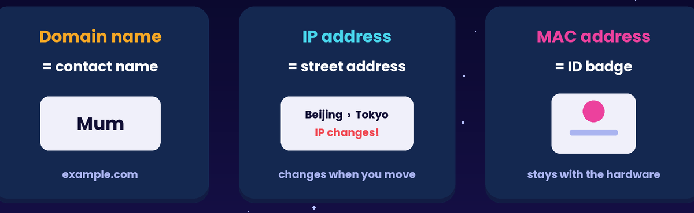

*Figure 1: Name → IP → MAC, like contact name → street address → ID badge.*


---

## 2. Key terms

| Term | Meaning |
|---|---|
| **MAC address** | 48-bit hardware address burned into a network card, e.g. `3C:22:FB:9A:10:7E` |
| **IP address** | Logical address used to route data between networks, e.g. `192.168.1.25` |
| **IPv4 / IPv6** | 32-bit addresses (≈4.3 billion) vs. 128-bit addresses (effectively unlimited) |
| **Subnet mask** | Says which part of an IP address is the *network* and which is the *host*, e.g. `255.255.255.0` (`/24`) |
| **Default gateway** | The router a device sends traffic to when the destination is on *another* network |
| **DHCP** | Protocol that hands out IP settings automatically |
| **ARP** | Protocol that finds the MAC address for a local IP address |
| **DNS** | System that translates domain names into IP addresses |
| **NAT** | Router feature that lets many private addresses share one public address |
| **Port** | A number (0–65535) that identifies which application or service should receive the data |
| **TCP** | Reliable, ordered, connection-based transport |
| **UDP** | Fast, connectionless transport with no delivery guarantee |
| **TLS** | Encryption and authentication layer used by HTTPS |

---

## 3. MAC addresses vs. IP addresses

| | **MAC address** | **IP address** |
|---|---|---|
| Example | `3C:22:FB:9A:10:7E` | `192.168.1.25` |
| Size | 48 bits (shown as 12 hex digits) | 32 bits (IPv4) / 128 bits (IPv6) |
| Assigned by | The manufacturer of the network card | The network, usually by DHCP |
| Changes when you move? | No (fixed to the hardware*) | Yes: a new network gives a new IP |
| Used for | Delivery **within the same LAN** (switches) | Delivery **across networks** (routers) |
| Layer | Link layer | Internet (network) layer |

\*Modern phones and laptops may use a *randomised* MAC on each Wi-Fi network for privacy.

**Key idea:** IP addresses get a packet to the **right network**. MAC addresses get it to the **right device on that network**. On every hop, the IP addresses stay the same while the MAC addresses change.

---

## 4. IPv4 addresses and subnet masks

An IPv4 address is **32 bits**, written as four decimal numbers (octets) from 0–255:

```
192      .168      .1        .25
11000000 .10101000 .00000001 .00011001
```

The **subnet mask** splits the address into a **network part** and a **host part**:

```
IP address:   192.168.1.25
Subnet mask:  255.255.255.0     ( = /24, the first 24 bits are the network)
              └── network ──┘ └ host ┘
Network ID:   192.168.1.0
Hosts:        192.168.1.1 – 192.168.1.254   (254 usable)
Broadcast:    192.168.1.255
```

**Same network or not?** Compare the network parts.

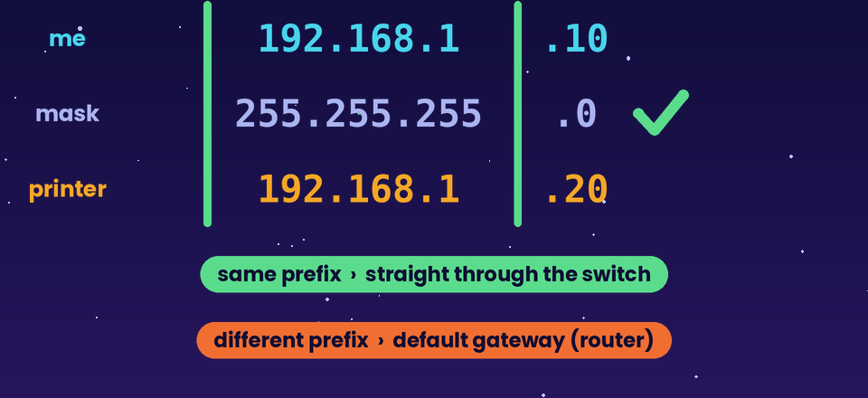

*Figure 2: Same prefix → deliver through the switch. Different prefix → send to the default gateway.*


| Device A | Device B | Mask | Same LAN? | So… |
|---|---|---|---|---|
| 192.168.1.25 | 192.168.1.80 | /24 | ✅ Yes (192.168.1) | Send directly using ARP and MAC |
| 192.168.1.25 | 192.168.2.80 | /24 | ❌ No | Send to the **default gateway** (router) |
| 10.0.5.9 | 10.0.200.1 | /16 (255.255.0.0) | ✅ Yes (10.0) | Send directly |

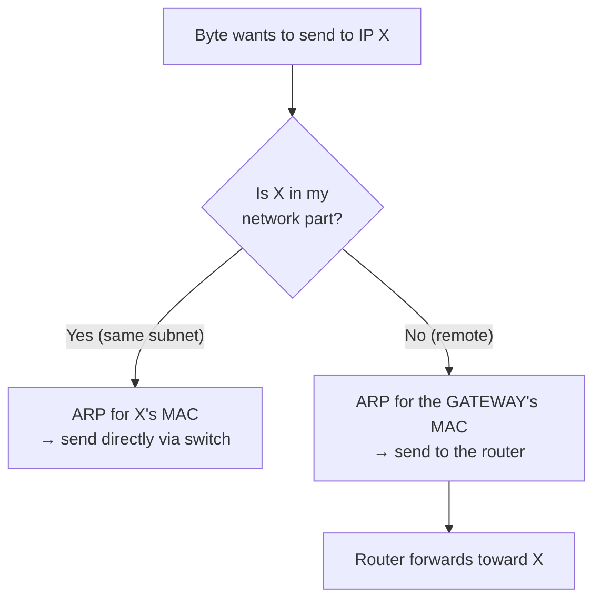

---

## 5. Private vs. public addresses and NAT

IPv4 has only ~4.3 billion addresses, which is fewer than the number of devices in the world. The solution is that homes and schools use **private** addresses inside, and share **one public** address outside.

| Private ranges (not routed on the Internet) | Typical use |
|---|---|
| `10.0.0.0 – 10.255.255.255` (/8) | Large organisations, schools |
| `172.16.0.0 – 172.31.255.255` (/12) | Medium networks |
| `192.168.0.0 – 192.168.255.255` (/16) | Home routers |

Special address: `127.0.0.1` (**localhost**) always means "this same computer".

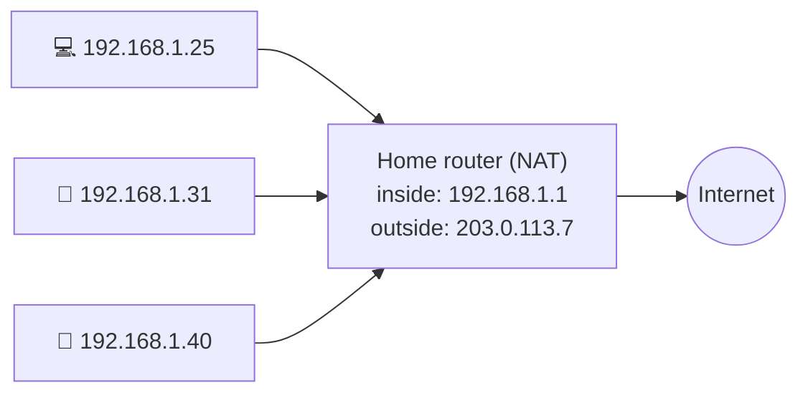

**NAT (Network Address Translation):** When `192.168.1.25` visits a website, the router replaces the source with its own public address `203.0.113.7` and remembers the mapping. When the reply comes back, it forwards it to the right inside device.

**IPv6** (e.g. `2001:db8:85a3::8a2e:370:7334`) has 2¹²⁸ addresses, enough that every device can have a public address.

---

## 6. DHCP: getting an address automatically

When Byte joins the Wi-Fi, he has no IP address yet. **DHCP** gives him one in four steps, known as **DORA**:

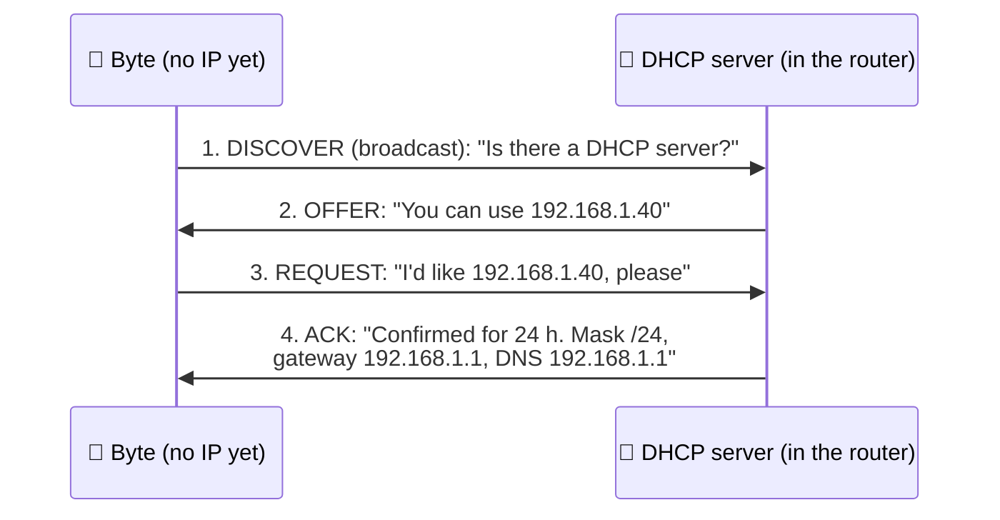

DHCP hands out four settings: **IP address, subnet mask, default gateway, DNS server** (plus a lease time).

> 🔍 If DHCP fails, Windows gives itself a `169.254.x.x` address. Seeing that address is a strong clue that the device never reached the DHCP server.

---

## 7. ARP: from IP to MAC

Switches deliver frames by **MAC address**, so a device that only knows an IP must find the matching MAC.

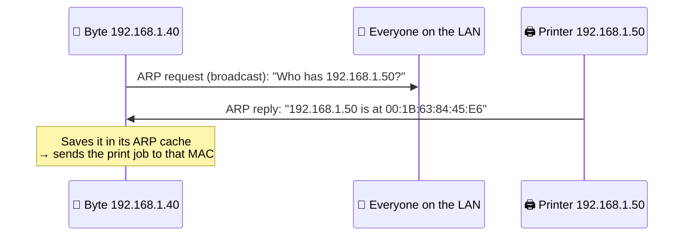

You can see your ARP cache with `arp -a`.

| Protocol | Question it answers |
|---|---|
| **DNS** | "What is the **IP** for this **name**?" |
| **ARP** | "What is the **MAC** for this **local IP**?" |
| **DHCP** | "What **IP settings** should I use?" |

---

## 8. DNS: from names to IP addresses

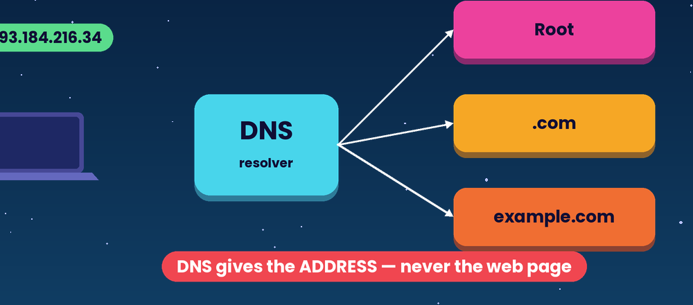

*Figure 3: DNS returns an address. It never sends the web page.*


People remember `www.wikipedia.org`; routers need `198.35.26.96`. **DNS** is the Internet's phone book.

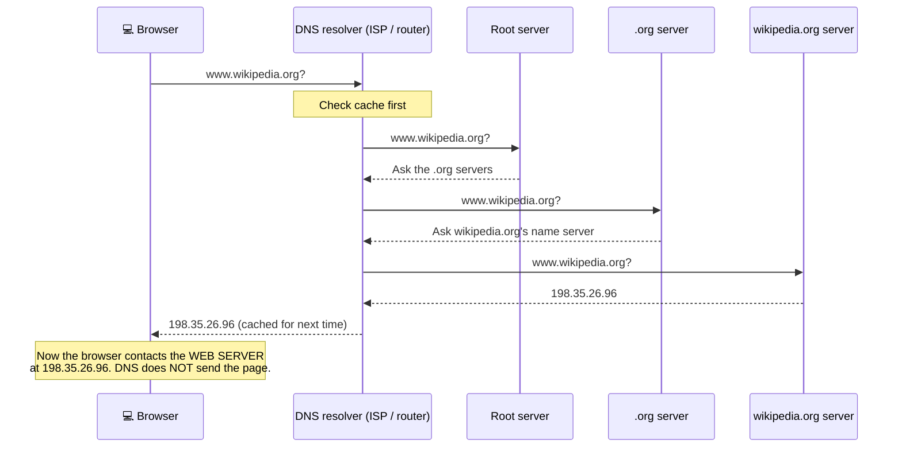

| DNS record | Holds | Example |
|---|---|---|
| **A** | IPv4 address | `lab404.example → 203.0.113.80` |
| **AAAA** | IPv6 address | `lab404.example → 2001:db8::80` |
| **CNAME** | An alias for another name | `www.lab404.example → lab404.example` |
| **MX** | Mail server for the domain | `lab404.example → mail.lab404.example` |

---

## 9. Ports, TCP and UDP

One server can run many services at once. The **port number** says which service the data is for. Together, an IP address and a port identify one conversation endpoint: `203.0.113.80:443`.

| Port | Protocol | Service |
|---|---|---|
| 20/21 | TCP | FTP (file transfer) |
| 22 | TCP | SSH (secure remote login) |
| 25 | TCP | SMTP (sending email) |
| 53 | UDP/TCP | DNS |
| 67/68 | UDP | DHCP |
| 80 | TCP | HTTP (web, unencrypted) |
| 443 | TCP (and UDP for HTTP/3) | HTTPS (secure web) |
| 3389 | TCP | Remote Desktop |

### TCP vs. UDP

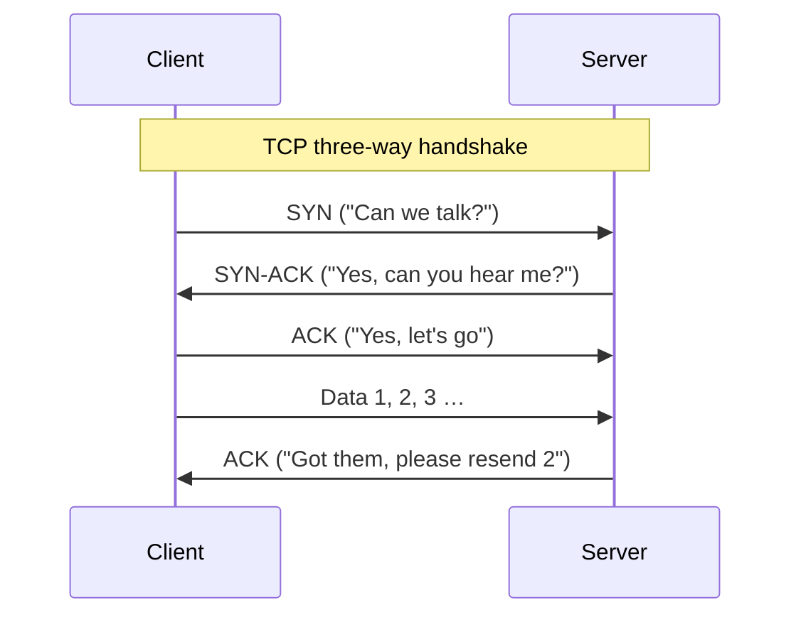

| | **TCP** | **UDP** |
|---|---|---|
| Connection | Handshake first (SYN, SYN-ACK, ACK) | None, just send |
| Reliability | Lost packets are **resent**; order is guaranteed | No resend, no ordering |
| Speed / overhead | Slower, more overhead | Faster, lightweight |
| Analogy | Registered mail with tracking | Shouting across a room |
| Used for | Web pages, email, file downloads | Live video calls, online games, DNS lookups, streaming |

**Why do games use UDP?** A late position update is useless. It is better to drop it and use the next one than to wait for a resend.

---

## 10. HTTP, HTTPS and TLS

**HTTP** is the language browsers and web servers speak:

```
Browser → GET /index.html HTTP/1.1
          Host: lab404.example

Server  → HTTP/1.1 200 OK
          Content-Type: text/html
          <html> … </html>
```

| Status code | Meaning |
|---|---|
| **200** OK | Here is the page |
| **301 / 302** | Moved; go to this other URL |
| **403** Forbidden | You're not allowed |
| **404** Not Found | No such page |
| **500** Server Error | The server broke |

**HTTPS = HTTP inside TLS.** TLS adds three protections:

| Protection | What it stops |
|---|---|
| **Encryption** | Eavesdroppers on café Wi-Fi reading your password |
| **Integrity** | Someone secretly changing the data in transit |
| **Authentication** (certificate) | A fake server pretending to be your bank |

> ⚠️ The padlock means the **connection** is secure. It does **not** mean the website is honest. Phishing sites can have HTTPS too.

---

## 11. The protocol stack

Networking is organised in **layers**. Each layer does one job and relies on the layer below.

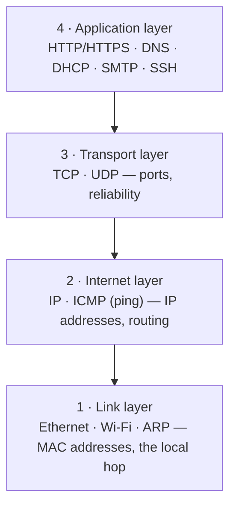

**Encapsulation:** As data goes **down** the stack, each layer wraps it in its own header. The receiver unwraps it going **up**.

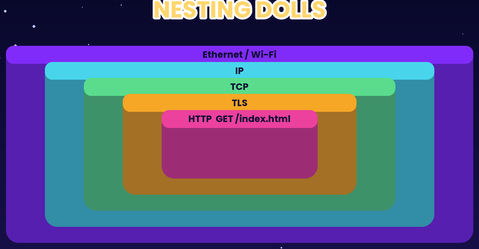

*Figure 4: Encapsulation, like nesting dolls. Each layer adds its own wrapper.*


```
[ Ethernet hdr | IP hdr | TCP hdr | HTTP request data | Ethernet trailer ]
   MAC addrs     IP addrs   ports      "GET /index.html"
```

| TCP/IP layer | Rough OSI equivalent |
|---|---|
| Application | 7 Application, 6 Presentation, 5 Session |
| Transport | 4 Transport |
| Internet | 3 Network |
| Link | 2 Data Link, 1 Physical |

---

## 12. Worked example: reading ipconfig

Leo runs `ipconfig /all` on the lab PC:

```
Wireless LAN adapter Wi-Fi:
   Physical Address. . . . . . . . . : 3C-22-FB-9A-10-7E
   DHCP Enabled. . . . . . . . . . . : Yes
   IPv4 Address. . . . . . . . . . . : 192.168.1.25
   Subnet Mask . . . . . . . . . . . : 255.255.255.0
   Default Gateway . . . . . . . . . : 192.168.1.1
   DHCP Server . . . . . . . . . . . : 192.168.1.1
   DNS Servers . . . . . . . . . . . : 192.168.1.1
   Lease Obtained. . . . . . . . . . : Saturday, 7 November 2026 09:02
```

| Line | Meaning |
|---|---|
| Physical Address | The Wi-Fi card's **MAC** |
| DHCP Enabled: Yes | Settings were received automatically (DORA) |
| IPv4 Address | **Private** address (192.168.x.x) on this LAN |
| Subnet Mask /24 | Devices from 192.168.1.1 to .254 are local |
| Default Gateway | The router, used for anything outside 192.168.1.x |
| DNS Servers | Name lookups go to the router, which forwards them to the ISP |

**Questions:**
- Byte is at `192.168.1.40`. Is he local? **Yes**, so Leo's PC uses ARP and sends directly.
- `www.lab404.example` resolves to `203.0.113.80`. Local? **No**, so the PC sends to the gateway `192.168.1.1`, and NAT translates the source to the router's public IP.
- Which port does the browser use for `https://`? **443/TCP**.

---

## 13. Common misconceptions

| ❌ Misconception | ✅ Reality |
|---|---|
| "My IP address is permanent, like a phone number." | Most devices get a **new IP from DHCP** on each network. The MAC is the more permanent one. |
| "DNS downloads the website for me." | DNS only returns an **IP address**. The browser then contacts the **web server**. |
| "Every device in my home has its own public IP." | They share **one public IP** through NAT. Inside, they use private 192.168.x.x addresses. |
| "A port is a physical socket on the computer." | Here, a port is a **number in the packet header**, not a hole for a cable. |
| "HTTPS means the site is safe." | HTTPS secures the **connection**, not the honesty of the site. |
| "UDP is just a broken TCP." | UDP is *deliberately* simple for speed. It's the right choice for real-time traffic. |

---

## 14. Try it yourself

**Activity A — Find your addresses (5 min)**
Run `ipconfig /all` (Windows) or `ifconfig` / *System Settings → Network → Details* (macOS). Record your MAC, IP, mask, gateway and DNS. Is your IP private? Which range?

**Activity B — DNS lookup (3 min)**
Run `nslookup www.wikipedia.org`. Write down the IP(s) returned. Run it again: is the answer faster (cached)?

**Activity C — Same subnet? (5 min)**
For each pair, say "direct" or "via gateway":
(a) 192.168.0.10 → 192.168.0.200, /24
(b) 192.168.0.10 → 192.168.1.10, /24
(c) 10.1.2.3 → 10.1.99.99, /16
(d) 172.16.5.5 → 8.8.8.8, /12

**Activity D — Pick the transport (3 min)**
TCP or UDP? (a) downloading a PDF; (b) a live voice call; (c) loading an online-banking page; (d) a multiplayer game's position updates.

---

## 15. Check your understanding

1. Give one difference between a MAC address and an IP address.
2. What four settings does DHCP provide?
3. A laptop shows the IP `169.254.12.7`. What has most likely gone wrong?
4. Which protocol answers "What is the MAC address for 192.168.1.50?"
5. **True or false:** During a website visit, the DNS resolver downloads the page's HTML and images.
6. Why can 30 devices in one home share one public IP?
7. Name the TCP handshake messages in order.
8. What three protections does TLS add to HTTP?
9. In which TCP/IP layer do IP addresses live? Ports? MAC addresses?

---

## 16. Answers and explanations

1. Any one: the **MAC** is fixed by the manufacturer, used within the LAN, and 48 bits; the **IP** is assigned by the network, changes between networks, is used for routing across networks, and is 32/128 bits.
2. IP address, subnet mask, default gateway, DNS server (plus lease time).
3. It is a self-assigned address: the device **could not reach a DHCP server** (e.g. a Wi-Fi authentication problem, a DHCP outage or a cable issue).
4. **ARP.**
5. **False.** DNS returns only the IP address. The browser then requests the page from the web server.
6. **NAT.** The router translates their private addresses to its single public address and tracks each conversation.
7. **SYN → SYN-ACK → ACK.**
8. **Encryption** (confidentiality), **integrity** (tamper detection) and **authentication** (a certificate proves the server's identity).
9. IP addresses: **Internet** layer. Ports: **Transport** layer. MAC addresses: **Link** layer.

**Activity C:** (a) direct · (b) via gateway · (c) direct · (d) via gateway (8.8.8.8 is a public address).
**Activity D:** (a) TCP · (b) UDP · (c) TCP · (d) UDP.

---

## 17. Summary

- **MAC** = fixed hardware ID for the local hop. **IP** = logical address for routing between networks.
- The **subnet mask** decides local vs. remote. Remote traffic goes to the **default gateway**.
- **DHCP** gives settings, **ARP** maps IP → MAC, and **DNS** maps name → IP.
- **NAT** lets private addresses share one public IPv4 address. **IPv6** removes the shortage.
- **Ports** pick the service. **TCP** is reliable and ordered; **UDP** is fast and lightweight.
- **HTTPS = HTTP + TLS**, which gives encryption, integrity and authentication.

**Related topics:** [Network Fundamentals](network-fundamentals.md) · [How Devices Communicate on a Local Network](how-devices-communicate-on-a-local.md) · [How Data Travels](how-data-travels.md) · [Firewalls](how-firewalls-control-network-traffic.md)

---

## 18. References

[1] Kurose, J. F., & Ross, K. W. *Computer Networking: A Top-Down Approach* (8th ed.). Pearson, Ch. 2–4.
[2] IETF RFC 1918, *Address Allocation for Private Internets*. https://www.rfc-editor.org/rfc/rfc1918
[3] IETF RFC 2131, *Dynamic Host Configuration Protocol*. https://www.rfc-editor.org/rfc/rfc2131
[4] Cloudflare Learning Center. *What is DNS?* https://www.cloudflare.com/learning/dns/what-is-dns/
[5] MDN Web Docs. *An overview of HTTP.* https://developer.mozilla.org/en-US/docs/Web/HTTP/Overview
[6] IANA. *Service Name and Transport Protocol Port Number Registry.* https://www.iana.org/assignments/service-names-port-numbers

*Example addresses use documentation ranges (192.0.2.0/24, 203.0.113.0/24, 2001:db8::/32) where possible. The analogies, scenarios, diagrams, activities and answers are original instructional material by team Whoisosy.*
