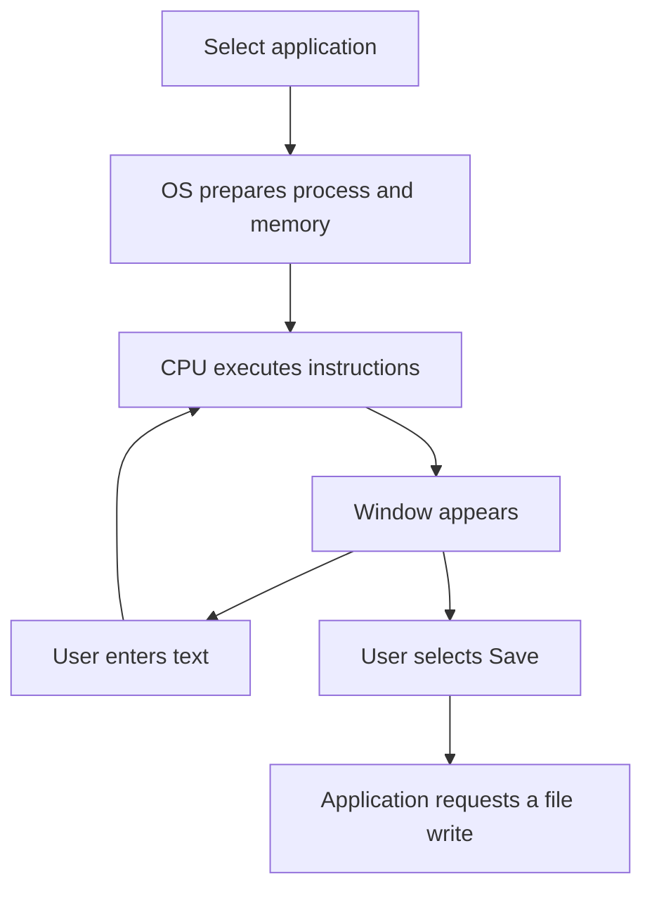

# What Happens When You Open an Application?
## Understanding the Roles of the CPU, Memory, Storage, and Operating System

| Document information | Details |
|---|---|
| Module | Hardware, Networks, and Behaviorist AI |
| Subtopic | Application execution and computer hardware |
| Intended audience | Beginners |
| Prerequisites | Basic familiarity with opening applications and saving files |
| Suggested teaching time | 10 minutes |
| Content version | V1.1 |
| Review status | Revised draft — awaiting peer review |

## Learning objectives

By the end of this lesson, learners should be able to:

1. Match the CPU, RAM, storage, and operating system to their main functions.
2. Arrange the major stages of launching an installed application in a simplified sequence.
3. Explain why unsaved changes may be lost after an unexpected shutdown.
4. Distinguish a task performed locally from a task that requires network access.

## 1. Overview

Opening an application is a coordinated activity involving hardware and software. The operating system manages the resources used by the application. The CPU executes instructions, RAM holds active instructions and data, and storage retains installed applications and saved files. [1]

This lesson uses an installed text editor as its example. It assumes that the computer is already running and that the application can create and save a local document without an internet connection.

> **Central idea:** Storage keeps files, RAM provides working memory, and the CPU executes instructions. The operating system manages their use.

## 2. Essential terminology

| Term | Meaning | Example in this lesson |
|---|---|---|
| Application | Software used to perform a particular user task. | A text editor used to write notes. |
| Operating system (OS) | System software that manages computer resources and supports applications. | Starts application processes and manages access to files. |
| CPU | The processor that executes program instructions. | Executes instructions that handle typing and editing. |
| RAM | Temporary working memory holding active instructions and data. | Holds information used while the editor runs. |
| Storage | Hardware that retains files when power is removed. | An SSD or HDD containing the editor and saved notes. |
| Process | An executing program with resources managed by the OS. | A running instance associated with the editor. |
| Input device | Hardware through which a user supplies information. | A keyboard or mouse. |
| Output device | Hardware that presents information to a user. | A monitor displaying the editor window. |

Hardware terminology follows IBM’s overview; the process definition follows Microsoft’s documentation. An application may use multiple processes. [1, 2]

## 3. How the components work together

### 3.1 Launch and interaction

**Figure 1.** Simplified application launch, interaction, and save workflow.

This diagram shows logical stages rather than individual electrical events. The CPU also executes operating-system instructions during startup. Memory preparation, execution, and input/output can overlap.

### 3.2 What this model simplifies

Applications do not necessarily load all their files into RAM before starting. Operating systems manage memory as programs execute. Virtual memory also means that an application’s memory addresses do not directly identify fixed physical RAM locations. [3]

The CPU executes instructions throughout the interaction, rather than completing its work when the first window appears. [4]

## 4. Worked example: creating a local text document

**Scenario:** A learner opens an installed text editor, types “My first computer lesson,” and saves the document as `lesson-notes.txt`.

| Stage | What happens | Main learning point |
|---|---|---|
| 1. Select | The learner chooses the application from a menu or shortcut. | User input initiates the task. |
| 2. Prepare | The OS prepares the process and its working memory. | The OS manages execution resources. |
| 3. Execute | The CPU runs application instructions. | Software requires a processor to execute it. |
| 4. Interact | The learner types and sees the document change. | Input, processing, and output work together. |
| 5. Save | The application asks the OS to write the document to local storage. | Saving preserves work beyond the current editing session. |
| 6. Reopen | After closing the editor, the learner opens the saved file. | The file exists separately from the running application. |

The process and execution concepts are supported by [2] and [4]. The example is an original instructional scenario.

> **Practical habit:** Check that saving completes successfully. An application may report an error if it cannot write to the selected location.

### Memory and storage compared

| Question | RAM | SSD or HDD storage |
|---|---|---|
| What is its main role here? | Working memory for active software. | Retaining applications and saved files. |
| Does it retain ordinary contents without power? | No; ordinary system RAM is volatile. | Yes; persistent storage is nonvolatile. |
| Does keeping a document open guarantee it is saved? | No. | The document must be written successfully to storage. |

Samsung’s memory overview explains the distinction between volatile RAM and nonvolatile SSD storage. [5]

Automatic saving and recovery features vary by application. They can reduce data loss, but learners should not assume that every unsaved change will be recoverable.

## 5. Connection to networking

The text-editing example can be completed locally. Network access becomes relevant when the learner performs an action such as opening a remote document or uploading a file.

| Action | Is network access required? |
|---|---|
| Open an installed editor that supports offline use. | No, under this lesson’s assumptions. |
| Edit a document stored on the local drive. | No, if the application supports offline editing. |
| Upload the document to an online service. | Yes. |
| Synchronize the document with a cloud account. | Yes, for synchronization to complete. |

Some applications require online sign-in or licensing checks. Their behavior may differ from the offline editor used here.

## 6. Learning activities

### Activity A — Sequence the launch

Arrange these stages in the simplified order taught in this lesson:

- **A.** The application displays its window.
- **B.** The learner selects the application.
- **C.** The CPU executes the application instructions needed to produce the window.
- **D.** The OS prepares the process and makes needed instructions and data available in memory.

**Response format:** Write the four letters in order.

### Activity B — Match the function

Match each description to **CPU**, **RAM**, **storage**, or **operating system**.

1. Executes program instructions.
2. Provides temporary working memory.
3. Retains installed applications and saved documents.
4. Manages the application’s access to system resources.

### Activity C — Explain a scenario

A learner types a paragraph but does not save it. The computer unexpectedly loses power.

1. Explain why the paragraph may be lost.
2. State one habit that reduces this risk.

### Activity D — Apply the network distinction

A learner can edit a local document while offline but cannot upload it to an online service.

Explain why these two results are consistent.

## 7. Answer key and assessment guidance

| Activity | Expected answer | Reasoning |
|---|---|---|
| A | **B → D → C → A** | Selection initiates launch; the OS prepares resources; execution produces the window. |
| B1 | **CPU** | It executes instructions. |
| B2 | **RAM** | It supplies temporary working memory. |
| B3 | **Storage** | It retains files after shutdown. |
| B4 | **Operating system** | It manages system resources. |
| C1 | Unsaved changes may exist only in volatile memory. | Ordinary RAM loses its contents without power. |
| C2 | Save regularly and confirm that saving succeeds. | This reduces dependence on unsaved working data. |
| D | Local editing uses local resources, while uploading requires communication with a remote service. | The two tasks have different network requirements. |

**Suggested scoring:** Award one point for Activity A, one for each match in Activity B, one for each part of Activity C, and one for Activity D: **8 points total**.

Use incorrect answers to guide feedback. For example, a learner who confuses RAM with storage should revisit the comparison in Section 4.

## 8. Teaching plan

| Time | Instructor action | Learner action |
|---|---|---|
| 0–1 minute | Ask what happens after selecting an application. | Share an initial explanation. |
| 1–3 minutes | Explain CPU, RAM, storage, and the OS. | Match each component to its role. |
| 3–5 minutes | Trace Figure 1. | Describe the launch sequence. |
| 5–7 minutes | Demonstrate typing, saving, closing, and reopening a document. | Identify where saving occurs. |
| 7–9 minutes | Use Activities A–C as a quick check. | Answer and explain reasoning. |
| 9–10 minutes | Discuss Activity D and correct misunderstandings. | Explain the network requirement. |

**Accessibility:** Describe the diagram aloud and provide its equivalent sequence in text: select → prepare → execute → display → interact or save. Do not rely on color to communicate meaning.

## 9. Adaptation into other teaching materials

- **Study guide:** Retain the terminology, worked example, comparison table, and activities.
- **Presentation:** Use slides for component roles, Figure 1, the save demonstration, and assessment.
- **Video:** Narrate an offline editing demonstration and show the saved document being reopened.

## 10. References

[1] IBM. *What is computer hardware?*  
https://www.ibm.com/think/topics/hardware  
Supports the distinction between hardware and software and the roles of major components.

[2] Microsoft Learn. *Processes and Threads.*  
https://learn.microsoft.com/en-us/windows/win32/procthread/processes-and-threads  
Supports application processes and the allocation of processor time. Implementation details refer to Windows.

[3] Microsoft Learn. *Virtual Address Space.*  
https://learn.microsoft.com/en-us/windows/win32/memory/virtual-address-space  
Supports the distinction between virtual addresses and physical memory locations. Implementation details refer to Windows.

[4] Arm. *What is a Central Processing Unit?*  
https://www.arm.com/glossary/cpu  
Supports the CPU’s role in instruction execution.

[5] Samsung Semiconductor. *DRAM.*  
https://semiconductor.samsung.com/dram/  
Supports the volatility of ordinary RAM and the persistence of SSD storage.

## Editorial and source notes

- Explanations are paraphrased for beginners.
- Figure 1, the activities, and the worked example are original teaching material.
- The diagram represents a simplified logical workflow.
- References support the technical concepts; the suggested timing and scoring are instructional design choices.
- Peer review and any course-specific attribution checks remain outstanding.

