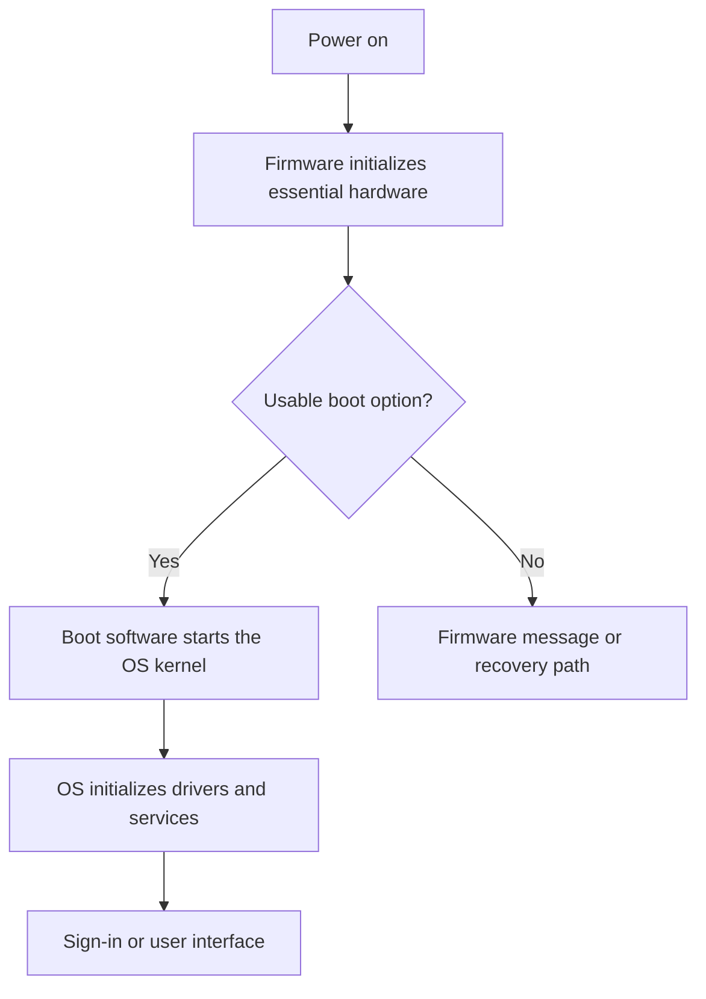

# How a Computer Starts Up
## From the Power Button to the Sign-In Screen

| Document information | Details |
|---|---|
| Module | Hardware, Networks, and Behaviorist AI |
| Subtopic | Firmware, bootloaders, and operating-system startup |
| Audience | Beginners |
| Prerequisites | Basic understanding of CPU, RAM, and storage |
| Suggested teaching time | 15–20 minutes |
| Content version | V1.0 |
| Status | Drafted — awaiting peer review |

## Learning objectives

After completing this lesson, learners should be able to:

1. Explain the purpose of booting.
2. Distinguish firmware, a bootloader, and an operating-system kernel.
3. Arrange the main stages of a simplified startup sequence.
4. Identify the roles of the CPU, RAM, and storage during startup.
5. Explain when startup may require a network connection.
6. Record useful observations about a startup problem without making an unsupported diagnosis.

## 1. Overview: why startup is necessary

A computer must establish a working environment before it can run ordinary applications. **Booting** is the process that brings the machine from its initial startup state into a running operating system.

Firmware performs early initialization. Boot software then prepares the operating system, whose kernel takes responsibility for core system operation. Later startup activity prepares services and the user interface. Microsoft describes distinct preboot, boot-manager, OS-loader, and kernel phases for Windows. [1]

This lesson uses a typical UEFI-based personal computer that starts an operating system installed on its local drive.

> **Scope:** This is a conceptual model. Hardware architectures and operating systems differ. Sleep, hibernation, and hybrid startup can follow different paths from a fresh boot.

## 2. Essential terminology

| Term | Beginner-friendly definition |
|---|---|
| Booting | Starting a computer and bringing its operating system into operation. |
| Firmware | Low-level software stored persistently on a device that supports hardware initialization and control. |
| UEFI | A specification defining interfaces between platform firmware and operating-system boot software. |
| Legacy BIOS | An older PC firmware interface and startup approach that predates UEFI. |
| POST | Power-on self-test: early checks performed during startup; their extent varies by machine. |
| Boot entry | A configured startup option identifying boot software or a boot target. |
| Boot manager | Software that selects or launches a boot option. It may be part of firmware or an OS boot environment. |
| Bootloader | Software that prepares and starts an operating-system kernel. A boot chain can contain several components. |
| Kernel | The core of an operating system, responsible for fundamental resource and hardware management. |
| Device driver | Software that enables the operating system to work with particular hardware. |
| System service | Background software supporting functions such as networking or sign-in. |
| Secure Boot | A UEFI security feature that checks eligible boot components against configured trust policy before allowing execution. |

UEFI terminology follows the UEFI Forum’s documentation. Windows startup stages follow Microsoft’s explanation. [1–3]

**Important distinction:** A firmware boot manager and Windows Boot Manager occupy different positions in the boot chain. The shared name does not make them the same component.

## 3. Roles of the main hardware components

| Component | Role during startup |
|---|---|
| Power circuitry | Provides and controls the electrical power needed for operation. |
| CPU | Executes firmware, boot software, and operating-system instructions. |
| RAM | Provides working memory for startup code and operating-system data. |
| Persistent storage | Holds operating-system files and commonly the OS boot software. |
| Motherboard firmware storage | Retains the platform firmware when power is removed. |
| Graphics hardware and display | Present startup information and the operating-system interface when initialized. |
| Network interface | Supports network communication when initialized and configured. |

These roles connect startup to the broader hardware functions described by IBM. [4]

**RAM versus storage:** The installed operating system remains on persistent storage after shutdown. Startup makes the needed code and data available in working memory; it does not imply that every installed file is copied into RAM.

## 4. The startup sequence

### 4.1 Simplified workflow

**Figure 1.** A simplified local startup workflow.

**Text equivalent:** Power on → firmware initialization → boot-option selection → operating-system loading → driver and service initialization → user interface. If no usable boot option is available, the machine may show an error or enter another startup path.

The diagram is an original teaching model based on [1, 2]. It does not show every firmware phase, security check, or recovery option.

### 4.2 Step-by-step explanation

1. **The user requests power-on.** The machine begins its hardware startup sequence.
2. **Firmware executes.** It initializes the resources needed to continue startup. Early checks may reveal problems.
3. **Firmware chooses a boot option.** UEFI boot policy and stored entries guide the selection. A machine may support several options, including a local drive, removable media, or a network target. [2]
4. **The boot chain prepares the operating system.** Boot components locate and load the kernel and other startup requirements.
5. **The kernel begins operating.** Operating-system initialization brings required drivers and core functions into operation.
6. **Services and the user environment start.** A graphical personal computer typically reaches a sign-in screen or desktop.

The OS-loading and kernel phases above are adapted from Microsoft’s Windows startup model. Other systems organize these responsibilities differently. [1]

## 5. Worked example: starting a classroom laptop

**Scenario:** A learner starts a powered-off laptop with a local operating-system installation. No installation USB drive is connected.

| Observation | Reasonable interpretation | What it does not prove |
|---|---|---|
| A power indicator lights up. | Some power circuitry is active. | The OS has loaded successfully. |
| A manufacturer logo appears. | The display path is working at least enough to show this image. | Every hardware component has passed a complete test. |
| An OS loading indicator appears. | Startup has progressed into an OS-related display stage. | Every driver and service is ready. |
| A sign-in screen appears. | The system has reached its sign-in interface. | Internet access is available. |
| An application opens after sign-in. | The user session can run that application. | Every possible system function is working. |

**Teaching point:** An observation provides evidence about progress. It rarely establishes a complete diagnosis on its own.

For example, a black screen can have multiple causes. “The screen is black” is a useful observation; “the storage drive has failed” requires additional evidence.

## 6. Secure Boot in context

Secure Boot checks eligible boot components using configured trust information, such as allowed signatures and revocations. Its purpose is to strengthen trust in the early boot chain. [3]

| Question | Answer |
|---|---|
| Does Secure Boot make startup instant? | No; it is a security mechanism. |
| Does it replace all operating-system security? | No; protecting boot components is one part of system security. |
| Does enabling it guarantee that every file is harmless? | No; its checks apply to defined parts of the boot process. |
| Is it the same as typing a sign-in password? | No; boot verification and user authentication serve different purposes. |

**Classroom practice:** This lesson explains the concept. It does not require changing firmware settings or disabling security features.

## 7. How networking relates to startup

An ordinary local boot does not inherently require downloading the operating system. However, some environments use network boot or require remote services for later functions.

| Situation | Network relationship |
|---|---|
| Starting a locally installed OS | Can generally proceed without internet access, depending on configuration. |
| Signing in with an organization-managed account | Requirements depend on account policy and cached credentials. |
| Booting from a network target | Requires access to the relevant boot infrastructure. |
| Opening an online learning platform after sign-in | Requires access to the platform over a network. |
| Running an installed offline application | Can work without a network if the application supports it. |

UEFI supports boot options that can include network targets. [2] The account and application examples illustrate why “the OS started” and “the internet works” are separate questions.

## 8. Basic troubleshooting: observe before changing

When startup does not proceed normally, record the last visible stage. Microsoft’s troubleshooting guidance emphasizes identifying the affected startup phase. [1]

### Safe initial checks

1. Check the external power connection and, for a separate monitor, its power and selected input.
2. Record the exact message, indicator pattern, or screen where startup stops.
3. Note whether the problem began after a known change.
4. If an update is visibly progressing, follow the device’s guidance and avoid interrupting it.
5. Give the observations to the instructor or responsible administrator.

Do not treat this checklist as a repair procedure. Reinstalling an operating system, changing boot policy, or resetting firmware can affect data and configuration.

### Observation worksheet

| Item | Learner notes |
|---|---|
| Power indicators | |
| Last visible screen or message | |
| Exact error text, if present | |
| Recent changes, if known | |
| Whether the behavior repeats | |

## 9. Common misconceptions

| Misconception | Correction |
|---|---|
| “The OS is already running when the power light appears.” | Power indication alone does not demonstrate successful OS startup. |
| “Firmware and the OS are the same thing.” | They have different responsibilities in startup. |
| “UEFI is just the settings screen.” | The settings interface exposes only part of the firmware environment. |
| “A boot error always means a broken drive.” | Software, configuration, and hardware problems can produce startup failures. |
| “A sign-in screen proves internet access.” | Local startup and network connectivity are separate capabilities. |
| “Booting loads every installed application.” | Many applications start only when requested; some configured programs start automatically. |

## 10. Learning activities

### Activity A — Order the stages

Arrange these stages in the simplified order used in this lesson.

- **A.** The sign-in interface becomes available.
- **B.** Firmware initializes essential hardware.
- **C.** The user requests power-on.
- **D.** Boot software prepares and starts the OS kernel.
- **E.** The OS initializes required drivers and services.

**Response:** Write the letters in order.

### Activity B — Match the role

Match each description to **firmware**, **bootloader**, **kernel**, or **storage**.

1. Retains installed OS files when power is removed.
2. Performs early platform initialization.
3. Prepares and starts the operating-system kernel.
4. Provides core operating-system resource management.

### Activity C — Explain the observation

A computer shows its sign-in screen, but a website does not load.

1. What does the sign-in screen tell you about startup?
2. Why does it not prove that the internet connection works?

### Activity D — Improve a troubleshooting report

A learner reports: “The computer is broken.”

Rewrite this as a more useful observation using this scenario:

> The power light is on. The display shows “No bootable device.” The sign-in screen never appears.

### Activity E — Apply the security concept

Explain one difference between Secure Boot and a user sign-in password.

## 11. Answer key and assessment guidance

| Activity | Expected answer | Reasoning |
|---|---|---|
| A | **C → B → D → E → A** | Power-on precedes firmware initialization, OS loading, and the user interface. |
| B1 | **Storage** | Installed files persist there after shutdown. |
| B2 | **Firmware** | It supports early platform initialization. |
| B3 | **Bootloader** | It prepares and starts the kernel. |
| B4 | **Kernel** | It provides core OS management. |
| C1 | Startup has reached the sign-in interface. | This is evidence of progress through substantial OS initialization. |
| C2 | Network access has separate requirements. | Reaching a local interface does not verify the network path or remote site. |
| D | “The power light is on, the display shows ‘No bootable device,’ and the sign-in screen does not appear.” | It records observable evidence without declaring a cause. |
| E | Secure Boot verifies eligible boot components; a password helps authenticate a user. | They act on different parts of system security. |

**Suggested scoring:** Activity A: 1 point; Activity B: 4 points; Activity C: 2 points; Activity D: 1 point; Activity E: 2 points. **Total: 10 points.**

For Activity E, award one point for each correctly distinguished purpose. Use the results to identify concepts needing further explanation rather than treating the score as a hardware diagnostic qualification.

## 12. Teaching plan: 20-minute session

| Time | Instructor action | Learner action |
|---|---|---|
| 0–2 minutes | Ask what happens before the sign-in screen. | Share an initial sequence. |
| 2–6 minutes | Explain firmware, bootloader, kernel, and hardware roles. | Match terms to functions. |
| 6–10 minutes | Trace Figure 1 and the laptop example. | Identify what each observation supports. |
| 10–13 minutes | Explain Secure Boot and network dependencies. | Distinguish verification, authentication, and connectivity. |
| 13–17 minutes | Assign Activities A–E. | Work individually or in pairs. |
| 17–20 minutes | Review answers and improve a troubleshooting report. | Correct misconceptions and justify answers. |

**Short-session adaptation:** For 15 minutes, use Activities A, C, and D in class and assign the others for independent study.

**Accessibility:** Provide the diagram’s text equivalent, describe visual startup indicators aloud, and allow written descriptions instead of photographs.

## 13. Adaptation into other learning resources

- **Study guide:** Retain the terminology, sequence, observation worksheet, and answers.
- **Presentation:** Use slides for hardware roles, boot stages, Secure Boot, networking, and the scenario exercise.
- **Video tutorial:** Show a permitted startup demonstration and narrate visible progress without assuming every internal stage is visible.
- **Pair discussion:** Ask one learner to describe a symptom and another to separate observations from possible causes.

## 14. References

[1] Microsoft Learn. *Windows startup issues troubleshooting.*  
https://learn.microsoft.com/windows/client-management/advanced-troubleshooting-boot-problems  
Supports the Windows startup phases and the importance of locating the affected phase. Windows-specific details should not be generalized to all platforms.

[2] UEFI Forum. *UEFI Specification 2.10, Errata A: Boot Manager.*  
https://uefi.org/specs/UEFI/2.10_A/03_Boot_Manager.html  
Supports firmware boot policy, boot options, and launching UEFI boot applications.

[3] UEFI Forum. *UEFI Specification 2.10: Secure Boot and Driver Signing.*  
https://uefi.org/specs/UEFI/2.10/32_Secure_Boot_and_Driver_Signing.html  
Supports trust checks for eligible UEFI images.

[4] IBM. *What is computer hardware?*  
https://www.ibm.com/think/topics/hardware  
Supports the general functions of processing, memory, storage, and input/output hardware.

## Editorial and source notes

- Technical explanations are paraphrased for beginners.
- The workflow, scenarios, worksheet, activities, and scoring are original instructional material.
- Startup details differ across hardware and operating systems; the lesson identifies its UEFI PC scope.
- The troubleshooting section teaches observation and reporting rather than advanced repair.
- Peer review and course-specific attribution checks remain outstanding.

