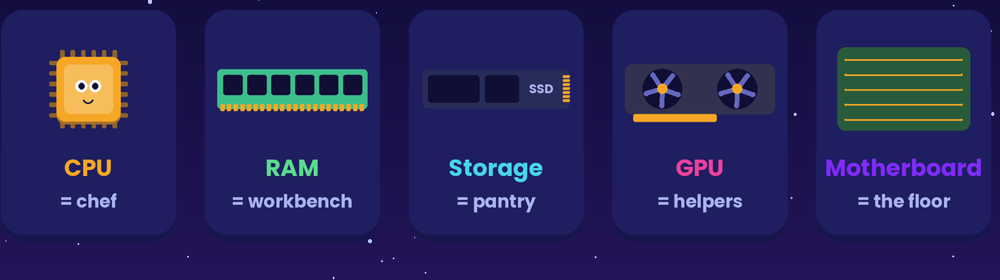
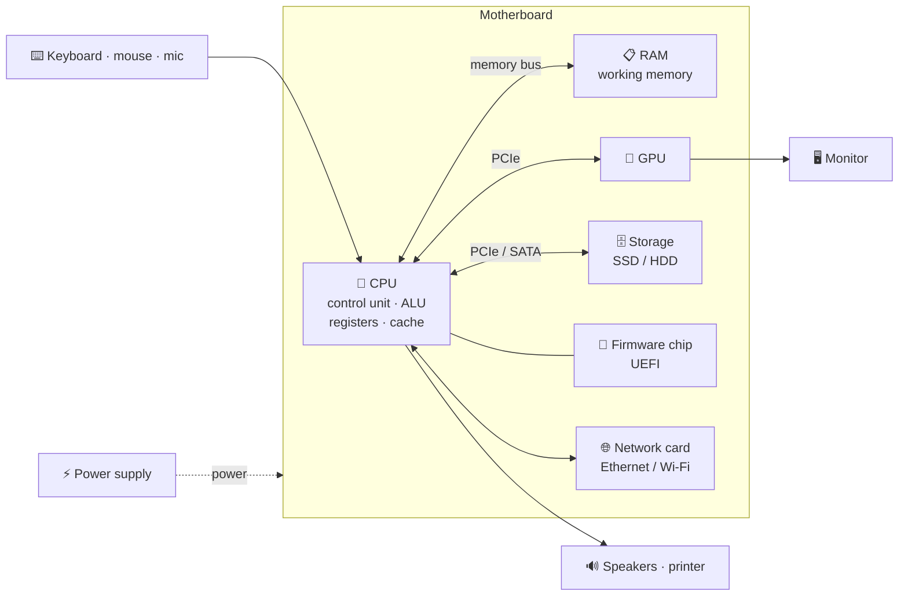
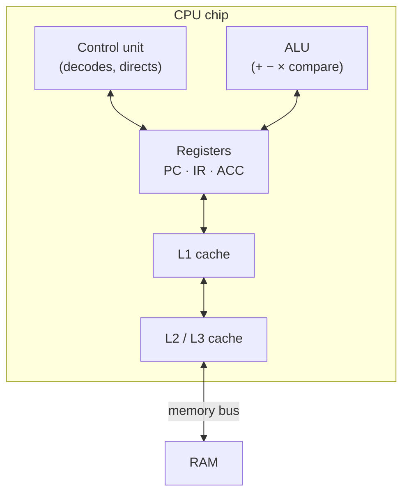
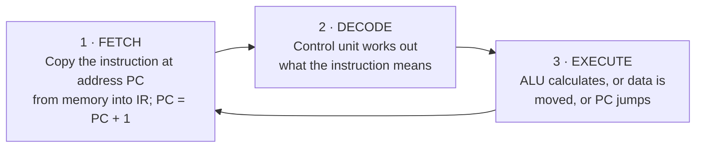
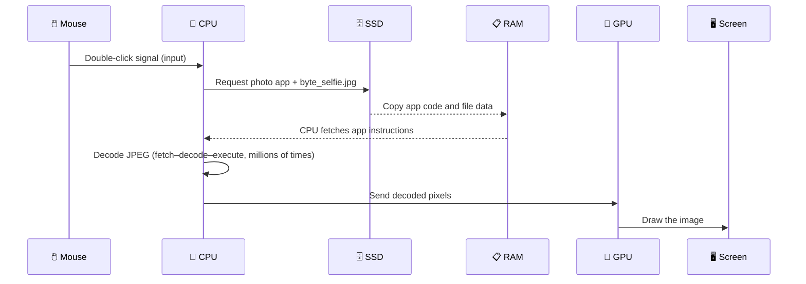
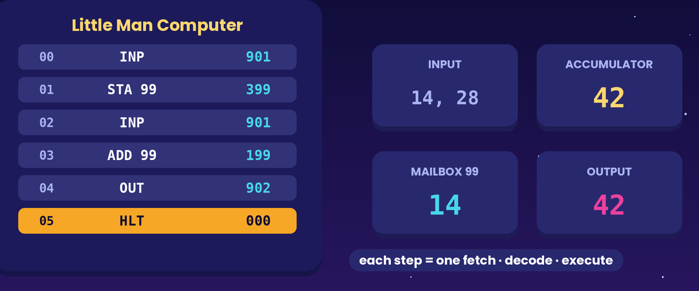

# Core Computer Components

> **Module:** Hardware, Networks, and Behaviorist AI — Part A (Hardware)
> **Audience:** Beginners
> **Content version:** V2.0 (rewritten from the V1.0 outline: full explanations, diagrams, worked examples, activities and answers)
> **Estimated study time:** 35–45 minutes

---

## Table of contents

1. [Learning goals](#learning-goals)
2. [The big idea](#1-the-big-idea)
3. [Key terms](#2-key-terms)
4. [How the parts connect](#3-how-the-parts-connect)
5. [The CPU — the processor](#4-the-cpu--the-processor)
6. [The GPU — the parallel specialist](#5-the-gpu--the-parallel-specialist)
7. [RAM — working memory](#6-ram--working-memory)
8. [Storage — long-term memory](#7-storage--long-term-memory)
9. [Motherboard, buses and chipset](#8-motherboard-buses-and-chipset)
10. [Power supply, cooling and firmware](#9-power-supply-cooling-and-firmware)
11. [Input, output and network devices](#10-input-output-and-network-devices)
12. [Worked example: opening a photo](#11-worked-example-opening-a-photo)
13. [Reading a laptop spec sheet](#12-reading-a-laptop-spec-sheet)
14. [Common misconceptions](#13-common-misconceptions)
15. [Try it yourself](#14-try-it-yourself)
16. [Check your understanding](#15-check-your-understanding)
17. [Answers and explanations](#16-answers-and-explanations)
18. [Summary](#17-summary)
19. [References](#18-references)

---

## Learning goals

After studying this topic, you should be able to:

- [ ] name the main hardware components of a computer and state the job of each one;
- [ ] describe the parts inside a CPU (**control unit, ALU, registers, cache**) and explain the **fetch–decode–execute** cycle;
- [ ] explain why a **GPU** is faster than a CPU for some tasks but not others;
- [ ] explain how the **motherboard** and **buses** let components exchange data;
- [ ] trace which components are used when you open a file; and
- [ ] read a basic laptop specification sheet and explain what each line means.

---

## 1. The big idea

A computer is a team of specialised parts. No single part "is" the computer. Each one does one job very well and hands its results to the next.

> 🔬 **Lab 404 story:** Byte the robot has just been rebuilt after a lab accident. Dr. Ada Lin lays his parts on the workbench and asks Leo to guess what each one does. "That shiny square is his brain," Leo says. "Partly," Ada smiles. "It *thinks*, but it can't *remember* anything for long. For that, Byte needs other parts."

> 💡 **Analogy: a restaurant kitchen**
>
> | Computer part | Kitchen role | Why the match works |
> |---|---|---|
> | **CPU** | Head chef | Follows the recipe one step at a time, very fast |
> | **Registers** | The chef's hands | Hold only what is being worked on *right now* |
> | **Cache** | Spice rack beside the stove | Tiny, but within arm's reach |
> | **RAM** | Countertop | Ingredients for today's orders; wiped clean at closing time |
> | **Storage (SSD/HDD)** | Pantry and freezer | Huge and permanent, but a walk away |
> | **GPU** | A line of 1,000 junior cooks | Each one is simple, but together they chop 1,000 onions at once |
> | **Motherboard and buses** | Floor plan and hallways | Connect every station |
> | **Power supply** | Gas and electricity | Nothing works without it |
> | **Input/output devices** | Waiters | Bring orders in and carry dishes out |

*Figure A: The computer as a kitchen. Each part has one job.*

---

## 2. Key terms

| Term | Plain-language meaning |
|---|---|
| **Hardware** | The physical parts of a computer you could touch |
| **Software** | Instructions (programs) that tell the hardware what to do |
| **CPU** (Central Processing Unit) | The general-purpose processor that runs program instructions |
| **Core** | One complete processing unit inside a CPU; a 6-core CPU can run 6 instruction streams at once |
| **Clock speed (GHz)** | How many cycles the CPU runs per second; 3 GHz ≈ 3 billion cycles per second |
| **ALU** (Arithmetic Logic Unit) | The part of the CPU that does arithmetic (+, −) and logic (AND, OR, compare) |
| **Control unit** | The part of the CPU that decodes instructions and directs the other parts |
| **Register** | A tiny, ultra-fast storage slot inside the CPU |
| **Cache** | Small, very fast memory on the CPU chip that keeps copies of recently used data |
| **GPU** (Graphics Processing Unit) | A processor with thousands of simple cores for parallel work (graphics, AI) |
| **RAM** (Random Access Memory) | Fast, **volatile** working memory for programs and data in use |
| **Storage** | **Non-volatile** memory (SSD or HDD) that keeps files when the power is off |
| **Motherboard** | The main circuit board that connects every component |
| **Bus** | A shared electrical pathway that carries data, addresses or control signals |
| **Firmware (UEFI/BIOS)** | Software stored on a chip on the motherboard that starts the hardware |
| **Peripheral** | A device outside the core system: keyboard, mouse, monitor, printer |

---

## 3. How the parts connect

*Figure 1: The CPU sits at the centre. RAM is on the fastest, shortest path. Storage, the GPU and the network card connect through high-speed PCIe or SATA links. Everything is powered by the PSU and connected by the motherboard.*

The **von Neumann model** describes this layout: a processor, a memory that holds **both** programs and data, and input/output, all linked by buses. Nearly every laptop, phone and server today follows it.

---

## 4. The CPU — the processor

### 4.1 Inside the CPU

*Figure 2: The CPU's internal parts.*

- The **Program Counter (PC)** register holds the address of the next instruction.
- The **Instruction Register (IR)** holds the instruction being decoded.
- The **Accumulator (ACC)** or general registers hold the values being calculated.

### 4.2 The fetch–decode–execute cycle

Every program, from a calculator to a video game, runs as millions of repetitions of this three-step loop:

*Figure B: The fetch–decode–execute loop. The ALU does the work in the execute step.*

**Example: the instruction `ADD 7`**

1. **Fetch:** The PC says `05`. The CPU copies the instruction at address 05 (`ADD 7`) into the IR, and the PC becomes `06`.
2. **Decode:** The control unit recognises "add the value stored at address 7 to the accumulator".
3. **Execute:** The ALU adds the value from address 7 (say 12) to the accumulator (say 30). The accumulator now holds 42.

### 4.3 What makes a CPU faster?

| Feature | What it means | Effect |
|---|---|---|
| **Clock speed** | Cycles per second (GHz) | More instructions per second on one core |
| **Number of cores** | Independent processing units | More tasks at the same time (if the software can split the work) |
| **Cache size** | Fast memory on the chip | Fewer slow trips to RAM |
| **Architecture / generation** | How much work is done per cycle | A newer 3 GHz CPU can beat an older 4 GHz one |

> ⚠️ Clock speed alone is a poor comparison. Compare CPUs of the same generation, or use benchmark results.

---

## 5. The GPU — the parallel specialist

A CPU has a **few powerful cores** (typically 4–16) that are good at complex, step-by-step decisions. A GPU has **thousands of simple cores** that are good at doing *the same small calculation on lots of data at once*.

| Task | Better on | Why |
|---|---|---|
| Colouring 8 million pixels for one frame | **GPU** | Every pixel can be computed independently, at the same time |
| Training a neural network (matrix multiplication) | **GPU** | Millions of independent multiply-adds |
| Running the operating system, opening files | **CPU** | Branching logic, each step depends on the last |
| A spreadsheet formula that depends on the previous cell | **CPU** | The work cannot be split into independent pieces |

GPUs may be **integrated** (built into the CPU chip and sharing system RAM) or **dedicated** (a separate card with its own fast VRAM).

---

## 6. RAM — working memory

- RAM holds the programs and data the CPU is **using right now**.
- It is **volatile**: when the power is cut, its contents disappear.
- It is much faster than storage, but smaller and more expensive per gigabyte.
- Typical sizes today are 8 GB (basic), 16 GB (comfortable) and 32 GB or more (video editing, large AI models).

When RAM fills up, the operating system starts moving data out to the much slower storage drive. This is called **paging** or **swap**, and it is why a computer with too many tabs open becomes sluggish.

➡️ Full details: [RAM Versus Storage](ram-vs-storage.md)

---

## 7. Storage — long-term memory

| | **HDD** (hard disk drive) | **SATA SSD** | **NVMe SSD** |
|---|---|---|---|
| How it stores data | Magnetic spinning platters + moving arm | Flash memory chips | Flash memory chips on the PCIe bus |
| Typical access time | ~5–10 ms | ~0.1 ms | ~0.02–0.1 ms |
| Moving parts? | Yes, so it is fragile and noisy | No | No |
| Cost per GB | Lowest | Medium | Medium–higher |
| Typical use | Bulk backups, archives | Older laptops, upgrades | Modern laptops and desktops |

Storage is **non-volatile**: files stay there without power. Your operating system, installed apps, photos and saved documents all live in storage, and are **copied into RAM** when you open them.

---

## 8. Motherboard, buses and chipset

The **motherboard** is the printed circuit board that everything plugs into. It provides:

- a **CPU socket**, **RAM slots** and **M.2/SATA connectors** for storage;
- **PCIe slots** for graphics cards and other expansion cards;
- the **firmware chip** (UEFI); and
- the **buses**: copper traces that carry signals between components.

A bus carries three kinds of signal:

| Bus type | Carries | Example |
|---|---|---|
| **Data bus** | The actual values being moved | The number 42 travelling from RAM to the CPU |
| **Address bus** | *Where* the value is (or should go) | "Memory location 0x1A3F" |
| **Control bus** | *What to do* and *when* | "READ now", "WRITE now", clock ticks |

---

## 9. Power supply, cooling and firmware

- **Power supply unit (PSU):** Converts AC mains power into the low, steady DC voltages the components need (for example 12 V, 5 V and 3.3 V). A laptop does the same with its charger and battery.
- **Cooling:** CPUs and GPUs turn electricity into heat. Fans, heat sinks and heat pipes carry the heat away. If cooling fails, the chip slows itself down (**thermal throttling**) or shuts down to protect itself.
- **Firmware (UEFI/BIOS):** The first code that runs at power-on. It checks the hardware, then hands control to the operating system's boot software. ➡️ See [How a Computer Starts Up](computer-startup.md).

---

## 10. Input, output and network devices

| Category | Examples | Direction |
|---|---|---|
| Input | Keyboard, mouse, touchscreen, microphone, camera, sensors | World → computer |
| Output | Monitor, speakers, printer, headphones | Computer → world |
| Both | Touchscreen, network card, USB drive, headset | Both ways |
| Network | **NIC** (Network Interface Card): Ethernet port or Wi-Fi chip | Computer ↔ other computers |

Every NIC has a factory-assigned **MAC address**. ➡️ See [Network Addresses and Protocols](addresses-and-protocols.md).

---

## 11. Worked example: opening a photo

**Scenario:** Leo double-clicks `byte_selfie.jpg`.

| Step | Component | Job |
|---|---|---|
| 1 | Mouse | Sends the click to the computer |
| 2 | CPU | Asks the OS to open the file |
| 3 | SSD | Supplies the app and the photo (non-volatile copy) |
| 4 | RAM | Holds the working copy while you view it |
| 5 | CPU | Decompresses the JPEG into pixels |
| 6 | GPU | Draws the pixels to the screen |
| 7 | Monitor | Shows the image (output) |

If Leo edits the photo and the power fails before he saves, only the **SSD's original** survives. The edits lived in RAM.

---

## 12. Reading a laptop spec sheet

> **Lab 404 Notebook X14**
> - Intel Core i5-1340P, 12 cores, up to 4.6 GHz, 12 MB cache
> - 16 GB LPDDR5 RAM
> - 512 GB NVMe SSD
> - Intel Iris Xe integrated graphics
> - Wi-Fi 6E, Bluetooth 5.3
> - 65 W USB-C charger

| Line | What it tells you |
|---|---|
| Core i5, 12 cores, 4.6 GHz, 12 MB cache | A mid-range CPU that can run many tasks in parallel; the cache size helps reduce trips to RAM |
| 16 GB LPDDR5 RAM | Working memory: enough for study, browsing and light editing |
| 512 GB NVMe SSD | Fast permanent storage; this is how many files you can *keep*, not how fast apps run once open |
| Integrated graphics | The GPU is built into the CPU and shares system RAM; fine for video, weak for 3D gaming or AI training |
| Wi-Fi 6E | The wireless network card |
| 65 W charger | Power supply |

---

## 13. Common misconceptions

| ❌ Misconception | ✅ Reality |
|---|---|
| "The CPU stores my files." | The CPU *processes* data. Files are stored on the SSD/HDD and loaded into RAM while in use. |
| "512 GB of memory means my laptop is fast." | 512 GB is usually **storage**. Speed with many apps open depends more on **RAM** and the CPU. |
| "Higher GHz always means a faster CPU." | Cores, cache and architecture matter just as much. |
| "A GPU is only for games." | GPUs also power video editing, scientific simulation and AI training. |
| "The motherboard does the computing." | The motherboard *connects* components. The CPU and GPU compute. |

---

## 14. Try it yourself

**Activity A — Find your own hardware (5 min)**
- **Windows:** Open *Task Manager → Performance*. Note your CPU name and core count, RAM size and disk type.
- **macOS:** *Apple menu → About This Mac*.

Record your results in a table with columns *Component · Your value · What it means*.

**Activity B — Match the role (3 min)**
Match each component to its kitchen role: CPU, RAM, SSD, GPU, motherboard, PSU → *pantry, countertop, head chef, 1,000 junior cooks, floor plan, gas and electricity*.

**Activity C — Be the CPU (5 min)**

*Figure C: A Little Man Computer trace. Each line is one fetch–decode–execute cycle.*

Memory: address 0 = `LOAD 5`, address 1 = `ADD 6`, address 2 = `STORE 7`, address 3 = `HALT`, address 5 = 20, address 6 = 22.
Starting with PC = 0, write down the PC, IR and accumulator after each fetch–decode–execute cycle. What ends up in address 7?

---

## 15. Check your understanding

1. Which part of the CPU performs the comparison "is 7 greater than 5"?
2. **True or false:** Registers are slower than RAM but larger.
3. Why is a GPU better than a CPU at drawing a 4K image?
4. Name the three kinds of bus signal and give one example of each.
5. Leo says: "My laptop freezes with 40 tabs open, so I'll buy a bigger SSD." Is that the right fix? Explain.
6. Put in order from smallest and fastest to largest and slowest: RAM, registers, SSD, L1 cache.
7. What is thermal throttling, and which component prevents it?

---

## 16. Answers and explanations

1. **The ALU** (Arithmetic Logic Unit) performs arithmetic and logical comparisons.
2. **False.** Registers are the *fastest* and *smallest* memory in the computer.
3. Each pixel can be calculated independently, so the GPU's thousands of cores work on them **in parallel**. A CPU has only a few cores.
4. **Data bus:** carries the value (e.g. the number 42). **Address bus:** carries the location (e.g. memory address 0x1A3F). **Control bus:** carries the command and timing (e.g. READ, WRITE, clock).
5. **No.** Freezing with many tabs is usually a **RAM** shortage that forces paging to storage. More RAM (or fewer tabs) helps; a bigger SSD only adds space for files.
6. Registers → L1 cache → RAM → SSD.
7. Thermal throttling is when a chip slows itself down to avoid overheating. **Cooling** (fans, heat sinks, heat pipes) prevents it.

**Activity C answer:**

| Cycle | PC after fetch | IR | Accumulator |
|---|---|---|---|
| 1 | 1 | LOAD 5 | 20 |
| 2 | 2 | ADD 6 | 42 |
| 3 | 3 | STORE 7 | 42 (address 7 = 42) |
| 4 | 4 | HALT | 42 |

---

## 17. Summary

- A computer is a team of parts: the **CPU** processes, **RAM** holds work in progress, **storage** keeps files, the **GPU** handles parallel work, and the **motherboard** connects everything.
- The CPU runs programs through the **fetch–decode–execute** cycle using its control unit, ALU, registers and cache.
- **Buses** carry data, addresses and control signals between components.
- Speed comes from the whole system working together, not one number on a spec sheet.

**Related topics:** [RAM Versus Storage](ram-vs-storage.md) · [How a Computer Starts Up](computer-startup.md) · [Application Launch](application-launch-professional.md)

---

## 18. References

[1] IBM. *What is computer hardware?* https://www.ibm.com/think/topics/hardware: general functions of processing, memory, storage and I/O.
[2] Patterson, D. A., & Hennessy, J. L. *Computer Organization and Design* (RISC-V ed.). Morgan Kaufmann: CPU datapath, fetch–decode–execute, memory hierarchy.
[3] NVIDIA. *What's the difference between a CPU and a GPU?* https://blogs.nvidia.com/blog/whats-the-difference-between-a-cpu-and-a-gpu/: parallel vs. serial processing.
[4] Intel. *What is a computer processor (CPU)?* https://www.intel.com/content/www/us/en/products/docs/processors/what-is-a-cpu.html: cores, clock speed and cache.

*The analogies, scenarios, diagrams, activities and answers are original instructional material by team Whoisosy.*
