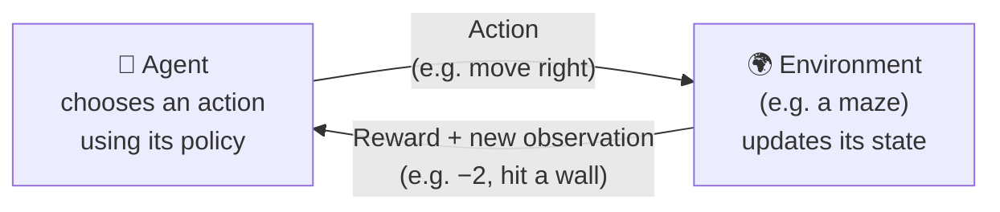
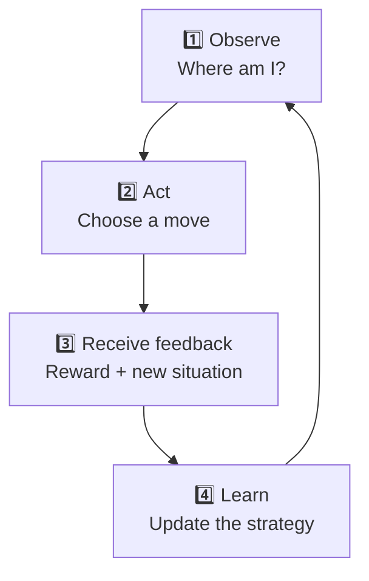
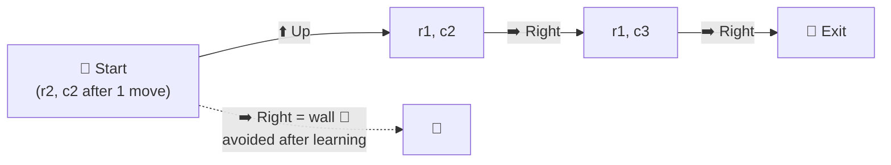

# How an AI Agent Learns Through Rewards and Penalties

> **Module:** Hardware, Networks, and Behaviorist AI
> **Audience:** Beginners
> **Content version:** V2.0 (added diagrams, maze visual, behaviorism link, and one new activity)
> **Status:** Revised — needs peer review, source verification, and image insertion

---

## Table of contents

1. [Learning goals](#learning-goals)
2. [The big idea](#1-the-big-idea)
3. [Key terms](#2-key-terms)
4. [The reinforcement learning cycle](#3-the-reinforcement-learning-cycle)
5. [Worked example: a maze](#4-worked-example-an-ai-agent-learning-to-navigate-a-maze)
6. [Why reward design matters](#5-why-reward-design-matters)
7. [Rule-based system vs RL agent](#6-how-is-this-different-from-a-rule-based-system)
8. [Check your understanding](#7-check-your-understanding)
9. [Answers and explanations](#8-answers-and-explanations)
10. [Mini-lecture plan](#9-mini-lecture-plan-510-minutes)
11. [Reuse as other resources](#10-how-this-topic-can-become-other-learning-resources)
12. [References](#11-references)
13. [Development and review record](#12-development-and-review-record)

---

## Learning goals

After studying this topic, you should be able to:

- [ ] explain the basic idea of behaviorist AI and its connection to learning through feedback;
- [ ] identify an agent, environment, action, observation, reward, and penalty in a simple AI scenario;
- [ ] describe how an AI agent can improve its decisions through trial and error;
- [ ] trace a simplified reinforcement learning cycle; and
- [ ] explain why the design of a reward system affects an agent's behavior.

---

## 1. The big idea

Imagine a computer-controlled character in a maze. At first, it does not know the best route to the exit. It tries different movements, receives feedback about the results, and gradually learns which actions are more useful.

This example illustrates a central idea associated with behaviorist approaches to learning: **behavior can be influenced by its consequences**.

In artificial intelligence (AI), one way to implement a related idea is through **reinforcement learning (RL)**. Reinforcement learning is a machine-learning approach in which an agent interacts with an environment and learns to select actions based on rewards or other feedback.

Unlike a system that only follows a fixed sequence of instructions, a learning agent can adjust its behavior based on experience. However, not every system that responds to feedback is learning: a program may simply follow predetermined rules.

### What is behaviorist AI?

Behaviorist AI is a broad way of thinking about intelligent behavior in which observable actions and the feedback they receive are important to how behavior is understood or modeled.

A useful historical connection is **behaviorism**, a school of psychology that studies observable behavior and how it is influenced by environmental conditions and consequences. [3]

### From animal learning to machine learning

A well-known behaviorist idea is **operant conditioning**, studied by B. F. Skinner: an animal in an experimental box learns that pressing a lever is followed by food, so it presses the lever more often. The table shows how the same pattern maps onto reinforcement learning.

| Behaviorism (animal experiment) | Reinforcement learning (AI) |
|---|---|
| Animal | Agent |
| Experimental box | Environment |
| What the animal sees or senses | Observation |
| Pressing a lever | Action |
| Food pellet | Positive reward |
| Unpleasant consequence | Negative reward (penalty) |
| Learned habit | Policy |

<!-- IMAGE: Add a simple diagram or illustration of an operant conditioning box (an animal, a lever, and a food dispenser). Drawing your own avoids licensing issues. Suggested file: images/operant-conditioning-box.png -->
<!--  -->
<!-- *Figure 1. Operant conditioning: behavior followed by a reward becomes more likely. Source: [add source and license].* -->

Modern reinforcement learning is related to some of these ideas, particularly learning from rewards and penalties. However, behaviorism and reinforcement learning are **not identical**: reinforcement learning is a formal computational framework with mathematical models and algorithms.

For this lesson, we will focus on how an AI agent can learn to make better decisions by interacting with its environment.

---

## 2. Key terms

| Term | Beginner-friendly meaning |
|---|---|
| **Artificial intelligence (AI)** | The field of developing computer systems that perform tasks associated with capabilities such as reasoning, prediction, or decision-making. |
| **Agent** | The system that observes a situation and chooses an action. |
| **Environment** | The world or situation in which an agent operates. |
| **State / Observation** | Information the agent receives about its current situation. |
| **Action** | A decision or movement made by the agent. |
| **Feedback** | Information about the result of an action. |
| **Reward** | A numerical signal used to encourage behavior that helps achieve the system's objective. |
| **Penalty** | An informal term for a negative reward or an unfavorable outcome signal. |
| **Episode** | One complete attempt at a task, e.g. from the start of the maze until the exit is reached. |
| **Trial and error** | Trying actions, observing their outcomes, and using the experience to improve future decisions. |
| **Exploration** | Trying actions the agent is unsure about, to discover new information. |
| **Exploitation** | Choosing the action that currently seems best, based on past experience. |
| **Policy** | A strategy or rule used by an agent to choose actions in different situations. |
| **Reinforcement learning** | A machine-learning approach in which an agent learns through interaction with an environment and reward feedback. |

**Important distinction:** A reward does not necessarily mean that an action is morally good or socially beneficial. It means the action or outcome receives a favorable signal according to the reward system designed for the task.

---

## 3. The reinforcement learning cycle

A simplified reinforcement learning system repeatedly interacts with its environment.

The cycle can be explained in four stages:

1. **Observe:** The agent receives information about its current situation.
2. **Act:** The agent selects an action according to its current strategy.
3. **Receive feedback:** The environment changes and provides a reward and a new observation.
4. **Learn:** The agent uses its experience to improve its future decisions.

The fourth stage is important. In an actual reinforcement learning algorithm, learning involves updating the agent's policy or other internal estimates. The exact update depends on the algorithm being used. [1] [2]

The diagram is simplified: an agent may explore unfamiliar actions, revisit previous situations, and receive rewards only after several actions rather than immediately.

### Exploration vs exploitation

An agent faces a constant choice:

| Exploration 🔍 | Exploitation ⭐ |
|---|---|
| Try something new | Use what already works |
| May discover a better route | Collects reliable rewards now |
| Risk: wastes moves on bad choices | Risk: never finds a better option |

> 💡 **Everyday analogy:** Always ordering your favourite dish at a restaurant is *exploitation*. Trying a new dish is *exploration* — it might be worse, or it might become your new favourite. Good learning agents balance both, usually exploring more at the start and less later.

---

## 4. Worked example: An AI agent learning to navigate a maze

Consider a small virtual maze with three important features:

- a starting point;
- a wall that blocks certain movements; and
- an exit that the agent must reach.

The agent can move up, down, left, or right. Its objective is to reach the exit efficiently without repeatedly attempting to move through walls.

### Step 1 — Define the environment

The maze is the environment. Its layout determines which movements are possible.

|   | Column 1 | Column 2 | Column 3 | Column 4 |
|---|:---:|:---:|:---:|:---:|
| **Row 1** | ⬜ | ⬜ | ⬜ | 🏁 Exit |
| **Row 2** | 🤖 Start | ⬜ | 🧱 Wall | ⬜ |

The agent receives an observation indicating its current position and relevant information about nearby obstacles.

<!-- IMAGE: Add a screenshot or drawing of a grid-world maze, ideally from a simple simulator, showing the start, walls, and exit. Suggested file: images/grid-world-maze.png -->
<!--  -->
<!-- *Figure 2. A grid-world maze used in reinforcement learning examples. Source: [add source and license].* -->

### Step 2 — Define the available actions

The agent can choose from four actions:

| Action | Meaning |
|---|---|
| ⬆️ Up | Attempt to move one cell upward. |
| ⬇️ Down | Attempt to move one cell downward. |
| ⬅️ Left | Attempt to move one cell to the left. |
| ➡️ Right | Attempt to move one cell to the right. |

These actions define the choices available to the agent.

### Step 3 — Design the reward system

Suppose the designer uses the following illustrative rewards:

| Outcome | Reward |
|---|---:|
| Reach the exit | +10 |
| Attempt to move into a wall | −2 |
| Make an ordinary valid move | −0.1 |

These values are examples, not universal rules.

The positive reward encourages the agent to reach the exit. The penalty discourages attempts to move into walls. The small negative reward for each ordinary move encourages the agent to avoid unnecessarily long routes.

Without the small movement cost, the agent might still learn to reach the exit, but it would have less incentive to find a shorter route.

### Step 4 — Observe an early attempt

Suppose the agent starts at the start cell and initially chooses actions without knowing which route is best.

| Step | Action | Outcome | Reward |
|---|---|---|---:|
| 1 | Right | Moves to an open cell (row 2, column 2) | −0.1 |
| 2 | Right | Encounters a wall — stays in place | −2 |
| 3 | Up | Moves to an open cell (row 1, column 2) | −0.1 |
| 4 | Right | Moves closer to the exit (row 1, column 3) | −0.1 |
| 5 | Right | Reaches the exit | +10 |
| | | **Total reward** | **+7.7** |

The agent has experienced both unfavorable and favorable outcomes.

The table illustrates one possible attempt. A real agent may take many more actions, and a reward may depend on the complete sequence of actions rather than on one step alone.

### Step 5 — Learn from experience

After collecting experience, the agent can update its decision strategy.

For example, it may learn that attempting to move right from row 2, column 2 is unhelpful because a wall blocks the route. It may instead prefer moving up.

One simple way to picture this is a table of **action values** — the agent's current estimate of how good each action is in a given position. (Real algorithms such as Q-learning calculate these values mathematically; the numbers below are illustrative.)

**Position: row 2, column 2**

| Action | Estimated value — before learning | Estimated value — after several episodes |
|---|:---:|:---:|
| ⬆️ Up | 0 | **high** ✅ |
| ➡️ Right | 0 | low ❌ (wall) |
| ⬅️ Left | 0 | low (moves away from exit) |
| ⬇️ Down | 0 | low (edge of maze) |

The learned **policy** in this position becomes: *choose Up*.

This does not mean that every AI agent automatically remembers every mistake. Its ability to use past experience depends on its learning algorithm, observations, and stored information.

### Step 6 — Evaluate the result

The agent should be tested to determine whether its decisions have improved.

Possible measures include:

- whether it reaches the exit;
- how many actions it needs;
- how often it attempts to move into walls; and
- the total reward accumulated during a run.

**Early attempt vs learned route:**

| | Early attempt | After learning |
|---|---|---|
| Route | Right → Right (wall) → Up → Right → Right | Right → Up → Right → Right |
| Number of actions | 5 | 4 |
| Wall collisions | 1 | 0 |
| Total reward | +7.7 | **+9.7** |

A successful learning process should improve performance on the intended task, not merely increase one reward value in isolation.

<!-- IMAGE: Add a learning-curve chart showing total reward per episode rising and levelling off over training. You can create it yourselves in a spreadsheet or Python. Suggested file: images/learning-curve.png -->
<!--  -->
<!-- *Figure 3. A typical learning curve — performance improves with experience. Created by the team.* -->

---

## 5. Why reward design matters

The reward system influences what the agent learns to optimize.

Suppose a designer wants the agent to reach the exit using a short route.

| Scenario | Reward system | Likely learned behavior | Matches the goal? |
|---|---|---|:---:|
| **A** | Only reaching the exit earns a reward. | Reaches the exit, but has little reason to take a short route. | ⚠️ Partly |
| **B** | Exit earns a reward; each move has a small cost. | Reaches the exit and avoids unnecessarily long routes. | ✅ Yes |
| **C** | A large reward for moving quickly, regardless of reaching the exit. | Moves quickly without solving the maze. | ❌ No |

Scenario C illustrates a potential problem: the system may optimize the reward it was given without achieving the designer's broader intention. This is sometimes called **reward hacking** or **specification gaming**.

This is one reason reward design and evaluation are important in reinforcement learning. A reward function is a mathematical way of specifying which outcomes the system should favor, but it may not capture every aspect of the desired behavior.

---

## 6. How is this different from a rule-based system?

A rule-based system and a reinforcement learning agent can sometimes behave similarly, but the way they produce their behavior differs.

| Feature | Fixed rule-based system | Reinforcement learning agent |
|---|---|---|
| How behavior is determined | Follows predefined rules. | Uses a learned or updated policy to select actions. |
| Role of experience | Does not necessarily change its rules based on experience. | Uses experience and reward feedback to improve decisions. |
| Example | If the cell above is blocked, move right. | Learn which actions tend to lead to higher cumulative rewards. |
| Main limitation | May perform poorly when its rules do not cover a situation. | May learn an undesirable strategy if rewards or training experiences are poorly designed. |

These approaches are not mutually exclusive. An AI system may combine fixed rules with a learning component.

### Where is reinforcement learning used?

| Area | Example | Reward idea |
|---|---|---|
| Games | DeepMind's AlphaGo combined reinforcement learning with other techniques to play Go at a professional level. [4] | Winning the game |
| Robotics | Robots learning to walk or grasp objects, often first in simulation | Moving forward without falling; holding an object |
| Resource control | Adjusting settings such as cooling or traffic signals | Lower energy use; shorter waiting times |

<!-- IMAGE: Add a photo of a robot or a Go board to illustrate real-world uses. Wikimedia Commons is a good source of freely licensed images. Suggested file: images/rl-applications.jpg -->
<!--  -->
<!-- *Figure 4. Source: [add source and license].* -->

---

## 7. Check your understanding

### Activity A — Identify the components

A robot learns to navigate a classroom. It receives information from its sensors, moves toward a target, and receives a positive reward when it reaches the destination.

Identify the following:

1. The agent.
2. The environment.
3. One possible observation.
4. One possible action.
5. One possible reward.

**Your answer:** Write one response for each item.

### Activity B — Interpret the reward system

A game agent receives the following rewards:

- +20 for collecting a key;
- +50 for completing the level;
- −5 for colliding with an obstacle;
- −1 for each movement.

Answer the following:

1. Which outcome receives the largest positive reward?
2. Why might the designer assign a small negative reward to each movement?
3. Could this reward system cause the agent to behave in an unexpected way? Explain one possibility.

### Activity C — Apply the concept

A virtual delivery robot receives a large reward whenever it delivers a package, but it receives no penalty for taking a very long route.

1. What behavior might the robot learn?
2. What additional reward or penalty could encourage more efficient delivery?
3. Why should the designer test the robot in different environments?

### Activity D — Calculate the reward

Using the maze rewards in Section 4 (exit +10, wall −2, valid move −0.1), calculate the total reward for this route:

**Up → Right → Right → Right**

Is it better or worse than the early attempt (+7.7)? Why?

---

## 8. Answers and explanations

### Activity A — Suggested answers

1. **Agent:** The robot.
2. **Environment:** The classroom and its layout.
3. **Observation:** The robot's current position or information from a distance sensor.
4. **Action:** Moving forward or turning left.
5. **Reward:** A positive numerical signal when the robot reaches its destination.

Other answers are acceptable if they correctly describe the scenario.

### Activity B — Suggested answers

1. **Completing the level** receives the largest positive reward, at +50.
2. The movement cost may encourage the agent to finish the level using fewer actions.
3. Yes. For example, the agent might take a risky shortcut to avoid movement costs. Whether this happens depends on the environment, available actions, and learning algorithm.

### Activity C — Suggested answers

1. The robot may learn to deliver packages successfully but take unnecessarily long routes.
2. The designer could introduce a small cost for each movement or a carefully designed cost for travel time, while preserving a sufficient reward for successful delivery.
3. Testing in different environments helps reveal whether the agent can handle unfamiliar layouts and whether its learned behavior continues to meet the intended objective.

### Activity D — Answer

Three valid moves (−0.1 × 3 = −0.3), then reaching the exit (+10): **total = +9.7**.

It is **better** than +7.7 because the route is shorter and avoids the wall penalty. It is equally good as the learned route in Section 4 — both use four actions.

These are suggested answers rather than the only possible solutions. Learners should receive credit for reasonable explanations supported by the scenario.

---

## 9. Mini-lecture plan (5–10 minutes)

| Time | Activity | Resource |
|---|---|---|
| 1 min | **Introduction:** Ask how a game character could learn to navigate a maze without being given a complete route. | — |
| 2 min | **Introduce terminology:** agent, environment, action, observation, reward, and policy — link to the behaviorism table. | Sections 1–2 |
| 2 min | **Walk through the learning cycle:** use the diagram; mention exploration vs exploitation. | Section 3 |
| 2 min | **Worked example:** show the maze grid, the early attempt, and the learned route. | Section 4 |
| 1–3 min | **Quick assessment:** Activity A or D, or explain why reward design matters. | Sections 5, 7 |

---

## 10. How this topic can become other learning resources

- **Study guide:** Include the key-term table, learning-cycle diagram, worked maze example, and activities with suggested answers.
- **PPT slides:** One slide for the behaviorism comparison, one for the learning cycle, two for the maze example, and one for reward design.
- **Video tutorial:** Animate an agent moving through the maze, display the reward after each action, and show how its decisions improve over repeated attempts.
- **Practical demonstration:** Use a simple grid-world simulator or a small program to demonstrate how an agent's choices change during training. If a simulator is used, explain its reward settings and distinguish actual learning from a prerecorded demonstration.

**Image checklist:** operant conditioning illustration (Section 1), grid-world maze (Section 4), learning curve (Section 4), real-world application photo (Section 6). Remove the `<!-- -->` markers once each image is in the `images/` folder, and add a caption with the source and license.

---

## 11. References

1. Sutton, R. S., & Barto, A. G. (2018). *Reinforcement Learning: An Introduction* (2nd ed.). MIT Press.
   https://incompleteideas.net/book/the-book-2nd.html
   Supports the fundamental concepts of agents, environments, actions, rewards, policies, exploration and exploitation, and learning through interaction.
2. OpenAI Spinning Up. *Key Concepts in Reinforcement Learning*.
   https://spinningup.openai.com/en/latest/spinningup/rl_intro.html
   Provides an accessible technical introduction to reinforcement learning concepts, including the agent, environment, reward, and policy.
3. Encyclopaedia Britannica. *Behaviorism*.
   https://www.britannica.com/science/behaviorism
   Provides background on behaviorism as a psychological approach to observable behavior and learning, including operant conditioning.
4. Silver, D., et al. (2016). Mastering the game of Go with deep neural networks and tree search. *Nature*, 529, 484–489.
   https://www.nature.com/articles/nature16961
   Supports the AlphaGo example in Section 6.

**Source-use note:** The explanations, reward values, tables, maze scenario, and action-value example in this learning material are original teaching examples written for beginners. The references provide conceptual and technical background. Before submission, the team should verify the sources, check that each reference supports the relevant claims, record any corrections, and follow the course's attribution requirements.

---

## 12. Development and review record

**Current status:** Revised — needs peer review and source verification.

Before marking this topic as `Checked`, a team member should:

- verify the definitions of reinforcement learning and behaviorism;
- confirm that the learning-cycle diagrams accurately represent the simplified process;
- review the reward examples, maze grid, and totals (+7.7 and +9.7) and ensure they are consistent;
- check the distinction between fixed rules and learning from experience;
- verify the references and any external material used, including image sources; and
- record the reviewer's name, review date, checks performed, findings, and corrections in the project submission report.

