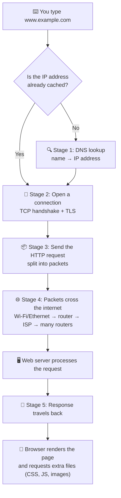
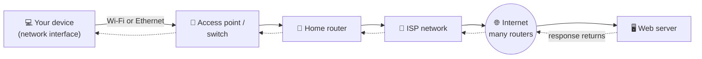
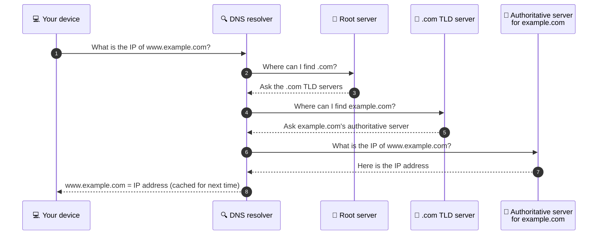
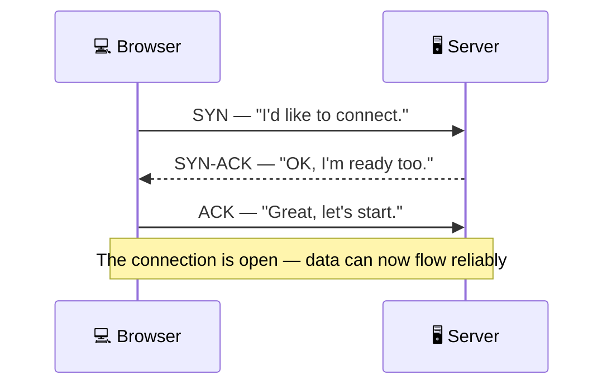
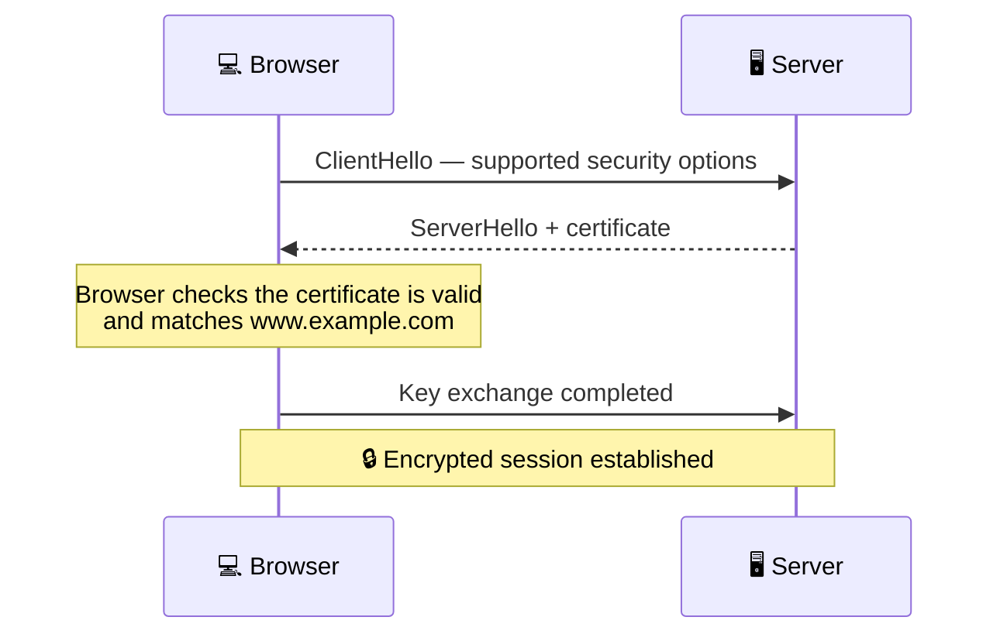
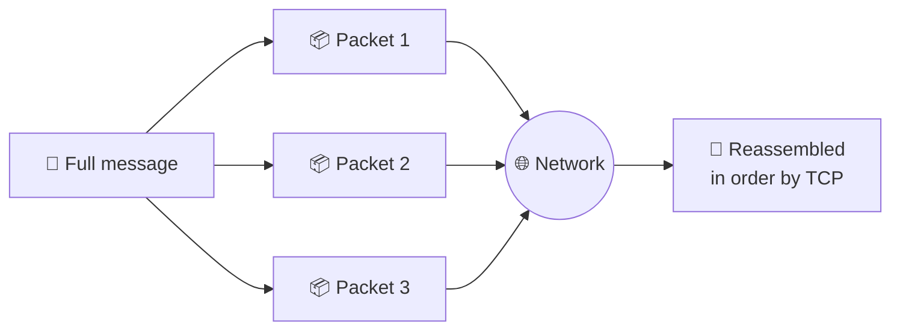
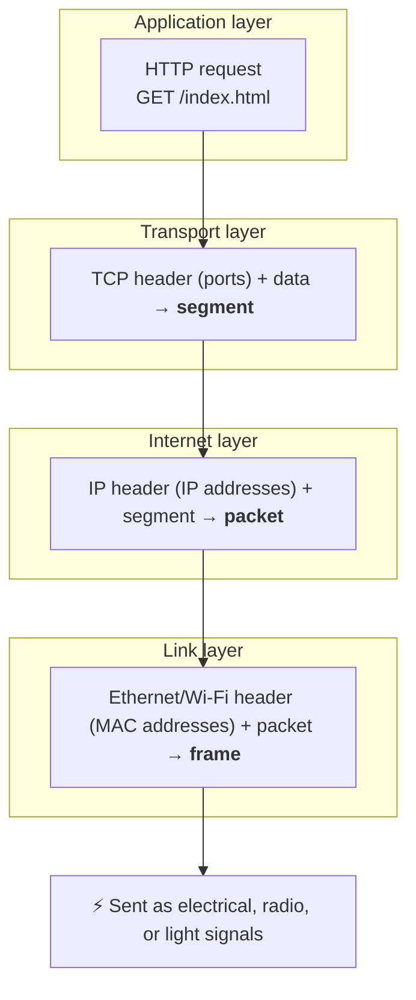
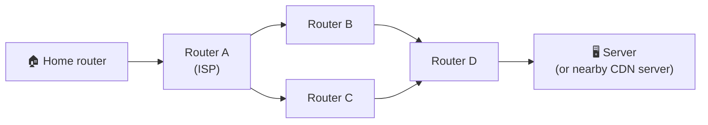
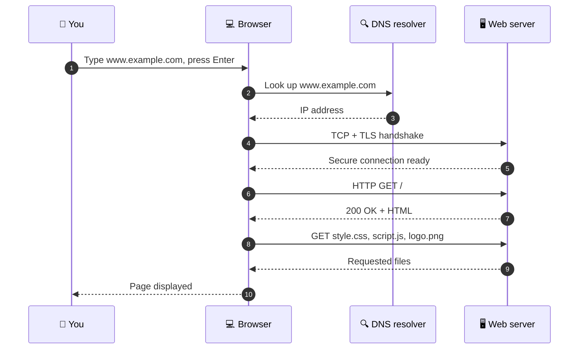

# How Data Travels from Your Computer to a Website

> **Module:** Hardware, Networks, and Behaviorist AI
> **Audience:** Beginners
> **Content version:** V2.0 (expanded with diagrams, visuals, and hands-on activities)
> **Status:** Revised — needs peer review, source verification, and image insertion

---

## Table of contents

1. [Learning goals](#learning-goals)
2. [The big idea](#1-the-big-idea)
3. [Key terms](#2-key-terms)
4. [The journey at a glance](#3-the-journey-at-a-glance)
5. [Stage 1 — DNS: finding the address](#4-stage-1--dns-finding-the-address)
6. [Stage 2 — Opening a connection (TCP + TLS)](#5-stage-2--opening-a-connection-tcp--tls)
7. [Stage 3 — Packets and layers](#6-stage-3--packets-and-layers)
8. [Stage 4 — Across the internet](#7-stage-4--across-the-internet)
9. [Stage 5 — The response and page rendering](#8-stage-5--the-response-and-page-rendering)
10. [Hardware roles](#9-which-hardware-does-what)
11. [Common misconceptions](#10-common-misconceptions)
12. [Try it yourself](#11-try-it-yourself)
13. [Check your understanding](#12-check-your-understanding)
14. [Answers and explanations](#13-answers-and-explanations)
15. [Mini-lecture plan](#14-mini-lecture-plan-1012-minutes)
16. [Reuse as other resources](#15-how-this-topic-can-become-other-learning-resources)
17. [Image checklist](#16-image-checklist-for-the-team)
18. [References](#17-references)

---

## Learning goals

After studying this topic, you should be able to:

- [ ] describe the purpose of **DNS** in a website visit;
- [ ] identify the roles of your **device, local network, router, internet, and web server**;
- [ ] explain why a connection is opened (**TCP**) and protected (**TLS / HTTPS**) before the page is requested;
- [ ] describe how data is split into **packets** and wrapped in layers (**encapsulation**);
- [ ] put the main stages of a simplified website request in the correct order; and
- [ ] explain why the response must travel back to your browser.

---

## 1. The big idea

When you type a website name into a browser, your computer does not magically receive a page. Your browser and operating system use networking services to **find** the destination, **connect** to it, **send** a request, and **receive** a response. The browser then interprets the returned web content and **displays** the page.

> 💡 **Analogy — sending a letter**
> | Website visit | Postal system |
> |---|---|
> | Domain name (`example.com`) | The name of the person you want to write to |
> | DNS lookup | Looking up their street address in an address book |
> | IP address | The street address on the envelope |
> | Packet | One envelope (a long letter is split across many envelopes) |
> | Routers | Sorting offices that pass envelopes along |
> | Web server | The recipient who reads your letter and writes back |

A **network** is a group of connected devices that can exchange data. Data is sent in units commonly called **packets** as it travels across many networks. A **server** is a computer or software system that provides a service — in this example, it sends website content when requested.

> ⚠️ The exact route depends on the network and the website. The sequence below is a **simplified learning model**, not a promise that every request follows an identical path.

<!-- IMAGE: Add a simple illustration of a laptop connected through a home router to "the internet" (cloud) and a server. Suggested file: images/data-travel-overview.png -->
<!--  -->
<!-- *Figure 1. Overview of a website visit. Source: [add source and license].* -->

---

## 2. Key terms

| Term | Beginner-friendly meaning | Analogy |
|---|---|---|
| **Browser** | An application used to request and display web pages, such as Chrome, Firefox, Safari, or Edge. | You, writing and reading letters |
| **URL** | The full web address, e.g. `https://www.example.com/page`. It includes the protocol, hostname, and path. | The full instructions on an envelope |
| **DNS (Domain Name System)** | A distributed naming system that helps find the IP address associated with a domain name. | An address book |
| **IP address** | A logical network address used to deliver data to a destination across IP networks (e.g. `93.184.215.14` in IPv4 or a longer IPv6 form). | A street address |
| **Port** | A number that identifies which service on a device should receive data (HTTPS usually uses port **443**). | An apartment number in a building |
| **Router** | A device that forwards packets **between networks**, such as a home network and an internet service provider's network. | A sorting office |
| **Switch** | A device that connects devices **within a local wired network** and forwards Ethernet frames toward the appropriate local connection. | A mail room inside one building |
| **Wi-Fi access point** | A device that lets wireless devices connect to a local network. It may be built into a home router. | A mailbox you can reach without a cable |
| **ISP (Internet Service Provider)** | The company that connects your home or school network to the wider internet. | The national postal service |
| **Server** | A computer or software service that responds to requests, for example by providing web content. | The recipient of your letter |
| **Packet** | A formatted unit of data carried by a network protocol. | One envelope |
| **Protocol** | An agreed set of rules that devices use to communicate. | The rules for addressing an envelope |
| **TCP** | A transport protocol that provides reliable, ordered delivery of data and resends missing pieces. | Registered mail with delivery confirmation |
| **HTTPS** | HTTP communication protected with **TLS** encryption and authentication. It helps protect data in transit between the browser and the website endpoint. | A sealed, tamper-evident envelope |
| **Cache** | A stored copy of earlier results (e.g. DNS answers or images) kept to save time. | Remembering an address you looked up yesterday |

---

## 3. The journey at a glance

The flowchart below shows the **five stages** of a simplified website visit.

### The physical path

> **Important:** These diagrams separate DNS from the website connection to make the ideas easier to learn. DNS information may already be cached, and the network path may include many routers. A home gateway often combines a **router, switch, Wi-Fi access point, and modem** in one box.

<!-- IMAGE: Add a labelled photo of a home router/gateway showing the WAN port, LAN ports, and antennas. Suggested file: images/home-router-labelled.jpg -->
<!--  -->
<!-- *Figure 2. A home gateway often combines several network devices. Source: [add source and license].* -->

---

## 4. Stage 1 — DNS: finding the address

Computers route data using **IP addresses**, not names. DNS translates a name such as `www.example.com` into an IP address.

### 4.1 Where the browser looks first

Before asking the network, the device checks its **caches** in roughly this order:

1. **Browser cache** — did the browser recently look this name up?
2. **Operating system cache** — does the OS remember it?
3. **Hosts file** — a small local file that can map names to addresses manually.
4. **DNS resolver** — if nothing is cached, ask the resolver (usually provided by your ISP, school network, or a chosen public service).

### 4.2 How the resolver finds the answer

If the resolver does not have the answer cached, it asks a chain of DNS servers. Each one points closer to the final answer.

| DNS server type | Role | Analogy |
|---|---|---|
| **Resolver** | Does the searching on your behalf and caches answers. | A librarian who finds the book for you |
| **Root server** | Knows where the top-level domain servers are. | The library's main directory |
| **TLD server** (`.com`, `.org`, `.cn`) | Knows which servers are responsible for each domain under it. | The shelf for one subject |
| **Authoritative server** | Holds the official records for a specific domain. | The exact book with the answer |

> ✅ **Key point:** DNS translates names to records; it **does not download the web page itself**.

---

## 5. Stage 2 — Opening a connection (TCP + TLS)

Once the browser knows the IP address, it opens a connection to the server, usually on **port 443** for HTTPS.

### 5.1 TCP three-way handshake

TCP makes sure both sides are ready and can track which data has arrived.

### 5.2 TLS handshake (the "S" in HTTPS)

TLS adds **encryption** (others cannot read the data) and **authentication** (the browser can check that it is talking to the real website, using the site's certificate).

> 💡 The padlock icon in the address bar means the connection uses HTTPS. It shows that the connection is **encrypted**, not that the website itself is trustworthy.

> ℹ️ Modern browsers may use **HTTP/3**, which runs over a different transport protocol (QUIC) instead of TCP. The idea is the same: set up a reliable, secure connection before sending the request.

<!-- IMAGE: Add a screenshot of a browser address bar showing the padlock icon and the certificate information panel. Take your own screenshot to avoid licensing issues. Suggested file: images/https-padlock.png -->
<!--  -->
<!-- *Figure 3. Certificate details shown by the browser. Screenshot by the team.* -->

---

## 6. Stage 3 — Packets and layers

### 6.1 Why split data into packets?

A web page and the request for it can be too large to send as one block. Data is split into smaller **packets** because:

- many users can share the same network links fairly;
- if one packet is lost, only that packet needs to be resent; and
- packets can take different routes and be reassembled in order at the destination.

### 6.2 Encapsulation — wrapping data in layers

As data goes down through the network layers on your device, each layer adds its own **header** (like putting a letter into an envelope, then into a box, then onto a truck). The receiver removes them in reverse order.

| TCP/IP layer | What it adds | Example information | Typical devices / software |
|---|---|---|---|
| **Application** | The actual request | `GET /index.html`, `Host: www.example.com` | Browser, web server |
| **Transport** | Ports, sequence numbers | Source port, destination port **443** | Operating system (TCP/UDP) |
| **Internet** | Logical addresses | Source IP, destination IP | Routers |
| **Link** | Local hardware addresses | Source and destination **MAC** addresses | Network interface, switch, access point |

> 💡 **Why two kinds of address?** The **IP address** stays the same for the whole journey (end to end). The **MAC address** changes at every hop, because each local link only needs to know the next device. Like a parcel: the final delivery address stays the same, but the truck changes at each depot.

---

## 7. Stage 4 — Across the internet

1. Your device sends the frame over **Wi-Fi or Ethernet** to the local network.
2. The **home router** sees that the destination is not on the local network and forwards the packet to the **ISP**. Most home routers also use **NAT** to share one public IP address between all home devices.
3. **Routers across the internet** read the destination IP address and forward the packet one **hop** closer, using routing tables.
4. Each packet has a **TTL (time to live)** value that decreases at each hop, so lost packets do not circle forever.
5. Large websites often use **CDNs (content delivery networks)** — copies of the site on servers around the world — so your request may reach a server near you instead of one on another continent.

*Packets can take different paths (via B or C) depending on network conditions.*

<!-- IMAGE: Add a map of undersea internet cables or a data-centre photo to show the physical scale of the internet. Wikimedia Commons is a good source of freely licensed images. Suggested file: images/undersea-cables-map.png -->
<!--  -->
<!-- *Figure 4. Most international internet traffic travels through undersea fibre-optic cables. Source: [add source and license].* -->

---

## 8. Stage 5 — The response and page rendering

### 8.1 The full conversation

### 8.2 HTTP status codes

The server's response starts with a **status code** telling the browser what happened.

| Code | Meaning | Example |
|---|---|---|
| **200** OK | Success — here is the content. | The page loads normally. |
| **301 / 302** | Redirect — the content is at another address. | `http://` redirects to `https://`. |
| **404** Not Found | The server has no such page. | A mistyped page path. |
| **500** Internal Server Error | Something went wrong on the server. | A bug in the website's code. |

### 8.3 How the browser builds the page

1. **Parse HTML** → build the page structure (the DOM).
2. **Request extra resources** → CSS (style), JavaScript (behaviour), images, fonts.
3. **Apply CSS** → work out how each element looks.
4. **Layout** → calculate the position and size of each element.
5. **Paint** → draw pixels on the screen (often with help from the **GPU**).

> 💡 One web page often needs **dozens of requests**. You can see them in your browser's Developer Tools (see Activity C).

---

## 9. Which hardware does what?

| Component | Role in a website visit | Linked topic |
|---|---|---|
| **CPU** | Executes browser and operating-system instructions, including encryption and page processing. | `core-components.md` |
| **RAM** | Temporarily holds the browser, the page data, and caches currently in use. | `ram-vs-storage.md` |
| **Storage (SSD/HDD)** | Keeps the browser's disk cache so repeated visits load faster. | `ram-vs-storage.md` |
| **GPU** | Helps draw (paint) the page on screen. | `core-components.md` |
| **Network interface** (Wi-Fi card / Ethernet port) | Sends and receives network data. | `network-hardware-explained.md` |
| **Switch / access point** | Connects devices inside the local network. | `how-devices-communicate-on-a-local.md` |
| **Router** | Forwards packets between networks. | `network-hardware-explained.md` |
| **Firewall** | Allows or blocks traffic based on rules. | `how-firewalls-control-network-traffic.md` |
| **DNS resolver** | Resolves the domain name to an IP address. | `addresses-and-protocols.md` |
| **Web server** | Responds to the browser's request. | — |

<!-- IMAGE: Add a photo of a laptop Wi-Fi card or a desktop Ethernet port (network interface). Suggested file: images/network-interface-card.jpg -->
<!--  -->
<!-- *Figure 5. A network interface card. Source: [add source and license].* -->

---

## 10. Common misconceptions

| ❌ Misconception | ✅ Reality |
|---|---|
| "DNS sends me the website." | DNS only provides the address. The page comes from the web server. |
| "The data travels as one big piece." | It is split into many packets that are reassembled at the destination. |
| "All packets take exactly the same route." | Routes can differ, and the path can change over time. |
| "The padlock means the website is safe." | It means the connection is encrypted. A scam site can also use HTTPS. |
| "Wi-Fi and the internet are the same thing." | Wi-Fi connects you to your **local** network; the router connects that network to the internet. |
| "A web page is one file." | A page usually needs HTML plus many CSS, JavaScript, image, and font files. |

---

## 11. Try it yourself

These commands are **read-only** and safe to run on your own computer. Follow your school's rules before running network tools on shared or school devices.

| Goal | Windows (Command Prompt) | macOS / Linux (Terminal) | What you will see |
|---|---|---|---|
| Look up an IP address with DNS | `nslookup example.com` | `nslookup example.com` | The IP address(es) for the domain |
| Check if a host responds | `ping example.com` | `ping -c 4 example.com` | Round-trip time in milliseconds |
| See the route (hops) | `tracert example.com` | `traceroute example.com` | Each router along the path |
| Show your own IP settings | `ipconfig` | `ifconfig` or `ip addr` | Your local IP address and router (gateway) |

> ℹ️ Some networks block `ping` or `traceroute` responses, so missing results do not always mean a problem.

<!-- IMAGE: Add your own screenshot of the tracert/traceroute output with each hop highlighted. Suggested file: images/traceroute-example.png -->
<!--  -->
<!-- *Figure 6. Each line is one router hop. Screenshot by the team.* -->

---

## 12. Check your understanding

### Activity A — Put the stages in order

Put these stages in order for a simplified website visit:

- A. The browser processes the response and displays the page.
- B. The browser/operating system obtains an IP address, using DNS if needed.
- C. The browser sends a request toward the website server.
- D. The website server sends a response.
- E. You enter a website address.
- F. The browser opens a secure connection with the server.

**Your answer:** Write the letters in order and give one sentence explaining the role of DNS.

### Activity B — Apply the idea

A learner can connect to the home Wi-Fi network, but one website does not load. Give two safe, basic checks they could try before assuming that the router is broken.

### Activity C — Observe real requests

1. Open any website in Chrome, Edge, or Firefox.
2. Press **F12** (or right-click → *Inspect*) and open the **Network** tab.
3. Reload the page.

Answer: How many requests were made? What was the status code of the first request? Name two types of files that were loaded.

### Activity D — Quick quiz

1. Which protocol translates domain names into IP addresses?
   a) HTTP  b) DNS  c) TCP  d) TLS
2. Which device forwards packets **between** networks?
   a) Switch  b) Access point  c) Router  d) Network interface
3. What does a **404** status code mean?
   a) Success  b) Redirect  c) Page not found  d) Server error
4. Which address changes at every hop: the IP address or the MAC address?
5. Name the three messages of the TCP handshake.

---

## 13. Answers and explanations

**Activity A:** E → B → F → C → D → A.

- You enter the address first.
- The device obtains the destination IP address, unless a usable result is already cached.
- The browser opens a (secure) connection, sends a request; the server responds; then the browser processes the response.
- **DNS's role:** it helps translate a domain name into the IP address needed to contact the destination. DNS does not itself send the page content.

**Activity B — possible answers:**

1. Check whether other websites load. This helps determine whether the problem is limited to one website.
2. Check the address for typing mistakes and try reloading the page.
3. Check whether the device still has a working network connection.
4. If permitted by the household or school's rules, ask the network administrator or responsible adult before changing network settings or restarting shared equipment.

These are initial checks, not a guaranteed diagnosis. A site, DNS service, browser, device, or network may be responsible.

**Activity C:** Answers vary by website. Typical pages make tens of requests; the first (main HTML) request usually returns **200** (or a **301/302** redirect first). Common file types: HTML, CSS, JavaScript, images (PNG/JPG/SVG/WebP), fonts.

**Activity D:** 1 — b) DNS; 2 — c) Router; 3 — c) Page not found; 4 — the **MAC address** changes at every hop, the IP address stays the same end to end (except where NAT changes it at the edge of a network); 5 — **SYN, SYN-ACK, ACK**.

---

## 14. Mini-lecture plan (10–12 minutes)

| Time | Activity | Resource |
|---|---|---|
| 1 min | **Hook:** "What happens after you type a website name and press Enter?" Collect guesses. | — |
| 2 min | **Introduce terms** using the postal analogy and key-term table. | Sections 1–2 |
| 3 min | **Walk through the journey** with the overview flowchart and the full-conversation sequence diagram. | Sections 3 and 8.1 |
| 2 min | **Live demo:** run `nslookup` and `tracert`/`traceroute`, or show the browser Network tab. | Section 11 |
| 2 min | **Quick activity:** learners order Activity A and explain DNS. | Section 12 |
| 1 min | **Exit question:** "Does DNS download the website page?" Expected answer: no; it helps resolve the name to an address. | — |

---

## 15. How this topic can become other learning resources

- **Study guide:** keep the key-term table, diagrams, misconceptions table, and activities with answers.
- **PPT slides:** one slide each for the overview flowchart, DNS lookup, TCP/TLS handshake, encapsulation, and the quiz.
- **Video tutorial:** narrate the full-conversation diagram while highlighting each stage; include the live `traceroute` demo; finish with the ordering question.
- **Interactive quiz:** convert Activity D into an online quiz.

---

## 16. Image checklist for the team

Diagrams in this file use **Mermaid**, which GitHub renders automatically. Photos and screenshots still need to be added — remove the `<!-- -->` comment markers once each image is in the `images/` folder.

| # | Image | Where | Suggested source | Done |
|---|---|---|---|---|
| 1 | Overview illustration (laptop → router → internet → server) | Section 1 | Draw yourselves (e.g. draw.io, Canva) | ☐ |
| 2 | Labelled home router photo | Section 3 | Own photo or Wikimedia Commons | ☐ |
| 3 | Browser padlock and certificate screenshot | Section 5 | Own screenshot | ☐ |
| 4 | Undersea cable map or data-centre photo | Section 7 | Wikimedia Commons (check license) | ☐ |
| 5 | Network interface card photo | Section 9 | Own photo or Wikimedia Commons | ☐ |
| 6 | `traceroute` output screenshot | Section 11 | Own screenshot | ☐ |

For every image: write meaningful **alt text**, add a **caption with the source and license**, and keep file sizes small (under ~500 KB).

---

## 17. References

1. Internet Engineering Task Force (IETF), **RFC 1034: Domain Names — Concepts and Facilities**. https://www.rfc-editor.org/rfc/rfc1034
   Supports the role and general design of the Domain Name System.
2. Internet Engineering Task Force (IETF), **RFC 1035: Domain Names — Implementation and Specification**. https://www.rfc-editor.org/rfc/rfc1035
   Supports details of DNS messages and resolution.
3. Internet Engineering Task Force (IETF), **RFC 791: Internet Protocol**. https://www.rfc-editor.org/rfc/rfc791
   Supports the description of IP addressing, packets, and TTL.
4. Internet Engineering Task Force (IETF), **RFC 9293: Transmission Control Protocol (TCP)**. https://www.rfc-editor.org/rfc/rfc9293
   Supports the description of reliable delivery and the three-way handshake.
5. Internet Engineering Task Force (IETF), **RFC 9110: HTTP Semantics**. https://www.rfc-editor.org/rfc/rfc9110
   Supports the concepts of HTTP requests, responses, and status codes.
6. Internet Engineering Task Force (IETF), **RFC 8446: The Transport Layer Security (TLS) Protocol Version 1.3**. https://www.rfc-editor.org/rfc/rfc8446
   Supports the description of TLS as a security protocol used to protect communication.
7. Cloudflare Learning Center, **What is a DNS server?** https://www.cloudflare.com/learning/dns/what-is-a-dns-server/
   Provides a beginner-oriented explanation of DNS resolvers and name resolution.
8. MDN Web Docs, **How browsers work / Populating the page**. https://developer.mozilla.org/en-US/docs/Web/Performance/How_browsers_work
   Supports the description of page parsing and rendering.

**Source-use note:** The explanations above are paraphrased for beginner learners. Before submission, the team should open the sources, confirm that they support the statements, add sources for any images used, and follow the course's attribution rules.
 rules.
