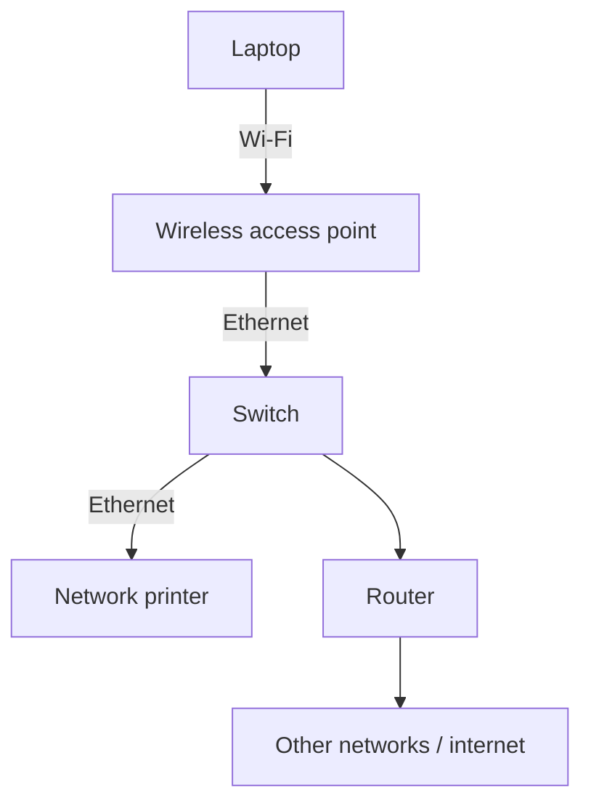

# How Devices Communicate on a Local Network

Module: Hardware, Networks, and Behaviorist AI  
Audience: Beginners  
Content version: V1.0  
Status: Drafted — needs peer review

## Learning goals

After studying this topic, you should be able to:

- describe the purpose of a local area network;
- distinguish the roles of a switch, wireless access point, and router;
- explain the basic purposes of IP addresses and MAC addresses; and
- describe how a computer sends data to a local network printer.

## 1. The big idea

A **local area network (LAN)** connects devices within a limited area, such as a home, classroom, or office. Devices can use it to share resources, including printers and files. [1]

Local communication does not always require internet access. This example follows a laptop sending a document directly to a printer on the same local network.

The exact process depends on the equipment and configuration. This is a simplified model using IPv4 and a printer that has already been configured on the laptop.

## 2. Key terms

| Term | Beginner-friendly meaning |
|---|---|
| LAN (Local Area Network) | A network connecting devices within a limited area. |
| Ethernet | A networking technology commonly used for wired local connections. |
| Wi-Fi | A technology that connects devices wirelessly to a local network. |
| Switch | A device that connects wired devices and forwards Ethernet frames. |
| Wireless access point | A device that connects wireless devices to a local network. |
| Router | A device that forwards packets between different IP networks. |
| IP address | A logical address used to identify a network interface for IP communication. |
| MAC address | A link-layer address used when delivering frames over technologies such as Ethernet. |
| DHCP | A protocol that can automatically provide IPv4 addresses and other network settings. |
| ARP | A protocol used to find the link-layer address associated with a local IPv4 address. |

Hardware roles are described in [1], DHCP in [2], and ARP in [3].

## 3. The journey in a simplified diagram

**Important:** The printing path in this example is laptop → access point → switch → printer. The router provides a path to other networks.

A home gateway may combine the access point, switch, and router in one physical box. Their functions remain different. [1]

## 4. Step-by-step worked example

Imagine this classroom setup:

| Device | IPv4 address |
|---|---|
| Laptop | `192.168.1.10` |
| Printer | `192.168.1.20` |

Both devices use the subnet mask `255.255.255.0` and belong to the same local network.

These example addresses come from a private IPv4 address range. Separate private networks may reuse them. [4]

1. **The devices obtain network settings.** DHCP may provide their addresses automatically. An administrator may also configure addresses manually. [2]
2. **You select the configured printer.** The laptop already knows its destination IP address for this example.
3. **The laptop identifies the destination as local.** Its network settings indicate that the printer is on the same subnet.
4. **The laptop finds the printer’s MAC address.** It checks its ARP cache or sends an ARP request if needed. [3]
5. **The laptop sends the print data.** Frames travel through the access point and switch to the printer.
6. **The printer receives the job.** It processes the document and, if ready, prints it.

**Assumptions:** The devices are permitted to communicate, the printer is compatible and configured, and no guest-network isolation or firewall rule blocks the connection.

### IP address versus MAC address

An IP address supports communication across IP networks. A MAC address supports frame delivery on the local link.

In this IPv4 example, ARP connects the two ideas by resolving the printer’s IP address to its MAC address. IPv6 uses a different mechanism. [3]

## 5. Check your understanding

### Activity A — Match the roles

Match each item to its function:

- A. Switch
- B. Wireless access point
- C. Router
- D. DHCP

Functions:

1. Provides network configuration automatically.
2. Connects wireless devices to the LAN.
3. Forwards packets between different IP networks.
4. Connects wired devices and forwards Ethernet frames.

**Your answer:** Write the matching letter beside each number.

### Activity B — Apply the idea

The classroom’s internet connection stops working, but its local network equipment remains operational.

Could the laptop still print to the local printer? Explain your answer in one sentence.

### Activity C — Basic troubleshooting

The laptop cannot print. Give two safe checks before changing any network settings.

## 6. Answers and explanations

**Activity A:** 1 → D, 2 → B, 3 → C, 4 → A.

**Activity B:** Yes, provided the local connection and printing service still work, because this printing path stays within the LAN.

**Activity C — possible answers:**

1. Check that the printer is powered on, ready, and has paper.
2. Confirm that the correct printer is selected.
3. Check that the laptop is connected to the intended classroom network.
4. Check whether the print queue shows an error or paused job.

These checks are starting points, not a guaranteed diagnosis. Ask the responsible administrator before changing shared equipment or network settings.

## 7. Mini-lecture plan (5–10 minutes)

1. **Hook (1 minute):** Ask, “Can a network printer work without the internet?”
2. **Introduce terms (2 minutes):** Explain LAN, switch, access point, and router.
3. **Trace the diagram (2 minutes):** Follow the printing path.
4. **Explain addresses (2 minutes):** Introduce IP addresses, MAC addresses, and ARP.
5. **Quick activity (1 minute):** Complete Activity A.
6. **Exit question (1 minute):** “Which device connects different IP networks?” Expected answer: router.

## 8. How this topic can become other learning resources

- **Study guide:** Keep the key terms, network diagram, worked example, and answers.
- **PPT slides:** Use separate slides for device roles, the printing path, and the activities.
- **Video tutorial:** Animate the printing path and pause to ask whether internet access is required.

## 9. References

1. Cisco, **Networking basics: what you need to know**.  
   https://www.cisco.com/site/us/en/learn/topics/small-business/networking-basics.html  
   Supports the roles of switches, routers, and wireless access points.

2. IETF, **RFC 2131: Dynamic Host Configuration Protocol**.  
   https://www.rfc-editor.org/rfc/rfc2131  
   Supports automatic IPv4 address allocation and network configuration.

3. IETF, **RFC 826: An Ethernet Address Resolution Protocol**.  
   https://www.rfc-editor.org/rfc/rfc826  
   Supports resolving protocol addresses to Ethernet hardware addresses.

4. IETF, **RFC 1918: Address Allocation for Private Internets**.  
   https://www.rfc-editor.org/rfc/rfc1918  
   Supports the use of private IPv4 addresses in the example.

**Source-use note:** Explanations are paraphrased for beginners. The diagram is an original teaching illustration. Before submission, peer-review the material and follow the course’s attribution requirements.
