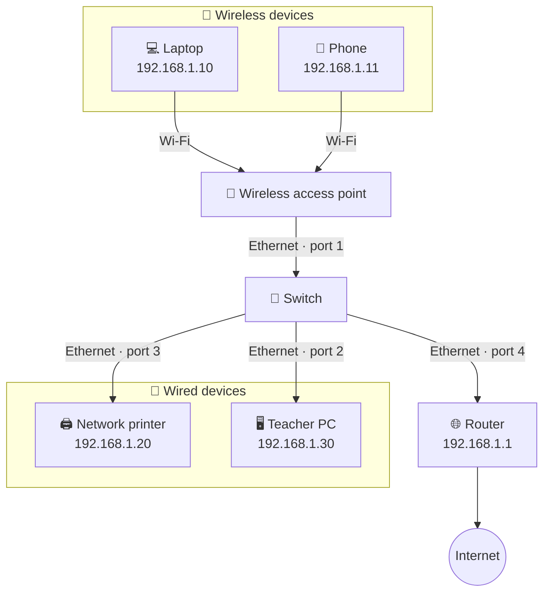
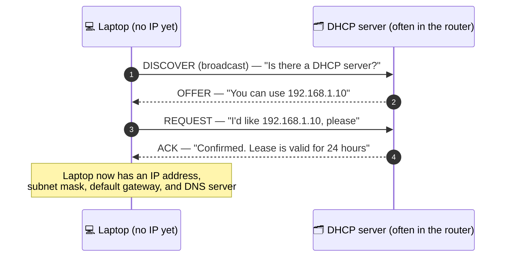
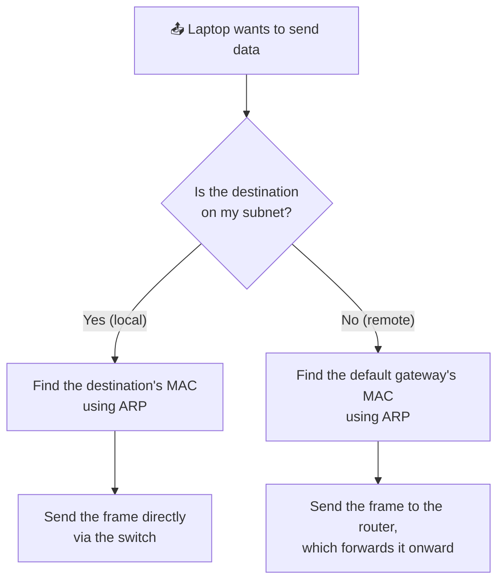
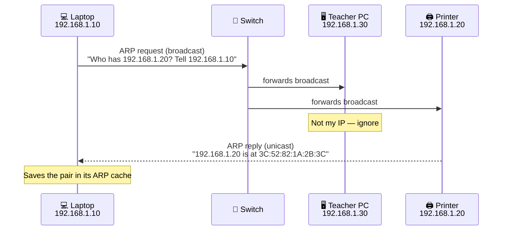
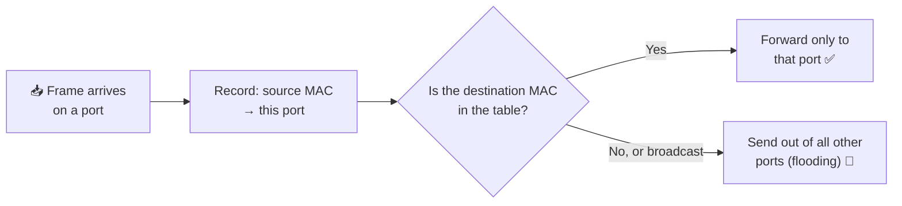
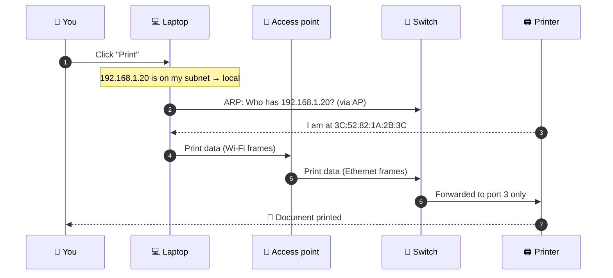

# How Devices Communicate on a Local Network

> **Module:** Hardware, Networks, and Behaviorist AI
> **Audience:** Beginners
> **Content version:** V2.0 (expanded with diagrams, visuals, and hands-on activities)
> **Status:** Revised — needs peer review, source verification, and image insertion

---

## Table of contents

1. [Learning goals](#learning-goals)
2. [The big idea](#1-the-big-idea)
3. [Key terms](#2-key-terms)
4. [LAN hardware and layout](#3-lan-hardware-and-layout)
5. [Two kinds of address: IP and MAC](#4-two-kinds-of-address-ip-and-mac)
6. [Getting an address automatically: DHCP](#5-getting-an-address-automatically-dhcp)
7. [Local or remote? The subnet decision](#6-local-or-remote-the-subnet-decision)
8. [Finding the MAC address: ARP](#7-finding-the-mac-address-arp)
9. [How a switch learns where devices are](#8-how-a-switch-learns-where-devices-are)
10. [Worked example: printing a document](#9-worked-example-printing-a-document)
11. [Common misconceptions](#10-common-misconceptions)
12. [Try it yourself](#11-try-it-yourself)
13. [Check your understanding](#12-check-your-understanding)
14. [Answers and explanations](#13-answers-and-explanations)
15. [Mini-lecture plan](#14-mini-lecture-plan-1012-minutes)
16. [Reuse as other resources](#15-how-this-topic-can-become-other-learning-resources)
17. [Image checklist](#16-image-checklist-for-the-team)
18. [References](#17-references)

---

## Learning goals

After studying this topic, you should be able to:

- [ ] describe the purpose of a **local area network (LAN)**;
- [ ] distinguish the roles of a **switch, wireless access point, and router**;
- [ ] explain the basic purposes of **IP addresses** and **MAC addresses**;
- [ ] describe how **DHCP** gives a device its network settings;
- [ ] explain how a device decides whether a destination is **local or remote** using the subnet mask;
- [ ] describe how **ARP** and a **switch's MAC address table** help deliver data; and
- [ ] describe how a computer sends data to a local network printer.

---

## 1. The big idea

A **local area network (LAN)** connects devices within a limited area, such as a home, classroom, or office. Devices can use it to share resources, including printers and files. [1]

Local communication **does not always require internet access**. This example follows a laptop sending a document directly to a printer on the same local network.

> 💡 **Analogy — a school building**
> | Network idea | School analogy |
> |---|---|
> | LAN | One school building |
> | IP address | A student's name on the class list (can change if they move class) |
> | MAC address | A student ID card number (fixed to that student) |
> | Switch | A corridor monitor who remembers which room each student is in |
> | Wireless access point | An open doorway that lets students walk in without a key card |
> | Router | The main gate that connects the school to the rest of the city |
> | DHCP | The office that assigns each new student a desk and a timetable |
> | ARP | Shouting in the hallway: "Who is sitting at desk 20? Please tell me your ID!" |

The exact process depends on the equipment and configuration. This is a **simplified model** using IPv4 and a printer that has already been configured on the laptop.

<!-- IMAGE: Add a simple illustration of a classroom LAN: laptops, a printer, a switch, a Wi-Fi access point, and a router. Suggested file: images/classroom-lan.png -->
<!--  -->
<!-- *Figure 1. A typical classroom LAN. Source: [add source and license].* -->

---

## 2. Key terms

| Term | Beginner-friendly meaning | Example |
|---|---|---|
| **LAN (Local Area Network)** | A network connecting devices within a limited area. | A home or classroom network |
| **WAN (Wide Area Network)** | A network covering a large area, connecting many LANs. | The internet |
| **Ethernet** | A networking technology commonly used for wired local connections. | A cable with an RJ-45 plug |
| **Wi-Fi** | A technology that connects devices wirelessly to a local network. | 2.4 GHz or 5 GHz wireless |
| **Switch** | A device that connects wired devices and forwards Ethernet frames. | A box with 8, 16, or 24 ports |
| **Wireless access point** | A device that connects wireless devices to a local network. | A ceiling-mounted Wi-Fi unit |
| **Router** | A device that forwards packets between different IP networks. | A home router |
| **IP address** | A logical address used to identify a network interface for IP communication. | `192.168.1.10` |
| **Subnet mask** | A value that shows which part of an IP address identifies the network. | `255.255.255.0` |
| **Default gateway** | The router address a device uses for destinations outside its own network. | `192.168.1.1` |
| **MAC address** | A link-layer address used when delivering frames over technologies such as Ethernet. | `3C:52:82:1A:2B:3C` |
| **Frame** | A unit of data delivered on the local link, with source and destination MAC addresses. | An Ethernet frame |
| **Broadcast** | A message sent to **every** device on the local network. | Destination MAC `FF:FF:FF:FF:FF:FF` |
| **DHCP** | A protocol that can automatically provide IPv4 addresses and other network settings. | Joining Wi-Fi without typing an address |
| **ARP** | A protocol used to find the link-layer address associated with a local IPv4 address. | "Who has `192.168.1.20`?" |

Hardware roles are described in [1], DHCP in [2], and ARP in [3].

---

## 3. LAN hardware and layout

### 3.1 The classroom network



**Important:** The printing path in this example is laptop → access point → switch → printer. The **router is not involved** in local printing; it provides a path to other networks.

Most LANs today use a **star layout (topology)**: every device connects to a central switch or access point. If one cable fails, only that device loses its connection.

### 3.2 Device roles at a glance

| Device | Connects… | Uses which address? | Layer (simplified) |
|---|---|---|---|
| **Access point** | Wireless devices to the LAN | MAC addresses | Link layer |
| **Switch** | Wired devices within one LAN | MAC addresses | Link layer |
| **Router** | Different IP networks (LAN ↔ internet) | IP addresses | Internet layer |

A home gateway may combine the access point, switch, and router in one physical box. **Their functions remain different.** [1]

<!-- IMAGE: Add a photo of a network switch with Ethernet cables plugged in, ideally with port numbers visible. Suggested file: images/network-switch.jpg -->
<!--  -->
<!-- *Figure 2. A network switch. Source: [add source and license].* -->

### 3.3 Wired vs wireless connections

| Feature | Ethernet (wired) | Wi-Fi (wireless) |
|---|---|---|
| Connection | Cable (RJ-45 plug) | Radio waves |
| Speed | Usually stable and fast | Varies with distance, walls, and interference |
| Reliability | Very reliable | Can be affected by other devices and obstacles |
| Mobility | Fixed location | Can move around within range |
| Typical use | Desktop PCs, printers, servers | Laptops, phones, tablets |
| Security | Needs physical access to a port | Needs a password; signals can be received nearby |

> ℹ️ Wi-Fi commonly uses the **2.4 GHz** band (longer range, more interference) and the **5 GHz** band (faster, shorter range). Newer equipment may also use **6 GHz**.

<!-- IMAGE: Add a close-up photo of an Ethernet cable with an RJ-45 connector. Suggested file: images/ethernet-rj45.jpg -->
<!--  -->
<!-- *Figure 3. An Ethernet cable with an RJ-45 connector. Source: [add source and license].* -->

---

## 4. Two kinds of address: IP and MAC

### 4.1 Comparison

| Feature | IP address (IPv4) | MAC address |
|---|---|---|
| Example | `192.168.1.20` | `3C:52:82:1A:2B:3C` |
| Format | 4 numbers (0–255) separated by dots, 32 bits | 6 pairs of hexadecimal digits, 48 bits |
| Assigned by | DHCP or an administrator | Built into the network interface by the manufacturer |
| Can it change? | Yes — on a different network, or after a new DHCP lease | Usually fixed (some devices use randomised MACs for privacy) |
| Used for | Communication **across** IP networks | Frame delivery **on the local link** |
| Analogy | Name on the class list | Student ID card number |

An IP address supports communication across IP networks. A MAC address supports frame delivery on the local link.

### 4.2 Reading a MAC address

```text
  3C : 52 : 82  :  1A : 2B : 3C
 └────────────┘   └────────────┘
  Manufacturer      Device-specific
  ID (OUI)          part
```

The first half usually identifies the **manufacturer** (the Organizationally Unique Identifier, or OUI); the second half identifies the individual interface.

> ℹ️ Modern phones and laptops often use a **randomised MAC address** for each Wi-Fi network to protect user privacy.

### 4.3 What an Ethernet frame contains

| Destination MAC | Source MAC | Type | Data (payload) | Error check (FCS) |
|---|---|---|---|---|
| Printer's MAC | Laptop's MAC | e.g. IPv4 | IP packet with the print data | Detects damaged frames |

The **IP packet** (with IP addresses) travels **inside** the frame (with MAC addresses).

---

## 5. Getting an address automatically: DHCP

When a device joins the network, it usually has **no IP address yet**. DHCP gives it one through four messages, often remembered as **DORA**. [2]



| DHCP provides | Example value |
|---|---|
| IP address | `192.168.1.10` |
| Subnet mask | `255.255.255.0` |
| Default gateway (router) | `192.168.1.1` |
| DNS server | `192.168.1.1` or another resolver |
| Lease time | e.g. 24 hours (then the device renews) |

> 💡 Printers and servers often get a **fixed (static) address** or a **DHCP reservation**, so their address does not change and other devices can always find them.

---

## 6. Local or remote? The subnet decision

Before sending anything, the laptop asks: **"Is the destination on my own network?"** It compares the **network part** of both addresses using the subnet mask.

With the mask `255.255.255.0`, the **first three numbers** are the network part:

| | IP address | Network part | Same as laptop? |
|---|---|---|---|
| Laptop | `192.168.1.10` | `192.168.1` | — |
| Printer | `192.168.1.20` | `192.168.1` | ✅ Yes → **local** |
| A website server | `93.184.215.14` | `93.184.215` | ❌ No → **remote** |



> ✅ **Key point:** For a **remote** destination, the laptop still uses ARP — but for the **router's** MAC address, not the website's.

---

## 7. Finding the MAC address: ARP

The laptop knows the printer's **IP address** but needs its **MAC address** to build the Ethernet frame. ARP solves this. [3]

1. The laptop checks its **ARP cache** (a table of recently found IP → MAC pairs).
2. If the entry is missing, it **broadcasts** an ARP request to every device on the LAN.
3. Only the device with that IP address **replies directly** (unicast).
4. The laptop saves the answer in its ARP cache for next time.



**Example ARP cache on the laptop:**

| IP address | MAC address | Type |
|---|---|---|
| `192.168.1.1` | `A4:91:B1:00:11:22` | dynamic |
| `192.168.1.20` | `3C:52:82:1A:2B:3C` | dynamic |

In this IPv4 example, ARP connects IP and MAC addresses. **IPv6 uses a different mechanism** called Neighbor Discovery. [3] [5]

---

## 8. How a switch learns where devices are

A switch keeps a **MAC address table** that links each MAC address to a port. It **learns** by reading the **source MAC** of every frame it receives.



**The table builds up over time:**

| Step | Event | MAC address table after the event |
|---|---|---|
| 0 | Switch is turned on | *(empty)* |
| 1 | Laptop's ARP request arrives on port 1 (via the access point) | Laptop MAC → port 1 |
| 2 | Printer's ARP reply arrives on port 3 | Laptop MAC → port 1, Printer MAC → port 3 |
| 3 | Print data from laptop to printer | Sent **only** to port 3 — no flooding needed |

> 💡 This is why a switch is more efficient than an old **hub**, which copied every frame to every port.

---

## 9. Worked example: printing a document

Imagine this classroom setup:

| Device | IPv4 address | MAC address (example) |
|---|---|---|
| Laptop | `192.168.1.10` | `F0:2F:74:5D:6E:7F` |
| Printer | `192.168.1.20` | `3C:52:82:1A:2B:3C` |
| Router (default gateway) | `192.168.1.1` | `A4:91:B1:00:11:22` |

All devices use the subnet mask `255.255.255.0` and belong to the same local network.

These example addresses come from a **private IPv4 address range**. Separate private networks may reuse them. [4]

| Private IPv4 range | Typical use |
|---|---|
| `10.0.0.0` – `10.255.255.255` | Large organisations |
| `172.16.0.0` – `172.31.255.255` | Medium networks |
| `192.168.0.0` – `192.168.255.255` | Homes and small offices |

### The steps

1. **The devices obtain network settings.** DHCP may provide their addresses automatically. An administrator may also configure addresses manually. [2]
2. **You select the configured printer.** The laptop already knows its destination IP address for this example.
3. **The laptop identifies the destination as local.** Its network settings indicate that the printer is on the same subnet (section 6).
4. **The laptop finds the printer's MAC address.** It checks its ARP cache or sends an ARP request if needed. [3]
5. **The laptop sends the print data.** Frames travel through the access point and switch to the printer. The switch forwards them only to the printer's port.
6. **The printer receives the job.** It processes the document and, if ready, prints it.



**What is inside the frame on the cable to the printer?**

| Field | Value |
|---|---|
| Source MAC | `F0:2F:74:5D:6E:7F` (laptop) |
| Destination MAC | `3C:52:82:1A:2B:3C` (printer) |
| Source IP | `192.168.1.10` |
| Destination IP | `192.168.1.20` |
| Data | Print job (often using a printing protocol such as IPP, port 631) [6] |

**Assumptions:** The devices are permitted to communicate, the printer is compatible and configured, and no guest-network isolation or firewall rule blocks the connection.

> ⚠️ **Guest Wi-Fi isolation:** Many guest networks deliberately stop devices from talking to each other. If the laptop is on a guest network, it may not see the printer at all, even though both are "on the Wi-Fi".

---

## 10. Common misconceptions

| ❌ Misconception | ✅ Reality |
|---|---|
| "You need the internet to print on a network printer." | Local printing stays inside the LAN. The internet is not needed. |
| "The router sends my print job to the printer." | On the same subnet, the switch and access point deliver it. The router connects **different** networks. |
| "IP and MAC addresses are the same thing." | IP is a logical address for networking across networks; MAC is a hardware address for local delivery. |
| "An IP address never changes." | DHCP may give a different address later, or on another network. |
| "A switch sends every message to every device." | A switch learns MAC addresses and forwards to the correct port. Only broadcasts and unknown destinations are flooded. |
| "Being on the same Wi-Fi name always means devices can talk." | Guest isolation, firewalls, or separate subnets can block local communication. |

---

## 11. Try it yourself

These commands are **read-only** and safe to run on your own computer. Follow your school's rules before running network tools on shared or school devices.

| Goal | Windows (Command Prompt) | macOS / Linux (Terminal) | What you will see |
|---|---|---|---|
| Show your IP, mask, gateway, and MAC | `ipconfig /all` | `ifconfig` (macOS) or `ip addr` (Linux) | Your IPv4 address, subnet mask, default gateway, and physical (MAC) address |
| Show your ARP cache | `arp -a` | `arp -a` | IP → MAC pairs your computer has learned |
| Test a local device | `ping 192.168.1.1` | `ping -c 4 192.168.1.1` | Replies from your router (use your own gateway address) |
| Check ARP after a ping | `ping` a device, then `arp -a` again | Same | A new entry appears for that device |

> ℹ️ Some devices are configured not to reply to `ping`, so no reply does not always mean the device is offline.

<!-- IMAGE: Add your own screenshot of `ipconfig /all` (or `ifconfig`) with the IPv4 address, subnet mask, default gateway, and MAC address highlighted. Blur any information you do not want to share. Suggested file: images/ipconfig-output.png -->
<!--  -->
<!-- *Figure 4. Network settings shown by ipconfig. Screenshot by the team.* -->

<!-- IMAGE: Add your own screenshot of `arp -a` output. Suggested file: images/arp-table.png -->
<!--  -->
<!-- *Figure 5. An ARP cache. Screenshot by the team.* -->

---

## 12. Check your understanding

### Activity A — Match the roles

Match each item to its function:

- A. Switch
- B. Wireless access point
- C. Router
- D. DHCP
- E. ARP

Functions:

1. Provides network configuration automatically.
2. Connects wireless devices to the LAN.
3. Forwards packets between different IP networks.
4. Connects wired devices and forwards Ethernet frames.
5. Finds the MAC address that matches a local IPv4 address.

**Your answer:** Write the matching letter beside each number.

### Activity B — Apply the idea

The classroom's internet connection stops working, but its local network equipment remains operational.

Could the laptop still print to the local printer? Explain your answer in one sentence.

### Activity C — Basic troubleshooting

The laptop cannot print. Give two safe checks before changing any network settings.

### Activity D — Local or remote?

A laptop has the address `192.168.1.10` and mask `255.255.255.0`. For each destination, decide whether it is **local** or **remote**:

1. `192.168.1.55`
2. `192.168.2.20`
3. `10.0.0.5`
4. `192.168.1.254`

### Activity E — Switch table

A switch has an empty MAC address table. Device X (port 2) sends a frame to Device Y (port 5).

1. What does the switch record?
2. Where does it send the frame, and why?

---

## 13. Answers and explanations

**Activity A:** 1 → D, 2 → B, 3 → C, 4 → A, 5 → E.

**Activity B:** Yes, provided the local connection and printing service still work, because this printing path stays within the LAN.

**Activity C — possible answers:**

1. Check that the printer is powered on, ready, and has paper.
2. Confirm that the correct printer is selected.
3. Check that the laptop is connected to the intended classroom network (not a guest network).
4. Check whether the print queue shows an error or paused job.

These checks are starting points, not a guaranteed diagnosis. Ask the responsible administrator before changing shared equipment or network settings.

**Activity D:**

1. `192.168.1.55` → **local** (network part `192.168.1` matches).
2. `192.168.2.20` → **remote** (`192.168.2` ≠ `192.168.1`), so the laptop sends it to the default gateway.
3. `10.0.0.5` → **remote**.
4. `192.168.1.254` → **local**.

**Activity E:**

1. The switch records **Device X's MAC → port 2** (it learns from the source MAC).
2. Device Y's MAC is not in the table yet, so the switch **floods** the frame out of all ports except port 2. When Y replies, the switch learns Y's port and can forward directly next time.

---

## 14. Mini-lecture plan (10–12 minutes)

| Time | Activity | Resource |
|---|---|---|
| 1 min | **Hook:** "Can a network printer work without the internet?" | — |
| 2 min | **Introduce terms** using the school analogy and device-role table. | Sections 1–3 |
| 2 min | **Explain addresses:** IP vs MAC, then DHCP (DORA). | Sections 4–5 |
| 2 min | **Local or remote?** Walk through the subnet decision flowchart. | Section 6 |
| 2 min | **Trace the print job:** ARP, switch table, worked-example diagram. | Sections 7–9 |
| 2 min | **Live demo:** run `ipconfig /all` and `arp -a`; learners complete Activity A or D. | Sections 11–12 |
| 1 min | **Exit question:** "Which device connects different IP networks?" Expected answer: router. | — |

---

## 15. How this topic can become other learning resources

- **Study guide:** keep the key terms, network diagram, IP vs MAC table, worked example, and answers.
- **PPT slides:** separate slides for device roles, DHCP, the subnet decision, ARP, the switch table, and the activities.
- **Video tutorial:** animate the print job travelling from laptop to printer; pause to ask whether internet access is required.
- **Interactive quiz:** turn Activities D and E into a short online quiz.

**Related topics in this repository:** `how-data-travels.md` (what happens when the destination is remote), `network-hardware-explained.md`, `addresses-and-protocols.md`, `how-firewalls-control-network-traffic.md`.

---

## 16. Image checklist for the team

Diagrams in this file use **Mermaid**, which GitHub renders automatically. Photos and screenshots still need to be added — remove the `<!-- -->` comment markers once each image is in the `images/` folder.

| # | Image | Where | Suggested source | Done |
|---|---|---|---|---|
| 1 | Classroom LAN illustration | Section 1 | Draw yourselves (draw.io, Canva) | ☐ |
| 2 | Network switch with cables | Section 3.2 | Own photo or Wikimedia Commons | ☐ |
| 3 | Ethernet cable with RJ-45 plug | Section 3.3 | Own photo or Wikimedia Commons | ☐ |
| 4 | `ipconfig /all` screenshot | Section 11 | Own screenshot (blur personal details) | ☐ |
| 5 | `arp -a` screenshot | Section 11 | Own screenshot | ☐ |

For every image: write meaningful **alt text**, add a **caption with the source and license**, and keep file sizes small (under ~500 KB).

---

## 17. References

1. Cisco, **Networking basics: what you need to know**.
   https://www.cisco.com/site/us/en/learn/topics/small-business/networking-basics.html
   Supports the roles of switches, routers, and wireless access points.
2. IETF, **RFC 2131: Dynamic Host Configuration Protocol**.
   https://www.rfc-editor.org/rfc/rfc2131
   Supports automatic IPv4 address allocation, network configuration, and the DHCP message exchange.
3. IETF, **RFC 826: An Ethernet Address Resolution Protocol**.
   https://www.rfc-editor.org/rfc/rfc826
   Supports resolving protocol addresses to Ethernet hardware addresses.
4. IETF, **RFC 1918: Address Allocation for Private Internets**.
   https://www.rfc-editor.org/rfc/rfc1918
   Supports the private IPv4 address ranges used in the example.
5. IETF, **RFC 4861: Neighbor Discovery for IP version 6 (IPv6)**.
   https://www.rfc-editor.org/rfc/rfc4861
   Supports the statement that IPv6 uses Neighbor Discovery instead of ARP.
6. IETF, **RFC 8011: Internet Printing Protocol/1.1: Model and Semantics**.
   https://www.rfc-editor.org/rfc/rfc8011
   Supports the mention of IPP as a network printing protocol.

**Source-use note:** Explanations are paraphrased for beginners. The diagrams are original teaching illustrations. Example MAC addresses are invented for teaching. Before submission, peer-review the material, add sources for any images used, and follow the course's attribution requirements.

