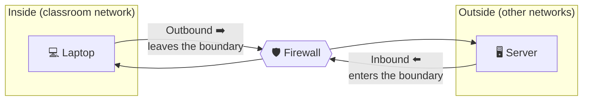
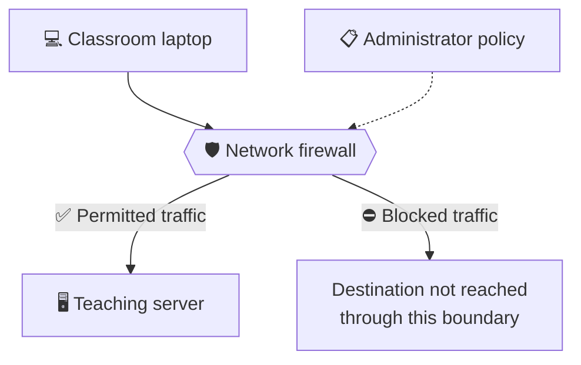
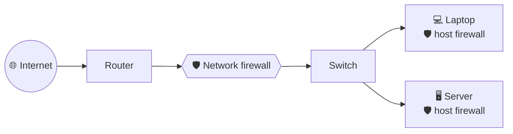
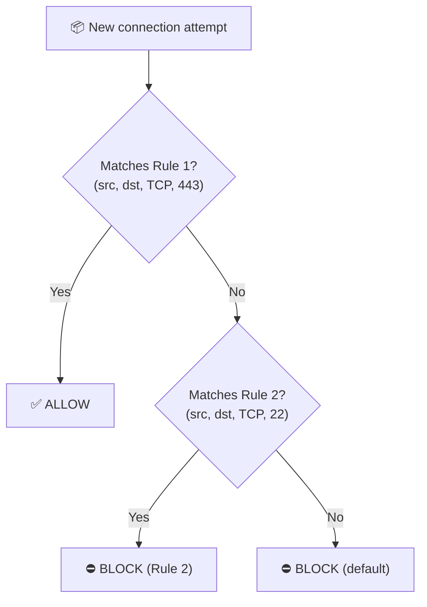
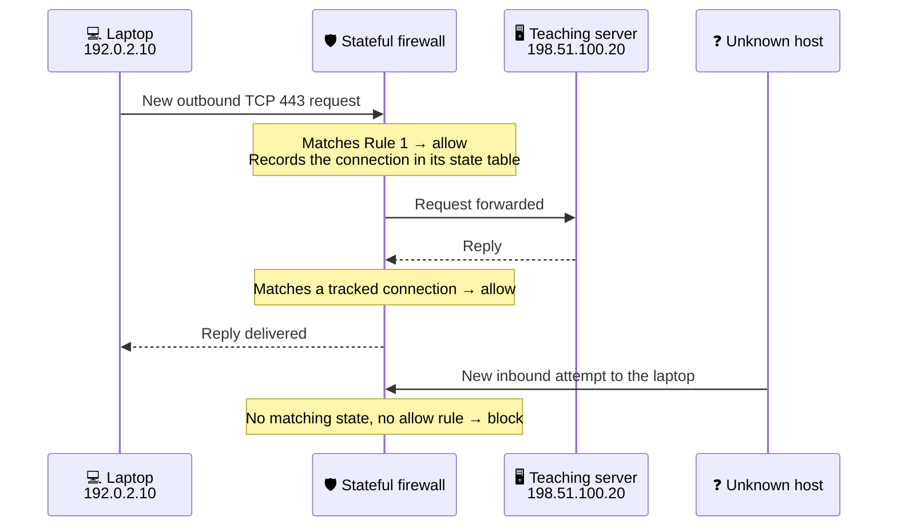
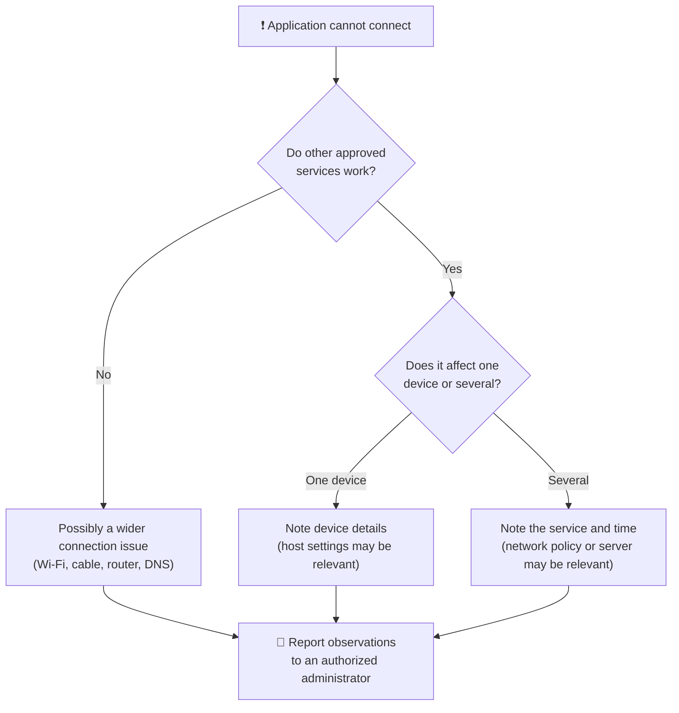

# How Firewalls Control Network Traffic
## Understanding Rules, Connections, and Network Boundaries

| Document information | Details |
|---|---|
| Module | Hardware, Networks, and Behaviorist AI |
| Subtopic | Firewalls and traffic filtering |
| Intended audience | Beginners |
| Prerequisites | Basic understanding of IP addresses and client–server communication (see `how-data-travels.md` and `how-devices-communicate-on-a-local.md`) |
| Suggested teaching time | 15–20 minutes |
| Content version | V2.0 (added diagrams, firewall types, common ports, and a safe hands-on check) |
| Review status | Revised — awaiting peer review and image insertion |

---

## Table of contents

1. [Learning objectives](#learning-objectives)
2. [The big idea](#1-the-big-idea)
3. [Essential terminology](#2-essential-terminology)
4. [Where firewalls operate](#3-where-firewalls-operate)
5. [What a rule can examine](#4-what-a-rule-can-examine)
6. [Worked example: evaluate a classroom policy](#5-worked-example-evaluate-a-classroom-policy)
7. [Why replies can return](#6-why-replies-can-return)
8. [What a firewall does not guarantee](#7-what-a-firewall-does-not-guarantee)
9. [Basic troubleshooting observations](#8-basic-troubleshooting-observations)
10. [Learning activities](#9-learning-activities)
11. [Answer key](#10-answer-key)
12. [Teaching plan](#11-teaching-plan)
13. [Adaptation into other resources](#12-adaptation-into-other-resources)
14. [References](#13-references)

---

## Learning objectives

After completing this lesson, learners should be able to:

1. Explain the purpose of a firewall.
2. Distinguish a host firewall from a network firewall.
3. Identify source, destination, protocol, and port information in a simplified rule.
4. Apply an explicitly stated rule-processing model to example traffic.
5. Explain why an allowed connection does not guarantee safe content.
6. Describe useful observations when an application cannot connect.

---

## 1. The big idea

A **firewall** controls network traffic according to policy. It can operate as software on a device or as a function positioned between networks. [1]

A firewall decision is specific to its configuration and capabilities. The word "allowed" means that traffic meets the applicable policy; it does not establish that the remote party or transferred content is trustworthy.

> **Central idea:** A firewall controls permitted communication. Its decisions depend on rules, context, and where it is placed.

> 💡 **Analogy — a security guard at a building entrance**
> | Firewall idea | Security guard analogy |
> |---|---|
> | Firewall | The guard at the entrance |
> | Rules | The guard's printed list: who may enter, which floor, at what door |
> | Source / destination | Who the visitor is / which office they want to visit |
> | Port | Which door or service desk they want |
> | Default block | "If you are not on the list, you do not enter." |
> | Stateful inspection | The guard remembers who went out, so they can come back in |
> | Log | The visitor book |
> | Limitation | The guard checks the list, **not** what is inside every bag |

This lesson uses fictional classroom networks. Learners evaluate examples on paper without changing real firewall settings.

<!-- IMAGE: Add a simple illustration of a firewall as a wall/checkpoint between a local network and the internet, with some traffic passing and some stopped. Draw your own (draw.io, Canva) to avoid licensing issues. Suggested file: images/firewall-concept.png -->
<!--  -->
<!-- *Figure 1. A firewall checks traffic against rules at a boundary. Created by the team.* -->

---

## 2. Essential terminology

| Term | Beginner-friendly meaning |
|---|---|
| **Firewall** | Software or a device function that controls network traffic using policy. |
| **Host firewall** | A firewall operating on an individual computer or other endpoint. |
| **Network firewall** | A firewall controlling traffic that passes between network areas. |
| **Policy** | The complete set of rules and settings that a firewall applies. |
| **Rule** | A condition and action used to decide how traffic is handled. |
| **Source** | Where a packet or connection attempt comes from. |
| **Destination** | Where a packet or connection attempt is going. |
| **Protocol** | Communication rules, such as TCP or UDP. |
| **Port number** | A transport-layer number used with a protocol and addresses to identify communication endpoints. |
| **Inbound traffic** | Traffic entering the device or network boundary being discussed. |
| **Outbound traffic** | Traffic leaving that device or network boundary. |
| **Default action** | What happens to traffic that matches no rule (often **block**). |
| **Stateful inspection** | Filtering that considers tracked connection state as well as packet information. |
| **Log** | A record of selected events, such as blocked traffic. |

Firewall concepts follow [1, 2]. Service names and transport port numbers are discussed in [3].

**Port caution:** A network port number is not a physical socket. TCP port 443 and UDP port 443 are also distinct protocol-and-port combinations.

### Common port numbers (for reference)

| Port | Protocol | Usual service | Typical firewall attitude |
|---|---|---|---|
| 53 | UDP / TCP | DNS (name lookup) | Often allowed to approved DNS servers |
| 80 | TCP | HTTP (unencrypted web) | Often allowed outbound |
| 443 | TCP (also UDP for HTTP/3) | HTTPS (encrypted web) | Often allowed outbound |
| 22 | TCP | SSH (remote command line) | Usually restricted to administrators |
| 3389 | TCP | Remote Desktop | Usually restricted; should not be open to the whole internet |
| 25 | TCP | SMTP (email between servers) | Often restricted from ordinary devices |

These are **conventions** registered with IANA. A service can be configured to use a different port, so a port number alone does not prove which application is running. [3]

### Inbound vs outbound



Direction always depends on **which boundary** is being discussed: traffic that is outbound for the laptop's network is inbound for the server's network.

---

## 3. Where firewalls operate

| Type | Example location | Illustrative purpose |
|---|---|---|
| Host firewall | On a learner's laptop. | Restrict incoming access to services on that laptop. |
| Network firewall | Between a classroom network and a server network. | Permit selected classroom access to selected servers. |

Microsoft documents host filtering by criteria such as addresses, protocols, ports, and applications. It also describes profiles that apply settings according to network context (for example, a stricter "public" profile on café Wi-Fi). [2]

### A simplified network boundary



**Figure 2.** A firewall applies policy to traffic crossing the illustrated boundary.

**Text equivalent:** Traffic from the laptop reaches a firewall. Policy determines whether it can continue through that boundary.

### Layers of protection

A separate host firewall can also act on the laptop or server. Using both is an example of **defense in depth** — several layers, so one gap does not expose everything.



The earlier diagram omits switches and routers to focus on filtering; this one shows where they fit. A home router often includes a basic network firewall in the same box.

<!-- IMAGE: Add a screenshot of a host firewall settings page (e.g. Windows Security → Firewall & network protection, or macOS System Settings → Network → Firewall) from your own computer. Suggested file: images/host-firewall-settings.png -->
<!--  -->
<!-- *Figure 3. A host firewall's settings page. Screenshot by the team.* -->

### Types of firewall (by how much they inspect)

| Type | What it looks at | Strength | Limitation |
|---|---|---|---|
| **Packet filter** | Each packet's addresses, protocol, and ports | Simple and fast | Does not remember connections |
| **Stateful firewall** | Packet details **plus** connection state | Allows replies safely (Section 6) | Usually does not understand application content |
| **Application-aware / next-generation firewall** | Can also identify applications and inspect some content | More detailed control | More complex; inspection of encrypted traffic is limited or requires special setup |

Capabilities vary by product. [1]

---

## 4. What a rule can examine

Consider this fictional connection attempt:

| Field | Example value |
|---|---|
| Source IP address | `192.0.2.10` |
| Destination IP address | `198.51.100.20` |
| Transport protocol | TCP |
| Destination port | 443 |
| Direction at the classroom boundary | Outbound |

A rule could allow this protocol and destination port only when the source and destination also match. Changing any required field can change the result.

**Example statement:** "Allow TCP traffic from classroom device 192.0.2.10 to teaching server 198.51.100.20, destination port 443."

**Reading the rule like a sentence:**

```text
  ALLOW    TCP     from 192.0.2.10   to 198.51.100.20   port 443
  └─────┘  └───┘   └─────────────┘   └───────────────┘   └──────┘
  Action  Protocol      Source          Destination        Port
```

The addresses are documentation examples, not instructions to contact real services. Their reserved purpose is defined in RFC 5737. [4]

A registered port number suggests an intended service convention; it is not proof of the application actually running or its trustworthiness. [3]

### Block vs reject

Firewalls can stop traffic in two common ways, which affects what the user sees:

| Action | What the sender experiences |
|---|---|
| **Drop** (silent block) | No reply — the application waits and eventually reports a **timeout**. |
| **Reject** | A quick refusal message — the application reports an error such as "connection refused" soon after. |

Products use different names for these actions. This is why the exact error message is useful in troubleshooting (Section 8).

---

## 5. Worked example: evaluate a classroom policy

### 5.1 Explicit processing assumptions

For this teaching exercise only:

- Rules are evaluated from top to bottom.
- The first matching rule determines the action.
- If no rule matches, the default action is **block**.
- Evaluate new outbound TCP connection attempts only.
- Return traffic, DNS, IPv6, and host firewall rules are outside this table's scope.

Real products can use different precedence and connection-handling behavior. This exercise is not a complete deployable policy.

### 5.2 The decision process



### 5.3 Rule table

| Order | Source | Destination | Protocol | Destination port | Action |
|---|---|---|---|---|---|
| 1 | `192.0.2.10` | `198.51.100.20` | TCP | 443 | Allow |
| 2 | `192.0.2.10` | `198.51.100.20` | TCP | 22 | Block |
| Default | Any unmatched attempt | Any | Any | Any | Block |

### 5.4 Apply the rules

| Attempt | Working | Decision |
|---|---|---|
| 192.0.2.10 → 198.51.100.20, TCP 443 | All fields match Rule 1. | **Allow** |
| 192.0.2.10 → 198.51.100.20, TCP 22 | Rule 1 fails on port; Rule 2 matches. | **Block** |
| 192.0.2.10 → 198.51.100.30, TCP 443 | Neither destination matches. | **Block by default** |
| 192.0.2.11 → 198.51.100.20, TCP 443 | Neither source matches. | **Block by default** |

**Interpretation:** Permission for one destination does not automatically permit every destination using the same port.

The explicit block in Rule 2 documents a decision that the default would also enforce. It is included to demonstrate a matched block versus a default block.

> ⚠️ **Why order matters:** If a broad rule such as "Allow any TCP from 192.0.2.10" were placed **above** Rule 2, the SSH attempt would match it first and be **allowed** — Rule 2 would never be reached. In a first-match model, specific rules usually go above general ones.

---

## 6. Why replies can return

A stateful firewall can track a permitted connection and evaluate its return traffic using that state. A reply to a permitted connection differs from an unrelated new inbound attempt. [1]

For example, a browser initiating a permitted connection to a server needs responses. A stateful policy can accommodate those responses without permitting arbitrary inbound connection attempts.



**Example state table entry (simplified):**

| Source | Destination | Protocol | Destination port | State |
|---|---|---|---|---|
| `192.0.2.10` | `198.51.100.20` | TCP | 443 | Established |

**Limit:** Successful return traffic depends on state, policy, and routing. The classroom rule table evaluates only new outbound attempts.

---

## 7. What a firewall does not guarantee

| Assumption | Better interpretation |
|---|---|
| "Allowed traffic is always harmless." | Policy permission does not certify content or intent. |
| "A blocked connection proves an attack." | Legitimate traffic can also conflict with policy. |
| "One firewall protects every path." | A firewall acts on traffic within its position and scope. |
| "A firewall automatically encrypts everything." | Filtering and encryption are different functions. |
| "A website that fails to load must be blocked." | A failure can have several causes. |
| "A firewall replaces antivirus and updates." | It is one layer; other protections remain necessary. |

Firewalls form part of a wider security approach; their capabilities and inspection limits vary. [1]

| Security layer | Main job |
|---|---|
| 🛡️ Firewall | Controls which communication is permitted |
| 🔒 Encryption (e.g. HTTPS/TLS) | Protects data in transit from being read or changed |
| 🦠 Anti-malware | Detects harmful files and behavior |
| 🔄 Software updates | Fix known weaknesses |
| 👤 Strong passwords / multi-factor authentication | Protect accounts |

---

## 8. Basic troubleshooting observations

**Scenario:** A classroom application cannot contact its teaching server.

A useful report records:

1. The application and intended destination.
2. The exact error message.
3. When the problem occurred.
4. Whether other permitted services still work.
5. Whether the problem affects one device or several.

Example:

> "At 10:15, the classroom browser could not open the teaching portal. It reported a connection timeout. Another approved website loaded on the same laptop."

This is more useful than "the firewall is broken." It records observations without claiming a cause.



An authorized administrator may compare these details with configuration and logs. Learners do not need to disable protection or create broad exceptions to complete the activity.

### Safe, read-only check (optional)

On **your own** computer, you can look at whether the host firewall is on **without changing anything**:

| System | Where to look (view only) |
|---|---|
| Windows | *Windows Security* → *Firewall & network protection* — shows the status for Domain, Private, and Public profiles |
| macOS | *System Settings* → *Network* → *Firewall* |

> ⚠️ Do not turn the firewall off or add exceptions as part of this lesson. On school or shared devices, follow the institution's rules and ask the administrator.

---

## 9. Learning activities

### Activity A — Identify the component

Choose **host firewall** or **network firewall**.

1. Filtering software runs on an individual laptop.
2. A firewall controls traffic between two network areas.

### Activity B — Apply the worked policy

Use Section 5's rules. Give a decision and the matching rule or default.

1. Source 192.0.2.10, destination 198.51.100.20, TCP destination port 443.
2. Source 192.0.2.10, destination 198.51.100.20, TCP destination port 22.
3. Source 192.0.2.10, destination 198.51.100.30, TCP destination port 443.

### Activity C — Explain the distinction

Why can a stateful firewall permit a server's reply while blocking an unrelated new inbound connection attempt?

### Activity D — Assess a claim

A learner says: "The firewall allowed this connection, so the downloaded file must be safe."

Explain the error in one or two sentences.

### Activity E — Improve the report

Rewrite "The internet does not work" using three details that would help an administrator investigate.

You may invent a clearly hypothetical example.

### Activity F — Practice (not scored): rule order

An administrator adds a new rule **at the top** of the Section 5 table:

| Order | Source | Destination | Protocol | Destination port | Action |
|---|---|---|---|---|---|
| 0 | `192.0.2.10` | Any | TCP | Any | Allow |

What now happens to the attempt 192.0.2.10 → 198.51.100.20, TCP 22? Why?

---

## 10. Answer key

| Activity | Expected answer | Reasoning |
|---|---|---|
| A1 | Host firewall. | It operates on one endpoint. |
| A2 | Network firewall. | It controls a boundary between network areas. |
| B1 | Allow: Rule 1. | All specified fields match. |
| B2 | Block: Rule 2. | The second rule matches the TCP port 22 attempt. |
| B3 | Block: default. | No listed destination matches. |
| C | The reply can match tracked state for a permitted connection. | A new inbound attempt does not automatically share that state or permission. |
| D | An allow decision reflects traffic policy, not a guarantee about file contents. | Other checks and protections still matter. |
| E | Example: "At 11:00, the browser timed out opening the teaching portal; another approved website loaded." | It specifies time, affected service, error, and a comparison. |
| F | **Allowed** by the new Rule 0. | In a first-match model, Rule 0 matches first, so Rule 2 is never reached. Broad rules placed too high can undo specific blocks. |

**Suggested assessment:** Award 2 points for Activity A, 3 for B, 2 for C, 2 for D, and 1 for E. **Total: 10 points.** Activity F is optional practice and is not scored.

For C, award one point for mentioning connection state and one for distinguishing an unrelated new attempt. For D, award one point for identifying the policy decision and one for explaining its limit.

---

## 11. Teaching plan

| Time | Instructor action | Learner action |
|---|---|---|
| 0–2 minutes | Ask what "allow" means in a network rule; introduce the security-guard analogy. | Share an initial explanation. |
| 2–5 minutes | Explain firewall locations, types, and rule fields. | Identify host versus network scope. |
| 5–9 minutes | Work through the decision flowchart and policy table. | Match attempts to rules. |
| 9–12 minutes | Explain connection state (sequence diagram) and limitations. | Distinguish replies from new attempts. |
| 12–17 minutes | Assign Activities A–E (F as extension). | Evaluate and justify answers. |
| 17–20 minutes | Review answers and improve reports. | Separate observations from conclusions. |

**Accessibility:** Provide the diagrams' text equivalents and read addresses in consistent groups. Decisions must be labeled in words (Allow / Block) rather than indicated by color or emoji alone.

---

## 12. Adaptation into other resources

- **Study guide:** Retain the terms, port table, policy table, decision flowchart, worked decisions, and answer key.
- **Presentation:** Use slides for the analogy, firewall locations and types, rule fields, the decision flowchart, stateful replies, and limitations.
- **Video:** Highlight each matching rule field before revealing a decision; animate the stateful sequence diagram.
- **Pair exercise:** One learner proposes a hypothetical attempt; another evaluates it against the fixed table.

**Image checklist:** firewall concept illustration (Section 1), host firewall settings screenshot (Section 3). Remove the `<!-- -->` markers once each image is in the `images/` folder, and add a caption with the source and license.

**Related topics in this repository:** `how-data-travels.md`, `how-devices-communicate-on-a-local.md`, `addresses-and-protocols.md`, `safety-and-troubleshooting.md`.

---

## 13. References

[1] Scarfone, K., and Hoffman, P. *Guidelines on Firewalls and Firewall Policy.* NIST SP 800-41 Revision 1, 2009.
https://csrc.nist.gov/pubs/sp/800/41/r1/final
Foundational background on firewall types, stateful inspection, policy, and limitations. Product-specific configuration requires current vendor documentation.

[2] Microsoft Learn. *Windows Firewall overview.*
https://learn.microsoft.com/en-us/windows/security/operating-system-security/network-security/windows-firewall/
Supports host filtering criteria and network profiles. Implementation details are Windows-specific.

[3] Cotton, M., et al. *RFC 6335: IANA Procedures for the Management of the Service Name and Transport Protocol Port Number Registry.* RFC Editor, 2011.
https://www.rfc-editor.org/rfc/rfc6335
Supports transport port terminology and the limits of treating a port assignment as evidence of a particular service.

[4] Arkko, J., Cotton, M., and Vegoda, L. *RFC 5737: IPv4 Address Blocks Reserved for Documentation.* RFC Editor, 2010.
https://www.rfc-editor.org/rfc/rfc5737
Defines the documentation address ranges used in the examples.

---

## Editorial and source notes

- Explanations are paraphrased for beginners.
- The diagrams, analogy, policy table, scenarios, exercises, and scoring are original teaching material.
- Rule precedence is explicitly defined for the exercise and must not be generalized to every product.
- The common-port table lists conventional assignments for reference; verify against the IANA registry before submission.
- This is a conceptual lesson, not a production firewall configuration.
- Peer review, image insertion, and course-specific attribution checks remain outstanding.

