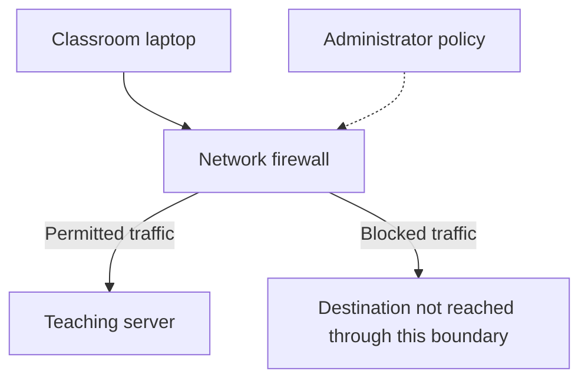

# How Firewalls Control Network Traffic
## Understanding Rules, Connections, and Network Boundaries

| Document information | Details |
|---|---|
| Module | Hardware, Networks, and Behaviorist AI |
| Subtopic | Firewalls and traffic filtering |
| Intended audience | Beginners |
| Prerequisites | Basic understanding of IP addresses and client–server communication |
| Suggested teaching time | 15–20 minutes |
| Content version | V1.0 |
| Review status | Drafted — awaiting peer review |

## Learning objectives

After completing this lesson, learners should be able to:

1. Explain the purpose of a firewall.
2. Distinguish a host firewall from a network firewall.
3. Identify source, destination, protocol, and port information in a simplified rule.
4. Apply an explicitly stated rule-processing model to example traffic.
5. Explain why an allowed connection does not guarantee safe content.
6. Describe useful observations when an application cannot connect.

## 1. The big idea

A **firewall** controls network traffic according to policy. It can operate as software on a device or as a function positioned between networks. [1]

A firewall decision is specific to its configuration and capabilities. The word “allowed” means that traffic meets the applicable policy; it does not establish that the remote party or transferred content is trustworthy.

> **Central idea:** A firewall controls permitted communication. Its decisions depend on rules, context, and where it is placed.

This lesson uses fictional classroom networks. Learners evaluate examples on paper without changing real firewall settings.

## 2. Essential terminology

| Term | Beginner-friendly meaning |
|---|---|
| Firewall | Software or a device function that controls network traffic using policy. |
| Host firewall | A firewall operating on an individual computer or other endpoint. |
| Network firewall | A firewall controlling traffic that passes between network areas. |
| Rule | A condition and action used to decide how traffic is handled. |
| Source | Where a packet or connection attempt comes from. |
| Destination | Where a packet or connection attempt is going. |
| Protocol | Communication rules, such as TCP or UDP. |
| Port number | A transport-layer number used with a protocol and addresses to identify communication endpoints. |
| Inbound traffic | Traffic entering the device or network boundary being discussed. |
| Outbound traffic | Traffic leaving that device or network boundary. |
| Stateful inspection | Filtering that considers tracked connection state as well as packet information. |
| Log | A record of selected events, such as blocked traffic. |

Firewall concepts follow [1, 2]. Service names and transport port numbers are discussed in [3].

**Port caution:** A network port number is not a physical socket. TCP port 443 and UDP port 443 are also distinct protocol-and-port combinations.

## 3. Where firewalls operate

| Type | Example location | Illustrative purpose |
|---|---|---|
| Host firewall | On a learner’s laptop. | Restrict incoming access to services on that laptop. |
| Network firewall | Between a classroom network and a server network. | Permit selected classroom access to selected servers. |

Microsoft documents host filtering by criteria such as addresses, protocols, ports, and applications. It also describes profiles that apply settings according to network context. [2]

### A simplified network boundary

**Figure 1.** A firewall applies policy to traffic crossing the illustrated boundary.

A separate host firewall can also act on the laptop or server. The diagram omits switches, routers, and other infrastructure to focus on filtering.

**Text equivalent:** Traffic from the laptop reaches a firewall. Policy determines whether it can continue through that boundary.

## 4. What a rule can examine

Consider this fictional connection attempt:

| Field | Example value |
|---|---|
| Source IP address | `192.0.2.10` |
| Destination IP address | `198.51.100.20` |
| Transport protocol | TCP |
| Destination port | 443 |
| Direction at the classroom boundary | Outbound |

A rule could allow this protocol and destination port only when the source and destination also match. Changing any required field can change the result.

**Example statement:** “Allow TCP traffic from classroom device 192.0.2.10 to teaching server 198.51.100.20, destination port 443.”

The addresses are documentation examples, not instructions to contact real services. Their reserved purpose is defined in RFC 5737. [4]

A registered port number suggests an intended service convention; it is not proof of the application actually running or its trustworthiness. [3]

## 5. Worked example: evaluate a classroom policy

### 5.1 Explicit processing assumptions

For this teaching exercise only:

- Rules are evaluated from top to bottom.
- The first matching rule determines the action.
- If no rule matches, the default action is **block**.
- Evaluate new outbound TCP connection attempts only.
- Return traffic, DNS, IPv6, and host firewall rules are outside this table’s scope.

Real products can use different precedence and connection-handling behavior. This exercise is not a complete deployable policy.

### 5.2 Rule table

| Order | Source | Destination | Protocol | Destination port | Action |
|---|---|---|---|---|---|
| 1 | `192.0.2.10` | `198.51.100.20` | TCP | 443 | Allow |
| 2 | `192.0.2.10` | `198.51.100.20` | TCP | 22 | Block |
| Default | Any unmatched attempt | Any | Any | Any | Block |

### 5.3 Apply the rules

| Attempt | Working | Decision |
|---|---|---|
| 192.0.2.10 → 198.51.100.20, TCP 443 | All fields match Rule 1. | **Allow** |
| 192.0.2.10 → 198.51.100.20, TCP 22 | Rule 1 fails on port; Rule 2 matches. | **Block** |
| 192.0.2.10 → 198.51.100.30, TCP 443 | Neither destination matches. | **Block by default** |
| 192.0.2.11 → 198.51.100.20, TCP 443 | Neither source matches. | **Block by default** |

**Interpretation:** Permission for one destination does not automatically permit every destination using the same port.

The explicit block in Rule 2 documents a decision that the default would also enforce. It is included to demonstrate a matched block versus a default block.

## 6. Why replies can return

A stateful firewall can track a permitted connection and evaluate its return traffic using that state. A reply to a permitted connection differs from an unrelated new inbound attempt. [1]

For example, a browser initiating a permitted connection to a server needs responses. A stateful policy can accommodate those responses without permitting arbitrary inbound connection attempts.

**Limit:** Successful return traffic depends on state, policy, and routing. The classroom rule table evaluates only new outbound attempts.

## 7. What a firewall does not guarantee

| Assumption | Better interpretation |
|---|---|
| “Allowed traffic is always harmless.” | Policy permission does not certify content or intent. |
| “A blocked connection proves an attack.” | Legitimate traffic can also conflict with policy. |
| “One firewall protects every path.” | A firewall acts on traffic within its position and scope. |
| “A firewall automatically encrypts everything.” | Filtering and encryption are different functions. |
| “A website that fails to load must be blocked.” | A failure can have several causes. |

Firewalls form part of a wider security approach; their capabilities and inspection limits vary. [1]

## 8. Basic troubleshooting observations

**Scenario:** A classroom application cannot contact its teaching server.

A useful report records:

1. The application and intended destination.
2. The exact error message.
3. When the problem occurred.
4. Whether other permitted services still work.
5. Whether the problem affects one device or several.

Example:

> “At 10:15, the classroom browser could not open the teaching portal. It reported a connection timeout. Another approved website loaded on the same laptop.”

This is more useful than “the firewall is broken.” It records observations without claiming a cause.

An authorized administrator may compare these details with configuration and logs. Learners do not need to disable protection or create broad exceptions to complete the activity.

## 9. Learning activities

### Activity A — Identify the component

Choose **host firewall** or **network firewall**.

1. Filtering software runs on an individual laptop.
2. A firewall controls traffic between two network areas.

### Activity B — Apply the worked policy

Use Section 5’s rules. Give a decision and the matching rule or default.

1. Source 192.0.2.10, destination 198.51.100.20, TCP destination port 443.
2. Source 192.0.2.10, destination 198.51.100.20, TCP destination port 22.
3. Source 192.0.2.10, destination 198.51.100.30, TCP destination port 443.

### Activity C — Explain the distinction

Why can a stateful firewall permit a server’s reply while blocking an unrelated new inbound connection attempt?

### Activity D — Assess a claim

A learner says: “The firewall allowed this connection, so the downloaded file must be safe.”

Explain the error in one or two sentences.

### Activity E — Improve the report

Rewrite “The internet does not work” using three details that would help an administrator investigate.

You may invent a clearly hypothetical example.

## 10. Answer key

| Activity | Expected answer | Reasoning |
|---|---|---|
| A1 | Host firewall. | It operates on one endpoint. |
| A2 | Network firewall. | It controls a boundary between network areas. |
| B1 | Allow: Rule 1. | All specified fields match. |
| B2 | Block: Rule 2. | The second rule matches the TCP port 22 attempt. |
| B3 | Block: default. | No listed destination matches. |
| C | The reply can match tracked state for a permitted connection. | A new inbound attempt does not automatically share that state or permission. |
| D | An allow decision reflects traffic policy, not a guarantee about file contents. | Other checks and protections still matter. |
| E | Example: “At 11:00, the browser timed out opening the teaching portal; another approved website loaded.” | It specifies time, affected service, error, and a comparison. |

**Suggested assessment:** Award 2 points for Activity A, 3 for B, 2 for C, 2 for D, and 1 for E. **Total: 10 points.**

For C, award one point for mentioning connection state and one for distinguishing an unrelated new attempt. For D, award one point for identifying the policy decision and one for explaining its limit.

## 11. Teaching plan

| Time | Instructor action | Learner action |
|---|---|---|
| 0–2 minutes | Ask what “allow” means in a network rule. | Share an initial explanation. |
| 2–5 minutes | Explain firewall locations and rule fields. | Identify host versus network scope. |
| 5–9 minutes | Work through the policy table. | Match attempts to rules. |
| 9–12 minutes | Explain connection state and limitations. | Distinguish replies from new attempts. |
| 12–17 minutes | Assign Activities A–E. | Evaluate and justify answers. |
| 17–20 minutes | Review answers and improve reports. | Separate observations from conclusions. |

**Accessibility:** Provide the diagram’s text equivalent and read addresses in consistent groups. Decisions must be labeled in words rather than indicated by color alone.

## 12. Adaptation into other resources

- **Study guide:** Retain the terms, policy table, worked decisions, and answer key.
- **Presentation:** Use slides for firewall locations, rule fields, stateful replies, and limitations.
- **Video:** Highlight each matching rule field before revealing a decision.
- **Pair exercise:** One learner proposes a hypothetical attempt; another evaluates it against the fixed table.

## 13. References

[1] Scarfone, K., and Hoffman, P. *Guidelines on Firewalls and Firewall Policy.* NIST SP 800-41 Revision 1, 2009.  
https://csrc.nist.gov/pubs/sp/800/41/r1/final  
Foundational background on firewall types, stateful inspection, policy, and limitations. Product-specific configuration requires current vendor documentation.

[2] Microsoft Learn. *Windows Firewall overview.*  
https://learn.microsoft.com/en-us/windows/security/operating-system-security/network-security/windows-firewall/  
Supports host filtering criteria and network profiles. Implementation details are Windows-specific.

[3] Cotton, M., et al. *RFC 6335: IANA Procedures for the Management of the Service Name and Transport Protocol Port Number Registry.* RFC Editor, 2011.  
https://www.rfc-editor.org/rfc/rfc6335  
Supports transport port terminology and the limits of treating a port assignment as evidence of a particular service.

[4] Arkko, J., Cotton, M., and Vegoda, L. *RFC 5737: IPv4 Address Blocks Reserved for Documentation.* RFC Editor, 2010.  
https://www.rfc-editor.org/rfc/rfc5737  
Defines the documentation address ranges used in the examples.

## Editorial and source notes

- Explanations are paraphrased for beginners.
- The diagram, policy table, scenarios, exercises, and scoring are original teaching material.
- Rule precedence is explicitly defined for the exercise and must not be generalized to every product.
- This is a conceptual lesson, not a production firewall configuration.
- Peer review and course-specific attribution checks remain outstanding.

