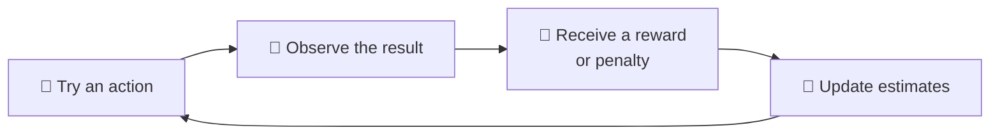
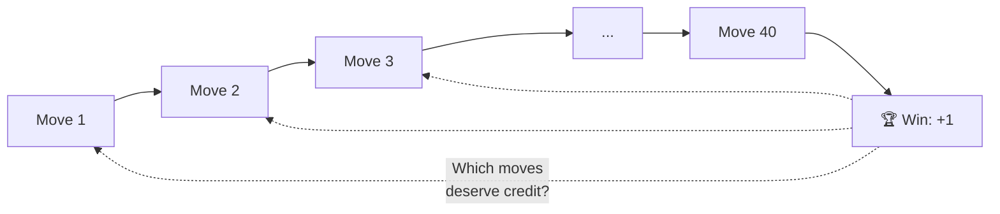
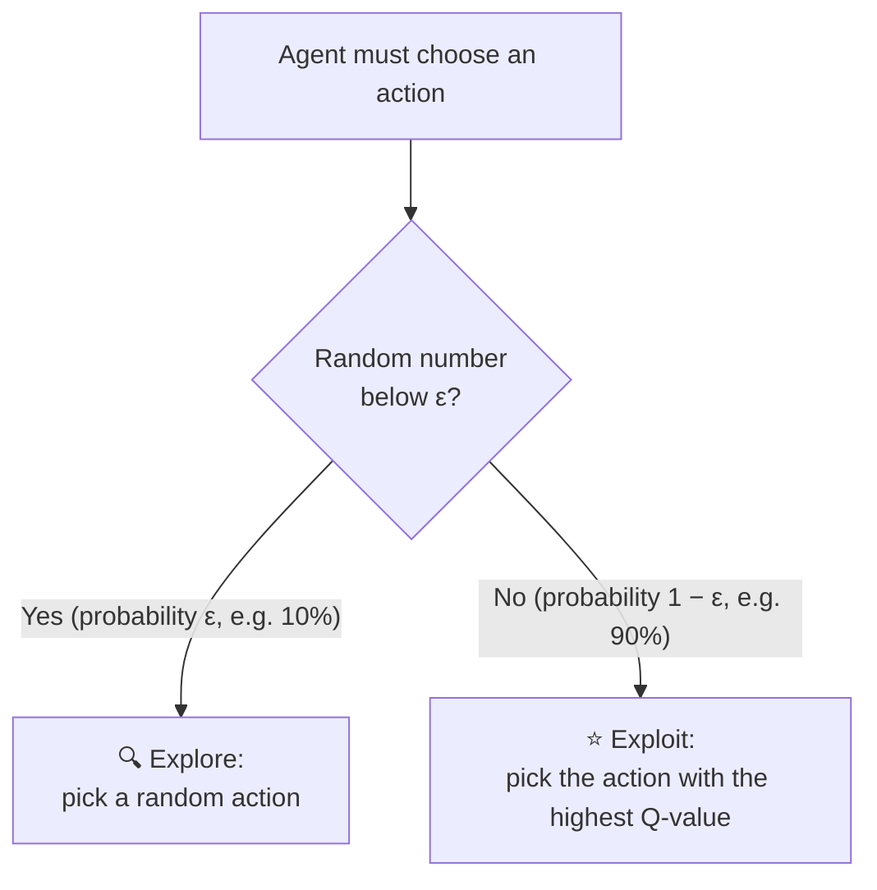
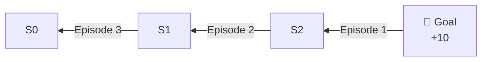

# Learning from Rewards and Penalties
## Trial and Error, Temporal Credit Assignment, Discount Factor, Exploration vs Exploitation, and a Worked Q-Learning Trace

| Document information | Details |
|---|---|
| Module | Hardware, Networks, and Behaviorist AI |
| Subtopic | Learning from rewards and penalties |
| Intended audience | Beginners |
| Prerequisites | `how-an-ai-agent-learns.md` (agent, environment, action, reward, policy) |
| Suggested teaching time | 20–25 minutes |
| Content version | V1.0 |
| Review status | Drafted — awaiting peer review, calculation check, and image insertion |

---

## Learning objectives

After completing this lesson, learners should be able to:

1. Describe trial-and-error learning in a reinforcement learning (RL) agent.
2. Explain the **temporal credit assignment problem** in plain language.
3. Calculate a simple **discounted return** using a discount factor (γ).
4. Explain the **exploration vs exploitation** trade-off and the ε-greedy strategy.
5. Follow a short **Q-learning** trace and explain how values spread backwards from the goal.

---

## 1. The big idea

An RL agent is not told the correct answer. It **tries actions**, receives **rewards or penalties**, and gradually adjusts its behavior. [1]

This creates three practical questions that this lesson answers:

| Question | Concept |
|---|---|
| "The reward came at the end — which earlier move deserves the credit?" | Temporal credit assignment |
| "Is a reward now worth more than the same reward later?" | Discount factor (γ) |
| "Should I try something new or repeat what worked?" | Exploration vs exploitation |

> 💡 **Analogy — learning to play a new video game without a manual.** You press buttons, sometimes lose a life, sometimes find a coin. After many tries you know which moves are good — even though nobody told you the rules.

---

## 2. Key terms

| Term | Beginner-friendly meaning |
|---|---|
| **Trial and error** | Trying actions, observing the outcome, and using that experience to improve future choices. |
| **State (s)** | The situation the agent is in, e.g. its position in a grid. |
| **Action (a)** | A choice the agent can make, e.g. move right. |
| **Reward (r)** | A number given after an action. Positive = encouraged, negative = discouraged (a "penalty"). |
| **Episode** | One complete attempt, from the start until the task ends. |
| **Return (G)** | The total (usually discounted) reward collected from a point onward. |
| **Discount factor (γ, "gamma")** | A number between 0 and 1 that makes future rewards count less than immediate ones. |
| **Temporal credit assignment** | Working out which earlier actions were responsible for a later reward. |
| **Q-value Q(s, a)** | The agent's current estimate of how good it is to take action *a* in state *s*. |
| **Learning rate (α, "alpha")** | How strongly each new experience changes the Q-value (0 = never changes, 1 = replaces completely). |
| **ε-greedy ("epsilon-greedy")** | Usually pick the best-known action, but with a small probability ε pick a random one. |

---

## 3. Trial and error



Early on, the agent's choices are mostly guesses. After many episodes, its estimates become more accurate and its behavior improves.

**Trial and error is not random forever.** A learning agent uses what it has experienced to make later choices better than chance. A program that only ever chooses randomly is **not** learning.

---

## 4. Temporal credit assignment

In many tasks, the important reward arrives **only at the end**. For example, in chess the reward might be "+1 for winning", given only after dozens of moves.



**The problem:** Was the win caused by a clever move early on, or by the last move? Or both?

**How RL handles it (simplified):** Algorithms such as Q-learning pass value **backwards**, step by step, from the reward to the actions that led to it. After many episodes, actions that reliably lead towards the reward gain higher values — you will see this happen in the worked trace in Section 7. [1] [2]

> 💡 **Analogy:** A football team scores a goal. The striker gets the obvious credit, but the pass before it — and the defender who won the ball — also contributed. Credit assignment is about sharing the credit fairly.

---

## 5. The discount factor (γ)

The **return** adds up future rewards, but each step further into the future is multiplied by γ once more:

```text
G = r₁ + γ·r₂ + γ²·r₃ + γ³·r₄ + ...
```

### Example: the same +10 reward, at different times (γ = 0.9)

| Reward arrives after… | Calculation | Value now |
|---|---|---:|
| 1 step | 10 | **10.0** |
| 2 steps | 0.9 × 10 | **9.0** |
| 3 steps | 0.9² × 10 | **8.1** |
| 5 steps | 0.9⁴ × 10 | **≈ 6.6** |
| 10 steps | 0.9⁹ × 10 | **≈ 3.9** |

### What different γ values mean

| γ | Agent behavior | Analogy |
|---|---|---|
| 0 | Cares only about the **immediate** reward | Eating the sweet now, ignoring tomorrow |
| 0.5 | Strongly prefers rewards soon | Short-term planner |
| 0.9 – 0.99 | Values future rewards highly | Saving money for a bigger goal |

**Why discount at all?**

- It encourages the agent to reach rewards **sooner** (shorter routes).
- The future is uncertain, so near rewards are more reliable.
- It keeps the total return finite in tasks that could continue forever. [1]

---

## 6. Exploration vs exploitation

| Exploration 🔍 | Exploitation ⭐ |
|---|---|
| Try something less known | Choose the action with the highest current Q-value |
| May find a better strategy | Collects reliable rewards now |
| Risk: wastes steps on bad actions | Risk: gets stuck with a "good enough" strategy |

### The ε-greedy strategy



A common approach is to **start with a high ε** (lots of exploration while the agent knows little) and **reduce it over time** (more exploitation once the estimates are good). [1]

> 💡 **Restaurant analogy:** Ordering your favourite dish is exploitation. Trying something new on the menu is exploration. Someone who never explores may never discover a better dish.

<!-- IMAGE: Add an illustration of a "multi-armed bandit" (a row of slot machines) — the classic picture used to explain exploration vs exploitation. Draw your own or use a freely licensed image. Suggested file: images/multi-armed-bandit.png -->
<!--  -->
<!-- *Figure 1. Which machine pays best? You only find out by trying. Source: [add source and license].* -->

---

## 7. Worked grid-world Q-learning trace

### 7.1 The environment

A simple corridor with four cells. The agent starts in **S0** and the episode ends when it reaches the **Goal**.

| S0 🤖 Start | S1 | S2 | 🏁 Goal |
|:---:|:---:|:---:|:---:|

- **Actions:** Left, Right (moving Left from S0 keeps the agent in S0).
- **Rewards:** +10 for reaching the Goal; 0 for any other move.
- **Settings:** learning rate **α = 0.5**, discount factor **γ = 0.9**.
- **Starting Q-values:** all 0.
- **Simplification:** to keep the trace short, the agent moves **Right** every time. In real training, ε-greedy exploration would sometimes choose Left.

### 7.2 The Q-learning update rule

After each step, the agent updates the Q-value of the action it just took: [2]

```text
New Q(s, a) = Q(s, a) + α × [ r + γ × (best Q-value in next state) − Q(s, a) ]
                              └──────────────────────────────────┘
                                         "target"
```

In words: **move the old estimate part of the way (α) towards a better target** — the reward just received plus the discounted value of where the agent ended up. If the next state is the Goal, the episode ends and its "best Q-value" is 0.

### 7.3 Episode 1

| Step | State → next | Reward | Calculation | New Q(state, Right) |
|---|---|---:|---|---:|
| 1 | S0 → S1 | 0 | 0 + 0.5 × (0 + 0.9 × 0 − 0) | **0** |
| 2 | S1 → S2 | 0 | 0 + 0.5 × (0 + 0.9 × 0 − 0) | **0** |
| 3 | S2 → Goal | +10 | 0 + 0.5 × (10 + 0 − 0) | **5** |

Only the action **right next to the reward** has learned anything so far.

### 7.4 Episode 2

| Step | State → next | Reward | Calculation | New Q(state, Right) |
|---|---|---:|---|---:|
| 1 | S0 → S1 | 0 | 0 + 0.5 × (0 + 0.9 × 0 − 0) | **0** |
| 2 | S1 → S2 | 0 | 0 + 0.5 × (0 + 0.9 × **5** − 0) | **2.25** |
| 3 | S2 → Goal | +10 | 5 + 0.5 × (10 + 0 − 5) | **7.5** |

The value has moved **one step backwards**: S1 now "knows" that moving Right leads somewhere good.

### 7.5 Episode 3

| Step | State → next | Reward | Calculation | New Q(state, Right) |
|---|---|---:|---|---:|
| 1 | S0 → S1 | 0 | 0 + 0.5 × (0 + 0.9 × **2.25** − 0) | **≈ 1.01** |
| 2 | S1 → S2 | 0 | 2.25 + 0.5 × (0 + 0.9 × **7.5** − 2.25) | **4.5** |
| 3 | S2 → Goal | +10 | 7.5 + 0.5 × (10 + 0 − 7.5) | **8.75** |

### 7.6 Summary: value flowing backwards

| Q(state, Right) | After episode 1 | After episode 2 | After episode 3 |
|---|---:|---:|---:|
| S0 | 0 | 0 | ≈ 1.01 |
| S1 | 0 | 2.25 | 4.5 |
| S2 | 5 | 7.5 | 8.75 |



**What this shows:**

- This is **temporal credit assignment** in action: credit for the final reward spreads backwards one step per episode.
- Values **closer to the goal are higher** because of the discount factor — reaching the goal sooner is better.
- With more episodes, the values would keep approaching their final levels (S2 → 10, S1 → 9, S0 → 8.1).
- The learned **policy** is simply: *in every state, choose the action with the highest Q-value* → Right, Right, Right.

<!-- IMAGE: Add a screenshot of a Q-table or grid-world visualisation from a simulator, or your own drawing of the corridor with Q-values written in each cell after episode 3. Suggested file: images/q-learning-trace.png -->
<!--  -->
<!-- *Figure 2. Q-values after three episodes. Created by the team.* -->

---

## 8. Learning activities

### Activity A — Concepts

Match each concept to its description.

| Concept | Description |
|---|---|
| A. Temporal credit assignment | 1. Choosing a random action with a small probability |
| B. Discount factor | 2. Deciding which earlier actions caused a later reward |
| C. ε-greedy | 3. Making future rewards count less than immediate ones |

### Activity B — Discounted return

With γ = 0.5, what is a reward of +8 worth if it arrives after **3 steps** (that is, multiplied by γ²)?

### Activity C — Continue the trace

Using the values after Episode 3 (S0 ≈ 1.01, S1 = 4.5, S2 = 8.75), calculate the new **Q(S2, Right)** after **Episode 4**.

### Activity D — Explain

An agent with ε = 0 found a route to the goal on its first try and now always repeats it. Why might this be a problem?

---

## 9. Answer key

| Activity | Answer | Explanation |
|---|---|---|
| A | A → 2, B → 3, C → 1 | — |
| B | 0.5² × 8 = **2** | Two extra steps halve the value twice. |
| C | 8.75 + 0.5 × (10 − 8.75) = **9.375** | The value keeps moving towards 10. |
| D | It never explores, so it can never discover a **shorter or better** route. | A small ε lets it keep checking alternatives. |

---

## 10. Teaching plan

| Time | Instructor action | Learner action |
|---|---|---|
| 0–3 min | Video-game analogy; recall the RL cycle. | Describe trial and error in their own words. |
| 3–7 min | Credit assignment (football analogy). | Discuss which moves "deserve credit". |
| 7–11 min | Discount factor table. | Complete Activity B. |
| 11–14 min | ε-greedy flowchart. | Complete Activity D. |
| 14–22 min | Walk through the Q-learning trace, one episode at a time. | Calculate Activity C. |
| 22–25 min | Review answers. | — |

**Extension:** run the trace physically with the **Tabletop Q-Learning Lab** in `behaviorist-ai-activities-and-labs.md`.

---

## 11. References

[1] Sutton, R. S., and Barto, A. G. *Reinforcement Learning: An Introduction* (2nd ed.). MIT Press, 2018.
https://incompleteideas.net/book/the-book-2nd.html
Supports returns, discounting, exploration vs exploitation, ε-greedy methods, and credit assignment.

[2] Watkins, C. J. C. H., and Dayan, P. "Q-learning." *Machine Learning*, 8, 279–292, 1992.
https://doi.org/10.1007/BF00992698
Original description and convergence result for the Q-learning update rule.

[3] OpenAI Spinning Up. *Key Concepts in Reinforcement Learning.*
https://spinningup.openai.com/en/latest/spinningup/rl_intro.html
Accessible introduction to returns, value functions, and policies.

---

## Editorial and source notes

- The corridor, reward values, α, γ, and all calculations are original teaching examples. A reviewer should recheck every calculation.
- The trace always moves Right to stay short; this simplification is stated in Section 7.1.
- Related topics: `how-an-ai-agent-learns.md`, `reward-design.md`, `behaviorist-ai-activities-and-labs.md`.
