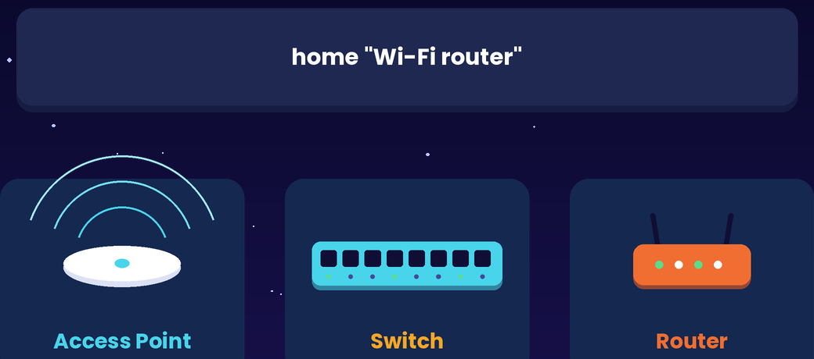
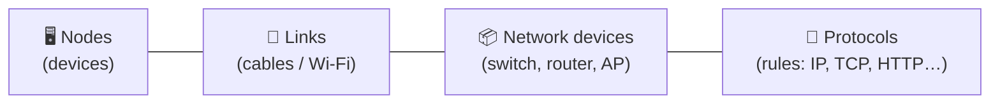
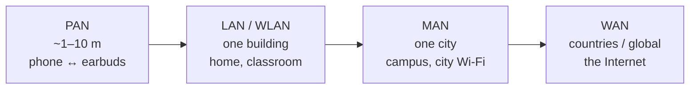
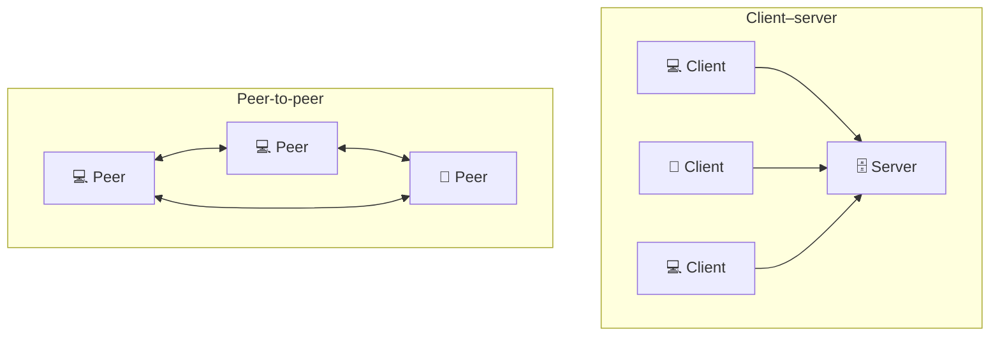
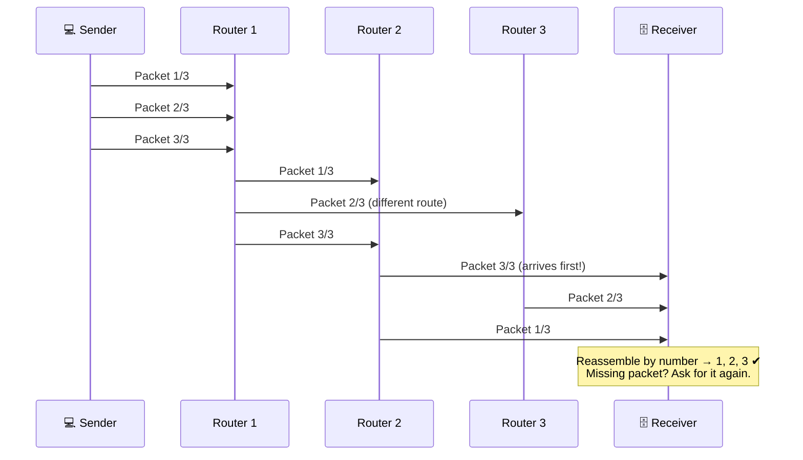
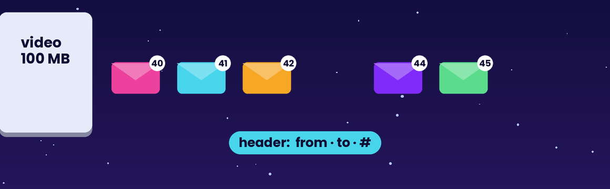
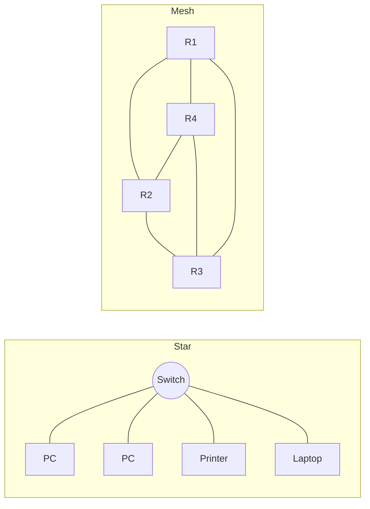
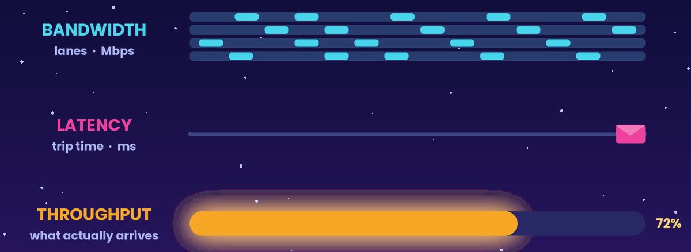
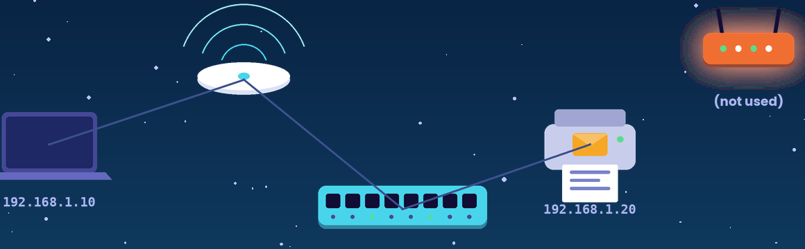
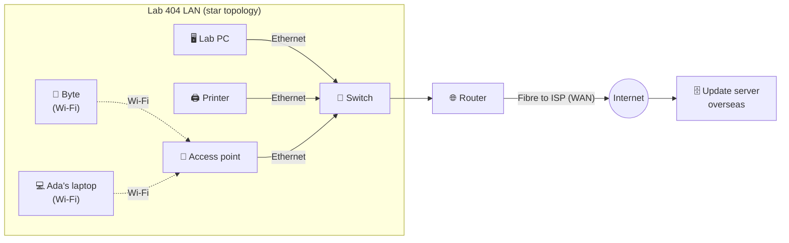

# Network Fundamentals and Types

> **Module:** Hardware, Networks, and Behaviorist AI — Part B (Networks)
> **Audience:** Beginners
> **Content version:** V2.0 (rewritten from the V1.0 outline: network types, models, packet switching, diagrams, activities and answers)
> **Estimated study time:** 35–45 minutes

---

## Table of contents

1. [Learning goals](#learning-goals)
2. [The big idea](#1-the-big-idea)
3. [Key terms](#2-key-terms)
4. [What makes a network](#3-what-makes-a-network)
5. [Types of networks by size](#4-types-of-networks-by-size)
6. [Client–server vs. peer-to-peer](#5-clientserver-vs-peer-to-peer)
7. [Packet switching](#6-packet-switching)
8. [Network topologies](#7-network-topologies)
9. [Transmission media](#8-transmission-media)
10. [Bandwidth and latency](#9-bandwidth-and-latency)
11. [The Internet vs. the World Wide Web](#10-the-internet-vs-the-world-wide-web)
12. [Worked example: Lab 404's network](#11-worked-example-lab-404s-network)
13. [Common misconceptions](#12-common-misconceptions)
14. [Try it yourself](#13-try-it-yourself)
15. [Check your understanding](#14-check-your-understanding)
16. [Answers and explanations](#15-answers-and-explanations)
17. [Summary](#16-summary)
18. [References](#17-references)

---

## Learning goals

After studying this topic, you should be able to:

- [ ] define a computer network and name its basic parts (**nodes, links, protocols**);
- [ ] distinguish **PAN, LAN, WLAN, MAN and WAN** with real examples;
- [ ] compare **client–server** and **peer-to-peer** models;
- [ ] explain how **packet switching** works and why the Internet uses it;
- [ ] identify common **topologies** and **transmission media**;
- [ ] explain the difference between **bandwidth** and **latency**; and
- [ ] explain why the **Internet** and the **World Wide Web** are not the same thing.

---

## 1. The big idea

A single computer is powerful, but **connected** computers can share files, printers, internet access, games, messages and video calls. A network is simply **devices + connections + agreed rules**.

> 🔬 **Lab 404 story:** Byte can only talk to the computer he is plugged into. Dr. Ada Lin wants him to send sensor data to her laptop, print reports in the next room, and download updates from a server on the other side of the world. "You need a network," says Inspector Ping. "And networks have *rules*. Without rules, it's just a pile of cables."

> 💡 **Analogy: a postal system**
> Houses are **devices (nodes)**. Roads are **links**. Postal rules about envelopes, addresses and stamps are **protocols**. Sorting offices are **routers**. Long letters are split across many envelopes, which are **packets**.

---

## 2. Key terms

| Term | Meaning |
|---|---|
| **Network** | Two or more devices connected so they can exchange data |
| **Node** | Any device on a network: laptop, phone, printer, server, router |
| **Link** | The connection between nodes: cable, fibre or radio (Wi-Fi) |
| **Protocol** | An agreed set of rules for formatting and exchanging data |
| **Host** | A node that sends or receives user data (laptop, server) |
| **Packet** | A small chunk of data with a header (addresses, order number) and a payload |
| **Bandwidth** | Maximum data per second a link can carry (e.g. 100 Mbps) |
| **Latency** | Time for data to travel from sender to receiver (e.g. 20 ms) |
| **Topology** | The layout or shape of how nodes are connected |
| **ISP** | Internet Service Provider: the company that connects you to the Internet |

---

## 3. What makes a network

*Figure 1: One home 'Wi-Fi router' box is really three devices: an access point, a switch and a router.*

Every network, from two phones sharing a file to the global Internet, has the same four ingredients:

| Benefit of networking | Example |
|---|---|
| Share resources | One printer used by 30 classmates |
| Share data | A shared folder or cloud drive |
| Communicate | Email, chat, video calls |
| Share one Internet connection | Every device at home uses one router |
| Centralise services | A school login server, a game server |

---

## 4. Types of networks by size

| Type | Full name | Typical range | Example | Who usually owns it |
|---|---|---|---|---|
| **PAN** | Personal Area Network | A few metres | Bluetooth earbuds, smartwatch to phone | You |
| **LAN** | Local Area Network | One room or building | School computer lab using Ethernet | The organisation |
| **WLAN** | Wireless LAN | One building | Home or café Wi-Fi | The organisation or household |
| **MAN** | Metropolitan Area Network | One city | A university's linked campuses | City, university or ISP |
| **WAN** | Wide Area Network | Countries or continents | **The Internet**; a bank's offices worldwide | ISPs and telecom companies |

> 🔍 **The Internet is a "network of networks".** It is millions of LANs joined together by WAN links run by ISPs.

*Figure: A typical home LAN. Several devices connect through one home router, which links the LAN to the ISP (WAN). Source: Wikimedia Commons.*

---

## 5. Client–server vs. peer-to-peer

| | **Client–server** | **Peer-to-peer (P2P)** |
|---|---|---|
| How it works | Clients request; a central server provides | Every device can both request and provide |
| Examples | Websites, email, school login, online banking | BitTorrent, local file sharing such as AirDrop, some video-call relays |
| ✅ Strengths | Central control, backups, security, easy to manage | No single point of failure, cheap, scales with users |
| ❌ Weaknesses | Server failure takes everyone down; servers are costly | Harder to secure and manage; quality depends on peers |

---

## 6. Packet switching

Big messages are not sent in one piece. They are **cut into packets**, and each packet travels **independently**, possibly by different routes. The receiver puts them back in order.

*Figure 3: A file cut into numbered packets. Each header says from, to, and packet number.*

Each packet has:
- a **header** with the source address, destination address, sequence number and error-check value; and
- a **payload**, which is a piece of the actual data.

| | **Circuit switching** (old telephone network) | **Packet switching** (the Internet) |
|---|---|---|
| Path | One dedicated path reserved for the whole call | Each packet finds its own path |
| Link use | Reserved even during silence, which wastes capacity | Shared by everyone, so it is efficient |
| If a link fails | The call drops | Packets are re-routed around the failure |
| Good for | Constant, predictable streams | Bursty data: web, email, apps |

---

## 7. Network topologies

| Topology | Shape | ✅ Advantage | ❌ Disadvantage | Where you see it |
|---|---|---|---|---|
| **Star** | Every device to one central switch or AP | One broken cable affects only one device; easy to add devices | If the centre fails, everything stops | Almost every home and school LAN |
| **Bus** | All devices on one shared cable | Cheap, little cable | One break or collision affects everyone | Old Ethernet; cars' CAN bus |
| **Ring** | Each device linked to two neighbours in a loop | Orderly traffic | One break can stop the ring (unless it is a double ring) | Some metro fibre networks |
| **Mesh** | Many or all devices linked to each other | Many paths, so very reliable | Lots of links, so expensive | Internet backbone, mesh Wi-Fi |

---

## 8. Transmission media

| Medium | How it carries data | Typical range | ✅ Strengths | ❌ Weaknesses |
|---|---|---|---|---|
| **Twisted-pair copper** (Ethernet, Cat5e/Cat6) | Electrical signals; twisting cancels interference | ≤100 m | Cheap, reliable, fast (1–10 Gbps) | Distance limit; affected by electrical noise |
| **Fibre optic** | Pulses of light in glass | Up to 100+ km | Very fast, long range, immune to electrical interference | More expensive; fragile to bend |
| **Wi-Fi (radio)** | Radio waves at 2.4 / 5 / 6 GHz | Tens of metres | No cables, mobile | Walls and interference reduce speed; shared airtime |
| **Cellular (4G/5G)** | Radio to phone towers | Kilometres | Works almost anywhere | Data costs; varying signal |
| **Bluetooth** | Low-power radio | ~10 m | Very low power | Slow, short range |

> 📶 **2.4 GHz vs. 5 GHz Wi-Fi:** 2.4 GHz travels **further and through walls** but is slower and more crowded. 5/6 GHz is **faster** but has a shorter range.

---

## 9. Bandwidth and latency

*Figure 4: Bandwidth, latency and throughput are three different measurements.*

These are the two numbers that describe how "fast" a connection is, and they measure different things.

> 💡 **Analogy: a highway**
> - **Bandwidth** = the number of lanes (how many cars per second can pass).
> - **Latency** = how long one car takes to drive from A to B.

| Activity | What matters most | Why |
|---|---|---|
| Downloading a 5 GB game | **Bandwidth** | Lots of data, and a small delay doesn't matter |
| Online gaming or a video call | **Latency** | Every action must arrive *now* |
| Streaming a 4K movie | **Bandwidth** (~25 Mbps) | A steady stream of lots of data |
| Loading a web page | Both | Many small requests (latency) plus images (bandwidth) |

**Worked calculation:** How long does it take to download a 500 MB file on a 100 Mbps connection?
500 MB × 8 = 4,000 megabits. 4,000 ÷ 100 = **40 seconds** (ideal case).
⚠️ Watch the units: **MB** (megabytes) vs. **Mb** (megabits). 1 byte = 8 bits.

---

## 10. The Internet vs. the World Wide Web

| | **The Internet** | **The World Wide Web** |
|---|---|---|
| What it is | The global **infrastructure**: cables, routers and networks using IP | A **service** that runs on the Internet: linked web pages |
| Invented | 1969 (ARPANET) → 1983 (TCP/IP) | 1989–1991 by Tim Berners-Lee at CERN |
| Protocols | IP, TCP, UDP… | HTTP/HTTPS, HTML, URLs |
| Analogy | The road network | One kind of traffic on the roads (delivery vans) |

Other services that use the Internet but are **not** the Web: email (SMTP/IMAP), online games, video calls, file transfer (FTP/SFTP), app notifications.

---

## 11. Worked example: Lab 404's network

*Figure 5: Printing stays inside the LAN. The router (top right) is not used.*

| Question | Answer |
|---|---|
| Which part is the LAN? | Everything inside the lab: Byte, laptop, PC, printer, switch, AP |
| Which part is a WLAN? | Byte and Ada's laptop, connected over Wi-Fi |
| Which links are wired? | PC, printer and AP to the switch (twisted pair); router to ISP (fibre) |
| What does printing use? | LAN only: laptop → AP → switch → printer. **No Internet needed.** |
| What does Byte's update use? | LAN → router → ISP (WAN) → server, as packets |
| Topology? | **Star**, centred on the switch |
| Model when downloading the update? | **Client–server**: Byte is the client |

---

## 12. Common misconceptions

| ❌ Misconception | ✅ Reality |
|---|---|
| "Wi-Fi *is* the Internet." | Wi-Fi is only the **wireless link** to your local router. If the router's ISP link is down, you have Wi-Fi but no Internet. |
| "The Internet and the Web are the same." | The Web is one service running *on* the Internet. |
| "Data travels as one big file." | It is split into **packets**, which may take different routes. |
| "Higher bandwidth means lower lag." | Lag is **latency**. A 1 Gbps link to a far-away server can still lag. |
| "Printing to the classroom printer goes over the Internet." | Local printing stays on the **LAN**. |

---

## 13. Try it yourself

**Activity A — Map your home network (10 min)**
Draw every device in your home that connects to Wi-Fi or Ethernet. Label each link as wired or wireless, the router, and where the ISP connection enters. What topology is it?

**Activity B — Classify it (3 min)**
PAN, LAN, WLAN, MAN or WAN?
(a) a smartwatch synced to a phone; (b) a company's offices in Beijing and Berlin; (c) a café's free Wi-Fi; (d) a school's wired computer lab; (e) a city-wide university network.

**Activity C — Measure it (5 min)**
Run a speed test (e.g. *fast.com* or *speedtest.net*). Record download bandwidth, upload bandwidth and latency (ping). Repeat while standing far from the router. Which value changed most?

---

## 14. Check your understanding

1. Name the four ingredients of every network.
2. Give one advantage and one disadvantage of a star topology.
3. **True or false:** Packet switching reserves one dedicated path for the whole message.
4. Why is the Internet called a "network of networks"?
5. A video call is choppy, but downloads are fast. Bandwidth or latency? Why?
6. How long, ideally, does a 250 MB file take to download at 50 Mbps?
7. Give two Internet services that are *not* part of the World Wide Web.
8. Which transmission medium would you choose to link two buildings 2 km apart, and why?

---

## 15. Answers and explanations

1. Nodes (devices), links (media), network devices (switch, router, AP), and protocols (rules).
2. ✅ One broken cable affects only one device, and it is easy to add devices. ❌ If the central switch or AP fails, everyone is cut off.
3. **False.** Packets travel independently and share links. Reserving a path is *circuit* switching.
4. It is made of millions of separate LANs and ISP networks joined together by routers and WAN links.
5. **Latency** (or jitter). Calls need each packet to arrive quickly; fast downloads show that bandwidth is fine.
6. 250 × 8 = 2,000 Mb. 2,000 ÷ 50 = **40 seconds**.
7. Any two of: email, online games, video calls, FTP/SFTP file transfer, app push notifications.
8. **Fibre optic.** Copper Ethernet is limited to about 100 m. Fibre carries light over kilometres without electrical interference.

**Activity B:** (a) PAN · (b) WAN · (c) WLAN · (d) LAN · (e) MAN.

---

## 16. Summary

- A **network** is nodes + links + network devices + protocols.
- Networks are grouped by size: **PAN → LAN/WLAN → MAN → WAN**. The Internet is the biggest WAN, a network of networks.
- **Client–server** centralises services; **peer-to-peer** spreads them out.
- The Internet uses **packet switching**: data is cut into packets that travel independently and are reassembled.
- **Bandwidth** is how much data per second; **latency** is how long it takes to arrive.
- The **Web** is one service running on the **Internet**.

**Related topics:** [Network Hardware Explained](network-hardware-explained.md) · [Network Addresses and Protocols](addresses-and-protocols.md) · [How Data Travels](how-data-travels.md)

---

## 17. References

[1] Kurose, J. F., & Ross, K. W. *Computer Networking: A Top-Down Approach* (8th ed.). Pearson, Ch. 1 (packet vs. circuit switching, network edge and core).
[2] Cisco. *What is a LAN?* https://www.cisco.com/c/en/us/products/switches/what-is-a-lan-local-area-network.html
[3] CERN. *A short history of the Web.* https://home.cern/science/computing/birth-web/short-history-web
[4] Cloudflare Learning Center. *What is latency?* https://www.cloudflare.com/learning/performance/glossary/what-is-latency/
[5] Home LAN diagram: Wikimedia Commons, *Home LAN local area network example diagram*.

*The analogies, scenarios, diagrams, activities and answers are original instructional material by team Whoisosy.*
