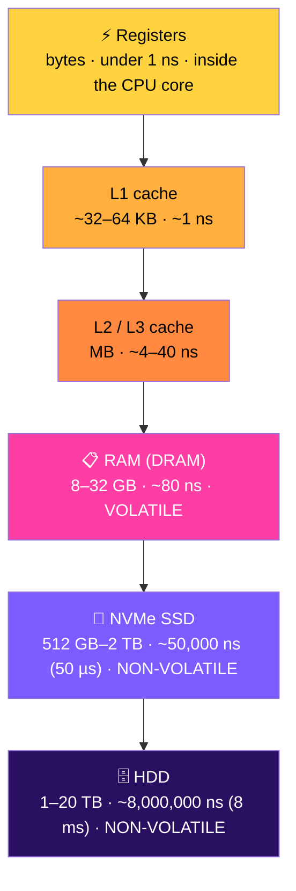
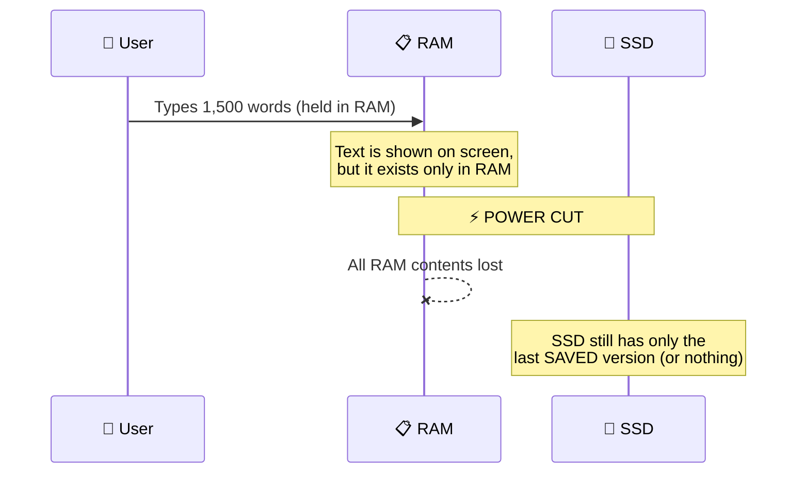
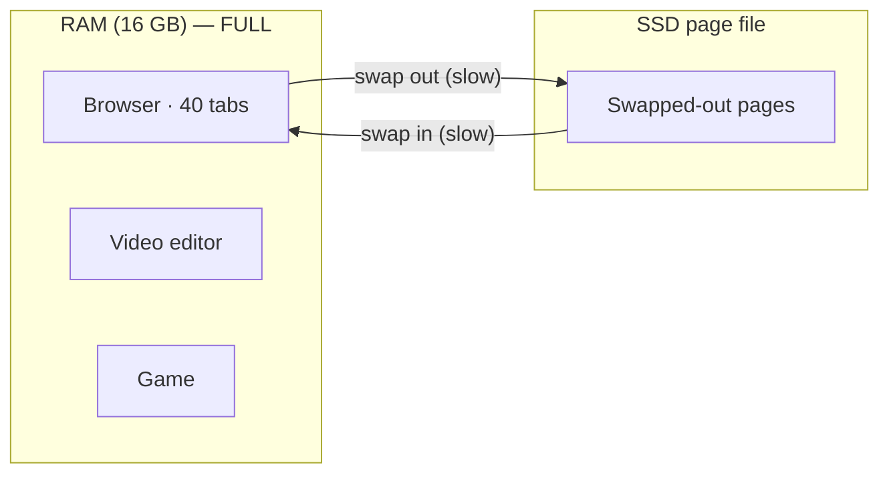

# RAM Versus Storage

> **Module:** Hardware, Networks, and Behaviorist AI — Part A (Hardware)
> **Audience:** Beginners
> **Content version:** V2.0 (rewritten from the V1.0 table: memory hierarchy, worked examples, activities and answers)
> **Estimated study time:** 30–40 minutes

---

## Table of contents

1. [Learning goals](#learning-goals)
2. [The big idea](#1-the-big-idea)
3. [Key terms](#2-key-terms)
4. [RAM and storage side by side](#3-ram-and-storage-side-by-side)
5. [The memory hierarchy](#4-the-memory-hierarchy)
6. [Why unsaved work disappears](#5-why-unsaved-work-disappears)
7. [What "Save" actually does](#6-what-save-actually-does)
8. [When RAM runs out: paging](#7-when-ram-runs-out-paging)
9. [Units and capacity](#8-units-and-capacity)
10. [Worked examples](#9-worked-examples)
11. [Common misconceptions](#10-common-misconceptions)
12. [Try it yourself](#11-try-it-yourself)
13. [Check your understanding](#12-check-your-understanding)
14. [Answers and explanations](#13-answers-and-explanations)
15. [Summary](#14-summary)
16. [References](#15-references)

---

## Learning goals

After studying this topic, you should be able to:

- [ ] explain the difference between **volatile** and **non-volatile** memory;
- [ ] compare RAM and storage by speed, capacity, cost and purpose;
- [ ] order the **memory hierarchy** from fastest to slowest;
- [ ] explain why unsaved work is lost after a power cut, and what **Save** actually does;
- [ ] explain why a computer slows down when RAM is full (**paging**); and
- [ ] choose the right upgrade (RAM or storage) for a described problem.

---

## 1. The big idea

A computer needs two very different kinds of memory:

- a **fast, temporary workspace** for whatever it is doing *right now* (**RAM**); and
- a **slower, permanent archive** for everything it must keep (**storage**: SSD or HDD).

> 🔬 **Lab 404 story:** Leo has typed a two-hour report on Byte's sensor data. The lab lights flicker and the power goes out. When the computer restarts, the report is gone. "But it was right there on the screen!" Leo protests. Inspector Ping writes in his notebook: *Shown on screen ≠ saved to storage.*

> 💡 **Analogy: a desk and a filing cabinet**
>
> | | RAM | Storage |
> |---|---|---|
> | Like a… | Desk / whiteboard | Filing cabinet / library |
> | Speed | Grab things instantly | Walk over, open drawer, search |
> | Size | Limited space | Huge |
> | At the end of the day | Cleaner wipes it | Everything stays filed |

---

## 2. Key terms

| Term | Meaning |
|---|---|
| **Volatile** | Needs power to keep data; contents vanish when power is lost |
| **Non-volatile** | Keeps data with no power |
| **RAM** (Random Access Memory) | Volatile working memory; most computers use **DRAM** |
| **Storage** | Non-volatile memory for files and programs: SSD, HDD, USB flash, SD card |
| **SSD** (Solid-State Drive) | Storage made of flash memory chips; no moving parts |
| **HDD** (Hard Disk Drive) | Storage that uses spinning magnetic platters and a moving read/write arm |
| **Cache** | Very small, very fast memory on the CPU chip |
| **Latency** | The waiting time before data starts to arrive |
| **Bandwidth / throughput** | How much data arrives per second once it starts |
| **Paging / swap** | Moving data out of full RAM onto the storage drive |
| **Load** | Copy from storage into RAM (opening a file) |
| **Save** | Copy from RAM into storage (making changes permanent) |

---

## 3. RAM and storage side by side

| Feature | RAM | Storage (SSD / HDD) |
|---|---|---|
| **Volatility** | Volatile: wiped when power is off | Non-volatile: keeps data without power |
| **Access time** | ~80–100 nanoseconds | SSD ~50–100 microseconds; HDD ~5–10 milliseconds |
| **Typical size** | 8–32 GB | 256 GB–2 TB+ |
| **Cost per GB** | High | Low |
| **Primary role** | Programs and files *currently open* | Installed apps, OS and *saved* files |
| **Connected to** | CPU via the memory bus | Motherboard via PCIe (NVMe) or SATA |
| **What happens at restart** | Starts empty | Unchanged |

**Why not make everything from RAM?** It would cost many times more per gigabyte and lose everything at every power cut. **Why not run everything from storage?** The CPU would spend most of its time waiting.

---

## 4. The memory hierarchy

Computers use several layers of memory. Each layer is **bigger, cheaper and slower** than the one above it.

*Figure 1: The memory hierarchy. Moving down, each layer gets bigger, cheaper and slower. Everything from RAM upward is volatile.*

*Figure 1b: The same hierarchy as a pyramid. Small and fast at the top, big and slow at the bottom.*

### Making the numbers human

The gaps are hard to picture, so pretend **1 ns = 1 second**:

| Memory | Real access time | If 1 ns were 1 second… |
|---|---|---|
| L1 cache | ~1 ns | **1 second**: reach for a pen |
| RAM | ~80 ns | **1.3 minutes**: walk to the next room |
| NVMe SSD | ~50 µs | **14 hours**: an overnight trip |
| HDD | ~8 ms | **3 months**: a long journey |

This is why the CPU keeps a copy of whatever it is using in cache and RAM, and why a slow HDD makes the whole computer feel slow.

---

## 5. Why unsaved work disappears

*Figure 2: Two hours of typing, never saved. It all exists only in RAM.*

1. When you type, every keystroke changes the document **in RAM**.
2. The screen shows the RAM copy, so it *looks* saved.
3. RAM is volatile. Without power, the electrical charges that store each bit leak away within milliseconds.
4. After a restart, the only copy left is whatever was last written to **storage**.

**AutoSave and cloud sync** reduce the risk by copying your work to storage, or to a server, every few seconds or minutes. They still copy *from RAM to storage*; they don't change how RAM works.

---

## 6. What "Save" actually does

*Figure 3: Pressing Ctrl + S copies the RAM buffer onto the SSD.*

- **Open/load** = storage → RAM (make a working copy).
- **Save** = RAM → storage (make the changes permanent).
- **Save As** = write the RAM copy to a *new* file in storage.

> ⚠️ **Safe-removal tip:** The OS may hold data in a RAM *write buffer* for a moment before it reaches a USB drive. Always use "Eject" before you unplug it.

---

## 7. When RAM runs out: paging

*Figure 4: A frozen computer with full RAM. A bigger SSD would not fix it.*

When open programs need more RAM than you have, the operating system moves the least-used parts of RAM out to a **page file / swap area on the storage drive**. When they are needed again, it swaps them back in.

Storage is roughly **1,000× slower** than RAM, so heavy paging makes the computer stutter or freeze. This is called **thrashing**.

| Symptom | Likely cause | Helpful fix |
|---|---|---|
| Slows down with many tabs or apps open | RAM full, so it is paging | Close apps, or **add RAM** |
| "Disk full" warnings, can't save new files | Storage full | Delete or move files, or get a **bigger SSD** |
| Takes minutes to boot; apps open slowly | Slow HDD | **Switch to an SSD** |
| Fine at first, slows after hours | A program using more and more RAM (memory leak) | Restart that program |

---

## 8. Units and capacity

| Unit | Size (binary, used for RAM) | Rough example |
|---|---|---|
| 1 byte (B) | 8 bits | One letter, such as "A" |
| 1 kilobyte (KB) | 1,024 bytes | A short text message |
| 1 megabyte (MB) | 1,024 KB | One minute of MP3 audio |
| 1 gigabyte (GB) | 1,024 MB | About 1 hour of HD video streaming |
| 1 terabyte (TB) | 1,024 GB | About 250,000 photos |

> 🔍 **Why does my "512 GB" SSD show only ~476 GB?** Drive makers count 1 GB = 1,000,000,000 bytes. Windows counts 1 GB = 1,073,741,824 bytes (2³⁰). Same bytes, different units.

---

## 9. Worked examples

**Example 1: Where is it right now?**

| Situation | In RAM? | In storage? |
|---|---|---|
| A photo saved last week, not open | ❌ | ✅ |
| A slide deck open and edited, not yet saved | ✅ (new version) | Old version only |
| A game you just closed | ❌ (freed) | ✅ (installed copy) |
| A web page you are reading | ✅ | Partly, in the browser's cache folder |

**Example 2: Upgrade advice**
Byte's laptop has **8 GB RAM** and a **1 TB HDD**. It boots in 3 minutes and freezes when Leo opens 30 tabs.
- The slow boot points to the **HDD**, so replace it with an **SSD**.
- The freezing with many tabs points to **RAM** being full, so upgrade to **16 GB**.
- A *bigger* HDD would fix neither problem.

**Example 3: Estimating the speed gap**
How many RAM reads could happen in the time of **one** HDD access?
8,000,000 ns ÷ 80 ns = **100,000 RAM reads**.

---

## 10. Common misconceptions

| ❌ Misconception | ✅ Reality |
|---|---|
| "If it's on my screen, it's saved." | Shown on screen means it is in **RAM**. It is only safe once saved to **storage**. |
| "My phone has 256 GB of memory." | That is **storage**. The phone's RAM is usually 6–12 GB. |
| "More storage makes my computer faster." | More storage gives more *space*. Speed with many apps depends on **RAM**; boot and load speed depend on **SSD vs. HDD**. |
| "Restarting deletes my files." | Restarting clears **RAM** only. Saved files in storage are untouched. |
| "SSDs and RAM are the same thing because both use chips." | Both are chips, but RAM is volatile DRAM and an SSD is non-volatile flash, about 1,000× slower. |

---

## 11. Try it yourself

**Activity A — Watch RAM fill up (5 min)**
1. Open *Task Manager → Performance → Memory* (Windows) or *Activity Monitor → Memory* (macOS).
2. Write down the "In use" value.
3. Open 15 browser tabs and a video. Write down the new value.
4. Close them and watch the RAM value drop. *What does this tell you about RAM?*

**Activity B — Volatile or not? (2 min)**
Sort these: RAM, SSD, USB flash drive, CPU registers, HDD, SD card, L1 cache.

**Activity C — Advise a classmate (5 min)**
Write a three-sentence recommendation for each:
- (a) "My laptop takes forever to start, but it's fine once it's running."
- (b) "Editing 4K video makes everything freeze."
- (c) "I can't install a new game: not enough space."

---

## 12. Check your understanding

1. Define *volatile* in one sentence.
2. **True or false:** Keeping a typed document open on screen means it has already been written to the SSD.
3. Order from fastest to slowest: HDD, L1 cache, NVMe SSD, DRAM.
4. Why does a computer slow down sharply when RAM is full?
5. What does pressing **Save** physically do?
6. A 1 TB HDD is replaced by a 1 TB NVMe SSD. What improves, and what stays the same?
7. Explain why restarting a frozen computer usually fixes it but never deletes saved files.

---

## 13. Answers and explanations

1. Volatile memory loses its contents when power is removed.
2. **False.** Text shown on screen is held in RAM. It reaches the SSD only when it is saved (or autosaved).
3. **L1 cache → DRAM → NVMe SSD → HDD** (about 1 ns → 80 ns → 50 µs → 8 ms).
4. The OS starts **paging**: it swaps data between RAM and storage, and storage is roughly 1,000× slower.
5. It tells the OS to copy the document's data from **RAM** to **non-volatile storage**.
6. **Speed** improves a lot (faster boot and app loading, because there is no moving arm). **Capacity** stays the same (1 TB).
7. Restarting clears RAM, which removes the stuck program state. Saved files are in storage, which does not depend on power.

**Activity B:** Volatile = RAM, CPU registers, L1 cache. Non-volatile = SSD, USB flash drive, HDD, SD card.

**Activity C (model answers):** (a) Replace the HDD with an SSD. (b) Add RAM (and a GPU helps). (c) Free up space or buy bigger storage. More RAM would not help.

---

## 14. Summary

- **RAM** is fast, small and volatile: the computer's desk. **Storage** is slower, large and non-volatile: its filing cabinet.
- The **memory hierarchy** runs registers → cache → RAM → SSD → HDD, getting bigger and slower at each step.
- Work exists only in RAM until you **save** it to storage.
- When RAM is full, **paging** to storage makes everything slow. Add RAM for multitasking, and use an SSD for fast loading.

**Related topics:** [Core Computer Components](core-components.md) · [Application Launch](application-launch-professional.md) · [How a Computer Starts Up](computer-startup.md)

---

## 15. References

[1] Patterson, D. A., & Hennessy, J. L. *Computer Organization and Design*. Morgan Kaufmann, Ch. 5 "Large and Fast: Exploiting Memory Hierarchy".
[2] Microsoft Support. *Save a file / Turn on AutoSave.* https://support.microsoft.com/office/what-is-autosave-6d6bd723-ebfd-4e40-b5f6-ae6e8088f7a5
[3] Crucial. *What is the difference between memory and storage?* https://www.crucial.com/articles/about-memory/difference-between-memory-and-storage
[4] Latency figures are typical order-of-magnitude values, after J. Dean's "Latency numbers every programmer should know".

*The analogies, scenarios, diagrams, activities and answers are original instructional material by team Whoisosy.*
loading ram-vs-storage.md…]()
