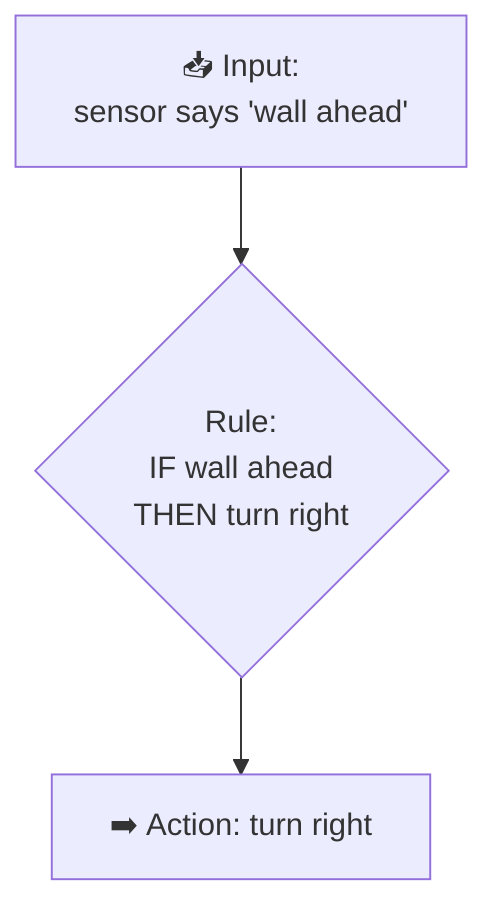
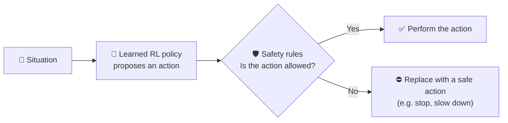
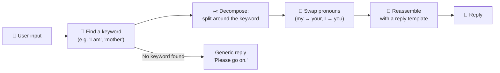

# Rule-Based Systems vs Learning Agents
## Fixed Rules and Prolog Knowledge Bases, Adaptive RL Policies, Hybrid Safety Systems, and ELIZA Pattern Matching

| Document information | Details |
|---|---|
| Module | Hardware, Networks, and Behaviorist AI |
| Subtopic | Rule-based vs learning approaches |
| Intended audience | Beginners |
| Prerequisites | `how-an-ai-agent-learns.md` |
| Suggested teaching time | 20–25 minutes |
| Content version | V1.0 |
| Review status | Drafted — awaiting peer review and image insertion |

---

## Learning objectives

After completing this lesson, learners should be able to:

1. Explain how a **rule-based system** produces behavior from fixed rules.
2. Read a small **Prolog** knowledge base (facts, rules, queries).
3. Explain how an **RL policy** adapts through experience.
4. Describe a **hybrid** system in which rules act as a safety layer around a learned policy.
5. Explain how **ELIZA** used pattern matching, and why it only *appeared* to understand.

---

## 1. The big idea

There are two very different ways to make a program behave "intelligently":

| | Rule-based system 📜 | Learning agent 🤖 |
|---|---|---|
| Where behavior comes from | Rules **written by humans** | A policy **learned from experience** |
| Analogy | Following a recipe exactly | A cook who improves by tasting and adjusting |
| Changes over time? | Only if a human edits the rules | Yes, through training |

> **Central idea:** Rules give **predictability and explainability**; learning gives **adaptability**. Many real systems combine both.

---

## 2. Key terms

| Term | Beginner-friendly meaning |
|---|---|
| **Rule-based system** | A program that decides what to do using explicit IF–THEN rules. |
| **Knowledge base** | A collection of facts and rules about a topic. |
| **Inference** | Deriving new conclusions from facts and rules. |
| **Prolog** | A logic programming language in which you state facts and rules, then ask questions (queries). |
| **Expert system** | A rule-based system that encodes specialist knowledge, e.g. for diagnosis. |
| **Policy** | In RL, the learned mapping from situations to actions. |
| **Hybrid system** | A system that combines rules and learning. |
| **Safety layer / shield** | Fixed rules that can block or override unsafe actions chosen by a learned policy. |
| **Pattern matching** | Recognising a pattern in input (e.g. a keyword) and responding with a matching template. |
| **ELIZA** | An early (1966) chatbot by Joseph Weizenbaum that used keyword patterns to reply. [3] |

---

## 3. Fixed rules



**Strengths:** predictable, easy to explain ("it turned because of rule 3"), no training data needed.
**Weaknesses:** cannot handle situations the author did not foresee; many rules become hard to maintain; does not improve by itself.

---

## 4. Prolog knowledge bases

Prolog separates **knowledge** (facts and rules) from the **question** (query). The Prolog engine works out the answer by inference. [1] [2]

### 4.1 Example: a small maze knowledge base

```prolog
% Facts: which cells are connected (an open path between them)
connected(start, a).
connected(a, b).
connected(b, exit).
connected(a, wall_cell).

% Fact: which cells are blocked
blocked(wall_cell).

% Rule: you can move from X to Y if they are connected and Y is not blocked
can_move(X, Y) :- connected(X, Y), \+ blocked(Y).

% Rule: a route exists from X to Y if you can move there directly...
route(X, Y) :- can_move(X, Y).
% ...or move to some Z first, then find a route from Z to Y
route(X, Y) :- can_move(X, Z), route(Z, Y).
```

### 4.2 Queries and answers

| Query | Meaning | Answer |
|---|---|---|
| `?- can_move(a, b).` | Can I move from a to b? | `true` |
| `?- can_move(a, wall_cell).` | Can I move into the wall cell? | `false` |
| `?- route(start, exit).` | Is there a route from start to the exit? | `true` |

**How to read the symbols:** `:-` means "if", a comma `,` means "and", and `\+` means "not provable".

> 💡 Notice: nobody told Prolog the route **start → a → b → exit**. It **inferred** it from the facts and rules — but it can only ever know what the knowledge base contains. It **does not learn** from trying.

You can run this code yourself in the **SWISH Prolog Lab** (`behaviorist-ai-activities-and-labs.md`).

<!-- IMAGE: Add your own screenshot of SWISH (online Prolog) running the maze knowledge base and the query route(start, exit). Suggested file: images/swish-prolog-maze.png -->
<!--  -->
<!-- *Figure 1. Running the maze knowledge base in SWISH. Screenshot by the team.* -->

---

## 5. Adaptive RL policies

A learning agent in the same maze is **not given** the connections. It discovers them by moving, bumping into walls, and receiving rewards (see `learning-from-rewards-and-penalties.md`).

| Question | Prolog maze | RL maze agent |
|---|---|---|
| Who provides the map? | The programmer writes all the facts | Nobody — the agent explores |
| What happens if a wall moves? | Wrong answers until a human updates the facts | Can re-learn through new experience (with more training) |
| Can it explain its answer? | Yes — the chain of rules used | Harder — it has learned numbers (Q-values or network weights) |
| Needs training? | No | Yes, often many episodes |

---

## 6. Hybrid safety systems

In the real world, a learned policy might sometimes choose a dangerous action — especially in a situation it was not trained on. A common design is to wrap the learned policy in **fixed safety rules**. [4]



| Example | Learned part | Fixed rule part |
|---|---|---|
| Warehouse robot | Learns efficient routes | "Never exceed 1 m/s near humans"; "Stop if the bumper is pressed" |
| Game AI | Learns strategies | "Never use moves that are illegal in the game" |
| Building climate control | Learns energy-saving settings | "Temperature must stay between 18 °C and 26 °C" |

*Examples are illustrative.* The rule layer adds **predictability** where mistakes would be costly; the learned layer adds **adaptability**.

---

## 7. ELIZA pattern matching

**ELIZA** (Joseph Weizenbaum, 1966) was one of the first chatbots. Its best-known script, **DOCTOR**, imitated a therapist who reflects the user's statements back as questions. [3]

### 7.1 How it worked



### 7.2 Example rules (simplified, in the style of ELIZA)

| If the input matches… | Example input | Reply template | Example reply |
|---|---|---|---|
| `I am <X>` | "I am tired of studying" | "Why do you say you are \<X\>?" | "Why do you say you are tired of studying?" |
| `I need <X>` | "I need a holiday" | "What would it mean to you if you got \<X\>?" | "What would it mean to you if you got a holiday?" |
| contains `mother` / `father` | "My father is strict" | "Tell me more about your family." | "Tell me more about your family." |
| *no keyword* | "The weather is nice" | "Please go on." | "Please go on." |

*These rules are original examples written to illustrate the technique, not the original DOCTOR script.*

### 7.3 Why ELIZA is important

- It **seemed** understanding to many users, but it had **no model of meaning, memory, or feelings** — only patterns and templates.
- Weizenbaum was surprised and concerned at how readily people attributed understanding to it. The tendency to assume a computer understands more than it does is often called the **"ELIZA effect"**. [3]
- ELIZA is a **rule-based** system: it never learns from conversations.

You can take it apart in the **ELIZA Breakdown Lab** (`behaviorist-ai-activities-and-labs.md`).

<!-- IMAGE: Add a screenshot of an ELIZA conversation from an online ELIZA implementation or from the team's own Python version in the labs file. Suggested file: images/eliza-conversation.png -->
<!--  -->
<!-- *Figure 2. ELIZA reflects the user's words back as questions. Screenshot by the team.* -->

---

## 8. Summary comparison

| Feature | Fixed rules / Prolog | ELIZA | RL agent | Hybrid |
|---|---|---|---|---|
| Behavior source | Human-written rules and facts | Human-written patterns | Learned from rewards | Learned + rules |
| Learns from experience? | ❌ | ❌ | ✅ | ✅ (learned part) |
| Explainable? | ✅ High | ✅ High | ⚠️ Low–medium | ⚠️ Medium |
| Handles unforeseen situations? | ❌ Poorly | ❌ Generic reply | ⚠️ Sometimes | ⚠️ Sometimes, with safety backup |
| Main risk | Gaps in the rules | Appears to understand when it does not | Reward hacking, unsafe actions | Complexity |

---

## 9. Learning activities

### Activity A — Classify

Rule-based, learning, or hybrid?

1. A spam filter that only blocks emails containing the word "lottery".
2. A game agent that improved over 10,000 practice games.
3. A self-learning robot that is forced to stop whenever a person is closer than 50 cm.

### Activity B — Prolog

Using the maze knowledge base in Section 4, what is the answer to `?- route(start, wall_cell).`? Explain.

### Activity C — ELIZA

Using the table in Section 7.2, what would ELIZA reply to **"I am worried about my exam"**? Does ELIZA understand the exam? Explain.

### Activity D — Design

Suggest **one** safety rule for an RL agent that learns to drive a toy car around a classroom.

---

## 10. Answer key

| Activity | Answer |
|---|---|
| A | 1 — rule-based; 2 — learning; 3 — hybrid. |
| B | `false`. `wall_cell` is `blocked`, so `can_move(a, wall_cell)` fails and no route can end there. |
| C | "Why do you say you are worried about your exam?" (after swapping *my* → *your*). No — it matched the pattern "I am …" and copied the words; it has no idea what an exam is. |
| D | Example: "If the distance sensor reads less than 20 cm, stop." Accept any rule that blocks an unsafe action regardless of the learned policy. |

---

## 11. Teaching plan

| Time | Instructor action | Learner action |
|---|---|---|
| 0–3 min | Recipe vs cook analogy. | Give one rule-based and one learning example from daily life. |
| 3–9 min | Prolog maze: facts, rules, queries. | Activity B. |
| 9–12 min | RL policy comparison table. | — |
| 12–15 min | Hybrid safety diagram. | Activity D. |
| 15–21 min | ELIZA flow and pattern table. | Activity C; discuss the ELIZA effect. |
| 21–25 min | Summary table; Activity A. | — |

---

## 12. References

[1] SWI-Prolog. *SWI-Prolog documentation and manual.*
https://www.swi-prolog.org/
Reference for Prolog syntax (facts, rules, queries, negation as failure `\+`).

[2] Bratko, I. *Prolog Programming for Artificial Intelligence* (4th ed.). Addison-Wesley, 2011.
Textbook introduction to Prolog and knowledge-based AI.

[3] Weizenbaum, J. "ELIZA — a computer program for the study of natural language communication between man and machine." *Communications of the ACM*, 9(1), 36–45, 1966.
https://doi.org/10.1145/365153.365168
Original description of ELIZA's keyword and transformation rules.

[4] Alshiekh, M., et al. "Safe Reinforcement Learning via Shielding." AAAI Conference on Artificial Intelligence, 2018. arXiv:1708.08611.
https://arxiv.org/abs/1708.08611
Describes a "shield" that blocks unsafe actions proposed by a learning agent.

---

## Editorial and source notes

- The maze knowledge base, ELIZA-style rules, and hybrid examples are original teaching material.
- Test the Prolog code in SWISH before submission.
- Related topics: `how-an-ai-agent-learns.md`, `reward-design.md`, `behaviorist-ai-activities-and-labs.md`.
