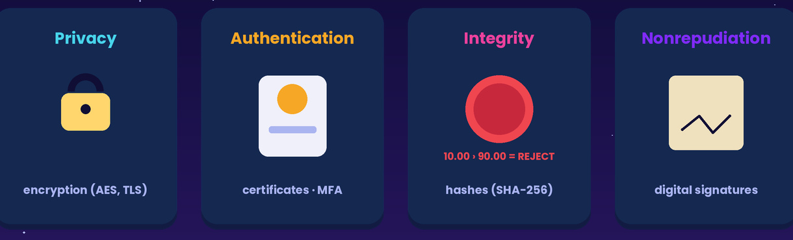
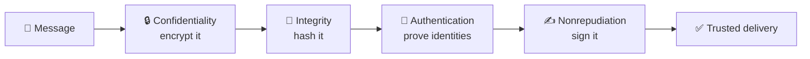
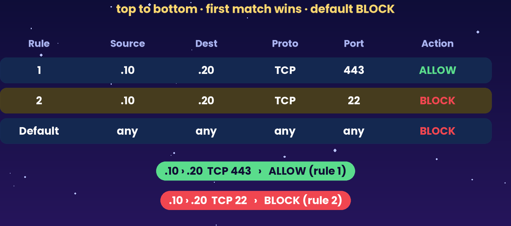
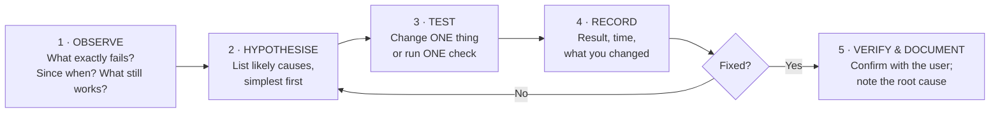
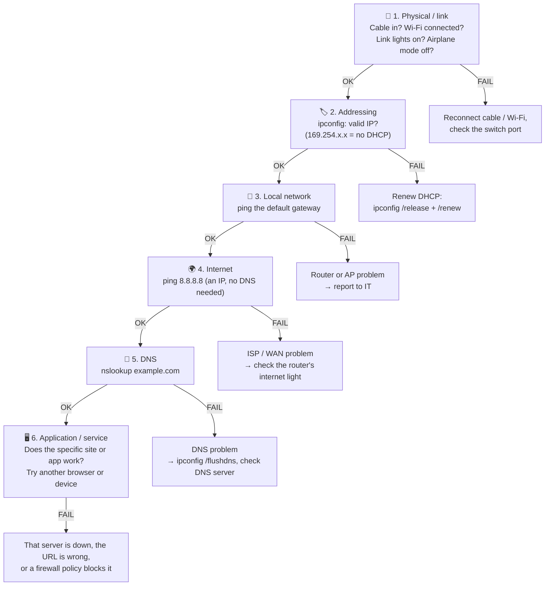
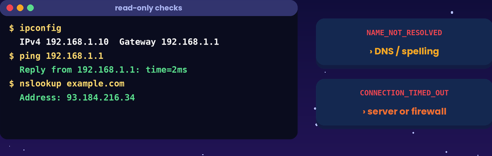

# Basic Network Safety and Troubleshooting

> **Module:** Hardware, Networks, and Behaviorist AI — Part B (Networks)
> **Audience:** Beginners
> **Content version:** V2.0 (rewritten from the V1.0 outline: four security pillars, everyday safety habits, a step-by-step troubleshooting method, command guide, case studies, activities and answers)
> **Estimated study time:** 40–50 minutes

---

## Table of contents

1. [Learning goals](#learning-goals)
2. [The big idea](#1-the-big-idea)
3. [Key terms](#2-key-terms)
4. [The four pillars of network security](#3-the-four-pillars-of-network-security)
5. [Common threats](#4-common-threats)
6. [Everyday safety habits](#5-everyday-safety-habits)
7. [Firewalls in one minute](#6-firewalls-in-one-minute)
8. [The troubleshooting method](#7-the-troubleshooting-method)
9. [Bottom-up: check the layers](#8-bottom-up-check-the-layers)
10. [Command toolkit](#9-command-toolkit)
11. [Case studies](#10-case-studies)
12. [Writing a good problem report](#11-writing-a-good-problem-report)
13. [Common misconceptions](#12-common-misconceptions)
14. [Try it yourself](#13-try-it-yourself)
15. [Check your understanding](#14-check-your-understanding)
16. [Answers and explanations](#15-answers-and-explanations)
17. [Summary](#16-summary)
18. [References](#17-references)

---

## Learning goals

After studying this topic, you should be able to:

- [ ] define the four pillars of network security: **confidentiality, integrity, authentication, nonrepudiation**;
- [ ] recognise common threats such as **phishing, malware, weak passwords and rogue Wi-Fi**;
- [ ] apply everyday safety habits (HTTPS, MFA, updates, backups);
- [ ] follow an evidence-based **troubleshooting method**: observe, isolate, test one change, record;
- [ ] use `ping`, `ipconfig`, `nslookup` and `tracert` to locate a fault; and
- [ ] write a clear problem report that someone else can act on.

---

## 1. The big idea

Networks bring two kinds of trouble: **attackers** who want your data, and **faults** that stop things working. The skills are similar for both. You **think in layers**, **collect evidence**, and **change one thing at a time**.

> 🔬 **Lab 404 story:** Leo bursts in: "The Wi-Fi is broken!" Inspector Ping doesn't touch anything. He asks three questions: *What exactly fails? Since when? Does anything still work?* It turns out every website loads except one. "So the Wi-Fi isn't broken," Ping says. "Isolate first. Fix second."

---

## 2. Key terms

| Term | Meaning |
|---|---|
| **Threat** | Anything that could harm data or systems (an attacker, malware, a fault) |
| **Vulnerability** | A weakness that a threat could exploit (an unpatched app, a weak password) |
| **Malware** | Malicious software: viruses, worms, ransomware, spyware, trojans |
| **Phishing** | Fake messages or sites that trick you into giving away passwords or money |
| **MFA** | Multi-factor authentication: something you **know** + something you **have** or **are** |
| **Encryption** | Scrambling data so only someone with the key can read it |
| **Hash** | A short fingerprint of data; any change to the data changes the hash |
| **Digital signature** | Proof, made with a private key, that a specific sender signed a message |
| **Firewall** | A filter that allows or blocks traffic using rules |
| **Latency / packet loss** | Delay / packets that never arrive, both measured with `ping` |
| **Isolation** | Narrowing down *where* a fault is before trying fixes |

---

## 3. The four pillars of network security



*Figure 1: The four pillars and the tool behind each one.*


| Pillar | Question it answers | Main tool | Example |
|---|---|---|---|
| **Confidentiality (privacy)** | Can outsiders **read** it? | **Encryption** (TLS, AES) | Café Wi-Fi snoopers can't read your HTTPS login |
| **Integrity** | Has it been **changed** in transit? | **Hashes / checksums / HMAC** | Changing a bank transfer from ¥100 to ¥10,000 is detected |
| **Authentication** | Are you **who you claim**? | Passwords + **MFA**, **certificates** | The site's certificate proves it really is your bank |
| **Nonrepudiation** | Can the sender **deny** sending it later? | **Digital signatures** (private key) | A customer can't later deny authorising a signed transfer |



> 💡 **Memory hook: a sealed, signed letter.** The envelope hides the contents (**confidentiality**). The wax seal shows tampering (**integrity**). The ID check at the door verifies who is who (**authentication**). The signature can't be denied later (**nonrepudiation**).

---

## 4. Common threats

| Threat | How it works | Warning signs | Defence |
|---|---|---|---|
| **Phishing** | A fake email, SMS or site copies a real brand to steal logins | Urgency ("account locked!"), odd sender address, misspelt URL (`paypa1.com`) | Check the URL; don't click links, type the address yourself; use MFA |
| **Malware / ransomware** | Malicious program installed from attachments, cracked software or USB drives | Pop-ups, slow PC, encrypted files with a ransom note | Updates, antivirus, only trusted downloads, **backups** |
| **Weak or reused passwords** | Attackers try leaked passwords on other sites ("credential stuffing") | — | Long unique passphrases + a password manager + MFA |
| **Rogue / evil-twin Wi-Fi** | An attacker creates "Free_Airport_WiFi" to intercept traffic | Open network with a familiar name; certificate warnings | Use HTTPS only, avoid sensitive logins, use mobile data or a VPN |
| **Unpatched software** | Known bugs are exploited automatically | "Update available" ignored for months | Turn on automatic updates |
| **Social engineering** | Someone phones pretending to be "IT support" | Asks for your password or remote access | Real IT never asks for your password; verify through official channels |

---

## 5. Everyday safety habits

| Habit | Why it works (which pillar) |
|---|---|
| ✅ Look for `https://` and the padlock before typing passwords | Encryption protects the data in transit (**confidentiality, integrity**) |
| ✅ Turn on **MFA** for email, school and bank accounts | A stolen password alone is no longer enough (**authentication**) |
| ✅ Use a **password manager** with long, unique passphrases | One leak doesn't unlock every account |
| ✅ Keep the OS, browser and apps **updated** | Closes known vulnerabilities |
| ✅ Keep the **host firewall** on | Blocks unsolicited inbound connections |
| ✅ Change the router's **default admin password**; use **WPA3/WPA2** Wi-Fi | Stops neighbours and attackers from taking over the network |
| ✅ Use the **3-2-1 backup rule**: 3 copies, 2 media, 1 off-site or cloud | Ransomware or a dead drive can't wipe everything |
| ✅ Think before you click; verify unusual requests by another channel | Defeats phishing and social engineering |

> ⚠️ **The padlock is not a safety guarantee.** It means the *connection* is encrypted and the site owns its certificate. A phishing site can have a padlock too. Always check the **domain name**.

---

## 6. Firewalls in one minute

A firewall checks traffic against an ordered list of rules, from **top to bottom**. The **first match wins**, and anything unmatched hits the **default rule** (usually *block*).

| # | Source | Destination | Protocol / port | Action |
|---|---|---|---|---|
| 1 | 192.0.2.10 | 198.51.100.20 | TCP 443 | ✅ Allow |
| 2 | 192.0.2.10 | 198.51.100.20 | TCP 22 | ❌ Block |
| Default | Any | Any | Any | ❌ Block |



*Figure 2: Rules are checked top to bottom, the first match wins, and the default is to block.*


- **Host firewall:** runs on one device (e.g. Windows Defender Firewall).
- **Network firewall:** sits at a boundary between networks.

> ⚠️ "The firewall allowed it" ≠ "it is safe". Firewalls check the **envelope** (addresses and ports), not whether the downloaded file inside is malware.

➡️ Full details: [How Firewalls Control Network Traffic](how-firewalls-control-network-traffic.md)

---

## 7. The troubleshooting method

Troubleshooting is the **scientific method** applied to computers.



**Golden rules**
1. **Observe before changing.** Read the exact error message; take a screenshot.
2. **Isolate:** One device or all devices? One site or all sites? Wired and wireless?
3. **One change at a time.** If you change three things and it works, you don't know which one fixed it.
4. **Simplest and least risky first:** check the cable before re-installing the OS.
5. **Never factory-reset shared equipment** without permission. You could take down the whole classroom.

---

## 8. Bottom-up: check the layers

Work from the physical layer upwards. Stop at the first layer that fails.



| Result | What it proves |
|---|---|
| `ping 192.168.1.1` (gateway) works | Your device, cable/Wi-Fi and LAN are fine |
| `ping 8.8.8.8` works but `ping google.com` fails | The Internet works; **DNS** is the problem |
| Every site works except one | Your connection is fine; the problem is **that site** (or a policy blocking it) |
| Only you are affected; classmates are fine | Look at **your device** first |
| Everyone is affected | Look at the **shared equipment** (router, AP, ISP) |

---

## 9. Command toolkit



*Figure 3: Read-only checks. Run them before you change anything.*


| Command (Windows) | macOS / Linux | What it tells you |
|---|---|---|
| `ipconfig` / `ipconfig /all` | `ifconfig` or `ip addr` | Your IP, mask, gateway, DNS, MAC |
| `ipconfig /release` then `/renew` | (reconnect Wi-Fi) | Requests a fresh address from DHCP |
| `ping 192.168.1.1` | same | Can I reach the target? How long does it take (latency)? Any loss? |
| `tracert example.com` | `traceroute example.com` | The list of routers (hops) on the way; where the delay or break happens |
| `nslookup example.com` | `nslookup` / `dig` | Does DNS resolve the name? To which IP? |
| `ipconfig /flushdns` | `sudo dscacheutil -flushcache` | Clears stale DNS answers |
| `arp -a` | same | Local IP → MAC table |

**Reading `ping` output**

```
> ping 192.168.1.1
Reply from 192.168.1.1: bytes=32 time=3ms TTL=64
Reply from 192.168.1.1: bytes=32 time=2ms TTL=64
Reply from 192.168.1.1: bytes=32 time=4ms TTL=64
Reply from 192.168.1.1: bytes=32 time=2ms TTL=64
Packets: Sent = 4, Received = 4, Lost = 0 (0% loss)
```

- `time=` is the round-trip latency (a few ms on a LAN is normal; 100+ ms is slow).
- `Lost` above 0% means packet loss, which points to Wi-Fi interference, an overloaded link or a bad cable.
- `Request timed out` means no reply. The target may be down, unreachable, or **blocking ping** (many servers do, so one timeout is not proof).

---

## 10. Case studies

**Case 1 — "Only one site fails"**
*Observation:* The laptop is on the classroom Wi-Fi. Wikipedia loads fine, but the school portal times out.
*Reasoning:* Another site loads over the same Wi-Fi and Internet path, so **local connectivity and general Internet access work**. The issue is specific to the portal: a server outage, a mistyped URL, or a firewall policy.
*Next test:* Check the URL, try the portal from a classmate's device or phone data, and check the school's status page.
*Wrong move:* Factory-resetting the classroom router.

**Case 2 — "169.254"**
*Observation:* `ipconfig` shows `169.254.33.10`, and no gateway.
*Reasoning:* The device **self-assigned** an address, which means DHCP never answered.
*Next test:* Reconnect the Wi-Fi (wrong password?), run `ipconfig /renew`, and check whether other devices are getting addresses.

**Case 3 — "Names don't work, numbers do"**
*Observation:* `ping 8.8.8.8` → replies. `ping www.example.com` → "could not find host".
*Reasoning:* The Internet path works; **DNS fails**.
*Next test:* `nslookup www.example.com`, `ipconfig /flushdns`, and check the DNS server setting.

**Case 4 — "Slow in the evening, only on Wi-Fi"**
*Observation:* Wired PC fine; laptop in the bedroom slow, with 10% ping loss to the router.
*Reasoning:* Points to **Wi-Fi signal or interference**, not the ISP.
*Next test:* Move closer, switch to 5 GHz, change the Wi-Fi channel, or add an access point.

---

## 11. Writing a good problem report

| ❌ Weak report | ✅ Strong report |
|---|---|
| "Internet broken pls fix" | "**What:** School portal (https://portal.school.example) times out after 30 s. **Since:** 09:10 today. **Who:** My laptop and Leo's phone; other sites load fine. **Evidence:** `ping` gateway 0% loss, 3 ms; `nslookup portal.school.example` → 203.0.113.44; `tracert` stops after hop 6. **Tried:** Different browser, phone data, same result. **Not tried:** Router changes (shared equipment)." |

A strong report answers **What, When, Who/Where, Evidence, Already tried**, so the person fixing it doesn't have to start from zero.

---

## 12. Common misconceptions

| ❌ Misconception | ✅ Reality |
|---|---|
| "If one website fails, the Wi-Fi is broken." | If other sites work, the Wi-Fi and Internet are fine. Isolate the specific service. |
| "Restart everything and hope." | Restarting can help, but **without observing first** you lose the evidence and learn nothing. |
| "HTTPS / the padlock means the site is trustworthy." | It means the connection is encrypted. Phishing sites can have it too. |
| "A firewall makes me 100% safe." | Firewalls filter by address and port. Phishing, malicious downloads and USB malware still get through. |
| "Ping timed out, so the server is definitely down." | Many servers **block ping**. Try the actual service, or use another test. |
| "Integrity means the data is secret." | Secrecy is **confidentiality**. Integrity means the data is **unchanged**. |

---

## 13. Try it yourself

**Activity A — Bottom-up test on your own device (10 min)**
Run, in order: `ipconfig` → `ping <your gateway>` → `ping 8.8.8.8` → `nslookup www.wikipedia.org` → `tracert www.wikipedia.org`. Record each result in a table with columns *Layer · Command · Result · What it proves*.

**Activity B — Spot the phish (5 min)**
Which are suspicious, and why?
(a) An email from `support@micros0ft-security.com` saying "Your account will be deleted in 1 hour";
(b) a text from your bank asking you to reply with your PIN;
(c) `https://www.wikipedia.org` with a padlock;
(d) a USB stick labelled "Exam answers" found in the corridor.

**Activity C — Match the pillar (3 min)**
Match each tool to a pillar: AES encryption, SHA-256 hash, password + phone code, private-key digital signature.

**Activity D — Rewrite the report (5 min)**
Improve this report: "Printer not working again." Use the What / When / Who / Evidence / Tried structure.

---

## 14. Check your understanding

1. Name the four pillars of network security and one tool for each.
2. A bank system uses (1) TLS encryption, (2) an HMAC hash, and (3) the customer's digital signature. Which pillar does each provide?
3. Why should you change only one thing at a time when troubleshooting?
4. `ping 8.8.8.8` succeeds, but websites won't load by name. What is the most likely cause?
5. Your laptop has the IP `169.254.10.5`. What does that tell you?
6. Wikipedia loads, but one school portal times out. What is the best initial conclusion?
7. Give two reasons MFA protects you even if your password leaks.
8. **True or false:** Because the firewall allowed a download on port 443, the downloaded file is safe.

---

## 15. Answers and explanations

1. **Confidentiality**: encryption (TLS/AES). **Integrity**: hashes/checksums/HMAC. **Authentication**: passwords + MFA, certificates. **Nonrepudiation**: digital signatures.
2. (1) **Confidentiality**, (2) **Integrity**, (3) **Nonrepudiation**.
3. So you know which change caused the result. Several changes at once hide the real cause, and can create new problems.
4. **DNS**: the Internet path works (raw IPs reach), but names aren't being translated.
5. The device **didn't get an address from DHCP** and assigned itself one. Check the Wi-Fi login, the cable, or the DHCP server.
6. Local connectivity and general Internet access work. The issue is **specific to that portal** (server outage, URL mistake, or a targeted firewall policy).
7. The attacker also needs your second factor (phone or key), and login prompts can alert you to an attempted break-in.
8. **False.** The firewall checks addresses and ports, not file contents. The file could still be malware.

**Activity B:** (a) suspicious: look-alike domain, urgency · (b) suspicious: banks never ask for your PIN by text · (c) fine: the correct domain · (d) suspicious: a classic "USB drop" malware trick; hand it to IT.
**Activity C:** AES → confidentiality · SHA-256 → integrity · password + phone code → authentication · digital signature → nonrepudiation.

---

## 16. Summary

- Security rests on four pillars: **confidentiality** (encryption), **integrity** (hashes), **authentication** (MFA, certificates) and **nonrepudiation** (digital signatures).
- Most real attacks rely on **people**: phishing, reused passwords, unpatched software. Good habits block most of them.
- Troubleshoot like a scientist: **observe → hypothesise → test one change → record → verify**.
- Check **bottom-up**: link → IP address → gateway → Internet → DNS → application.
- A clear report with evidence saves everyone time.

**Related topics:** [How Firewalls Control Network Traffic](how-firewalls-control-network-traffic.md) · [Network Addresses and Protocols](addresses-and-protocols.md) · [How a Computer Starts Up](computer-startup.md) (troubleshooting startup)

---

## 17. References

[1] Stallings, W. *Network Security Essentials* (6th ed.). Pearson: security services (confidentiality, integrity, authentication, nonrepudiation).
[2] CISA. *Recognize and Report Phishing.* https://www.cisa.gov/secure-our-world/recognize-and-report-phishing
[3] NIST SP 800-63B. *Digital Identity Guidelines: Authentication.* https://pages.nist.gov/800-63-3/sp800-63b.html
[4] Microsoft Learn. *Fix network connection issues in Windows.* https://support.microsoft.com/windows/fix-wi-fi-connection-issues-in-windows-9424a1f7-6a3b-65a6-4d78-7f07eee84d2c
[5] Cisco. *What is a firewall?* https://www.cisco.com/c/en/us/products/security/firewalls/what-is-a-firewall.html

*The scenarios, flowcharts, case studies, activities and answers are original instructional material by team Whoisosy.*
